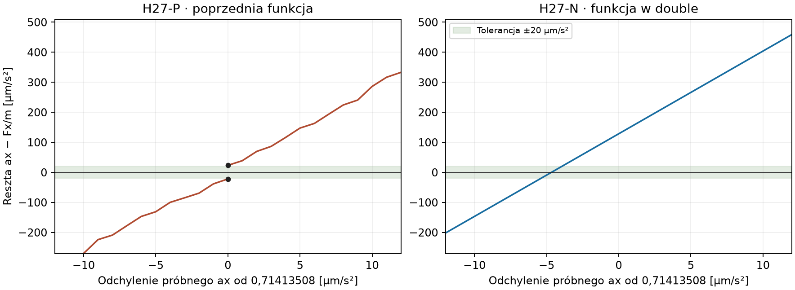

# Badanie #204 — H27-N i certyfikacja sprzężenia nacisków

Wariant H27-N na gałęzi `experiment/speedway-204` wychodzi z `cf56aff36763e4eca526d1ad4a56e4d28dae6374`. Zachowuje fizykę H27-P, łącznie z quasi-statyczną postawą zawodnika. H25 pozostaje domyślne. H26-LE i H27-P zachowują pierwotną ścieżkę obliczeń i komendy.

## Błąd P0 i jego przyczyna

Odtworzenie offline dokładnego prefiksu przy review 20,300 s zatrzymało H27-P w 20,510 s. Krok to 10 ms przy h = 0,5169064772208308 m, Fzf ≈ 623,829 N i Fzr ≈ 818,241 N. Wewnętrzna zmienna przyspieszenia ma typ double, ale argumenty reszty siłowej przechodzą w H27-P przez operacje single.

| Próba ax [m/s²] | RearFy przed cast [N] | RearFy po cast [N] | Cel skrętu [rad] | Fx przodu [N] | Reszta H27-P [m/s²] |
|---:|---:|---:|---:|---:|---:|
| 0,7141350798350723 | 1112,9574584960935 | 1112,9574 | 0,43379173 | −409,51282 | −2,190544782565418·10⁻⁵ |
| 0,7141350798350724 | 1112,9574584960938 | 1112,9575 | 0,43380610 | −409,51953 | +2,333447755897833·10⁻⁵ |

W stałym stanie łączny budżet ma już rzutowanie na float, jednak wynik tego rzutowania jest identyczny po obu stronach. Pierwsza zmiana na granicy double→float zależna od próbnego ax następuje w **`float rearFy = (float)(-loads.RearCapacityNewtons * normalizedSide * share)`**. Przyrost surowej siły jest rzędu 10⁻¹³ N, a po konwersji przeskakuje o jedną wartość single. Następnie `rearFy * left` i moment tyłu w `Vector2.Cross` trafiają do `FrontInverse`. Trzy iteracje odwrotności z dzieleniem przez przednią pojemność i cosinus kąta wzmacniają zaburzenie do około 1,44·10⁻⁵ rad zmiany celu sterowania. Ostateczna różnica Fx przodu wynosi −0,0067 N. W pobliżu pojedynczej zmiany znaku wszystkie sąsiednie osiągalne wartości reszty są poza pasem 2·10⁻⁵ m/s². Stary Illinois zgłaszał limit, a bisekcja starej funkcji również natrafiała na skok.

W H27-N hybryda znajduje rozwiązanie w pobliżu ax = **0,714130 m/s²**, a bisekcja double niezależnie osiąga tę samą tolerancję. Przy dwóch starych sąsiednich argumentach H27-N daje praktycznie identyczną resztę, około +1,28445·10⁻⁴ m/s² w obu punktach. Rozwiązanie ciągłej funkcji leży nieco wcześniej. Dokładny zapisany prefiks przeszedł do końca okna 20,550 s bez zmiany aktywnej komendy albo nieodwołalnego pending. [Surowy ślad i krzywa](../../../data/experiments/speedway204/p0-residual.json) · [Testy prefiksu](../../../data/experiments/speedway204/targeted-scenarios.json)

## Co oblicza wariant H27-N

Rzeczywisty przepływ w tym badaniu to `TrafficWorld191 → HandlingRig → HandlingContact.Prepare`, a w prognozie `tools/speedway-h26/Predictor198.cs → HandlingContact.Prepare`. Obie ścieżki H27-N wywołują wspólny kernel `ContactQuery64`. Starszy predyktor z katalogu #200 nie uczestniczy w tym badaniu.

W starym jądrze precyzję pośrednią ograniczały kolejne miejsca.

- Wartości `RiderView.Speed` i `SlideRadians`, float suma rozstawu osi i budżet zamieniony do float przed wyznaczeniem żądania yaw. Lokalne osie korzystały z `MathF`, punkty i ramiona z `Vector2`, podobnie jak prędkości punktowe oraz projekcje u/w.
- `Fyr` zwężano przed momentem tyłu. `FrontInverse` liczył wnętrze w double z projekcji single, oddawał float, a krok kierownicy i kąt środkowy również korzystały z single. Prawo boczne przodu zwracało float. Opór używał prędkości, zwrotu wartości oporu oraz pierwiastka w ścieżce single.
- Siła wzdłużna koła była zaokrąglana podczas każdej ewaluacji sprzęgła. Resztę axle load zamykał float wynik `Vector2.Dot(NetForce, forward)/mass`, odejmowany od próbnego double.

W H27-N odczytane wartości Box2D są źródłowymi wartościami single, następnie geometria, osie, projekcje, naciski, kąty, opór, oba prawa sił kontaktowych, ich momenty i reszta pracują w double. Wał i sprzęgło korzystają z tych samych równań, krzywej momentu i modelu strat oraz z wersji double siły wzdłużnej koła. Tył nadal rezerwuje najpierw siłę boczną. Wspólna funkcja konstytutywna koła ma oddzielne zakończenia double i legacy, a osiągnięte wartości legacy zweryfikowano dokładnie na archiwach.

Dopiero przy przygotowaniu przyjętego kroku następuje konwersja globalnych punktów i wektorów sił do Box2D. Projekcja **tej samej zaokrąglonej siły tyłu** na podłużną oś double jest podstawą reakcji w kole, obliczenia poślizgu i rozliczenia energii. Rozliczenie pracy wału i sprzęgła wykorzystuje tę samą reakcję po konwersji. `Prepared` nie zmienia się podczas próbnych ewaluacji. `Commit` pozostaje po przyjęciu kroku.

## Rozwiązanie i klasyfikacja

Oryginalny Illinois uznawał zgodne znaki na końcach za odciążenie i przechowywał ważoną wartość w polu reszty. H27-N zachowuje wartości węzłów dokładnie takie, jakie obliczył kernel. Osobne wagi sterują interpolacją. Cztery podprzedziały są testowane deterministycznie. Zmiany znaku i kilka węzłów zerowych powodują odrzucenie jako `AmbiguousOrMultipleRoots` przy więcej niż jednym kandydacie. Start z jedną wykrytą zmianą znaku przechodzi do ograniczonej interpolacji Illinois z ochronną bisekcją. Po maksymalnie 12 próbach interpolacyjnych pozostaje bisekcja, z całkowitym limitem 48 iteracji. Pas akceptacji pozostaje ±2·10⁻⁵ m/s² wewnątrz modelu i po konwersji. Raportowanie rozróżnia `Converged`, `NoPhysicallyAdmissibleRoot`, `NumericalDiscontinuity`, `IterationLimit`, `AmbiguousOrMultipleRoots` i `InvalidPhysicalState`.

Zgodny znak może dać certyfikat braku rozwiązania tylko po ograniczeniu siły na całej dodatniej dziedzinie. Dla każdego przedziału ax ogranicza się boczną siłę przodu pomnożoną przez sinus maksymalnego osiągalnego kąta środkowego. Otrzymuje się granice zewnętrznej siły podłużnej `E`. Przy ustalonym Fx wzrost `E` zmniejsza poślizg. Gdy rośnie Fx, wzrost przenoszonego momentu przez pasywne sprzęgło kompensuje tylko część reakcji koła. Poślizg zatem maleje z Fx, a całkowite `E + Fx` rośnie z `E`. Przy ustalonym `E` znak Fx można wyznaczyć przy zerowej reakcji koła. Przy ustalonym znaku jego moduł jest niemalejący z budżetem tyłu, także przy relaksacji zależnej od nacisku, ponieważ `B / sqrt(c + (k·B)²)` rośnie z `B` dla dodatniego `c`. Te zależności pozwalają użyć granicznych pojemności tyłu i odpowiedniej granicy `E` do wykluczenia zera reszty. Przedział dzieli się, gdy oszacowanie obejmuje zero. Nierozstrzygnięta domena pozostaje niejednoznaczna. Przód i tył zachowują dodatnie naciski oraz margines 0,001 m/s² względem granic kinematycznych.

Siatka izolacji wykrywa wielokrotne rozwiązania widoczne na próbkach. Dla archiwów dodatkowa siatka 16 przedziałów nie wykazała spadku reszty w żadnym stanie dynamicznym. To wynik dla badanego zbioru, z rozdzielczością siatki. Certyfikat braku rozwiązania z przedziałowych ograniczeń siły nie wymaga globalnej monotoniczności reszty.

## Pokrycie MODEL

W 16 archiwach #202 i #203 odtworzono **49 283/49 283** przyjęte kroki z zamrożonymi ustawieniami, łącznie z siłami, skrętem, przechyłem, wałem i kołem. Wśród nich **34 231/34 231** stanów z dynamicznymi naciskami dało rozwiązanie double bez nierozwiązanych przypadków. Przy zaakceptowanych krokach H27-P sprawdzono również skoki starej reszty w pobliżu zapisanego rozwiązania. Największy zaobserwowany skok wyniósł **2,92·10⁻⁵ m/s²**. Żaden z tych przyjętych stanów nie miał przeskoku przez cały pas tolerancji. Odrębny stan P0 nie należał wcześniej do przyjętych kroków.

| Przypadek | Obserwacja |
|---|---|
| A — +2 cm | Stary limit iteracji, H27-N przechodzi identyczny stan i prefiks. |
| B — start 0,370 s | Certyfikat braku rozwiązania w dodatniej domenie. Stary wynik brzegowy około −0,02478 m/s². |
| C — #196, 25,487128 s | Certyfikat braku rozwiązania. Reszta na górnej granicy wynosi −0,954400471 m/s² w H26-LE i −0,954399977 m/s² przy obliczeniu double. Koniec kroku 25,490 s przypada przed zmianą pending. |
| D — 4,954 i 0,734 N | Oba zapisane stany z dodatnim, małym Fzf mają rozwiązanie w H27-N. |
| E — hamowanie, mały nacisk tyłu | Najmniejszy zapisany Fzr rozwiązano od nowa, uzyskując około 655,377 N. Na tym samym stanie oceniono zadany ax na dolnej granicy domeny, przy Fzr ≈ 0,062 N. Ten punkt służy wyłącznie do sprawdzenia funkcji na granicy. |
| F — signed slip | Testy od −0,7 do +0,7 na tym samym stanie oraz oba znaki zapisanych poślizgów. Reakcja i praca w ledgerze pochodzą z przekazanej siły. |
| G — sterowanie | Próby od −0,61 do +0,61 rad, w tym granice osiągalnych kątów i zarejestrowane punkty saturacji. |
| H — silnik i sprzęgło | Stany po obu stronach węzłów mapy i wejścia sprzęgła 1500/4000 RPM, z zapisanym RPM środka kroku, momentem i bilansem. |
| I — krok | 2,5/5/10/20 ms i zapisany podkrok pending 2,872 ms. |
| J — czystość | Ewaluacja 33 próbnych wartości przy zachowanej referencji `Prepared` i tym samym stanie wału. Dwa przyjęte rozwiązania dają te same wyniki mechaniczne. |

Największe różnice po konwersji w audycie archiwów wyniosły 0,0001161 N dla wypadkowej i 0,006834 N·m dla momentu, włącznie z zaokrągleniem punktów przyłożenia. Maksymalna reszta zastosowanej siły w osi wyniosła 1,9989·10⁻⁵ m/s², maksymalna reszta impulsu koła 3,224·10⁻¹⁴ N·m·s, a reszta energii wału i sprzęgła 7,76·10⁻¹² J. [Pełna ewidencja archiwów](../../../data/experiments/speedway204/archive-model.json)

Pierwszy modelowy przegląd gazu ujawnił jeden osobny przypadek limitu solvera po decyzji 4,60 s w kontrfaktycznym kroku 5,380 s. W tym przypadku pas osiągnęła bisekcja diagnostyczna. Wersja końcowa używa ograniczonej liczby interpolacji i przechodzi na bisekcję w tym samym limicie tolerancji. Powtórzenie tej samej interwencji z 24 decyzjami pełnego gazu przeszło do 6,100 s. [Surowe wyniki pierwszej próby](../../../data/experiments/speedway204/throttle-pilot-model.json.gz)

## Granica wykonania w pierwszych próbach natywnych

Cztery pierwsze konstrukcje zatrzymał `actuator invariant` po przyjętym kroku przy 1,310 s. Krok miał kąt przed 0,014686691 rad i po 0,0005062097 rad, czyli zmianę około 0,01418048 rad przy dopuszczalnych około 0,01570796 rad. Dotychczasowy test odtwarzał operacje float i porównywał kąt bitowo. Podjęte odejmowanie i ponowne dodawanie zaokrąglonego kąta dało inną reprezentację niż jednokrotne zaokrąglenie wyniku double. Przy jawnej informacji o oryginalnym celu double walidacja obecnie odtwarza ten sam ograniczony krok w double i sprawdza bitowo trzy wyjściowe kąty float. Limity prędkości i kąta zachowano, a ścieżka H25, H26-LE i H27-P zachowuje swój test single. Test jednostkowy obejmuje zarówno odtworzone odrzucenie, jak i wykrycie zmodyfikowanego kąta po poprawce.

Niezależnie od tego zamrożona nominalna polityka dla −12 cm odpadła na pełnej weryfikacji początkowej przy `wide-entry`. Preflight nie otwiera świata. Zapisano osobno dane pierwszych przebiegów, aby porażki pozostały częścią wyniku badania. [Archiwum pierwszych prób](../../../data/experiments/speedway204/native-pilot)

## Walidacja natywna zamrożonej polityki

Każda próba używa nominalnego zbioru komend H27-P z #203, tego samego `Receding198` i tych samych zasad pending. Standardowy receding może przyjąć poprawkę w zegarze review, tak jak w archiwalnej polityce. Nie wykonano treningu. H27-N zachowuje progi swept, β, yaw i techniki.

| Stan początkowy | Pierwsza próba | Wynik po poprawce granicy | Min. swept po poprawce [m] |
|---|---|---|---:|
| Nominalny | Slot 1, DNF actuator 1,310 s | Slot 5, S3 47,356525 s | 0,534170 |
| +2 cm | Slot 2, DNF actuator 1,310 s | Slot 6, S3 47,356792 s | 0,616147 |
| −2 cm | Slot 3, DNF actuator 1,310 s | Slot 7, S3 47,356534 s | 0,554059 |
| −12 cm | Preflight `wide-entry` w 3,510 s | Oba kernele reprodukują odrzucenie MODEL | — |
| +12 cm | Slot 4, DNF actuator 1,310 s | Pełny preflight MODEL, brak powtórzenia natywnego | — |

We wszystkich siedmiu światach liczba kontaktów z bandą wynosiła zero. Trzy ukończenia dają medianę 47,356534 s i rozstęp 0,000267 s. W próbie +2 cm H27-N przeszedł review 20,300 s, na którym H27-P kończył bieg. Nominalny H27-P osiągał 47,356528 s. Różnica około 2,55 µs jest bez znaczenia sportowego.

Na wspólnych znacznikach czasu pierwsza różnica pozycji wyniosła około 1,86·10⁻⁹ m przy 0,340 s. Różnica wektorów sił powyżej 0,001 N pojawiła się przy 3,260 s nadal przy identycznej aktywnej komendzie. Maksima rozjazdu pozycji względem H27-P wynoszą około 0,57 mm nominalnie, 0,51 mm dla +2 cm do czasu starego DNF i 0,74 mm dla −2 cm. Ponowne przeliczenie 14 244 kroków końcowych odtworzyło przyjęte siły i stan napędu dokładnie. Stare klasyfikatory nadal wykrywają `wide-direction` około 10,930 s i `technique-correction` około 11,050 s. Dane przechowują sześć łuków z wejściem, minimum, apexem i wyjściem, prędkości prostych, udział gazu, β, yaw, poślizg, Fx/Fy, przebytą drogę oraz próby zmian komend. [Metryki i rozbieżności](../../../data/experiments/speedway204/native-summary.json) · [Niezmienione kryteria techniki](../../../data/experiments/speedway204/native-parity-and-style.json)

### Weryfikacja precyzji i bilansu w Box2D

| Maksimum modułu | Nominalny | +2 cm | −2 cm |
|---|---:|---:|---:|
| Wewnętrzna reszta [m/s²] | 1,998514·10⁻⁵ | 1,996925·10⁻⁵ | 1,996371·10⁻⁵ |
| Reszta po kwantyzacji [m/s²] | 1,999854·10⁻⁵ | 1,997125·10⁻⁵ | 1,997005·10⁻⁵ |
| Błąd zaokrąglenia wypadkowej [N] | 9,73·10⁻⁵ | 1,00·10⁻⁴ | 1,09·10⁻⁴ |
| Błąd zaokrąglenia momentu [N·m] | 0,006385 | 0,005831 | 0,006050 |
| Reszta rzeczywistego impulsu ciała [N·s] | 0,000757 | 0,000773 | 0,000728 |
| Reszta rzeczywistego impulsu yaw [N·m·s] | 1,210·10⁻⁵ | 1,171·10⁻⁵ | 1,226·10⁻⁵ |
| Reszta impulsu tylnego koła [N·m·s] | 2,92·10⁻¹⁴ | 3,29·10⁻¹⁴ | 2,95·10⁻¹⁴ |
| Reszta energii całego układu [J/krok] | 0,01685 | 0,01699 | 0,01753 |

Reszty rzeczywistych impulsów i energii wyznaczono z przyjętych prędkości Box2D oraz przekazanych punktów i sił. Niezależna projekcja siły tyłu jest identyczna z siłą wzdłużną księgowaną przez koło. Maksymalna reszta momentu sprzęgła przed zaokrągleniem jest niższa niż 10⁻⁸ N·m, a po odtworzeniu reakcji koła z rzeczywistej siły wzrosła najwyżej do 2,45·10⁻⁵ N·m. Reszta energii wału i sprzęgła pozostaje poniżej 8·10⁻¹² J. Suma całkowitej reszty energii przez S3 to kolejno −0,3463, +0,0526 i −0,2372 J. [Wektory i ledger kroków](../../../data/experiments/speedway204/native)

### FAST50 i rozkład kosztów

| Próba | p50 [ms] | p95 [ms] | p99 [ms] | Maks. [ms] | CPU biegu [s] |
|---|---:|---:|---:|---:|---:|
| H27-P nominalny #203 | 4,902 | 10,393 | 13,145 | 16,819 | 5,453 |
| H27-N nominalny | 4,532 | 9,668 | 11,841 | 14,643 | 5,078 |
| H27-N +2 cm | 4,533 | 9,718 | 11,696 | 14,615 | 5,047 |
| H27-N −2 cm | 4,563 | 9,758 | 11,953 | 14,884 | 5,078 |

Każdy końcowy bieg wydał 948 decyzji i mieścił wszystkie w 50 ms. W nominalnym H27-N dla 4748 zaakceptowanych kroków wykonano 49 982 ewaluacje reszty. Łączny czas ścienny ewaluacji wyniósł 116,7 ms. Czas solvera z tymi ewaluacjami i zatwierdzeniem granicy wyniósł 124,6 ms. W nominalnej prognozie MODEL po rozgrzaniu pełne 4737 kroków kosztuje około 264 ms dla P i 230 ms dla N. Pozostałe składowe można odczytać bezpośrednio z liczników. W H27-N około 117 ms przypada na próbne siły w solverze, 124 ms na cały solver łącznie, a 126 ms na pełne przygotowanie kontaktu. W starym jądrze 160 ms mierzy równocześnie siły i solver. Budżet 50 ms odnosi się do pojedynczych decyzji, a czasy pełnej prognozy i preflight są osobnymi pomiarami. [Pomiar predyktora](../../../data/experiments/speedway204/predictor-timings.json)

## Rezerwy pełnego gazu

Dwa nominalne archiwa H27-P i H27-N odtworzono w obu kernelach. Każde porównanie zaczyna się przy gazie wybranym poniżej 0,999, na wspólnym zapisanym stanie review. Zmieniono gaz kolejno w 1, 10 albo 24 decyzjach przy zachowanym skręcie, z oryginalną aktywną komendą i pending. Okna mają 0,20/0,80/1,50 s. Warunki legalnej dalszej jazdy oceniono przez dodatkowe 0,70 s po powrocie do zapisanych komend, z obowiązującym korytarzem i certyfikatem swept. Wynik do wspólnego celu mierzy czas do pozycji, którą niezmieniona polityka osiągała na końcu okna. Za krótszy wynik uznano przewagę powyżej 1 ms. Najkrótsze fragmenty przy mecie cenzurowano.

Liczby są takie same w czterech porównaniach. Tabela podaje liczbę decyzji na jedno archiwum i kernel. Domena w tabeli to certyfikat H27-N. H27-P dla tych samych decyzji zatrzymuje się na odrzuceniu w brzegach.

| Horyzont | Porównywalne decyzje | Pełny gaz wykonalny lokalnie | Wyższa prędkość lokalnie | Blokada domeny | Blokada swept | Legalna kontynuacja +0,70 s | Szybciej do wspólnego celu |
|---:|---:|---:|---:|---:|---:|---:|---:|
| 0,20 s | 889 | 889 | 757 | 0 | 0 | 852 | 113 |
| 0,80 s | 877 | 718 | 718 | 97 | 62 | 520 | 516 |
| 1,50 s | 863 | 451 | 451 | 156 | 256 | 92 | 92 |

W żadnej z 10 516 końcowych prób lokalnych nie pojawił się błąd iteracji ani nieciągłość solvera. Jednorazowe użycie pełnego gazu pozostawia dużo lokalnych możliwości, a dłuższe okna ujawniają konkretne fizyczne i geometryczne ograniczenia, których krótki test nie widzi. W horyzoncie 0,80 s liczba 516 oznacza nieużyte przez zamrożoną politykę interwencje szybsze do określonego celu i wykonalne przez sprawdzony dalszy odcinek. Decyzje zachodzą na siebie w czasie, więc zysków nie można sumować ani przekładać bezpośrednio na czas S3. W sześciu próbach reprezentatywnych dla każdego archiwum i prawa sił pełny gaz od ostatnich 8 m łuku do końca następnej prostej ani razu nie przeszedł całego odcinka. Pięć odpadło na swept i jedna na `wide-direction`. [Szczegóły rezerw i cele geometryczne](../../../data/experiments/speedway204/throttle-summary.json)

## Werdykty i #205

| Kryterium | Wynik |
|---|---|
| Numeryczne | **PASS w zbadanym zbiorze.** Dokładny P0 i ujawniony przypadek limitu iteracji rozwiązano bez zmiany tolerancji. Dwa przypadki fizycznego przekroczenia domeny zachowały klasyfikację. Archiwa i końcowe próby potwierdzają bilans. |
| Funkcjonalne | **Częściowe.** Trzy legalne ukończenia z jedną polityką, w tym dawny DNF +2 cm. −12 cm pozostaje odrzucone, a +12 cm kończy się jedynie certyfikatem MODEL w końcowej wersji. Wymóg 5/5 nie został spełniony. |
| Wydajnościowe | **PASS w trzech ukończonych biegach.** Maksimum 14,884 ms przy 948 decyzjach na bieg. |
| Sportowe | **Brak PASS.** Czasy P i N są praktycznie takie same, a stary klasyfikator techniki zgłasza korekty. |

Rejestr zawiera **7/8 konstrukcji**. Pierwsza seria zużyła cztery, trzy kolejne to powtórzenia rozstrzygające rozbieżność aktuatora. Próby MODEL, testy i odrzucony preflight zużyły zero. Build Release zakończył się z 0 ostrzeżeń i 0 błędów. Wybrane testy C# zakończyły się **98/98**, a trzy opublikowane polityki H26 zachowały swoje certyfikaty. Workflow `Core simulation CI` nie uruchamia się przy pushu tej eksperymentalnej gałęzi. Wyniki testów pochodzą z lokalnego Windows. [Walidacja](../../../data/experiments/speedway204/validation.json) · [Centralny licznik](../../../data/experiments/speedway204/world-ledger.jsonl)

**Rekomendacja #205.** Użyć H27-N jako zamrożonej bazy i najpierw porównać osobny wariant combined-slip w MODEL na próbach ze slipem dodatnim i ujemnym oraz na prefiksie #196. Rozstrzygnąć jednocześnie wpływ na Fx, moment yaw i dodatnią domenę nacisku. Obecny certyfikat wykluczenia pierwiastka opiera się na zależnościach lateral-first i wymaga osobnej weryfikacji dla nowego prawa. Wariant powinien przejść porównanie na tej samej polityce i zachować ograniczenia swept przed decyzją o ewentualnym uczeniu.
