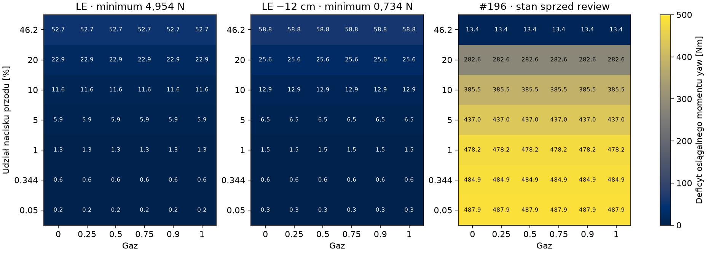
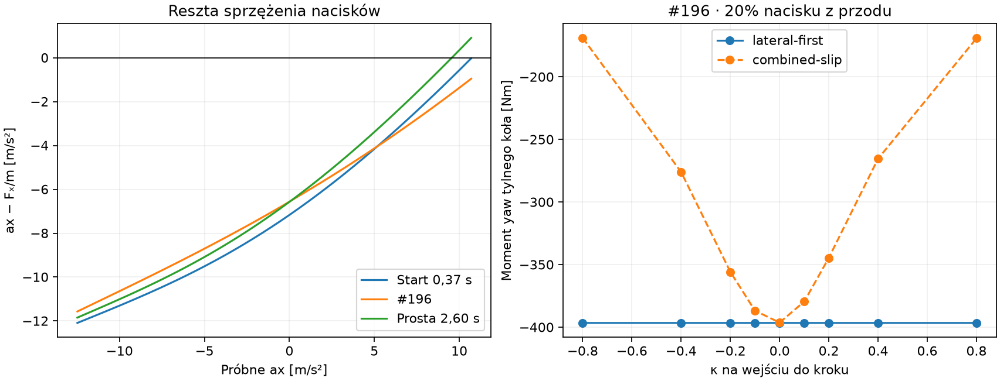
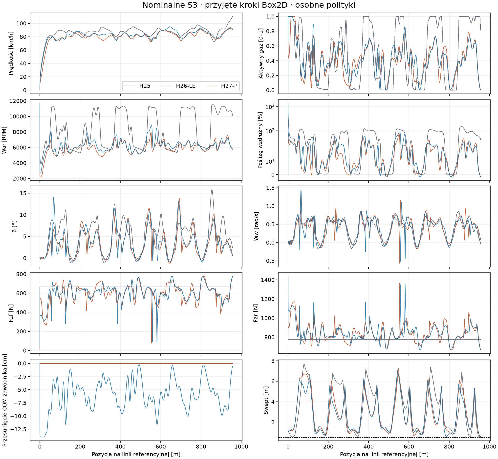

# Badanie #203 — nacisk przodu, moment yaw i ruch zawodnika

Gałąź `experiment/speedway-203` wychodzi z `1126084a9391626a9953b640a80a9d47471f4b3a` z badania #202. H25 i H26-LE zachowują swoje ustawienia, prawa sił i polityki. H27-P jest jawnym wariantem eksperymentalnym uruchamianym w narzędziu badawczym.

**Dominującym mechanizmem regresji H26 jest transfer nacisku na tył i związane z nim zmniejszenie zakresu momentu yaw.** Przeniesienie nacisku zwiększa dostępne Fx tyłu bez zwiększenia sumy μFz. Przy wyjściu z łuku i rozpędzaniu przód ma mniej siły na skorygowanie momentu tyłu. Przy ekstremalnym napędzie następny krok może już wyjść poza dodatni obszar dwóch kontaktów. H26-L osiągnął większe chwilowe ax i stracił 3,153 s do H25. Gałąź z samymi oporami silnika H26-E straciła 0,677 s. Te wyniki wykorzystują osobno uczone polityki, więc różnica czasów obejmuje zmianę sterowania. Dopasowane stany i wymiany pojedynczych komend poniżej izolują mechanizmy fizyczne.

| Ocena | Werdykt |
|---|---|
| Diagnostyczna | **PASS.** Potwierdzono dwa przypadki braku dodatniego rozwiązania oraz osobny przypadek nieciągłości numerycznej. Rozdzielono siły wzdłużne, moment yaw i lokalne odrzucenia swept. |
| Mechaniczna | **PASS dla bilansu płaskiego i dodatnich kontaktów w przyjętych krokach.** Pełny bilans mechaniki zawodnika i pitch pozostaje poza diagnostycznym modelem H27-P. |
| Funkcjonalna | **Częściowa.** Nominalne H27-P i start −2 cm ukończyły legalne S3. Próby +2 cm i −12 cm przerwał predyktor. |
| Sportowa | **Bez PASS.** Nominalne −2,510759 s względem H26-LE, ale +0,969665 s względem H25, pogorszenie klasyfikacji techniki w H27-P i brak wymaganej odporności. |

## A. Ścieżka wykonania i przyczyny ograniczeń

Odtworzono **25 306/25 306** przyjętych kroków ośmiu archiwów #202. Zgodność obejmuje Fx/Fy, wał, skręt i przechył. `HandlingRig` przekazuje zaakceptowane siły przez `TrafficWorld191` do jednego kroku `ContactAdapter`. `tools/speedway-h26/Predictor198.cs` używa tego samego `HandlingContact.Prepare` i konfiguracji wału, a ciało przewiduje integratorem jawnym. Plik `tools/speedway-controller200/Predictor198.cs` to starsza ścieżka H25. Tworzy wał bez strat H26, więc samo czytanie tego pliku prowadziłoby do błędnego opisu H26-LE.

| Archiwum | Fzf <1% | <5% | <10% | <20% | min Fzf [N] |
|---|---:|---:|---:|---:|---:|
| H25, komendy #200 | 0 | 0 | 0 | 0 | 665,571 |
| H26-L, komendy #200 | 2,703% | 13,514% | 21,622% | 27,027% | 6,000 |
| H26-E, komendy #200 | 0 | 0 | 0 | 0 | 665,571 |
| H26-LE, komendy #200 | 2,703% | 13,514% | 21,622% | 27,027% | 6,000 |
| H26-L, uczony | 0,040% | 0,141% | 0,242% | 2,685% | 6,830 |
| H26-E, uczony | 0 | 0 | 0 | 0 | 665,571 |
| H26-LE, uczony | 0,040% | 0,160% | 0,341% | 2,246% | 4,954 |
| H26-LE, uczony −12 cm | 0,062% | 0,206% | 0,371% | 2,246% | 0,734 |

Procenty ważono czasem przyjętych kroków, również przed puszczeniem sprzęgła. Dwa odtworzenia kończące się przy 0,37 s mają krótki mianownik. Przy 2,60 s stary model dawał 665,6 N na przodzie, a H26-LE 71,3 N przy wzroście ax z 6,568 do 9,555 m/s². Wychodzenie blisko granicy odciążenia występuje w obu ukończonych przejazdach LE. Warunek dodatniego Fzf sam nie gwarantuje zapasu momentu.

Przesiano decyzje z gazem poniżej 0,999 i zapisanym stanem dokładnie na zegarze review. Zachowano aktywną komendę i pending. Interwencja jednorazowa zastępuje tylko bieżącą decyzję i prognozuje 0,20 s. Druga interwencja utrzymuje gaz równy 1 w dziesięciu kolejnych review przy zapisanych skrętach i obserwuje do 0,80 s, z cenzurowaniem na końcu archiwum. Przy jednorazowym odrzuceniu sprawdzono sześć odchyleń skrętu ±0,02/0,04/0,08 rad.

| Uczona polityka | Decyzje | Jednorazowo wykonalne | Jednorazowo brak dodatniego rozwiązania | Gaz utrzymany wykonalny | Gaz utrzymany brak dodatniego rozwiązania | Gaz utrzymany swept |
|---|---:|---:|---:|---:|---:|---:|
| H25 | 713 | 713 | 0 | 713 | 0 | 0 |
| H26-L | 947 | 945 | 2 | 728 | 152 | 67 |
| H26-E | 842 | 842 | 0 | 842 | 0 | 0 |
| H26-LE | 966 | 960 | 6 | 753 | 142 | 71 |
| H26-LE −12 cm | 961 | 955 | 6 | 771 | 130 | 60 |

Pod nazwą „wykonalne” mieszczą się wyłącznie sprawdzony krótki fragment i zastosowane bramki: dodatnie naciski, pasywność, swept 0,5 m, β i postęp. Wśród odrzuceń jednorazowego pełnego gazu nie znaleziono ratunku w sześciu przyrostach skrętu. W H26-LE 960 ograniczonych komend miało wykonalny odpowiednik na 0,20 s, a 753 miały wykonalny dłuższy test. To górna granica liczby lokalnych okazji, ponieważ sam test nie certyfikuje dalszej kontynuacji, techniki ani zysku czasu. `Receding198` kontynuuje zaplanowaną politykę i sprawdza kandydatów zmian, a nie test pełnego gazu przy każdym review. Bez mutowania całego planu można przypisać wymienione odrzucenia do nacisków lub geometrii, lecz nie przypisać jednej przyczyny wszystkim 753 pozostałym decyzjom. W tych próbach nie zadziałała samodzielna bramka β, napędu, solvera ani RPM. W zapisanych krokach pełnych porównań RPM środka kroku nigdy nie osiągnęło 12 000. Deficyt momentu yaw analizowano jako osobną wielkość ciągłą, ponieważ nie stanowi osobnej bramki w tym predyktorze. [Dane audytu](../../../data/experiments/speedway203/decision-summary-model.json)

### Start 0,370 s

Zamrożony start H25 wydaje pełny gaz. LE na tym samym strumieniu osiąga 1,0534 m/s, około 7 244 RPM na wejściu do kroku i 733% poślizgu wzdłużnego. Sprzęgło w kroku 10 ms jest na 80 Nm. Przy górnym końcu przedziału przód ma 0,062 N. Fx tyłu jest 1613,001 N, Fx przodu −0,0014 N, a opór −36,337 N. Wynika z tego 10,72560 m/s² wobec dopuszczonych w solverze 10,70082 m/s², czyli reszta −0,02478 m/s². Skan 8193 punktów nie wykrył zmiany znaku. Granica bez rezerwy 0,001 m/s² również pozostaje poniżej wyniku równania sił.

### #196 przy 25,487128 s

Gaz 89,538% i komenda −0,004596 rad są już aktywne. Pending 91,591% wchodzi o 25,500 s. Pierwszy podkrok do 25,490 s ma 2,872 ms, więc żadna nowa decyzja nie może zmienić wejścia do niego. Prędkość wynosi 78,967 km/h, β = 0,03768 rad, a `Rω−u` jest około 15,18 m/s. Sprzęgło przenosi 59,267 Nm, co po przełożeniu 8 i sprawności 0,94 daje 445,684 Nm na kole. Poślizg i energia obrotowa utrzymują duże Fx przy gazie poniżej 100%.

Przy `ax = g·0,60/0,55 − 0,001 = 10,700818607` m/s² tył daje **1849,416 N Fx** i **826,078 N Fy**, a przód daje −0,00008 N Fx. Opór −136,099 N daje sumę około 1713,317 N wzdłuż ciała. Po podzieleniu przez 147 kg siły wymagają **11,655219078 m/s²**. Z definicji reszty `ax − Fₓ/m` otrzymujemy **−0,954400471 m/s²**. Reszta na dolnym końcu to −11,568429 m/s². Skan pokazuje rosnący przebieg, z najmniejszym nachyleniem siecznym 0,372, i ujemną resztę aż do obszaru prawie zerowego Fzf. To brak dopuszczalnego rozwiązania dla tego modelu i kroku. W tej samej ocenie wymagany moment yaw wynosi −34,52 Nm, tył daje −495,64 Nm, przód daje +0,023 Nm, a przedział netto wynosi około [−495,620; −495,617] Nm. Mimo dodatniego zapasu w okręgu tylnego koła brakuje około **461 Nm** momentu korygującego. [Krzywe reszt](../../../data/experiments/speedway203/load-residual-model.json)

### Ciągłość i awaria numeryczna

Na siatkach dopasowanych stanów reszta miała dodatnie nachylenia sieczne i najwyżej jedną zmianę znaku. Założenie ciągłości w pełnej dokładności obliczeń okazało się fałszywe w odłożonym starcie +2 cm. Review w 20,300 s zatrzymało bieg, kiedy prognozowany krok w 20,510 s, o dt = 10 ms i h = 0,516906 m, przekroczył 36 iteracji Illinois. Brzegowe reszty −6,195 i +5,532 m/s² obejmują zmianę znaku. Przy dwóch sąsiednich liczbach double wokół ax = 0,71413508 m/s² reszta skacze z **−2,19054·10⁻⁵ do +2,33345·10⁻⁵ m/s²**, oba moduły przekraczają tolerancję 2·10⁻⁵. Bisekcja reprodukuje szczelinę. Fzf po obu stronach to **623,829 N**, a Fzr 818,241 N. Zaokrąglenie rearFy o sąsiednią wartość float zmienia wejście `FrontInverse`, cel kierownicy skacze o około 1,44·10⁻⁵ rad, a Fx przodu zmienia się o około −0,0067 N. Ten skok jest widoczny dopiero na gęstszym poziomie niż diagnostyczna siatka. Na tym samym zamrożonym stanie i wysokości kroki 2,5, 5 i 20 ms znajdują rozwiązanie. To błąd numeryczny sprzężenia, mimo dużego zapasu obu nacisków. Brak zmiany znaku na dwóch brzegach w dowolnym innym stanie nadal wymaga sprawdzenia wnętrza, ponieważ siatki nie dowodzą globalnej monotoniczności. [Odtworzenie błędu](../../../data/experiments/speedway203/holdout-solver-model.json)

## B. Osiągalność przodu i moment yaw

Poniższe wartości pochodzą z dwóch przyjętych kroków przy 0,370 s. Przedział momentu obejmuje 33 położenia w osiągalnym w jednym kroku przedziale kierownicy, z już przygotowanym stanem, gazem i naciskiem. Fx/Fy z przodu są składowymi obróconej siły bocznej. Maksymalny dostępny moment samego przodu jest ograniczony przez `a·μ·Fzf`, a faktyczny zakres jest węższy przez poślizg, poprzednie położenie i prędkość kierownicy.

| Wielkość | LE nominalny | LE −12 cm |
|---|---:|---:|
| Fzf / Fzr [N] | 4,954 / 1437,116 | 0,734 / 1441,336 |
| Maks. bezwzględny moment przodu z μFzf [Nm] | 5,568 | 0,825 |
| Komenda / cel / użyty / koniec skrętu [rad] | −0,00379 / −0,07868 / −0,04935 / −0,05721 | +0,00439 / +0,61087 / +0,05329 / +0,06115 |
| Yaw żądany / rzeczywisty [rad/s] | −0,003074 / −0,000656 | +0,003561 / +0,000778 |
| Moment przodu / tyłu [Nm] | −0,576 / +0,064 | +0,092 / −0,074 |
| Moment żądany [Nm] | −0,850 | +0,978 |
| Osiągalny moment netto [Nm] | [−0,512; −0,327] | [−0,010; +0,018] |
| Dominujące ograniczenie w punkcie | Osiągalny krok aktuatora | Budżet siły, ograniczenie kąta i kroku |

W punkcie 4,954 N `FrontInverse` nie potrzebuje przekroczyć 98% statycznego budżetu Fy. Brakuje ruchu kierownicy w 10 ms. W punkcie 0,734 N żądanie przekracza pełny budżet, działa ograniczenie `FrontInverse` i cel dochodzi do 35°. W otoczeniu #196 tylny moment jest głównym składnikiem deficytu. Wyższe μFz tyłu samo w sobie nie zwiększa przedniego momentu. [Mapa prób MODEL](../../../data/experiments/speedway203/reachability-model.json.gz)

Deficyt powyżej 1/10/50 Nm zajmował odpowiednio **4,25/1,24/0,00%** czasu H25, **22,81/9,90/4,56%** H26-L, **7,99/3,70/2,38%** H26-E i **29,78/17,51/6,56%** H26-LE. Spośród 112 kroków LE z Fzf <20% w 17 wystąpił deficyt powyżej 1 Nm, w dziewięciu żądanie Fy przekraczało nawet statyczny budżet przodu. Duża część deficytu zdarzała się z Fzf powyżej 20%. Osiągalny krok skrętu i bieżący moment tyłu mają zatem znaczenie również przy solidnym podparciu. [Rozkład deficytów](../../../data/experiments/speedway203/decision-summary-model.json)

Mapa zawiera dwa preparowane prawa tylnej opony, sześć poziomów gazu, siedem wymuszonych udziałów nacisku i skręty od −0,16 do +0,16 rad. Przekrój syntetyczny zmienia v = 10/22/30 m/s, β = −0,20/0/+0,20 rad i yaw = −0,8/0/+0,8 rad/s na bazie #196. Każdy wiersz zachowuje zakres Fx/Fy, momenty, żądanie i stan skrętu, wykorzystanie budżetu i energię. Dyskretny przekrój na rysunku używa skrętu równego zero.

## C. Uzasadnienie i granice H27-P

Próby na zamrożonych stanach wskazały czułość na wysokość. Przy 0,370 s zmiana h z 0,55 do 0,52/0,50/0,48 m daje odpowiednio 44,51/75,02/105,14 N z przodu. W #196 h = 0,52 m wciąż nie daje pierwiastka, a 0,50/0,48 m daje 10,42/51,26 N. Zbadano także przesunięcie całkowitego COM o ±0,06 m i wynikową zmianę obu ramion w tej samej geometrii rozstawu osi. To maksima hipotezy odpowiadające około ±0,126 m przemieszczenia COM zawodnika. Przy stałym h przesunięcie całkowite o +0,06 m zwiększa statyczne Fzf o około 66,6 N i przesuwa granicę odciążenia przodu o około 1,07 m/s². [Macierz czułości postawy](../../../data/experiments/speedway203/posture-sensitivity-model.json.gz)

Wybrano **quasi-statyczny wariant pionowy**. Przesunięcie wzdłużne zmieniałoby położenie rzutu COM względem ramy, ramiona yaw i moment bezwładności. Zmiana położenia tego punktu w obecnym Box2D bez policzenia ruchu ramy i reakcji na ruch względny naruszałaby bilans pędu. W H27-P pionowe przesunięcie przy stałym rzucie poziomym zachowuje ramiona yaw, obrys i moment bezwładności względem osi pionowej w zakresie przyjętego modelu.

Przy 77 kg motocykla i 70 kg zawodnika wspólne `h = (77·h_m + 70·h_z) / 147`. Przy hipotezie `h_m = 0,45 m` neutralne `h_z = 0,660 m` zachowuje 0,55 m H26. Przyjęto ruch COM zawodnika maksymalnie 0,14 m w dół, ograniczony do 0,50 m/s i z odpowiedzią pierwszego rzędu o stałej 0,15 s. Przepustnica po aktywacji wyznacza cel przykucnięcia, także przed ruszeniem przy otwartym sprzęgle. Przykucnięcie może nastąpić tylko przez upływ czasu, po wejściu aktywnej komendy. Parametry opisują hipotezę ograniczonego zgięcia tułowia i nóg. Pionowy zakres całego układu wynosi 6,67 cm przy pełnym ruchu, a narastanie pochłania co najmniej 0,28 s. Liczby nie pochodzą z kalibracji żużlowej. Badania segmentowe pokazują istotność ustawienia tułowia dla COM i bezwładności przy różnych pozycjach na motocyklu. [Bova, Massaro i Petrone](https://www.mdpi.com/2076-3417/10/13/4509)

Wysokość z połowy kroku zasila wyłącznie równanie nacisków, a nowa postawa jest zatwierdzana po przyjęciu kroku. Zawodnik zmienia rozkład dostępnych sił, bez sztucznego Fx, narzucania prędkości lub rotacji. W pełnym 3D napęd mięśni wykonuje pracę, która obejmuje m.in. zmianę energii potencjalnej (m_z g Δz) i kinetycznej ruchu względnego. Zredukowany model nie księguje tego pionowego toru energii. Odnotowany bilans dotyczy dynamiki płaskiej, wału i koła. W #196 H27-P z neutralną postawą wciąż kończy się przed review. Przy uprzednio osiągniętym −10,5 lub −14 cm prefiks dochodzi do 25,500 s. Brakuje historii pozycji zawodnika dla #196, więc te dwa warianty opisują warunek możliwości, a nie gotową rekonstrukcję przejazdu. [Próby postawy MODEL](../../../data/experiments/speedway203/posture-check-model.json)

## D. Pitch i jednostronny kontakt

W płaskim adapterze `Fzf > 0, Fzr > 0` oznacza ważny punkt równania dwóch podpartych kół. Odciążenie opisuje malejące Fzf przy obu kołach na podłożu. Prawdziwe oderwanie wymaga ewolucji szczeliny i pitch. Model docelowy powinien mieć współrzędną pionową, pitch, bezwładność motocykla i zawodnika, prędkości szczelin oraz jednostronne warunki `g_i ≥ 0, λ_i ≥ 0, g_i·λ_i = 0`. Przy otwartej szczelinie znikają wszystkie siły opony tego koła. Powrót następuje przy `g_i = 0` i domykającej się szczelinie, ze zgodnym i pasywnym impulsem lub modelem sprężystości. Osobny werdykt utraty kontroli zależy od osiągalnych sił, yaw i obrysu po zdarzeniu.

Przebudowa wymaga pętli pitch/obciążenia i rozwiązania pracy reakcji normalnych oraz aktuatorów przed krokiem płaskim. Samo wyzerowanie Fzf z naruszeniem równania sił wytworzyłoby sztuczny kontakt. Zachowano jawne odrzucenie przez H26. Kierownica pozostaje aktuowaną współrzędną, a obrys i kontakt z bandą zachowują dotychczasowe znaczenie.

## E. Combined-slip

W lateral-first `b=v_y/δ_y` i `Fyr=−Br·b/√(1+b²)`; pozostały budżet `Br/√(1+b²)` otrzymuje rozwiązanie Fx. Przy zamrożonym nacisku i stanie `Fyr` nie zależy od gazu ani κ. Dynamiczny H26 umożliwia tylko pośrednią zmianę `Fyr` przez Br. W istniejącym wspólnym prawie `RearWheelDynamics.Evaluate` używa `a=v_slip,mid/δ_x` i wspólnego mianownika `√(1+a²+b²)`. Dodatni i ujemny poślizg obniżają moduł Fyr, przy znaku napędzania lub hamowania wynikającym z Fx. Zmienia się moment tylnego koła i pochodna β. Przy zamrożonym nacisku moment jest więc dostępny przez zmianę κ gazem, ale efekt jest opóźniony przez wał, sprzęgło i bezwładność koła. W kilku stanach w pojedynczym podkroku dominował zastany poślizg. Zmniejszenie Fyr może uwolnić Fx i wzmocnić odciążenie przodu, co ma znaczenie dla #196.

Porównanie utrzymuje przygotowaną kierownicę i przód lateral-first, zmienia tylko prawo tylne. Mapa dla obu znaków κ podaje pracę stratną `Fx·v_slip,mid·dt` i `−Fyr·v_y·dt`. Ujęcie środkowe ma pasywne znaki, a boczna siła używa chwilowej prędkości, więc nie jest pełnym wspólnym rozwiązaniem dynamiki body yaw. Brak wyników pomiarowych opony na tej nawierzchni uzasadnia zachowanie istniejącego prawa jako kontrfaktycznego MODEL, bez wprowadzania trzeciej krzywej dopasowanej do jazdy.

W #196 z Fzf = 20% i zastanym κ = 0,692 przy przejściu z 0 do 100% gazu lateral-first zachowuje Fyr = 660,9 N i moment tyłu −396,53 Nm. Combined-slip przy tych samych wejściach daje Fyr 309,8→307,8 N i moment −185,85→−184,69 Nm. Odpowiedź na sam gaz przez 2,872 ms wynosi tu około **+1,16 Nm** przy tym samym stanie początkowym. Wymuszenie κ = −0,4/0/+0,4 na wejściu daje przy combined-slip kolejno Fx −1330/+71/+1376 N, Fyr 460/660/442 N i moment −276/−396/−265 Nm. Lateral-first utrzymuje około 661 N Fy w każdym z tych trzech stanów. Straty kontaktowe wzdłużne/boczne przy combined-slip wynoszą 31,36/1,11 J dla κ = −0,4 oraz 34,92/1,07 J dla κ = +0,4. Przy większym dodatnim poślizgu maleje skręt przezeń narzucony, ale rośnie reakcja wzdłużna. Zmiana momentu i sumy sił zmienia odpowiednio `yaw_dot = Mz/Izz` oraz `β_dot = yaw − (u·a_y − v·a_x)/(u²+v²)` w konwencji znaku zapisanego β. Sama zmiana Fx nie jest zastępstwem za sterowność.

## F. Przejazdy natywne i limit światów

| Slot | Przejazd | Wynik | Meta albo koniec [s] | Min swept [m] |
|---:|---|---|---:|---:|
| 1 | H25, komendy H25 | 3 okr. i identyczność kroków | 46,386863 | 0,543118 |
| 2 | H27-P, komendy H25 | DNF swept po przejściu startu | 6,520 | 0,486346 |
| 3 | H27-P, komendy H26-LE | DNF swept | 10,390 | 0,496615 |
| 4 | H26-LE, zamrożona uczona | 3 okr. i czas identyczny z #202 | 49,867287 | 0,537738 |
| 5 | H27-P, osobno uczona | 3 okr. | 47,356528 | 0,533779 |
| 6 | H27-P, osobno uczona, −12 cm | DNF `wide-entry` w prognozie | 11,000 | 0,890013 |
| 7 | H27-P, nominalna polityka, −2 cm | 3 okr., odłożony start | 47,356561 | 0,554192 |
| 8 | H27-P, nominalna polityka, +2 cm | DNF numeryczny w prognozie, 1 okr. | 20,300 | 0,677754 |

Archiwum #202 daje też DNF H26-LE na taśmie H25 przy 0,370 s oraz poprawne S3 H26-LE po osobnym uczeniu w starcie −12 cm z czasem 48,537322 s. To punkty kontrolne do światów 2 i 6. Żaden z nowych przejazdów nie odnotował kontaktu z bandą. Dwa odtworzenia przekroczyły zachowawczą granicę swept i zostały zatrzymane. Próby 6 i 8 zakończyły się najpierw na certyfikacie predykcyjnym. W osobnym audycie bez zmiany progów wąski korytarz techniki odrzucił nominalne H26-LE za `wide-direction`, a nominalne H27-P za `wide-direction` i `technique-correction`. Dwa ukończenia H27-P nie oznaczają 5/5 warunków autonomii. [Wyniki i przyczyny](../../../data/experiments/speedway203/native-parity-and-style.json)

H27-P trenowano od tego samego legalnego stanu początkowego, z propozycjami wygenerowanymi przez istniejący planner H26 i z ponowną oceną całego ciągłego S3. Zachowano ten sam silnik, przełożenie 8:1, μ, geometrię, metę, narzut sterowania i kolejkę pending. Próby 7 i 8 używają tej samej polityki co 5. Nominalne −5,03% względem H26-LE łączy efekt postawy i osobnej nauki. Porównanie identycznych komend wskazuje odzyskanie wykonalności startu oraz wrażliwość linii na zmianę fizyki. Pomiary figur fazowych dopasowano po położeniu geometrycznym, przy różnym stanie wejścia.

### Prędkości i fazy

Każda komórka podaje kolejno **maksimum poprzedniej prostej / wejście / minimum łuku / apex geometryczny / wyjście** w km/h. Przecięcia granic mierzono interpolacją zapisanej trajektorii po współrzędnej referencyjnej. Minimum i maksimum pochodzą z próbek odpowiedniej fazy.

| Łuk | H25 | H26-L | H26-E | H26-LE | H27-P |
|---:|---|---|---|---|---|
| 1 | 77,18 / 77,18 / 77,18 / 87,41 / 85,97 | 68,67 / 68,85 / 68,85 / 79,94 / 82,81 | 74,52 / 74,63 / 74,63 / 86,59 / 81,75 | 65,70 / 65,88 / 65,88 / 74,20 / 80,06 | 73,84 / 73,88 / 73,88 / 74,81 / 82,82 |
| 2 | 89,35 / 82,46 / 78,30 / 87,53 / 87,90 | 84,48 / 81,13 / 74,25 / 80,62 / 85,65 | 92,57 / 87,85 / 68,40 / 74,77 / 84,80 | 87,17 / 86,45 / 77,89 / 80,62 / 79,02 | 88,09 / 87,83 / 79,58 / 80,10 / 82,33 |
| 3 | 94,71 / 87,61 / 79,83 / 88,00 / 92,49 | 87,40 / 86,04 / 77,10 / 80,29 / 78,31 | 101,64 / 101,65 / 64,08 / 78,43 / 88,10 | 82,41 / 82,41 / 75,91 / 80,53 / 77,13 | 84,64 / 84,64 / 74,17 / 79,91 / 82,20 |
| 4 | 95,07 / 87,18 / 79,98 / 84,12 / 88,69 | 89,65 / 86,49 / 75,78 / 79,50 / 83,65 | 93,49 / 85,52 / 80,41 / 82,50 / 88,64 | 83,30 / 81,44 / 71,89 / 76,97 / 88,99 | 84,33 / 81,50 / 72,97 / 78,25 / 89,23 |
| 5 | 90,22 / 84,30 / 78,93 / 85,14 / 93,03 | 88,64 / 87,67 / 76,26 / 81,37 / 84,25 | 89,40 / 82,08 / 78,30 / 82,55 / 89,94 | 88,99 / 83,52 / 73,39 / 80,17 / 80,83 | 94,95 / 90,10 / 77,59 / 79,74 / 86,41 |
| 6 | 97,77 / 89,85 / 72,55 / 82,99 / 97,36 | 86,31 / 84,03 / 76,28 / 78,71 / 92,50 | 98,62 / 89,07 / 74,72 / 83,66 / 97,88 | 91,33 / 84,66 / 75,12 / 77,20 / 90,13 | 92,46 / 86,51 / 77,47 / 78,09 / 90,30 |

H27-P osiąga 70 km/h po 3,31 s, między H25 (3,07 s) a H26-LE (5,02 s). Maksima ax w tych trzech biegach to 7,972/10,622/11,298 m/s². H27-P ma większą prędkość wejścia i wyjścia we wszystkich sześciu łukach względem nominalnego LE. W apexach łuków 2, 3 i 5 pozostaje nieco wolniejszy. Pierwszy odcinek wejście→apex→wyjście→20 m zajmuje w H27-P 2,71/2,73/0,86 s wobec 2,79/2,77/0,89 s w LE. Z kolei H25 pokonuje te fazy w 2,70/2,43/0,82 s. Całkowite Vmax H27-P wynosi 94,95 km/h. Aspiracji 100/110–120 km/h nie osiągnięto w H27-P.

Aktywny gaz 0 / częściowy / ≥99% zajmował odpowiednio 6,25/69,17/24,57% w H25, 1,70/95,29/3,01% w LE i 0,11/93,98/5,91% w H27-P. Po żadnym wyjściu H26-L, H26-LE i H27-P nie utrzymują ≥99% przez 0,15 s przed następnym wejściem lub metą. H25 po szóstym wyjściu odzyskuje to po około 0,02 s, a H26-E ma już ≥99% na szóstym wyjściu. Przy progu 90% wnioski dla LE i P są te same. Pozostałe czasy są ocenzurowane długością prostych. Wynik wyższej prędkości wyjścia H27-P nie potwierdza tym samym wcześniejszego odzyskania pełnego gazu. [Metryki faz, czasu i gazu](../../../data/experiments/speedway203/native-summary.json)

Oba adaptery wywołują jeden punkt `Box2DConstructionBudget.Create`. Każda rezerwacja jest zapisana pod wyłączną blokadą pliku przed konstrukcją i liczy się także w razie błędu inicjalizacji. Dla tego badania rejestr jest wspólny dla procesów i obejmuje **8 przejazdów + 0 mikroświatów = 8/8**. Próba równoległa w osobnym pliku pomiarowym przepuściła osiem rezerwacji i odrzuciła kolejne cztery. Obliczenia MODEL i testy C# uruchamiano z blokadą konstrukcji. [Rejestr konstrukcji](../../../data/experiments/speedway203/world-ledger.jsonl)

| Bieg | Decyzje | p50 / p95 / p99 / maks. [ms] | CPU biegu [s] |
|---|---:|---|---:|
| H25, taśma | — | — | 0,969 |
| H26-LE, uczony | 998 | 4,860 / 10,686 / 12,802 / 17,994 | 5,641 |
| H27-P, nominalny | 948 | 4,902 / 10,393 / 13,145 / 16,819 | 5,453 |
| H27-P, −12 cm | 220 | 1,803 / 6,744 / 10,819 / 13,052 | 0,875 |
| H27-P, −2 cm | 948 | 4,943 / 10,478 / 13,099 / 16,319 | 5,453 |
| H27-P, +2 cm | 406 | 4,996 / 10,266 / 12,941 / 16,680 | 2,516 |

Każda wydana decyzja nowych uczonych biegów zmieściła się w 50 ms. Certyfikat startowy i obliczenia rozwojowe biegną osobno od zegara decyzji. W nominalnym P minimalny Fzf wzrósł z 4,954 do **43,214 N**, minimalna h wyniosła 0,48333 m. W nowych zaakceptowanych krokach przyczepność pozostaje w dotychczasowych budżetach. Dla nominalnego P maksymalna reszta impulsu płaskiego wyniosła **0,000755 N·s**, momentu impulsu **1,38·10⁻⁵ N·m·s**, a energii **0,01694 J/krok** i **−0,2345 J** w sumie. Suma normalnych odpowiada 1442,07 N z błędem zaokrąglenia. [Bilans i koszty](../../../data/experiments/speedway203/native-summary.json)

## Walidacja i kolejny eksperyment

Restore i kompilacja Release dla .NET 8 zakończyły się poprawnie. Audyt manifestów NuGet zwrócił NU1900 z powodu niedostępnego indeksu podatności w izolacji. Dobór testów objął `H26PhysicsTests`, `TrackGeometryTests` i `PhysicalTrackWidthGeometryTests`. Wynik **91/91** bez konstrukcji świata, uzupełniony 627 sprawdzeniami postawy i rezerwacji. Certyfikaty trzech osadzonych polityk H26 zachowały czasy predykcyjne. Ponownie przeliczono każdy przyjęty krok także w nowych nagraniach, z zapisanym stanem kierownicy, wału i postawy. [Dane i procedura odtworzenia](../../../data/experiments/speedway203/README.md)

**Następny eksperyment** powinien zamrozić H27-P i odizolować błąd solvera na zapisanym podkroku +2 cm. Porównać residuum sprzężonych sił po obu stronach przełączenia oraz wariant obliczeń z jednolitą precyzją przed końcowym zaokrągleniem sił do Box2D. Zachować identyczną tolerancję, dodatnią domenę i progi techniki. Warunkiem kolejnej walidacji natywnej jest odtworzenie prefiksu na starym i poprawionym algorytmie w MODEL.
