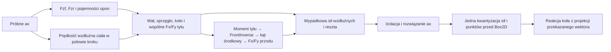
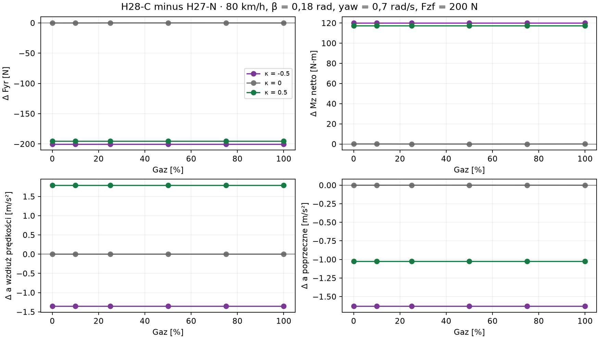
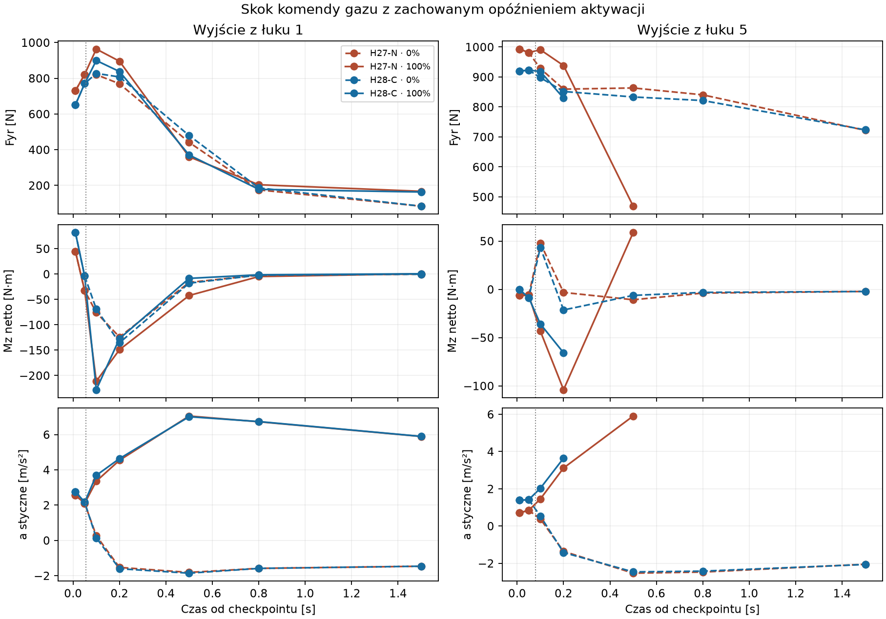
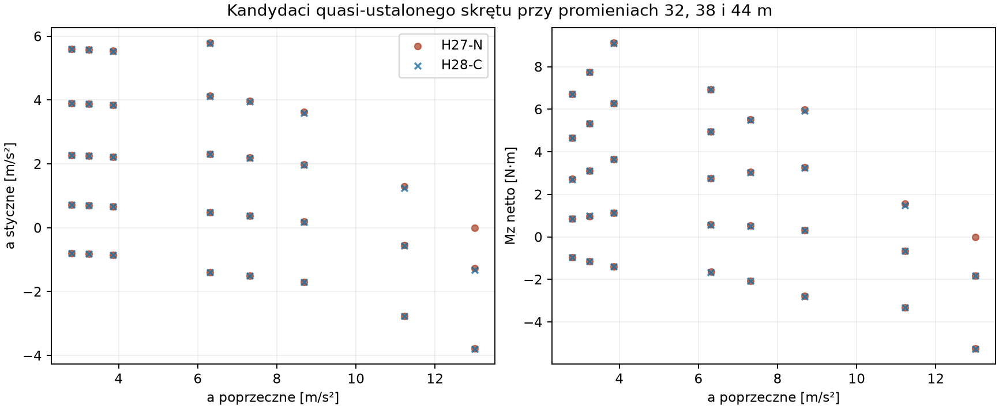
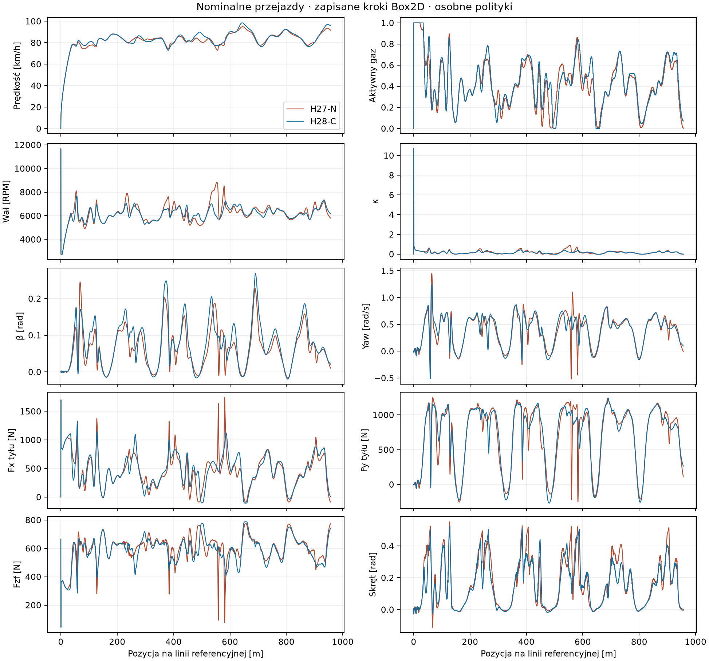

# Badanie #205 — sprzężona tylna opona H28-C

**Status PROVISIONAL.** Punktem odniesienia jest H27-N z commitu `828c41863a4ef8ad309b49444395aa3a3b9027ec`. H28-C zmienia prawo tylnej opony na wspólne combined-slip. Zachowuje postawę, parametry opon, nawierzchnię, mapę i straty silnika, przełożenie 8:1, geometrię, sterownik, jego opóźnienie i pending. H25 pozostaje wariantem domyślnym.

## Sprzężenie mechaniczne



Obie ścieżki wykonania dochodzą do `HandlingContact.Prepare`. W natywnym sterowaniu `TrafficWorld191` wywołuje go przez `HandlingRig`, a prognoza używa `tools/speedway-h26/Predictor198.cs`. Dla H28-C kernel `ContactQuery64` przełącza się na `CoupledPower` i certyfikację przedziałową. `Inverse` zachowuje zależność żądanej orientacji od komendy i dotychczasowe ograniczenia kąta oraz prędkości aktuatora. Oba kontakty i napęd wychodzą z jednego zaakceptowanego stanu. Próbne ewaluacje nie wykonują commit.

Dla tylnego kontaktu przyjmujemy `a = s/D`, `b = v_y/D_y`, `B = μ·Fzr`, `D² = c + (k·B)²`, gdzie `c` to kwadrat skali prędkości wymnożony przez dotychczasowy współczynnik sztywności, a `k` to dotychczasowa relaksacja przemnożona przez ruchliwość koło–ciało. Siły są następujące:

```text
Fx = B · a / sqrt(1 + a² + b²)
Fy = −B · b / sqrt(1 + a² + b²)
```

Dla `b = 0` wraca czysta charakterystyka Fx, a dla `a = 0` wraca `Fy = −B·b/sqrt(1+b²)`. W H27-N Fx używa zredukowanego budżetu `B·share` i relaksacji `relaxation/share`, co zachowuje iloczyn wewnątrz D. W H28-C zarówno D, jak i wspólne prawo pracują na pełnym B z oryginalną relaksacją. Powtórne dzielenie przez share zmieniłoby charakterystykę. Mianownik jest dodatni także przy bardzo małej prędkości dzięki istniejącemu regularizatorowi D. Siły są nieparzyste względem swojego poślizgu i parzyste względem drugiego, cieplna praca `Fx·s − Fy·v_y` jest nieujemna, a `Fx²+Fy² ≤ B²`. Skrajne testy zachowują te własności również przy bardzo dużej wartości względnej prędkości koła. Prawo pozostaje niekalibrowaną hipotezą dla żużla.

### Rozwiązanie układu bez iterowania opóźnionego Fy

W podłużnym równaniu kontaktowym używanym przez poprzedni model `u_mid = u + dt·(E+Fx)/(2m)`, gdzie `E` obejmuje Fx przodu i opór. Na rozwiązaniu całego motocykla `E+Fx = m·ax`. Przy długości bazy L, wysokości środka masy h i odległości środka od przedniej osi lf, naciski wynoszą Fzr = m·(g·lf + ax·h)/L i Fzf = m·g − Fzr. Dla próbnego ax można więc użyć `u + dt·ax/2` w równaniu poślizgu koła. Rozwiązanie wału i sprzęgła w tej ewaluacji od razu daje Fx i Fy tyłu. Koło rozwiązuje monotoniczne równanie modułu poślizgu z nieujemnym członem reakcji, zaczynając od dolnego ograniczenia. Kierownica otrzymuje żądany moment pomniejszony o moment tylnego kontaktu. Po wykonaniu ograniczonego kroku skrętu obliczamy obie siły przodu, sumę momentów z obu ramion oraz resztę `ax − (Fx+E)/m`. Na jej zerze oba sformułowania mają ten sam środek kroku. W wewnętrznym równaniu poślizgu pozostaje ruchliwość koła, natomiast skala D nadal zawiera dotychczasową ruchliwość i relaksację całego kontaktu. Obliczenia pośrednie są w double. Przy zaakceptowanym kroku stosowana siła jest konwertowana raz, a `Apply` odtwarza reakcję koła, energię sprzęgła i poślizg podłużny z wektorów podanych Box2D.

### Nowy certyfikat

`ExcludesRoots()` lateral-first nadal obsługuje wyłącznie H27-N. Dla H28-C funkcja przedziałowa ogranicza sprzężony Fx i przeprowadza pochodne przez Fy, moment tyłu, trzy iteracje odwrotności kierownicy, saturację i siłę przodu.

Przy narzuconym Fx prędkość obwodowa koła w połowie kroku jest funkcją nierosnącą Fx, z pochodną `C′ ∈ [−αw,0]`, gdzie `αw` jest połową kroku razy ruchliwość samego koła z tłumieniem łożyska. Wynika to z pasywności sprzęgła. Większy opór koła zwiększa przeniesiony moment, a rosnący moment zmniejsza prędkość wału przy ustalonej komendzie. Sprzęgło wyrównuje część spadku prędkości koła. Zależność ma ciągłe gałęzie w granicach nasycenia, przy przejściu przez zero momentu i na węzłach mapy. Dla kroków do 20 ms i bezwładności wału co najmniej 0,005 kg·m² składnik 2I/dt wynosi co najmniej 0,50 N·m·s/rad. Największe dodatnie nachylenie mapy momentu to około 0,167 N·m·s/rad, a człon strat jest nieujemny. Rozwiązanie wału jest zatem jednoznaczne względem próbnego momentu sprzęgła także na przecięciach sąsiednich odcinków mapy.

Przy `s = C(Fx) − u − dt·ax/2` oraz oznaczeniu `f(B,s) = B·s/sqrt((1+b²)·D²+s²)` dostajemy `Fx′ = (B′·∂f/∂B − dt·∂f/∂s/2)/(1−C′·∂f/∂s)`. Mianownik jest dodatni, ponieważ `∂f/∂s ≥ 0`. Moduł `∂f/∂B` jest co najwyżej jeden. Te granice dają obwiednię Fx wokół środka przedziału. Certyfikat najpierw stosuje ścisły geometryczny limit projekcji Fx przodu, a gdy przedział obejmuje zero, zawęża resztę i jej pochodną, śledząc Fy oraz FrontInverse. Każdy przedział jest wykluczany, potwierdzany jako monotoniczny lub dzielony. Jeśli zostaje więcej niż jeden pierwiastek lub pozostaje nierozstrzygnięty przedział, zwracamy niejednoznaczność. Negatywny wynik fizyczny wymaga wykluczenia całej dodatniej domeny. Dwa składowe przyspieszenia i moment yaw są wynikiem sił, a nie narzuconym stanem.

Wewnętrzna dokładność celuje w 10⁻⁸ m/s², żeby substytucja nie wpłynęła na spójność opony po konwersji. Wymaganie na rzeczywiste przyspieszenie po kwantyzacji pozostaje 2·10⁻⁵ m/s². W przebiegach zachowano rezerwę 0,001 m/s² od kontaktowego końca przedziału. Oddzielna ewaluacja MODEL obejmuje oba wyłączone paski aż do zerowego nacisku. Nie wykryła możliwości dodatkowego zera w żadnym z 4748 stanów i potwierdziła brak zera w obu historycznych odrzuceniach. W najwęższym przypadku 0,370 s obwiednia reszty przy odciążeniu przodu wynosi [−0,001694, −0,000731] m/s². [Krzywe i certyfikaty](../../../data/experiments/speedway205/certification-model.json)

## Diagnostyka mechaniczna MODEL

Na **32 400** rozwiązaniach siatki (16 200 wejść razy dwa prawa) oba jądra zachowały dodatnie naciski, budżet koła, tę samą granicę aktuatora oraz bilanse. Siatka obejmuje gaz 0–100%, 40–120 km/h, oba znaki β, yaw i κ, wymuszone diagnostycznie Fzf 0,0622/5/200/665 N oraz kroki 2,5/5/10/20 ms i pending 2,872 ms. Wymuszenie Fzf w tym teście służy przekrojowi prawa, a nie integracji motocykla ani ocenie, że prędkość jest osiągalna. Dodano 4748 zaakceptowanych nominalnych stanów H27-N z dynamicznymi naciskami. H28-C rozwiązało je wszystkie. Maksymalne odchylenia po kwantyzacji w tym audycie są równe **6,64·10⁻⁵ N** dla Fx i **6,17·10⁻⁵ N** dla Fy. Maksymalna reszta wzdłużna wyniosła **5,30·10⁻⁷ m/s²**, a reszta impulsu tylnego koła **3,30·10⁻¹⁴ N·m·s**. [Siatka](../../../data/experiments/speedway205/synthetic-grid-model.json.gz)

W historycznym starcie 0,370 s z neutralną kontrfaktyczną postawą oba prawa wykluczają rozwiązanie w dodatniej domenie. W H28-C górna reszta wynosi około −0,00157 m/s². W #196 zachowano realną kolejkę pending i użyto neutralnej postawy, której historii tam nie ma. H28-C również wyklucza rozwiązanie, a górna reszta zmienia się z −0,94774 do −1,57508 m/s². W tym stanie uwolnienie większej części Fx pogarsza limit odciążenia przodu. Małe dodatnie naciski z #202, #203 i #204 rozwiązują się przy obu prawach. Tak samo dawna awaria numeryczna +2 cm przy 20,510 s. W tym punkcie H28-C zmienia fizykę wyraźnie: Fx tyłu rośnie z około 639 do 1197 N i Fzf maleje z 624 do 324 N. Zmiana aktualizacji yaw netto z −40 do −354 N·m oznacza zwiększenie deficytu momentu, mimo większego przyspieszenia. Nacisk, poślizg i ograniczony skok kierownicy rozstrzygają wypadkową. [Dopasowane przypadki](../../../data/experiments/speedway205/matched-model.json)



## Reakcja na gaz i równowaga poślizgu

Na stałym Fzr model H27-N utrzymuje Fy niezależnie od gazu i κ. H28-C zmniejsza moduł Fy przy wzroście modułu środkowego poślizgu wzdłużnego. Znak reakcji momentu zależy od znaku siły bocznej i od tego, czy gaz prowadzi κ w kierunku zera, czy od niego. W dynamicznym motocyklu gaz równocześnie przesuwa naciski, więc ten sam znak zmiany Fy na stałym Fzr nie zawsze przechodzi na siłę całego motocykla.

Na wyjściu z łuku 1 przy zapisanym gazie i tym samym stanie H28-C daje ok. **+26,2 N Fx** oraz **−81,7 N Fy** tyłu względem H27-N. Moment netto rośnie o około **38,0 N·m**, podczas gdy deficyt względem dostępnej korekty przedniej rośnie o około **38,0 N·m**. Przyspieszenie w kierunku rzeczywistej prędkości rośnie o 0,22 m/s², a poprzeczne spada o 0,66 m/s². Na wyjściu z łuku 5 zysk to +0,69 m/s² stycznie przy −0,84 m/s² poprzecznie i pojawieniu się około 8 N·m deficytu yaw. Na prostej z małym β obie charakterystyki dają praktycznie to samo Fx i przyspieszenie styczne. Sprawdzono również stany `wide-entry`, `wide-direction`, `technique-correction` oraz wcześniejsze niewykorzystane okazje gazowe.

Dane rozdzielają jednorazową ewaluację sił przy zmienionej aktywnej komendzie od integracji po wybraniu nowej komendy na review. W tej drugiej obowiązuje zachowane pending i czas aktywacji. Zapisano 10/50/100/200/500/800 ms i 1,5 s, także dla stanów z aktywnym gazem bliskim 0% i 100%. Zmiany wielkości i znaków po aktywacji są ważniejsze dla osiągalności od samego jednorazowego efektu Fy. Odpowiedzi kończą się na pierwszej bramce modelu, a reszta krzywej nie jest interpolowana po odrzuceniu. [Odpowiedzi dynamiczne i siły wstępne](../../../data/experiments/speedway205/transients-model.json.gz)



Przy stałym Fzf = 200 N, 80 km/h i β = 0,18 rad, dla κ = +0,5 H28-C zwiększa Fx z **675 do 907 N**, obniża Fy z **1785 do 1590 N** i zwiększa moment netto o **117 N·m**. Dla κ = −0,5 Fx zmienia się z −679 do −918 N, a moment netto rośnie o 120 N·m. W obu skrajnych punktach zadziałał limit sprzęgła i sama zmiana gazu w jednym kroku nie poruszyła tych wartości. Przy κ = 0 gaz zmienia Fx z −26,3 do +21,6 N, a zmiana Fy w H28-C wynosi mniej niż 0,1 N. Zatem zapas regulacji momentu zależy także od stanu wału i koła przed zmianą komendy.

Na wyjściu z łuku 5 natychmiastowe przełączenie komendy od 0 do 100% zmniejsza w H28-C oszacowany deficyt przedniego momentu z **26,32 do 0,35 N·m** (H27-N z 12,96 do 7,10). Przyspieszenie styczne H28-C rośnie z 1,11 do 1,51 m/s² i spada poprzeczne z 11,92 do 11,78 m/s². Po zachowaniu pending gaz zaczyna działać dopiero po **79,9 ms**. Po 0,20 s pełny gaz w H28-C daje 3,65 m/s² stycznie wobec 3,12 w H27-N, ale tylko 10,17 m/s² poprzecznie wobec 11,09. H28-C przekracza próg swept już przed 0,50 s (0,479 m), H27-N po 0,50 s i przed 0,80 s (0,487 m).

Na wyjściu z łuku 1 aktywacja następuje po **55,0 ms**. Po 0,50 s przy pełnym gazie moment netto H28-C wynosi −8,4 N·m wobec −42,2 w H27-N, a przyspieszenie styczne pozostaje około 7,0 m/s². Oba roll-outy dochodzą do 1,5 s i utrzymują swept powyżej 0,93 m. W tym przypadku chwilową zmianę yaw można uzyskać bez złamania bramki geometrii w badanym oknie. Progi techniki i legalną kontynuację na zapisanej taśmie weryfikuje oddzielnie audyt poniżej.

Kandydat quasi-ustalony spełnia a poprzeczne bliskie `v²/R`, stałe β, zmianę yaw zgodną z `aT/R`, zgodność docelowego i fizycznego skrętu oraz prędkości wału i koła rosnące zgodnie z utrzymaniem κ podczas przyspieszenia. Kandydat jest szukany dla stanu początkowego zadanego w MODEL, a późniejsze 0,20 s jest swobodnie integrowane z tą samą komendą. Spośród poziomów gazu i promieni 32/38/44 m znaleziono 34 kandydatów H27-N i 33 H28-C. Po sześć kombinacji wysokiej prędkości z każdego prawa odpada na oszacowaniu `v²/R > μg`. Pozostałe przypadki z dużą resztą są wynikiem poszukiwania, bez dowodu fizycznej niemożliwości. Rozrzut kandydatów nie pokazuje poszerzenia domeny ustalonego skrętu przez H28-C. Wskazuje zmianę kompromisu między napędem, siłą boczną oraz sterowaniem yaw. [Stany i ich swobodna integracja](../../../data/experiments/speedway205/equilibria-model.json)

Wśród znalezionych stanów quasi-ustalonych przyspieszenia H27-N obejmują **−3,78 do 5,79 m/s²** stycznie i **2,81 do 13,00 m/s²** poprzecznie, a ich moment yaw netto mieści się między −5,25 a 9,12 N·m. W H28-C zakresy to **−3,79 do 5,78 m/s²**, **2,81 do 13,00 m/s²** oraz −5,26 do 9,12 N·m. Oba maksima styczne przypadają na 60 km/h, R = 44 m i 100% gazu. Dla 80 km/h, R = 44 m, gazu 50%, mamy 1,30 m/s² w H27-N i 1,25 w H28-C. Wyniki dotyczą poszukiwanych krzywizn, poziomów gazu i warunków początkowych. Krótka integracja sprawdza zachowanie stanu bez wymuszania prędkości, yaw lub β. [Pełna tabela i reszty](../../../data/experiments/speedway205/equilibria-model.json)



## Powtórzenie audytu pełnego gazu #204

Wspólne checkpointy pochodzą z nominalnego Box2D H27-N. Zmieniane są 1, 10 albo 24 kolejne żądania gazu, przy tym samym skręcie, pending i zegarze. Lokalna wykonalność obejmuje fizykę i swept. Kontynuacja sprawdza kolejne 0,70 s w obowiązującym korytarzu po powrocie do taśmy. Zysk oznacza ponad 1 ms do pozycji osiągniętej przez niewymuszoną prognozę danego prawa. Mianownik wspólny obejmuje checkpointy, na których oba prawa akceptują prognozę bez interwencji w lokalnym oknie.

| Horyzont | Wspólna baza | Lokalne H27-N / H28-C | Legalna kontynuacja | Szybciej do celu |
|---|---:|---:|---:|---:|
| 0,20 s | 889 | 889 / 889 | 852 / 838 | 113 / 115 |
| 0,80 s | 873 z 877 | 718 / 807 | 520 / 644 | 516 / 644 |
| 1,50 s | 821 z 863 | 451 / 576 | 92 / 78 | 92 / 78 |

W H27-N wszystkie 877 i 863 nietraktowane checkpointy są lokalnie wykonalne na odpowiednich horyzontach. Przy pełnym gazie liczby #204 odtworzyły się dokładnie, 718/877 na 0,80 s, 520 kontynuacji, 516 szybszych oraz 92/863 szybszych na 1,50 s. W H28-C cztery i 42 bazowe okna odpadają przez swept. Zysk 0,80 s utrzymuje się po ograniczeniu porównania do wspólnych checkpointów. Pełny gaz od końcówki łuku do następnego wejścia lub mety przechodzi w **0/6 prób w każdym modelu**. Przy H28-C tylko dwie z sześciu pełnych faz przechodzą nawet na taśmie bazowej. W obu prawach interwencję kończy pięć naruszeń swept i jedno wide-direction. Okna nakładają się i ich zysków czasowych nie agregowano. [Wszystkie interwencje i oba mianowniki](../../../data/experiments/speedway205/throttle-summary.json) · [Surowe prognozy](../../../data/experiments/speedway205/throttle-model.json.gz)

- **Dodatnia domena nacisków.** W H27-N certyfikowane odrzucenia stanowią 97 i 156 okien na 0,80 i 1,50 s. W H28-C liczby w tych grupach wynoszą zero. Historyczny #196 wciąż odpada z tego powodu w H28-C.
- **Siły, yaw i skręt.** Wśród 245 odrzuceń H28-C za swept we wspólnych oknach 1,50 s, na ostatnim kroku 140 ma siłę poprzeczną poniżej przybliżonego zapotrzebowania krzywizny drogi, 63 wykazują deficyt yaw nawet przy górnym limicie przodu, a w 93 skręt pozostaje ograniczony prędkością aktuatora. Kategorie mogą występować równocześnie. Różnice od referencyjnego zapotrzebowania drogi służą diagnozie. Rzeczywista krzywizna może się od niego różnić. W oknie 0,80 s w 31 z 66 naruszeń swept aktywny jest limit aktuatora, a ostatni krok pokazuje tylko jeden niedobór siły według tego przybliżenia. Stan linii w całym oknie ma tu większe znaczenie niż chwilowa flaga siły.
- **Wał i koło.** Log zawiera RPM, moment i stan sprzęgła oraz κ na ostatnim zaakceptowanym kroku. Ograniczenie sprzęgła tłumi jednorazowy wpływ gazu przy dużym |κ|, a blisko prostej zmiana gazu działa przede wszystkim na Fx. Audyt nie znalazł technicznego DNF wału ani solvera. Mechaniczne rozstrzygnięcia obciążenia są oddzielne od limitu iteracji i niejednoznaczności.
- **Strategia.** Sterownik miał niewykorzystane decyzje z legalnym zyskiem, szczególnie na 0,80 s. Interwencja zachowuje skręt z taśmy, więc liczby mierzą potencjał w danych warunkach. Zwiększanie gazu w całej fazie wymagałoby innej trajektorii lub korekt sterowania.

## Sterownik, preflight i próby Box2D

Taśmę komend z nominalnego Box2D H27-N uruchomiono na obu prawach. H27-N odtwarza ukończenie MODEL. H28-C kończy przy 7,600 s, S = 107,46 m, swept 0,478 m. Następnie sprawdzono zamrożoną politykę H27-N. Nominalnie odrzuca ją ta sama bramka i czas, a przy przesunięciach startu swept odrzuca ją między 7,590 i 7,610 s. Nie otwierano dla tych przewidywalnych odrzuceń świata.

Osobny trening H28-C zaczął od polityki H27-P używanej w H27-N i korzystał z tego samego transferu, reguł oceny oraz 60 rund po 24 próby. To 1441 ewaluacji, tak jak przy historycznym treningu H27-P, którego politykę H27-N zachowało. H28-C w tym pomiarze kosztował 75,20 s ścienne i 277,25 CPU-s (historyczny H27-P 30,30 s i 98,09 CPU-s). W ramieniu zamrożonym nie ponowiono treningu H27-N. Transfer strategii startowej w ramieniu treningowym odpadł na swept przy 9,34 s i S = 142,08 m. Zwycięzca H28-C w MODEL miał **46,994490 s** i minimalny swept **0,61081 m**. [Wszystkie kandydatury i odrzucenia](../../../data/experiments/speedway205/H28-C-training.json.gz) · [Transfer](../../../data/experiments/speedway205/changed-transfer.json.gz)

| Start | H28-C z nową polityką, preflight MODEL | Ten sam zestaw komend, Box2D z receding verification |
|---|---|---|
| C | Cel, swept 0,611 m | S3 w 46,988410 s, swept 0,612 m, 0 kontaktów |
| −2 cm | Cel, swept 0,591 m | S3 w 46,988411 s, swept 0,592 m, 0 kontaktów |
| +2 cm | wide-position, 25,110 s, S 476,88 m | Bez konstrukcji |
| −12 cm | swept 0,498 m, 39,260 s, S 783,52 m | Bez konstrukcji |
| +12 cm | wide-position, 24,930 s, S 472,59 m | Bez konstrukcji |

Preflight był poprzedzony sprawdzeniem aktuatora i granicy sił. Początkowa wersja preflight odrzuciła stan spoczynku w MODEL. Reszta bliska zeru mogła dawać ujemny wynik prędkości koła o wielkości wynikającej z numerycznego przybliżenia. Poprawka wybiera dokładny punkt zerowy, jeżeli leży w przedziale o udowodnionej jednoznaczności i ma dokładnie zerową resztę. Nie zmienia sił ani nie zaciska prędkości koła. Pełne testy i preflight powtórzono przed pierwszą konstrukcją. W kolejności nominalny, −2 cm rejestr centralny zapisał **2/8 konstrukcji**, bez technicznego DNF. Pierwsze końcowe odrzucenia MODEL wszystkich strategii są w preflight. [Ślady preflight](../../../data/experiments/speedway205/preflight-model.json.gz) · [Rejestr światów i nagrania](../../../data/experiments/speedway205/native/)

Odtworzenie z zaakceptowanych stanów porównało dokładnie po **4711 kroków** każdego przejazdu. Budżet i format certyfikatów pozostają wspólne dla predyktora i natywnego. Dodatkowy audyt ostrzejszego korytarza i klasyfikacji techniki obydwu przejazdów wykrył wide-direction przy 10,840 s i technique-correction przy 10,960 s. Zamrożony H27-N również miał te flagi, odpowiednio przy 10,930 i 11,050 s. S3 spełnia natywne warunki mety, swept i braku kontaktu. Kryteria pełnej oceny techniki oraz odporność pięciu startów nie są spełnione. [Audyt H28-C](../../../data/experiments/speedway205/native-parity-and-style.json) · [Ten sam audyt H27-N](../../../data/experiments/speedway205/frozen/native-parity-and-style.json)

## Przejazdy nominalne i bilans mechaniczny

W każdej komórce podano H27-N / H28-C w km/h. Apex to środek łuku w metrach referencyjnych.

| Łuk | Vmax prostej przed wejściem | Wejście | Minimum | Apex | Wyjście |
|---|---:|---:|---:|---:|---:|
| 1 | 73,84 / 74,73 | 73,88 / 74,73 | 73,88 / 74,73 | 74,81 / 77,40 | 82,82 / 82,59 |
| 2 | 88,09 / 88,09 | 87,83 / 87,86 | 79,58 / 79,35 | 80,10 / 79,77 | 82,33 / 83,57 |
| 3 | 84,64 / 84,21 | 84,64 / 84,20 | 74,17 / 72,97 | 79,91 / 80,61 | 82,20 / 81,41 |
| 4 | 84,33 / 89,90 | 81,50 / 85,42 | 72,97 / 77,13 | 78,25 / 77,27 | 89,23 / 90,05 |
| 5 | 94,95 / 98,51 | 90,10 / 91,96 | 77,59 / 76,43 | 79,74 / 78,04 | 86,41 / 85,69 |
| 6 | 92,46 / 92,48 | 86,51 / 87,51 | 77,47 / 76,27 | 78,09 / 76,35 | 90,30 / 92,07 |

Prosta do mety daje 93,55 / 96,95 km/h. Przy progu gazu co najmniej 99% przez 0,15 s na żadnej z sześciu prostych po wyjściu nie nastąpiło trwałe odzyskanie pełnego gazu. Nawet próg 90% przez 0,15 s pozostał niewypełniony. Udział czasu ≥99% wzrósł z **5,91% do 7,24%**, zakres od 0,1 do 99% zajmuje 93,98% i 91,59% czasu, a poniżej 0,1% było 0,11% i 1,17%. Czas od wyjścia do +20 m poprawił się w łukach 3, 4 i 6, a pogorszył w łukach 2 i 5. Osobno wyuczona nominalna polityka oszczędza **0,368115 s** względem 47,356525 s H27-N, ale do **46,3869 s H25** brakuje 0,602 s. Przy −2 cm H27-N miał 47,356534 s, więc zysk przy dopasowanym starcie to 0,368122 s. Mediana dwóch ukończeń H28-C to 46,988411 s, rozstęp 1,2 µs. Droga rzeczywista nominalnie wynosi 1046,32 m wobec 1048,06 m H27-N. Najszybszy odczyt H28-C to 98,51 km/h. [Statystyki odcinków i obu przejazdów](../../../data/experiments/speedway205/native-summary.json)

H28-C osiągnął 2738–11 684 RPM, względny poślizg koła od −1,88% do 1069,82% (maksimum przy bardzo małej prędkości), maksymalne |β| 15,41° i |yaw| 1,243 rad/s. W H27-N wartości to odpowiednio 2738–11 684 RPM, −1,67% do 1069,81%, 14,06° i 1,450 rad/s. Zakres Fx tyłu H28-C to −107 do 1701 N, Fy od −270 do 1242 N. Minimalne Fzf/Fzr to 43,29/653,82 N (H27-N 43,21/665,50 N). Kąt fizyczny w nominalnym H28-C mieści się między −0,028 i 0,523 rad. Maksymalna obserwowana wykorzystana część budżetu tyłu wyniosła 0,966 wobec 0,993 w H27-N. [Nagrania Box2D](../../../data/experiments/speedway205/native/)



W dwóch nowych przejazdach maksymalna reszta wzdłużna po kwantyzacji wyniosła **5,37·10⁻⁷ m/s²** przy limicie 2·10⁻⁵. Różnica między projekcją wektora tylnej siły a Fx przyjętym w bilansie koła wynosiła dokładnie zero. Maksymalne różnice od prawa combined-slip po konwersji to 7,00·10⁻⁵ N dla Fx i 6,33·10⁻⁵ N dla Fy. Maksymalna reszta impulsu koła wynosi 2,83·10⁻¹⁴ N·m·s. Osobne przeliczenie translacji i yaw Box2D dało maksymalne reszty impulsów 7,66·10⁻⁴ N·s i 1,26·10⁻⁵ N·m·s. Maksymalna reszta pełnej energii kroku to 0,0180 J, suma 0,050 J nominalnie i 0,199 J przy −2 cm. Maksymalna reszta energii wału to 7,76·10⁻¹² J. Zarejestrowana boczna dyssypacja tyłu była nieujemna w każdym kroku i wyniosła około 97,3 kJ na przejazd. [Przeliczenie wektorów, impulsów i energii](../../../data/experiments/speedway205/native-summary.json)

## Wydajność i weryfikacja

| Próba Box2D | p50 [ms] | p95 [ms] | p99 [ms] | max [ms] | >50 ms | CPU-s |
|---|---:|---:|---:|---:|---:|---:|
| H27-N nominalny, #204 | 4,532 | 9,668 | 11,841 | 14,643 | 0/948 | 5,078 |
| H28-C nominalny | 19,103 | 44,815 | 53,422 | 69,176 | 21/940 | 20,172 |
| H28-C −2 cm | 18,873 | 45,276 | 52,981 | 67,569 | 22/940 | 20,188 |

Oba przejazdy użyły po pięć poprawek receding. Limity i logika harmonogramu FAST50 pozostały bez zmian, ale rzeczywiste czasy wykonania przekroczyły limit. Pomiar ścienny jest zależny od obciążenia hosta. Przy −2 cm równolegle rozpoczęto odczyt i przygotowanie wykresów ze zgromadzonych danych. Dwa przejazdy dały podobny koszt CPU.

Nominalny pełny preflight po rozgrzaniu trwa 235,9 ms w H27-N (4737 kroków), a w H28-C 961,9 ms (4700). W H28-C przygotowanie kontaktów zajmuje 855,9 ms, w tym solver nacisków 853,9 ms. Ewaluacje sił zajmują 420,2 ms, w tym wewnętrzne rozwiązania wału, sprzęgła i koła 377,6 ms. Osobne ograniczenia przedziałowe zajmują 381,7 ms. Liczniki zagnieżdżone opisują te same kroki. W nominalnym Box2D samo rozwiązywanie nacisków zabrało 843,2 ms, ewaluacje sił 395,3 ms, wewnętrzny napęd 354,2 ms, a przedziały 397,7 ms. Wykonano 166 116 próbnych reszt i 113 937 przedziałów certyfikatu. Największe pozycje kosztowe to wewnętrzne rozwiązania kontaktu oraz weryfikacja przedziałów, powtarzane przez predyktor na ścieżce rzeczywistej decyzji. [Liczniki MODEL](../../../data/experiments/speedway205/preflight-model.json.gz) · [Liczniki Box2D](../../../data/experiments/speedway205/native-summary.json)

Pełny lokalny build rozwiązania w Release przeszedł z zerem ostrzeżeń i błędów. Ukierunkowane testy .NET przeszły 107/107 przed pierwszą konstrukcją i 107/107 po zbudowaniu całego rozwiązania. Testy reguł CI przeszły 7/7, a testy odtwarzacza 124/124. Zamrożone archiwa H25/H26/H27-P zachowały bitową zgodność na 49 283 krokach, trzy archiwa H27-N na kolejnych 14 244, a wszystkie trzy osadzone polityki H26 przeszły test kompatybilności. Pokrycie A–J, nowe testy i regresje MODEL nie tworzyły światów. Lokalny zestaw kalibracji Python miał 400/448 zaliczeń. Na izolowanym checkoutcie dokładnej bazy #204 wystąpił identyczny zbiór 45 niezaliczeń i 3 błędów testów historycznych. GitHub Actions ma automatyczny trigger push dla main, a tę gałąź opublikowano samodzielnie. Wynik lokalny i status dla commitu w GitHub są odrębnymi pomiarami. [Wyniki testów i lista wcześniejszych niezaliczeń](../../../data/experiments/speedway205/validation.json) · [Dane regresji](../../../data/experiments/speedway205/frozen/)

## Werdykty

| Kryterium | Wynik | Uzasadnienie |
|---|---|---|
| Mechaniczne | **PASS w zbadanym zakresie** | Wspólny krok obu kontaktów i napędu, pasywność, zgodne impulsy i energia, reakcja koła z rzeczywistego wektora siły. Prawo pozostaje hipotezą kalibracyjną. |
| Diagnostyczne | **PASS** | Zaobserwowano zmianę momentu i kompromis sił o obu skutkach dla linii. 0,80 s daje więcej użytecznych interwencji, 1,50 s ich nie utrzymuje. |
| Numeryczne | **PASS w zbadanym zakresie** | 4748/4748 stanów H27-N i oba nagrania H28-C przeszły audyt. Historyczne odrzucenia fizyczne mają odrębny certyfikat. |
| Funkcjonalne | **Częściowo** | Dwa ukończenia S3 bez kontaktu, 2/5 wspólnie zweryfikowanych startów, odrzucenia korytarza pozostałych startów i czerwone flagi ostrzejszej techniki. |
| Sportowe | **Brak pełnego PASS** | Zysk 0,368 s i wyższa Vmax w osobnym treningu. Nierówne wyniki na wyjściach, 0/6 prób pełnej fazy, brak 100 km/h, rekordu H25 i wymaganej odporności. |
| Wydajnościowe | **FAIL** | 21 i 22 przekroczenia FAST50, około 20,2 CPU-s na przejazd. |

## Odpowiedzi

1. **Tak, warunkowo.** H28-C daje bezpośrednie sprzężenie poślizgu wzdłużnego z tylnym momentem yaw. Dostępna chwilowa korekta zależy od znaku κ, stanu sprzęgła i zapasu przodu. Po opóźnieniu interwencja może zmienić orientację przy zachowanym swept, jak w testowanym oknie wyjścia z łuku 1.
2. **Nie wykazano poszerzenia obszaru kontrolowanego poślizgu.** Zakres quasi-ustalonych przyspieszeń i momentu jest zbliżony. Wzrost liczby użytecznych okien 0,80 s nie przechodzi na pełną fazę ani na 1,50 s.
3. **Tylko lokalnie.** Większy napęd może obniżyć wymagany moment przodu, jak w chwilowym teście wyjścia z łuku 5. W innych stanach spadek Fzf i utrata bocznej siły tyłu zwiększają deficyt yaw, jak przy +2 cm z 20,510 s.
4. **W części okien tak.** Jest 644 zamiast 516 szybszych prób w 0,80 s na wspólnym zbiorze. Jest 78 zamiast 92 na 1,50 s i w obu prawach 0/6 skutecznych prób pełnej fazy. Użycie ≥99% gazu wzrosło, a utrzymane odzyskanie go na prostych nie wystąpiło.
5. **Zapas siły bocznej i yaw potrzebny do utrzymania linii przy zwiększaniu gazu.** Po usunięciu licznych krótkich odrzuceń odciążenia, o długich próbach najczęściej rozstrzygają swept, wymagany kierunek, dostępna siła przedniej opony i tempo skrętu. W skrajnych stanach startowych nadal wiąże dodatnia domena nacisków.
6. **Najpierw wydajność i optymalizacja kontrolera.** Zmniejszyć koszt pełnego certyfikatu przed kolejnym testem FAST50, a w kontrolerze zbadać wspólne decyzje gazu i skrętu na marginesach swept, kierunku i dostępnego yaw. Porównać na pięciu startach przy zamrożonych parametrach fizyki i postawy. Testy kalibracyjne opony będą osobnym etapem, gdy pojawią się dane empiryczne.