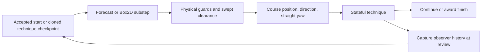

# Study #206 — H28-F certified contact solving and racing technique

H28-F is an opt-in research variant based on H28-C at `0b8f817187ffb69b8476e3cc99a2bce055089257`. It accelerates the same contact solve and puts the existing racing-technique rules on the acceptance path. H25 remains the default. The tyre equations, posture, engine and loss maps, clutch, gearing, resistance, steering command and actuator are the same as H28-C. The accepted residual limits remain 10⁻⁸ m/s² internally and 2·10⁻⁵ m/s² at the Box2D boundary. State and force rounding remain at the existing boundary. [H28-C equations and baseline evidence](../speedway-h28-c/REPORT.md)

## Frozen reference and actual execution path

The #205 nominal and −2 cm native recordings finish at **46.988410280** and **46.988411479 s**. They use two of eight available worlds. The native decision p50 was 19.103 and 18.873 ms, p99 53.422 and 52.981 ms, maximum 69.176 and 67.569 ms, and misses 21/940 and 22/940. Process cost was 20.172 and 20.188 CPU-s. The nominal recording used 166,116 residual evaluations and 113,937 full interval boxes for native contact preparation. Three others failed preflight. The frozen strict audit identifies both a direction failure and a later correction. These values were independently parsed from the committed records, including recounting boxes from the raw per-step logs. [Frozen profile and source cross-check](../../../data/experiments/speedway206/summary.json)

The H26 executable links `speedway-controller200/Receding198.cs` and `speedway-study201/Technique200.cs`. The files with the same names under `speedway-study200` are earlier versions. The active training route runs `CyclePlanner199 → Predictor198 → HandlingContact.Prepare`. Receding uses that predictor for the 0.25 s live guard and for the worker's common prefix, baseline suffix and edited suffix. Native uses `TrafficWorld191 → HandlingRig → HandlingContact.Prepare` and advances the original Box2D world. The #205 post-run audit used a strict `Corridor199` and the observer over every saved substep. The #205 training and native preflight set the yaw limit to infinity and supplied no technique observer. The online controller inherited that permissive corridor.

## Certified exclusion before the midpoint

Let `a` denote trial axial acceleration, `Br(a) = μFzr(a)`, and `Bf = μmg − Br`. The residual is `r(a) = a − (Fxr(a) + Fxf(a) + D)/m`, with `D` the fixed projected resistance on this immutable query. On each closed subinterval inside the existing positive-load domain, the affine axle-load equations bound `Br`, and the tyre law gives `−Br ≤ Fxr ≤ Br`. For the front projection, let `δ` be its physical midpoint steering angle. The actuator gives `δ ∈ [δ₀ − Δ/2, δ₀ + Δ/2]` even when the inverse steers against either limit. In body axes, `uδ = u cos δ + v sin δ` and `vδ = v cos δ − u sin δ`. Thus `Fxf/Bf = sin δ · vδ / sqrt(vδ² + scale(uδ)²)`. The interval for this fraction is precomputed once for the query and applies to all axle-load boxes. Directed bounds and the inherited force padding enclose the projection. An interval for `r` that excludes zero removes the entire box.

When the rear budgets alone overlap zero, already evaluated endpoints can tighten the result. The #205 slip argument gives `|Fxr′| ≤ Br′ + dt/2 · max(∂Fxr/∂s)`. The latter derivative is bounded by `Br_max / sqrt((1+b²)(c+k²Br_max²))`. If the resulting upper bound is strictly below mass, `a − Fxr(a)/m` is strictly increasing. Enclosing its values at the two exact computed endpoints and subtracting the bounded front projection and resistance gives a second valid exclusion test. The endpoint bound includes the existing 10⁻⁵ N padding. It measures the residual defects of the inner wheel and clutch equations at both endpoints, whose slopes are at least one in their respective unknowns. The slip-to-force and torque-to-wheel sensitivities propagate those defects to an upper bound on endpoint force error. When the bound cannot fit inside the padding the endpoint shortcut stays inconclusive. The check never discards a box with an exact zero or opposing evaluated signs at its endpoints.

An inconclusive box runs the same full coupled midpoint evaluation and derivative enclosure as H28-C. The solver still covers the entire admissible domain, marks multiple or unresolved roots ambiguous, and refines only after proving uniqueness. Refinement retains the original evaluation grid and Illinois/bisection arithmetic. It can retrieve the exact endpoint or midpoint from the same query. An exact zero at rest still takes precedence. The accepted state is committed once. Unaccepted trials share immutable physical inputs with no force or powertrain commit. There is no cache between timesteps.

Two additional changes reduce repeated work within a query. Load/tyre and actuator constants are computed once. The same piecewise affine crank map is precomputed with the original floating-point expression order, and H28-F reuses the wheel callback over trial accelerations. Both operations are charged inside force preparation and inside the synchronous decision. [Solver code](../../../tools/shared-world-speedway/ContactLoadSolver64.cs) · [Coupled contact code](../../../tools/speedway-handling/HandlingContact64.cs)

## Numerical and mechanical equivalence

Across 21 named archives from #202 through #205, all **72,949 accepted checkpoints** reproduced their original applied front and rear forces, steering, shaft and wheel states. Some archives repeat an earlier trace. At the same checkpoint and command, applying H28-C and H28-F, including as paired counterfactuals on older trajectories, returned **72,949/72,949 bit-identical physical results**. There was no first numerical divergence. Both classification and the accepted residual, loads, forces, moments, shaft, wheel, posture and lean agreed. Another 2,346 re-evaluations reproduced their preceding result. All 16,200 combinations in the independent fixed-load #205 grid also matched exactly, including 0.0622 N front load and five step lengths. The grid tests local equations rather than reachability. The focused A–J audit includes the historical contact-domain rejections at 0.370 s and #196, and the recovered +2 cm checkpoint. The solver kept the source code paths and exact archive behavior for H25, H26, H27-P and H27-N. [Complete archive and focused parity](../../../data/experiments/speedway206/parity.json)

The nominal #205 native states required 166,116 residual/clutch solves in C and 118,002 in F. Full midpoint/derivative boxes fell from 113,937 to 79,884. Across all paired archives, residuals fell from 1,863,375 to 1,205,786 (−35.3%), full boxes from 1,112,520 to 659,735 (−40.7%), and F rejected 287,475 boxes before the midpoint. On the nominal native-state pair the optimized forces and states are exactly the old ones. Consequently the applied impulse and energy ledger is the same at every recorded step. Independent #205 reconstruction gave a maximum translational impulse defect of 7.66·10⁻⁴ N·s, yaw impulse defect 1.26·10⁻⁵ N·m·s and per-step energy defect about 0.0180 J. Positive axle loads, passive wheel/clutch work and rear utilisation subject to the existing rounding allowance were checked again in each accepted paired step. [Raw and aggregated counts](../../../data/experiments/speedway206/summary.json) · [Historical native impulse reconstruction](../../../data/experiments/speedway205/native-summary.json)

## Synchronous decision cost on archived native states

Each replay executes `Receding198.Choose` 940 times at the corresponding original native review state, with original active controls, irrevocable pending, clocks, goal and permissive #205 gate. Archived states keep the controller workload fixed. All eight passes reproduced the archived chosen actions and five patch adoptions. The full predictor run at the start acts as warm-up and is timed separately. Each pass uses a fresh Windows .NET process on the same 16-logical-processor host as #205. Measurements were serial, with no candidate training or calibration runs during the benchmark. The detailed passes retain extra instrumentation. Process CPU observations per decision are coarse and the total is reported separately. These are **MODEL controller replays**. None is a native H28-F latency measurement or an end-to-end claim for a strict policy.

| Archive and mode | Kernel | p50 ms | p95 ms | p99 ms | Max ms | >50 ms | Decision CPU-s | Decision wall s |
|---|---|---:|---:|---:|---:|---:|---:|---:|
| Nominal, plain 1 | C | 18.972 | 44.495 | 53.353 | 67.302 | 22 | 18.734 | 18.707 |
| Nominal, plain 1 | F | 11.541 | 30.545 | 36.746 | 46.252 | 0 | 12.094 | 12.038 |
| Nominal, plain 2 | C | 18.781 | 44.452 | 53.445 | 68.845 | 22 | 18.641 | 18.618 |
| Nominal, plain 2 | F | 11.475 | 30.700 | 37.099 | 46.591 | 0 | 12.031 | 11.998 |
| −2 cm, plain | C | 18.889 | 44.534 | 53.001 | 67.272 | 19 | 18.891 | 18.832 |
| −2 cm, plain | F | 11.409 | 30.773 | 36.675 | 45.771 | 0 | 12.047 | 12.034 |
| Nominal, detailed | C | 18.873 | 44.334 | 53.010 | 67.377 | 19 | 18.719 | 18.674 |
| Nominal, detailed | F | 11.506 | 30.468 | 36.741 | 46.130 | 0 | 12.062 | 12.003 |

In the detailed nominal comparison, both kernels ran 89,424 forecast steps. C → F took 3,327,659 → 2,394,012 residual/clutch solves, 35,874,511 → 25,839,761 wheel evaluations and 2,338,112 → 1,672,455 full boxes. F rejected 498,185 additional boxes before evaluating a midpoint. Timing below is cumulative wall time across the 940 decisions. Isolation includes its force evaluations and interval arithmetic, while worker time contains its forecasts.

| Component of the nominal detailed decision replay | H28-C s | H28-F s |
|---|---:|---:|
| Root isolation | 14.515 | 9.100 |
| Root refinement | 1.985 | 0.718 |
| Full interval evaluation | 7.607 | 5.901 |
| New cheap exclusions | 0.000 | 0.229 |
| In-kernel powertrain | 7.089 | 2.251 |
| All force preparation including solver | 16.611 | 9.973 |
| Acceptance and Box2D vector conversion | 0.036 | 0.037 |
| Geometry and swept | 1.724 | 1.700 |
| Synchronous receding worker | 14.010 | 9.007 |

The detailed full 4700-step warm-up rollout took 1539.2 → 1120.3 ms. On the separate raw 4711-contact nominal archive, the optimized solver time is reported per archive independently of forecasting in `parity.json`. This separates contact evaluation from controller cost. Comparable #205 native contact preparation was about 0.843 s for the solver over a run, while the whole native process used about 20.2 CPU-s.

The 19 slow C decisions in the detailed pass averaged 189.2 forecast steps and 9369 clutch solves, versus 95.1 and 3540 over all decisions. The slow set has 18 bends and 1 straights. Pearson r with wall duration was 0.780 for forecast steps, 0.991 for clutch solves, 0.993 for full boxes, 0.261 for actively rate-limited steps, 0.026 for steps with an axle below 50 N. All slow decisions had both suffix workers active, although most such decisions still finished before the deadline. The extra branches amplify the work at expensive states. Near-unloading does not explain the slow tail. Raw rows preserve action requests, physical acceleration from the preceding solved contact, the observed state and pending, load/actuator counters and worker activity. The controller requests gas and steering, with axial acceleration solved by the physics. [Decision profiles and slow checkpoints](../../../data/experiments/speedway206/profiling/)

## A single racing certification profile

H28-F uses `RacingProfile206` in training, the frozen-tape check, preflight, the live receding guard, both worker suffixes, the native accepted-substep callback and the final audit. The profile evaluates physical legality and swept first, then position/course and straight yaw, then temporal technique and finish. Native retains its additional Box2D contact, finite-transform and energy-consequence checks. Existing training and preflight swept buffers remain conservative above the common physical 0.50 m floor.

The straight core remains `start+12 … start+54 m` with yaw at most 0.23 rad/s and absolute course error at most 4° above 3 m/s. The original entry window and outer clearances are unchanged. The yaw rule applies in the straight window only. Turn initiation still needs positive yaw ≥0.25 rad/s for 0.12 s in its approach window, and the slip condition still needs |β| ≥6° for 0.12 s in its own window. Settlement needs |yaw| <0.10 rad/s and |course| <3° for 0.12 s. After settlement, a sustained same-sign correction at |yaw| ≥0.16 rad/s fails once both its 0.12 s duration and the 2° course-change predicate hold.

Every accepted substep advances a private observer. Its snapshot records the straight index, all four timers, settlement, turn and slip flags, correction sign and initial course. An interior rollout without history is rejected. Receding restores the native snapshot into its local guard. The worker captures the observer at the common-prefix anchor and clones it independently for its two suffixes. Patch adoption requires matching history in addition to the existing physical anchor and pending checks. Training checkpoints preserve the same state at review. The final audit can replay accepted samples from the start. A failure records gate, precise condition, time, distance, accepted kinematics, clearance and the relevant threshold or temporal state. [Strict profile](../../../tools/speedway-h26/RacingProfile206.cs)

### Exact reproduction of the two #205 failures

Both archived Box2D runs fail `wide-direction` at **10.840 s, S = 178.363182 m**. The yaw is +0.23203696 rad/s, above +0.23. Course error is +0.02711828 rad (1.554°), below the 0.06981317 rad (4°) threshold. The straight is S = 132.389375–194.389375 m. Its strict yaw and course window is S = 144.389375–186.389375 m. The predicate that fails is yaw magnitude.

The independent technique trace fails at **10.960 s, S = 181.288469 m**. The rider was already settled, with the stable episode starting at 9.390 s. A positive correction started at 10.740 s and lasted 0.220 s without a sign change. At the failed step yaw is +0.321687 rad/s. Course changes from +0.04022092 to +0.00315698 rad, an absolute change of 0.03706393 rad (2.124°). The conjunction of a settled rider, sustained same-sign correction and a course change above 2° triggers `technique-correction`. Both snapshots are part of the straight's temporal window S = 144.389375–182.389375 m. The correction trace is measured independently on the preserved #205 archive. An enforcing native profile would stop at the earlier yaw failure.

The nominal strict preflight rejects the frozen policy at 10.840 s and S ≈178.361 m. The slight reference difference comes from predicting from the stationary start with MODEL integration. Both kernels give exactly the same result for each of the five starts. All fail this first yaw gate. Under the former permissive gate, the two archived finish conditions and the three later holdout failures are recovered, with causal review states, steering, gas and pending preserved. [Exact predicates, causal windows and five-start preflight](../../../data/experiments/speedway206/strict-style.json.gz)

## Controlled policy experiment and five starts

The existing `Profile199` generator makes the same smooth steering, gas and timing edits used by the previous planner. The study began with 265 nominal attempts through six rounds, then added 176 near the remaining failure frontier. Each series used the existing control ranges and kept the frozen full trajectory as its reference. Selection during exploration used continuity and legal progress on the nominal start. No offset result informed later edit generation. The locked shortlist used one exact command tape per candidate at all five prescribed starts. Full validity on all five is a condition of selection, after which the existing time objective is averaged across starts.

Across **441 nominal attempts**, 233 ended at `wide-direction`, 116 at `wide-position`, 56 at swept, 31 at `technique-correction` and five at `wide-entry`. The initial six rounds progressed from S ≈178 m to S ≈185 m. Round eight passed the original yaw and correction region and reached 302.32 m. Round ten's deepest strict nominal continuation, #434, reached **502.002 m at 26.620 s**. It failed straight yaw at 0.233207 rad/s in the core ending at S = 505.168 m. Course error was 0.01655 rad, within its limit, and active gas was zero. No candidate earned a finish in training. This bounded experiment demonstrates that the generator can repair earlier local violations and exposes where its screened candidates still fail. It leaves the existence of a fully strict policy open. [All attempts and locked tapes](../../../data/experiments/speedway206/controlled-search.json.gz)

| Start | Frozen policy with #205 permissive profile | Frozen policy with strict profile | Longest nominal candidate #434 with strict profile |
|---|---|---|---|
| Nominal | S3, 46.994490 s in MODEL | yaw at 10.840 s, S 178.361 m | yaw at 26.620 s, S 502.002 m |
| −2 cm | S3, 46.994490 s in MODEL | yaw at 10.840 s, S 178.361 m | yaw at 26.620 s, S 502.002 m |
| +2 cm | wide-position at 25.110 s, S 476.885 m | yaw at 10.840 s, S 178.361 m | yaw at 26.620 s, S 502.002 m |
| −12 cm | swept at 39.260 s, S 783.517 m | yaw at 10.840 s, S 178.361 m | yaw at 26.620 s, S 502.002 m |
| +12 cm | wide-position at 24.930 s, S 472.595 m | yaw at 10.840 s, S 178.361 m | wide-entry at 11.630 s, S 194.097 m |

On the old +2 cm continuation at 25.000–25.110 s, requested active steer moves from −0.00930 to −0.00812 rad, gas falls from 40.8% to 37.0%, yaw stays negative and the final outward clearance reaches 1.800028 m. On +12 cm the predecessor at 24.800 s has yaw −0.08099 and β +0.00507 rad at 52.1% active gas. By 24.930 s gas is 47.9%, yaw −0.13865, β −0.00557 and outward clearance 1.800508 m. Both fail the maximum distance from the outside line in the straight core, even though the instantaneous swept margin exceeds 1.67 m. Candidate #435 also fails near S 475 m. The exact condition and its causal review states are preserved in the two traces.

The old −12 cm swept failure occurs beyond both of those straight-core problems, with the bike already close to the outside boundary. From S = 780.81 to 783.52 m, physical steer drops from 0.08057 to 0.04192 rad and positive yaw from 0.28328 to 0.20545 rad/s while throttle stays near 51%. At failure, the static outer clearance is 0.623 m and the conservative swept value is **0.49763 m**. The extra +12 cm failure of all five final tapes is a separate entry-position fault, with outer clearance 2.20897 m beyond the allowed 2.20 m. It shows why the longest nominal prefix still cannot be selected for robust validation. [Frozen late failures and predecessor states](../../../data/experiments/speedway206/strict-style.json.gz) · [Initial six-round validation](../../../data/experiments/speedway206/controlled-search-rounds1-6.json.gz)

All five shortlisted final tapes failed at each member of the five-start set. The final kernel rechecked the locked tapes and reproduced all 25 results. No strict legal policy was selected and no new native performance or sporting result can be awarded from these predictions. The Box2D ledger records **0 of 8 constructions**, with no new native technical DNF. [Independent recheck](../../../data/experiments/speedway206/final-policy-recheck.json.gz) · [Construction ledger](../../../data/experiments/speedway206/world-ledger.jsonl)

## Tests and CI

Release build completed with zero warnings and errors. The same 107 targeted #205 .NET cases and ten new #206 cases passed. The additions exercise midpoint-free exclusion, inconclusive and ambiguous boxes, the prepared engine/clutch solve, determinism, independent observer forks, interior restore, distinct yaw/course predicates, turn/slip/correction thresholds and the FAST50 percentile gate. The three embedded H26 policies reproduced their published certificates. The replay viewer passed 124/124 and CI policy passed 7/7. The historical Python calibration passed 400/448. Its 45 failures and three errors have exactly the same IDs as on an independent checkout of the exact #205 parent. All simulation tests and audits in this study ran with the zero-world guard. GitHub's automatic push workflow targets main. The experimental branch publication did not provide a GitHub Actions verdict. [Validation and matching historical failures](../../../data/experiments/speedway206/validation.json)

## Acceptance verdicts

| Area | Verdict | Evidence |
|---|---|---|
| Numerical | **PASS in tested domain** | Exhaustive interval coverage on every accepted solve, exact physical parity on 72,949 archived steps and unchanged ambiguous/no-root classifications in the focused checks. |
| Mechanical | **PASS in tested domain** | Same double equations and committed vectors, loads, steering, wheel reaction, posture and powertrain, with the applied residual, impulse, energy and passivity checks preserved. |
| Performance | **MODEL targets met, native requirement unverified** | The timed decision replays show substantial improvement and no deadlines missed in the tested final passes. There is no strict native run and the CPU replay remains above 10 s. |
| Technique | **Unified implementation verified** | The frozen policy is rejected by the same yaw rule found in the historic exact trace. Checkpoints preserve temporal predicates independently across forks. No strict-valid S3 was found. |
| Functional | **FAIL** | Zero of five strict-valid S3 predictions with one tested policy. |
| Sporting | **Unverified under strict technique** | Frozen C's 46.9884 s versus H27-N's 47.3565 s and H25's 46.3869 s remain historical results. No eligible H28-F finish enters that comparison. |

## Technical decision

1. **FAST50 is met on the archived MODEL replay.** Native FAST50 remains unverified because the strict policy gate kept the native series closed.
2. **The H28-F stages share the same strict rules.** The replay and preflight reproduce the first historical failure, and the native adapter and final audit use the same stateful criteria. Candidate forecasts with missing history are rejected.
3. **H28-C's time improvement has not been reproduced under strict technique.** The original tape fails all five strict predictions before its first problematic straight ends. Candidate editing repairs that region locally without producing a five-start finish.
4. **The constraint is the timing of yaw and lateral position across the exit and the next approach.** Turning early enough to prepare the following bend overshoots the 0.23 rad/s straight limit on the archived path. Steering and gas changes that repair it can move the bike past a position limit or eliminate swept reserve. The old continuous-full-gas experiment hit swept in five of six phases and direction in the sixth. The new best prefix still violates yaw at zero gas, so merely choosing a larger or smaller throttle does not resolve the transition.
5. **#207 is ready for a bounded joint gas/steering investigation.** Give the existing generator a complete strict continuation score across offset checkpoints and retain earlier feasible approach states when editing the transition. A robust strict reserve and an actual native timing run are the missing validation before a larger joint optimizer effort.
