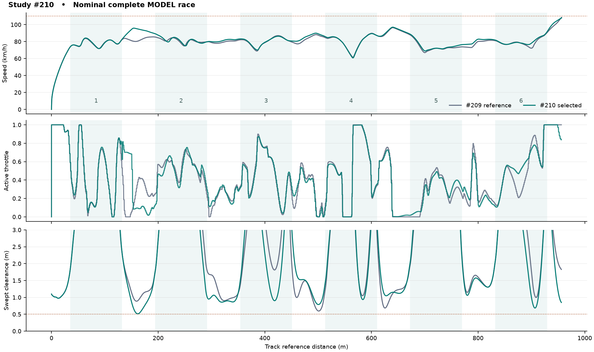

# Study #210 — H29-P: Fast corner exits and full-race pace optimization

One H28-F feedback policy finished all five strict native three-lap races. Best native S3 was **48.976570 s**, a **0.843660 s (1.69%) gain** over #209. Peak strict native speed was **107.867 km/h**. The policy spent longer above 100 and 105 km/h, with its strongest sector gain on the first straight. The first frozen candidate recorded a real native DNF. The five completed races use the separately frozen repair.

The experiment is tools-only and H25 remains the production default. The parent is `3f668b43a5ead239133a52f5c9a0149d24f5c1ad`. The branch is `experiment/speedway-210` and remains unmerged. The final frozen controller SHA-256 is `AE98FCE5026C5F84388AF0ADF70550B4EE9BC76B56FF5232D980C2FD4FE6185B`. [Frozen policy and selection](../../../data/experiments/speedway210/freeze.json)

## Frozen #209 reference

The exact frozen candidate has SHA-256 `F5604A0F89374D14520078C92D7FEAAD04D488D336652603ED4B87D2CBD5D0DD`. Using original native states and queues, the harness recalculated **4,985 controller requests** with zero differences and independently matched **4,985 observer checkpoints**. It checked **24,975 native accepted steps**, recomputed crossings and minimum swept, and verified zero contacts. All five time-zero MODEL races also reproduced. Archived native decision times, recalculated from every sample, give 2.0855 / 6.8197 / 11.0597 / 15.7875 ms for p50 / p95 / p99 / maximum, with zero above 50 ms. This use of published substeps constructs zero worlds. The #209 policy remains callable from the original start. [Archive hashes and reconstruction](../../../data/experiments/speedway210/reference/frozen-reference.json)

## Six bends and acceleration limits

Crossings use linearly interpolated accepted samples at common reference distances. This explains small differences from #209’s first-sample-after-crossing table. Speeds are km/h in the order entry, geometric apex, exit, exit+20 m and next entry. Positive time gain is faster.

| Bend | #209 speeds | #210 speeds | Bend gain (s) | Following straight gain (s) |
| --- | --- | --- | --- | --- |
| 1 | 73.69 / 73.52 / 82.32 / 80.63 / 85.36 | 73.69 / 74.00 / 82.87 / 95.54 / 89.24 | 0.017 | 0.258 |
| 2 | 85.36 / 77.92 / 79.75 / 78.00 / 82.10 | 89.24 / 79.65 / 79.79 / 79.78 / 83.16 | -0.040 | 0.053 |
| 3 | 82.10 / 79.50 / 79.37 / 80.41 / 84.71 | 83.16 / 79.95 / 80.66 / 83.65 / 85.91 | 0.150 | 0.073 |
| 4 | 84.71 / 63.81 / 87.03 / 91.68 / 87.83 | 85.91 / 63.14 / 87.05 / 92.58 / 88.75 | -0.015 | 0.019 |
| 5 | 87.83 / 72.07 / 73.78 / 73.86 / 81.14 | 88.75 / 72.20 / 76.42 / 77.84 / 81.80 | 0.126 | 0.091 |
| 6 | 81.14 / 77.99 / 90.53 / 102.93 / 108.46 | 81.80 / 78.28 / 91.54 / 105.14 / 107.82 | 0.097 | 0.016 |

The first straight gains **0.258 s**. Its exit+20 m crossing rises from **80.63 to 95.54 km/h**. Bend 3 accounts for the largest solo corner gain. Bend 5 cuts both bend and straight time, and bend 4 trades apex speed for a faster following crossing. Changes propagate to the next corner. Removing a bend’s correction can cause a DNF several bends later. [Interpolated bend, force and phase metrics](../../../data/experiments/speedway210/race-metrics.json)

The first eight numeric columns below describe the frozen nominal straight or the selected exit+22 m probe. Rear use is the maximum combined-slip utilisation, front load the minimum observed load, moment the maximum absolute net yaw moment and rate time the duration of actual actuator rate limitation. The release lead is the smallest tested number of metres before the next entry at which the original continuation completed. It can coincide with the causal probe anchor.

| Straight | #209 req / active | Max ax (m/s²) | Rear use | Front N | Yaw N·m | Exit outward m/s | Rate limit s | Selected physical peak | Selected hold-to-entry peak | First strict stop | First passing lead m |
| --- | --- | --- | --- | --- | --- | --- | --- | --- | --- | --- | --- |
| 1 | 0.22 / 0.23 | 3.33 | 0.686 | 461 | 185.0 | 3.11 | 0.08 | 121.87 | 122.90 | swept | 40 |
| 2 | 0.22 / 0.22 | 1.20 | 0.656 | 593 | 138.1 | 1.59 | 0.00 | 111.80 | 112.97 | swept | 34 |
| 3 | 0.28 / 0.28 | 3.14 | 0.893 | 481 | 122.0 | 5.18 | 0.06 | 115.04 | 115.99 | swept | 40 |
| 4 | 0.28 / 0.28 | 4.81 | 0.924 | 391 | 132.3 | 7.84 | 0.29 | 121.26 | 117.17 | wide-direction | 40 |
| 5 | 0.28 / 0.29 | 4.55 | 0.659 | 401 | 97.8 | 4.85 | 0.01 | 111.91 | 106.04 | wide-direction | 36 |
| 6 | 1.00 / 1.00 | 6.77 | 0.835 | 288 | 78.2 | 7.54 | 0.35 | 107.95 | 107.95 | goal | 0 |

Early straight baseline throttle averaged about 0.22–0.29, with ample vertical load and no sustained steering-angle stop. The exact queue, active and requested steering, tyre forces, yaw, beta and course are retained per accepted step. The kinematic straight diagnostic starts from the reached exit+22 m state, uses the original track, actual queued command, unchanged contact solver, footprint and swept test, and holds 100% new requests until the next entry or finish. The straight diagnostic omits the technique observer and uses the geometric steering feedback without the predictive gas supervisors. Its speed is physical capability over that distance. Strict holds preserve the observer and continue through the following bend or finish. [All matched-state trajectories, stop states and budgets](../../../data/experiments/speedway210/probes/probes.json.gz)

The frozen command attribution identifies [#207's drive bias](../../../tools/speedway-h26/JointPlanner207.cs#L202) as the dominant raw reduction for 2.67, 2.80 and 2.44 s on straights 1–3. On straight 4, inherited speed feedback dominates for 1.15 s and the [#208 pace cap](../../../tools/speedway-h26/ExitPolicy208.cs#L152) for 0.34 s. The pace cap dominates for 2.33 s on straight 5. Straight 6 often has a raw speed feedback reduction before the recovery stage while its final active request is already full. These are overlapping command-stage labels. The paired rollouts measure the consequences of changing the selected request.

With the tested steering, holding gas to the following entry after straights 1–3 can carry more than 110 km/h into approaches that then fail swept clearance. After straight 4 the original yaw envelope can fail before bend 5 begins. Straight 5 is sensitive to yaw bound and the next entry. Finite results locate a cutoff or preparation interval for these tested controls. They do not establish the earliest possible correction across other racing lines. Tightening the line and adjusting the pending gas well before entry is the unresolved task. Straight 6 ends at the race finish and has no following scored bend.

The selected controller's hold-to-entry probes after straights 1, 2 and 3 first lose swept at S=213.121, 373.957 and 532.669 m, with lower bounds 0.4813, 0.4865 and 0.4977 m. After straight 4, yaw first reaches 0.23291 rad/s at S=664.279 m, above the 0.23 rad/s limit while 8.279 m short of the next entry. Its corresponding swept value is still 1.1951 m. At the sampled release leads, 38 m failed and 40 m passed after straight 4. This is evidence for preparing earlier with the tested steering and queue. The overall race can still use more gas in an earlier window, as the first straight demonstrates.

## Arms, budgets and coupled control

Development used nominal, ±1 cm, then ±6 and ±16 cm for screening. The registered nonnominal offsets were withheld from parameter selection. Each candidate had to finish under the exact strict profile. The rank then used worst-start time, minimum swept reserve and nominal time. Direction, yaw, temporal technique and physical legality were hard gates. Full trajectory records include their headroom. A cached training prefix ended before any editable pulse and included its own wheel, shaft, posture, steering, pending queue and observer. Every scored suffix ran to its actual finish or recorded failure. Screened and official races ran from time zero.

| Arm | Winner | Development S3 | Worst s | Nominal s | Min swept m | Nominal peak km/h |
| --- | --- | --- | --- | --- | --- | --- |
| A | 1 | 7/7 | 49.828805 | 49.825417 | 0.594098 | 108.461 |
| B | 512 | 7/7 | 49.575686 | 49.574497 | 0.599988 | 108.416 |
| C | 522 | 7/7 | 49.496318 | 49.490291 | 0.861105 | 108.473 |
| D | 383 | 7/7 | 49.596861 | 49.592971 | 0.594098 | 108.053 |
| E | 486 | 7/7 | 49.111090 | 49.110607 | 0.667707 | 107.780 |
| F, initial | 5 | 7/7 | 48.984753 | 48.971491 | 0.500337 | 107.838 |
| F, reserve | 46 | 7/7 | 48.984854 | 48.982593 | 0.512258 | — |
| F, repaired | 22 | 7/7 | 48.985048 | 48.982747 | 0.512258 | 107.824 |

A is frozen #209. B works on bends 1–2, C on bends 3–4, and D on bend 5. E tests B/C/D combinations, then searches bend 6 and all six bends using complete-race scoring. The six distance-based pulse windows cover approach, rotation, apex, exit preparation, stabilization and straight drive. They adjust steering, line correction and throttle together and can relax inherited gas restrictions without assigning vehicle speed. F adds bounded predictive recovery on the first exit. The final patch spans exit−5 to exit+19 m with a 0.65 restoration fraction before forecast selection. Its geometry-relative steering and yaw corrections come from joint feedback.

| Arm | Trials | Screens or guard finalists | Search integration steps | Separate screening steps | CPU s | Wall s |
| --- | --- | --- | --- | --- | --- | --- |
| A | 1 | 1 | 14949 | 34879 | 6.906 | 6.864 |
| B | 532 | 13 | 3164921 | 448085 | 567.359 | 252.413 |
| C | 532 | 13 | 2199654 | 443529 | 465.453 | 217.014 |
| D | 387 | 13 | 1068532 | 444659 | 270.641 | 151.593 |
| E | 505 | 13 | 3383698 | 423521 | 732.781 | 383.692 |
| F, initial | 33 | 3 | 347523 | 102961 | 85.500 | 86.268 |
| F, reserve | 47 | 0 | 1563353 | 0 | 309.656 | 89.403 |
| F, repaired | 22 | 1 | 755055 | 0 | 158.250 | 66.549 |

A–E bounds were checked between batches of up to 12, with four workers, 1,050 CPU s, 1,050 wall s and 11 million scored steps per arm. One-bend stages allowed 192 proposals and joint stages 144. Prefix generation and internal predictive steps have different scopes from the table’s outer rollout steps. The CPU columns measure the complete recorded loops, including screening. F allowed 33 proposals and nine seven-start screens. The reserve grid used 47 proposals. Repair used 22 proposals with up to five seven-start timed guard finalists. Reserve and repair allowed 10,000 outer steps per run. The fixed probe menu took 71.984 CPU s, under its 180 s cap. Ablation took 15.906 CPU s. All search, diagnostics and parity runs constructed zero worlds. [Complete search receipts and policies](../../../data/experiments/speedway210/search)

| Ablation | Training S3 | Nominal s | First recorded stop |
| --- | --- | --- | --- |
| selected | 3/3 | 48.982747 | — |
| remove bend 1 | 0/3 | — | wide-entry at S=672.52 |
| remove bend 2 | 0/3 | — | wide-direction at S=303.77 |
| remove bend 3 | 3/3 | 49.239469 | — |
| remove bend 4 | 0/3 | — | wide-entry at S=831.94 |
| remove bend 5 | 2/3 | — | wide-direction at S=823.67 |
| remove bend 6 | 3/3 | 49.102177 | — |
| throttle pulses only | 0/3 | — | wide-direction at S=787.39 |
| steering pulses only | 0/3 | — | wide-entry at S=831.76 |

## Predictions and the first native failure

The first-exit supervisor tries restoration fractions 1, 0.75, 0.5 and 0.25, checking an exact 1.2 s successor from the current state and queue. Its first request can change, then the trajectory uses joint feedback. The native decision also checks a 0.25 s successor with a separately defined unboosted joint fallback. Both forecasts are finite, use the original contact solver and strict history, and preserve the original 0.050 s command timing. The sixth-exit #209 supervisor remains inside the inherited feedback. The full-race MODEL and native validation are separate from these local checks.

| Nominal policy | One-request probes | Pass 0.25 s | Pass 1.2 s | Pass complete continuation |
| --- | --- | --- | --- | --- |
| A | 58 | 58 | 56 | 39 |
| selected | 58 | 58 | 57 | 47 |

F’s fastest initial development proposal had only 0.34 mm of clearance reserve. The next bounded screen required 0.506 m for selection, about three times the maximum 1.915 mm #209 MODEL-to-native deficit above the unchanged 0.50 m rule. Its first frozen candidate `C5726FF7E53351B6FE2AE93AC29615584736C83963445AEC3CB45C92DAB99921` completed all five MODEL preflights. The native nominal guard stopped at **48.450 s**. The forecast failed at **48.610 s**, S=945.508 m, with **AmbiguousOrMultipleRoots**. The guard stopped before applying that request. The measured swept reserve and having zero contacts did not make an uncertified force solution usable. [First freeze, five preflights and native DNF](../../../data/experiments/speedway210/first-freeze)

Repair used the last nine checkpoints from that failed **nominal** run and the already declared development set. The guard reproduced the exact rejection on the archived state. The reserve candidate’s extra sixth-exit restoration was backed out or varied with the original sixth-bend pulses in a finite menu. Each proposed repair had to pass the native-state stress checkpoints, the seven development races and a separate receding-guard replay. Final choice 22 was **sixth scale 1, recovery drive delta 0,055**. No nonnominal official outcome was used to choose the repair. After refreezing, the five prescribed offsets were re-evaluated and four additional independent MODEL holdouts at ±9 and ±20 cm were opened. [Repair trials and causal guard failure](../../../data/experiments/speedway210/search/repair/repair.json.gz)

| Fresh offset (cm) | MODEL S3 (s) | Swept (m) | Result |
| --- | --- | --- | --- |
| -9 | 48.978314 | 0.516413 | goal |
| 9 | 48.980414 | 0.515057 | goal |
| -20 | 48.976790 | 0.524655 | goal |
| 20 | 48.975332 | 0.510226 | goal |

## Strict BOX2D series and FAST50

| Start | #209 native (s) | #210 MODEL (s) | #210 native (s) | Paired gain (s) | Native swept (m) | Peak through finish (km/h) | Contacts |
| --- | --- | --- | --- | --- | --- | --- | --- |
| Nominal | 49.824440 | 48.982747 | 48.980637 | 0.843803 | 0.512992 | 107.843 | 0 |
| −2 cm | 49.826819 | 48.979279 | 48.981634 | 0.845184 | 0.519843 | 107.846 | 0 |
| +2 cm | 49.828793 | 48.983432 | 48.980598 | 0.848195 | 0.516008 | 107.867 | 0 |
| −12 cm | 49.829720 | 48.982472 | 48.976570 | 0.853150 | 0.516984 | 107.807 | 0 |
| +12 cm | 49.820230 | 48.983658 | 48.984204 | 0.836026 | 0.514553 | 107.793 | 0 |

The central ledger records **6/8** worlds including the failed original nominal attempt. Both series used the registered start order and separate complete time-zero MODEL admissions for their frozen candidate. Every successful native run was rechecked over its recorded substeps using an independent strict observer. [World ledger](../../../data/experiments/speedway210/world-ledger.jsonl) · [Native traces, pending queue and decision timings](../../../data/experiments/speedway210/native)

The five completed starts have mean **48.980729 s**, median **48.980637 s** and range **0.007634 s**. The initial candidate’s one DNF is excluded from those finish statistics and included in the construction ledger.

| Start | Decisions | p50 ms | p95 ms | p99 ms | Max ms | >50 ms |
| --- | --- | --- | --- | --- | --- | --- |
| Nominal | 980 | 2.2202 | 6.9210 | 10.5896 | 16.3621 | 0 |
| −2 cm | 980 | 2.2107 | 6.9188 | 10.4357 | 15.8493 | 0 |
| +2 cm | 980 | 2.2026 | 6.9258 | 11.0030 | 16.8014 | 0 |
| −12 cm | 980 | 2.2206 | 6.8255 | 10.7958 | 16.7522 | 0 |
| +12 cm | 980 | 2.1904 | 6.8520 | 10.3043 | 15.8349 | 0 |
| Final pooled | 4900 | 2.2099 | 6.8901 | 10.7958 | 16.8014 | 0 |
| Initial nominal DNF | 970 | 2.1483 | 6.7411 | 10.7351 | 16.5421 | 0 |

Online decision timing includes feedback and the applicable forecasts. Across both native candidates there were 5,870 measured decisions and 0 above 50 ms. Offline search cost is outside these measurements.

| Start | Native−MODEL s | Max XY m | Max reference m | Max speed m/s | Matched reviews | Native cumulative lap times s |
| --- | --- | --- | --- | --- | --- | --- |
| Nominal | -0.002111 | 0.0667 | 0.0636 | 0.0175 | 980 | 17.978 / 33.464 / 48.981 |
| −2 cm | 0.002356 | 0.0781 | 0.0734 | 0.0245 | 980 | 17.978 / 33.465 / 48.982 |
| +2 cm | -0.002834 | 0.1164 | 0.1046 | 0.0756 | 980 | 17.978 / 33.465 / 48.981 |
| −12 cm | -0.005902 | 0.1939 | 0.1864 | 0.1184 | 980 | 17.974 / 33.459 / 48.977 |
| +12 cm | 0.000546 | 0.0170 | 0.0160 | 0.0083 | 980 | 17.979 / 33.467 / 48.984 |

Full native bend splits, every requested and active interval and all individual matched-review differences are indexed in the metrics archive. Speeds are clipped at the interpolated finish. The raw traces also preserve the sample on the far side of the finish crossing.

Each of the five runs requests and applies at least 99% throttle for 4.950 s. Mean requested drive is 45.53–45.55% and mean active drive is 45.45–45.46%. Active zero throttle totals 1.450 s per run except at −12 cm, where it totals 1.500 s. The five repaired runs use 18.921875 process CPU seconds. The failed nominal uses another 3.875000 CPU seconds. [Exact native build hashes](../../../data/experiments/speedway210/validation/native-builds.json).

## Sustained speed in complete strict races

| Native start | Above 100 km/h | Above 105 km/h | Above 110 km/h | Above 115 km/h | Above 120 km/h |
| --- | --- | --- | --- | --- | --- |
| Nominal | 0.602 s / 17.44 m (straight 6) | 0.244 s / 7.20 m (straight 6) | — | — | — |
| −2 cm | 0.604 s / 17.51 m (straight 6) | 0.247 s / 7.30 m (straight 6) | — | — | — |
| +2 cm | 0.602 s / 17.44 m (straight 6) | 0.245 s / 7.25 m (straight 6) | — | — | — |
| −12 cm | 0.599 s / 17.35 m (straight 6) | 0.238 s / 7.04 m (straight 6) | — | — | — |
| +12 cm | 0.608 s / 17.61 m (straight 6) | 0.248 s / 7.33 m (straight 6) | — | — | — |

Nominal MODEL stays above 100 km/h for **0.606 s / 17.57 m (straight 6)** and above 105 km/h for **0.249 s / 7.36 m (straight 6)**. The corresponding #209 MODEL intervals are 0.411 s / 11.87 m (straight 6) and 0.144 s / 4.26 m (straight 6). Native thresholds are integrated over continuous accepted intervals and reported with actual travelled distance. The peak and duration can move in opposite directions. [All intervals, physical distances and throttle utilization](../../../data/experiments/speedway210/race-metrics.json)

## Physics and regression

Release solution and study builds passed with zero warnings or errors. The focused suites passed 53/53, including two new geometry and queued-action cases. The full core shard moved from 2,060/2,281 to 2,062/2,283 passing, with the same 221 failure identities. The world guard blocked 219 historical tests that would construct extra Box2D worlds. The other two are inherited frozen-source hash failures. The 448 Python tests had the same 404 passes, 39 failures and five errors on both source trees after normalizing fixture permissions and indexing the parent checkout. The replay viewer passed 237/237 and CI policy passed 7/7.

Archived H28-C/H28-F parity matched **72,949/72,949** states, with **16,200/16,200** synthetic matches and **2,346** deterministic rechecks. Physical values and classifications match. The source audit checks the original 316-file physics/runtime seal and byte equality across production sources, the shared-world harness and #209 evidence, for **482** unique files. The original H28-F settings and original CLI cases compare exactly. The native runner wrapper uses the existing Box2D loop and observer. [Build, regression, parity and source integrity](../../../data/experiments/speedway210/validation)

GitHub reported **0 workflow runs, 0 check runs and 0 status contexts** for implementation commit `d1ebe1ff7d391f30d89f110f899497123e84ec9c`. The combined commit status is `pending`. The experiment branch falls outside the workflow’s push-to-main trigger. The measurements above are local. [Dated GitHub API snapshot and queried endpoints](../../../data/experiments/speedway210/validation/hosted-ci.json).

## Sporting conclusions

1. **S3 gain.** 0.843660 s best to best, from 49.820230 to 48.976570 s, with all five pairings in the race table.

2. **Largest gains.** Earlier preparation and predictive drive on bend 1 produce the biggest straight gain. Bend 3 produces the biggest standalone corner gain and a large reserve improvement. Bend 5’s coupled steering and throttle cut time in both phases.

3. **Sustained speed.** The complete-race intervals above 100 and 105 km/h occur on the final straight. The table records each duration and distance.

4. **110–120 km/h.** The physical straight probes exceed 120 km/h. Some strict trial prefixes exceed 110 before a subsequent failure. The complete strict races did not reach 110 km/h.

5. **Restrictions.** Delayed activation, finite steering authority, combined-slip force, certified contact and the physical footprint are genuine constraints. The test establishes that gas roll-off and earlier line or yaw preparation are necessary for the tested high-speed continuations. It does not prove a universal throttle cap.

6. **Bottleneck.** The first repeatable bottleneck is the controller’s ability to prepare a feasible line and course for the next bend within the available straight. Continued full gas can leave infeasible outward momentum or exceed the strict yaw limit. Individual ambiguous contact forecasts also require a valid continuation.

7. **Next work.** Continue controller optimization, especially planning the throttle release and steering earlier on the long straights. The unchanged engine already supplies the observed straight speed and current results do not justify changing tyre, engine or contact parameters.
