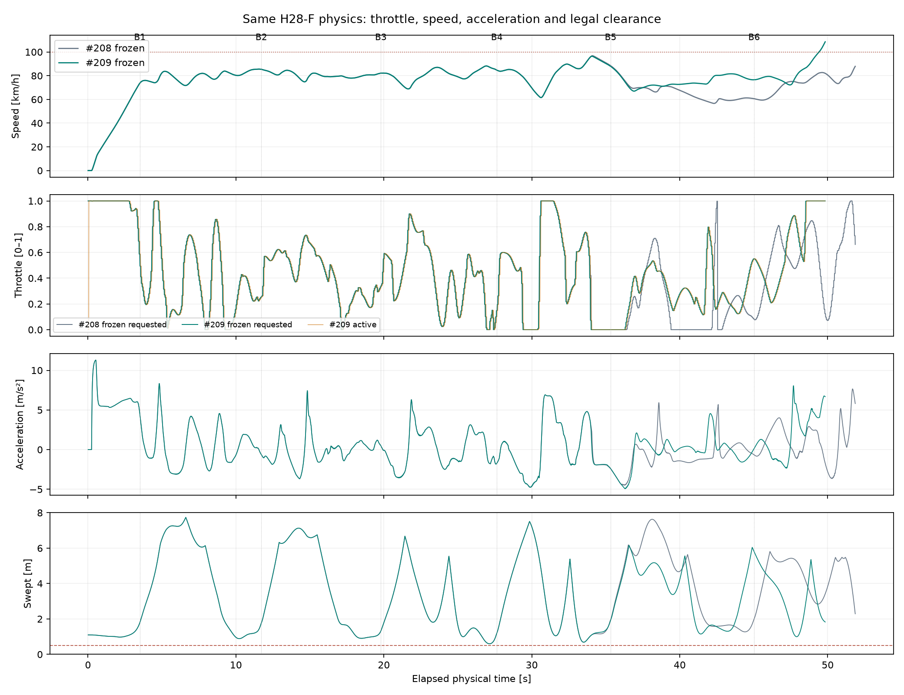
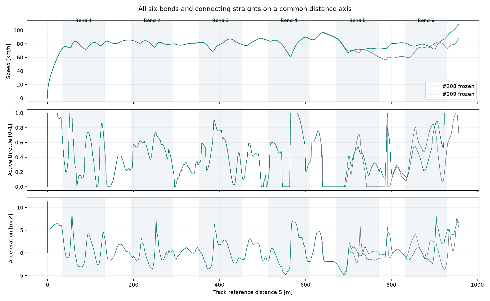
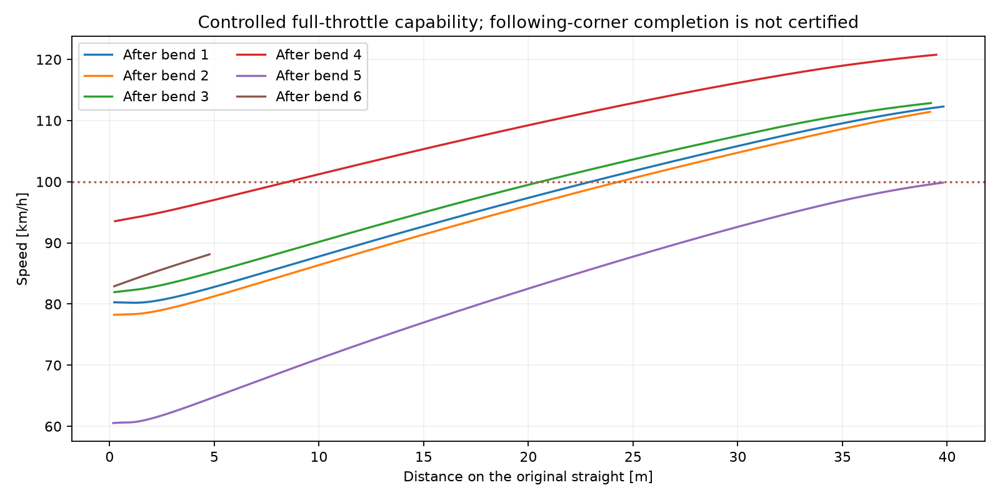

# Study #209 — H29-S: throttle suppression audit and safe speed recovery

The frozen controller, rather than a 97 km/h physical power limit, explains a substantial part of #208's performance. With unchanged H28-F mechanics, one shared feedback policy completes all five strict MODEL and Box2D races. Best native S3 improves from **51.867334 to 49.820230 s**, recovering **2.047104 s (3.947%)**. Native peak speed is **108.48–108.80 km/h**. All **4,985** native decisions satisfy FAST50; maximum **15.7875 ms**. There are zero contacts and minimum swept clearance remains **0.593939 m**.

H25 remains the production default. No merge is performed. The original #208 candidate and evidence are unchanged. The new policy remains an experiment, and this is the fastest independently certified candidate found within the recorded search bounds, not a proof of a globally optimal lap.

## Frozen reference and reconstruction

Exact parent: `e0607f555de2d4c764b4bf26bd9bcafc420db6ec`, branch `experiment/speedway-208`. New branch: `experiment/speedway-209`. [Original report](../speedway-h29-v/REPORT.md).

The unmodified binary first reproduced all five MODEL finishes. Instrumented reconstruction subsequently matched **all 5,190 published native actions exactly**, including steering, at their actual native checkpoints. There is no substituted warm trajectory or changed physical initial state. The original nominal MODEL time is 51.853248385 s; its native counterpart is 51.878036 s. Best native and nominal MODEL are distinct comparisons throughout this report.

The frozen #209 candidate SHA-256 is `F5604A0F89374D14520078C92D7FEAAD04D488D336652603ED4B87D2CBD5D0DD`. The complete policy is [frozen-candidate.json](../../../data/experiments/speedway209/frozen-candidate.json). It was independently rechecked on the five registered starts before the first native construction. A later source reconstruction also matched **all 4,985 final native actions exactly**. [Reference reconstruction](../../../data/experiments/speedway209/native-clamp-baseline/baseline.json), [final reconstruction](../../../data/experiments/speedway209/native-clamp-final/native-command-reconstruction.json).

The protected #208 policy is a time-zero fallback choice. Switching to its feedback from an already changed race state is not assumed to restore its certificate; such a successor must be checked from that actual state and pending queue.

## Restriction inventory and when each matters

[Every registered phase, its distance boundaries and selected move](../../../data/experiments/speedway209/phase-restrictions.csv), [baseline command-by-command attribution](../../../data/experiments/speedway209/baseline-command-clamps.csv), and [final command attribution](../../../data/experiments/speedway209/final-command-clamps.csv) provide the full inventory. The phase transitions retain the original 3 m smooth blend, including transitions to or from a null ceiling. Every negative bias and the zero ceiling is represented; none is inferred active solely from its presence in JSON.

| Execution source | Effect and observed activity | Classification supported by the counterfactuals |
|---|---|---|
| [JointPlanner207.cs:202](../../../tools/speedway-h26/JointPlanner207.cs#L202), inherited `power.FeedForward.Drive` | Reuses the H28-C learned throttle reference, with spatial lead and a flying-lap template. Raising only this term could increase the final #208 command for 34.76 s, before considering whether the resulting trajectory remains legal. | **4**, inherited tuning. It is not evidence that the engine is delivering all available power. Full-throttle straight diagnostics reject a 97 km/h mechanical ceiling. |
| Same expression, `DriveBias` | Negative selected biases include −0.07, −0.08, −0.12, −0.14, −0.18 and −0.24. Removing only negative bias changes the effective command for 19.20 s. | **2/3/4**, depending on phase. Even a 1% blanket restoration is only 4/5 on registered starts. Larger restoration first loses the second-exit direction/core constraint. This establishes necessity under the tested steering policy, not physical impossibility of a faster line. |
| Same expression, `.11*(current.Speed-v)` | Reduces throttle above the inherited reference; it never assigns vehicle speed. Its effective suppressing influence is 5.35 s. Gas lead samples the power reference at a different distance from the current speed reference. | **3/4**. Its effect is inseparable from line tracking and inherited pace without a paired rollout. |
| [JointPlanner207.cs:205](../../../tools/speedway-h26/JointPlanner207.cs#L205), `ThrottleCeiling` | Selected phase 39, fourth-bend apex, S=542.168–561.863 m, has ceiling zero. After the 3 m blend it is literally zero, and blends out in the next phase. Actual final-command suppression lasts 1.25 s, including the transitions. | Full removal is **2/3**: variants with unchanged line/steering settings fail the following outside-band position. The part recovered by raising the ceiling to 0.025 is **5**, locally unnecessary: 5/5 MODEL, nominal gain 19.6 ms. This small upstream change is not included in the final policy, which preserves the first four bends. |
| [ExitPolicy208.cs:152](../../../tools/speedway-h26/ExitPolicy208.cs#L152), `Coast`, `MidPace`, `ExitPace` | Lowers a reference, then computes `Clamp(.23+.17*(speed-v),0,1)`, takes `Min(q.Drive,cap)`, and blends by the size of the pace cut and the maneuver boundary. A cap that exceeds `q.Drive`, or has zero pace blend, has no effect. | **3/4**, with measured removable portions. Excessive fifth-bend restoration fails its exit; sixth approach restoration fails the preceding straight direction. Joint line/steering changes recover much more than blanket gas changes. |
| [ExitPolicy208.cs:160](../../../tools/speedway-h26/ExitPolicy208.cs#L160), ramp and `Recovery.Gas` | The −0.65 ramp peaks 10 m before exit; recovery gas blends after exit. Their raw sum can be negative, but the final actuator floor can mask it. | Sixth-bend −0.65 ramp is **5** under the tested policy: complete removal passes 5/5 and improves nominal time by 191.4 ms. A fifth-bend removal also passes the development starts. Some apparent reductions are redundant (**5**) because another clamp already forces zero. |
| Steering angle, rate, `StraightYawTarget`, drift feedback and yaw/core feedback | Gas does not directly depend on steering request, but tyre Fx/Fy, normal load and yaw change the next state and therefore the later gas choice. Steering saturation can make otherwise available engine power unusable with that line. | **1** for the original actuator/contact limits; **2** for strict technique; **3** for a deficient steering/line combination. None is relaxed. |
| `[0,1]` drive bound, `Max(3,v)` divisors, route endpoint clamps, predictor deadline | Actuator range is physical. The low-speed divisor and route endpoint interpolation bounds are not hard vehicle speed limits. The deadline does not bind the completed races. | Actuator range **1**; geometric/reference implementation bounds are disclosed, not disguised as mechanical top speed. |
| Engine, clutch, wheel, H26 losses, H28-F contact solve | Torque map and 12,000 rpm combustion cutoff, passive bidirectional clutch, transmission/bearing losses, dynamic loads and combined slip remain unchanged. | **1**, original mechanics. The cutoff removes combustion torque; it does not clamp wheel or body velocity. No active brake exists in this action path. |

These categories follow the requested numbering: 1 physical, 2 strict profile, 3 line/steering deficiency, 4 historical tuning without demonstrated necessity, 5 demonstrated removable or redundant restriction. A failed intervention under unchanged steering feedback is not labelled physically necessary.

### Selected fourth, fifth and sixth maneuvers

The fourth maneuver has `Speed=false`: its Coast, MidPace, ExitPace, Ramp and recovery-gas speed channel are inactive. It reshapes steering and line while retaining #207 gas feedback. The selected fifth maneuver has Coast=5.303716, MidPace=1.039598, ExitPace=8.400547, Ramp=−0.65 and Recovery.Gas=−0.08. The sixth has Coast=7.584916, MidPace=0, ExitPace=0, Ramp=−0.65 and Recovery.Gas=−0.08.

The outgoing maneuver owns the first 20 m after its exit. Consequently, a following maneuver's preparation parameter is not necessarily the distance at which it first changes the command. These gates and the boundary blend are evaluated from actual S, not a clocked tape.

The final fifth settings reduce Coast to 4.583837 and ExitPace to 6.819171, change the ramp to **+0.324169**, and change recovery gas to **+0.111068**, together with its line and steering recipe. The final sixth uses Coast=1.577064, MidPace=0.600819, ExitPace=0.025265, Ramp=−0.037931 and recovery gas=+0.129924. The small new MidPace is an optimized joint choice, not a physical-model change. Exact parameters and all ancestors are archived.

## Exact telemetry and deceleration accounting

The accepted-step archives contain original state, active action, ordered pending queue, observer checkpoint, posture, wheel, shaft, steering, selected request, unclamped drive, every clamp stage, speed references, forces, normal loads, RPM, clutch slip/torque, work/loss ledgers, signed acceleration, yaw, beta, course, outer clearance and swept certificate. Rejected states are kept separately in the first-failure records and never counted as accepted steps. [Detailed reference](../../../data/experiments/speedway209/effective-audit), [detailed final](../../../data/experiments/speedway209/official-effective), [native command decompositions](../../../data/experiments/speedway209/native-clamp-final), [original native substeps](../../../data/experiments/speedway208/native).

Raw stage reductions and effective command changes are different quantities. The effective audit removes one restriction locally while keeping every other clamp. These changes are **not additive**. It reports 240 accepted steps with a negative ramp whose removal makes no final-command difference. The independently reconstructed #208 output differs by at most 2.96e−8 in throttle, due to reconstructing a speed from the saved floating-point feedback term; the recorded stage inputs/outputs and selected float action are exact. Effective counterfactual values are labelled at the #208 output, before the new #209 supervisor. [Effective attribution](../../../data/experiments/speedway209/effective-attribution.json).

The actual configured command delay is **0.050 s**, on a 0.050 s review grid. This is measured from accepted pending commands, not assumed from rider reaction. `Schedule188.Due` overrides the ordinary reaction value in this study. A final request that has not activated by the finish is not counted as an observed activation. The clutch release/reaction calculation remains its original, separate physical input.

| Nominal MODEL metric | #208 | #209 |
|---|---:|---:|
| Finish [s] | 51.853248 | 49.825417 |
| Peak [km/h] | 96.836 | 108.572 |
| Requested throttle ≥99% of accepted time | 8.099% | 10.696% |
| Active throttle ≥99% | 8.099% | 10.596% |
| Active zero throttle [s] | 7.400 | 4.250 |
| Accelerating [s] | 25.660 | 26.340 |
| Decelerating [s] | 25.950 | 23.240 |
| Request drops larger than 5 percentage points | 70 | 62 |
| Negative clutch torque [s] | 8.560 | 5.280 |
| Deceleration while active throttle ≥50% [s] | 5.000 | 4.710 |

The accepted integration grid can extend a few milliseconds past the interpolated finish; percentages use its explicitly recorded duration (51.86/49.83 s). Signed physical deceleration comes from net contact force, including lateral tyre force projected against travel, road resistance and sometimes engine backdrive. It is not an explicit brake command. The nominal reference accumulates 43.723 m/s of successive speed decreases; this is an across-run variation statistic, not a single drop or a causal sum of throttle restrictions. During decelerating steps, instantaneous tangent impulses per mass are −23.270 m/s from resistance, −35.161 m/s from front contact and +13.931 m/s from rear contact. The positive rear total does not imply positive rear force at every step. Finite speed differences also include the direction change over a step; they are logged separately from the instantaneous tangent projection.

Crank-drag work is 88.920 kJ, clutch heat 15.907 kJ, transmission loss 39.520 kJ, rear longitudinal slip loss 124.331 kJ and bearing loss 5.603 kJ in the nominal reference. These coupled rotational/contact ledgers must not be subtracted a second time from the already measured body net force. Maximum rear combined-slip utilization is 0.975020; minimum front normal load is 43.278 N. Full throttle does not remove these physical limitations.

### Paired tests at every major request reduction

All 70 drops larger than five percentage points were tested from their exact accepted checkpoint, with unchanged wheel, shaft, posture, steering, pending commands and strict history. The control suffix reproduces the full reference finish in **70/70** cases. The intervention requests full throttle for 0.25 s and then resumes frozen feedback. **18/70** interventions admit a strict complete successor; **11/70** improve time by more than 1 ms. The other 52 fail the tested continuation. The largest gain is 130.5 ms at S=790.581 m, t=42.55 s. Four meaningful opportunities are attributed to inherited bias, one to the pace cap, five to ramp/recovery, and one to a low inherited feed-forward request with no additional raw clamp dominating.

These are state-specific witnesses of available acceleration rejected by the controller. They neither prove that the remaining 52 events cannot be repaired by different steering nor permit adding all gains together. The per-event next-half-second distance and speed change are available in [telemetry-summary.json](../../../data/experiments/speedway209/telemetry-summary.json); those observed changes alone are not causal attribution. [All 70 paired full-suffix trials](../../../data/experiments/speedway209/events/reduction-events.json.gz).

## Physical acceleration capability

Eighteen reachable entry, exit and straight anchors were evaluated at 100%, 90%, 70%, frozen-policy throttle, coasting and a 15% low-throttle control: **108 local/suffix pairs**. The local hold lasts 1 s; the separate complete-race successor changes requests for only 0.25 s. They are deliberately not conflated. Every fork retains the complete original mechanical and pending state. [Capability archive](../../../data/experiments/speedway209/diagnostics/capability.json.gz), [compact results](../../../data/experiments/speedway209/capability-summary.json).

The isolated straight diagnostic uses the **original track**, beginning at an actually reached exit+22 m state and stopping at the next bend entry. It disables only the racing-technique observer for this physical diagnostic; original mechanics, contact solve, footprint, swept and basic physical gates remain. It does not manufacture an aligned wheel/shaft state or extend the track. Full throttle reaches 112.29, 111.42, 112.86 and **120.76 km/h** on the first four tested straights, over approximately 39 m. The fifth starts much slower and reaches 99.84 km/h; the last test has only 4.77 m remaining before the finish and reaches 88.12 km/h.

This is measured finite-distance acceleration potential, not an equilibrium or certified following-corner speed. The results contain acceleration at each speed, wheelspin, contact utilization, front load, engine/clutch operating point and all losses. The baseline race itself achieves approximately 8.34 m/s² in the 70–80 km/h band and 4.81 m/s² in the 90–100 km/h band; these are observed transient maxima, not a sustainable envelope.

A legally usable 100+ km/h race requires the correct exit course, yaw, lateral velocity, clearance, pending state and enough remaining straight. In #209 this is demonstrated at the final straight: the joint sixth-bend recipe reaches a faster, aligned exit, and the supervisor restores gas while checking its exact successor. Nominal MODEL stays above 100 km/h for **0.420 s over 12.092 m**, peaking at 108.572 km/h. All five native races repeat 108.48–108.80 km/h. **110–120 km/h is physically demonstrated in the controlled straight test, but not certified in a complete strict race by this study.**

## Bend entry and exit speeds

Bend labels on the time plot refer to #208; the common-distance plot compares corresponding bends directly. All values below are nominal MODEL km/h at the first accepted crossing; complete five-start passage tables for every arm are in its run records.

| Bend | #208 entry / apex / exit / exit+20 m | #209 entry / apex / exit / exit+20 m |
|---|---|---|
| 1 | 73.785 / 73.458 / 82.430 / 80.611 | 73.785 / 73.458 / 82.430 / 80.611 |
| 2 | 85.342 / 77.805 / 79.756 / 78.006 | 85.342 / 77.805 / 79.756 / 78.006 |
| 3 | 82.105 / 79.508 / 79.322 / 80.480 | 82.105 / 79.508 / 79.322 / 80.480 |
| 4 | 84.676 / 63.799 / 87.008 / 91.838 | 84.676 / 63.799 / 87.008 / 91.838 |
| 5 | 88.395 / 66.928 / 60.774 / 58.306 | 87.747 / 72.067 / 73.784 / 73.959 |
| 6 | 60.588 / 73.948 / 73.598 / 80.455 | 81.113 / 77.966 / 90.550 / 102.993 |

The controlled fourth straight accelerates from 93.380 to 120.760 km/h over 39.480 m in 1.320 s. It remains above 110 km/h for 0.580 s / 18.658 m before its diagnostic stop. This is distinct from the 100+ km/h complete-race witness.

## Controlled arms A–G and bounded search

Development uses nominal and ±1 cm. The first five prescribed starts do not select the parameters. F uses 24 finalists per bend screened on those three development starts plus ±6 and ±16 cm. The fastest F5 development candidate has only 0.503 m suffix swept and fails screening. F5 root 1503 is selected for its faster successful performance with reserve comparable to the protected baseline. F6 screening rejects its fastest development winner as well. This avoids promoting an incomplete or fragile prefix as an S3 improvement.

| Arm | Intervention | Development result | Registered five-start result; fastest legal MODEL [s] | First demonstrated regression |
|---|---|---|---|---|
| A | Exact frozen #208 | 3/3 | **5/5; 51.853248** | None |
| B | Restore negative biases toward zero | 1% restoration passes 3/3 | **4/5; 51.862953**; not robust | 2.5% restoration first loses `wide-direction` around S=303.76 m. Full restoration fails swept near S=277.55 m. |
| C | Relax selected zero ceiling | 0.025 ceiling passes 3/3 | **5/5; 51.833635** | Full removal loses `wide-position` near S=622.43 m; 0.05 is already not 3/3. |
| D | Reduce Coast/MidPace/ExitPace, one bend at a time | Sixth pace −10% passes 3/3 | **5/5; 51.720065** | Fifth −25% loses exit direction near S=781.95 m; sixth larger changes can lose the preceding core. |
| E | Make −0.65 ramp milder or remove it | Sixth ramp zero passes 3/3 | **5/5; 51.661894** | No DNF in the registered ramp-only menu. This does not certify arbitrary positive ramps on the old line. |
| F | Joint gas, line, steering, exit preparation and recovery for bends 5 and 6 | Two bounded searches, then seven-start screening | **5/5; 49.875237** | All rejected trials retain exact first failure, last legal S, swept and solver outcome in the search archive. |
| G | Shared joint F policy plus predictive final-exit acceleration | Frozen before five-start check | **5/5; 49.820176**; qualified for native | None in the five registered MODEL or native starts |

The following are complete nominal MODEL metrics for the selected arm policies (B's separate held-start DNF remains in the count above). No A–F policy exceeds 100 km/h; their sustained-over-100 duration is zero. G's 0.420 s / 12.092 m interval is measured above. Full crossing tables and every first failure are retained per start.

| Arm | Peak [km/h] | Requested / active full throttle [s] | Min swept [m] |
|---|---:|---:|---:|
| A | 96.836 | 4.200 / 4.200 | 0.595854 |
| B | 96.799 | 4.200 / 4.200 | 0.595533 |
| C | 97.015 | 4.150 / 4.150 | 0.595854 |
| D | 96.836 | 4.250 / 4.250 | 0.595854 |
| E | 96.836 | 4.050 / 4.050 | 0.595854 |
| F | 99.518 | 4.000 / 4.000 | 0.595854 |
| G | 108.572 | 5.330 / 5.280 | 0.595854 |

MODEL arms construct no collision world; they do not substitute a claimed native contact count. Solver/contact-root failures and strict technique failures appear separately in each run record. Only G enters native collision verification, with zero contacts in every run.

For A–E, the complete menus contain 1, 7, 7, 18 and 18 proposals respectively, each evaluated on all three development starts. They share a predeclared 900 CPU s / 1,200 wall s outer limit and finite proposal counts; actual outer cost is **98.890625 CPU s**, 98.971417 wall s, 153 per-start calls and 694,674 steps. Per-arm measured rollout CPU is 1.859375 / 5.031250 / 9.859375 / 27.750000 / 29.203125 s; the remaining outer cost includes construction of policy delegates, bookkeeping and archive work. The per-start maximum is 10,000 integration steps. [All A–E trials](../../../data/experiments/speedway209/controlled/arms.json.gz), [five-start checks](../../../data/experiments/speedway209/controlled-held/five-start-arms.json).

F5 and F6 each cap proposals at 1,536, batches at 32, integration steps at 9 million, CPU at 900 s and wall at 1,200 s, with four workers. Stops are checked between batches, so the final batch is the declared possible overshoot. Both searches exhaust the proposal limit without approaching the CPU or step cap. F5 uses **430.484375 CPU s, 128.934967 wall s and 4,578,739 steps**; F6 uses **299.937500 CPU s, 89.660282 wall s and 2,673,504 steps**. Each has 4,608 per-start calls. The two 24×7 screening passes add 92.406250 and 90.500000 measured rollout CPU s. The 108 capability pairs use 17.718750 CPU s under a 360 s cap; the 70 event pairs use 32.000000 CPU s under a 180 s cap. Search and diagnostics construct **zero** Box2D worlds.

The search loops' CPU counters have explicit scopes; they exclude the initial reconstruction before the loop. No inferred total process CPU or offline optimization cost is presented as a native decision time. All failed proposals remain in the archives. Partial suffix minima in F search are labelled suffix measurements; full-run minima come from the later time-zero checks.

[Full F5 archive](../../../data/experiments/speedway209/F5/search.json.gz), [F5 screening](../../../data/experiments/speedway209/F5-screen/screen.json.gz), [full F6 archive](../../../data/experiments/speedway209/F6/search.json.gz), [F6 screening](../../../data/experiments/speedway209/F6-screen/screen.json.gz), [F five-start check](../../../data/experiments/speedway209/F-held/results.json).

## Predictive throttle strategy

[Recovery209.cs](../../../tools/speedway-h26/Recovery209.cs) proposes a smooth throttle restoration and joint steering correction in geometry-relative coordinates. The final selected window runs from 10 m before the sixth exit to exit+40 m; its steering correction is zero because the jointly optimized sixth-bend feedback supplies the line. The general window representation supports simultaneous steering changes.

At each applicable review the supervisor tests restoration fractions **1, 0.75, 0.5, 0.25**, in that order, and otherwise returns the unboosted joint feedback. Every fork starts from the current complete checkpoint and pending queue. It changes the first new request and evaluates an exact **1.2 s** strict successor using the joint feedback. The accepted trial therefore includes actual combined slip, wheelspin, dynamic front load, contact/yaw authority, physical steering travel, posture, delay, future track geometry, predicted swept and the observer's accumulated history. Rejected traction/physical or yaw/line continuations do not obtain extra gas merely because instantaneous clearance is wide.

This chooses the highest demonstrated restoration in the finite tested family. It is not a proof over the continuous control space or an infinite-horizon viability kernel. The full receding policy is independently validated through the actual finish on five starts. Native also checks a separate exact 0.25 s action-plus-fallback guard. Its fallback is the jointly optimized F feedback from the actual state, not a reset to an earlier state. Neither forecast modifies the physical world. There is no new maximum speed parameter.

## Strict full-race MODEL and native results

| Start | #208 native [s] | #209 MODEL [s] | #209 native [s] | Native swept [m] | Native peak [km/h] | Contacts |
|---|---:|---:|---:|---:|---:|---:|
| Nominal | 51.878036 | 49.825417 | 49.824440 | 0.593939 | 108.630 | 0 |
| −2 cm | 51.881195 | 49.827240 | 49.826819 | 0.594381 | 108.484 | 0 |
| +2 cm | 51.867334 | 49.828582 | 49.828793 | 0.595759 | 108.534 | 0 |
| −12 cm | 51.870059 | 49.830152 | 49.829720 | 0.595182 | 108.490 | 0 |
| +12 cm | 51.868171 | 49.820176 | 49.820230 | 0.596090 | 108.804 | 0 |

All are continuous original-start S3 races with one shared frozen policy. The first four MODEL bends are preserved exactly. Mean native time is 49.826000 s, median 49.826819 s and range 0.009490 s; DNF count is zero. Native-minus-MODEL time differs by at most 0.000978 s. At matched decision times, maximum position separation is 0.090209 m, maximum speed difference 0.118223 m/s. Every native archive passed the online strict observer and an independent audit of all recorded substeps. [All native results and decisions](../../../data/experiments/speedway209/native), [trajectory/time comparison](../../../data/experiments/speedway209/native-summary.json).

The central ledger contains **five of at most eight** reservations, in the required order: nominal, −2 cm, +2 cm, −12 cm, +12 cm. No failed or unrecorded construction is excluded. There are three unused slots. Legacy tests run with world construction forbidden; no historical micro-world is silently added. [Central ledger](../../../data/experiments/speedway209/world-ledger.jsonl).

| Native start | Decisions | p50 [ms] | p95 [ms] | p99 [ms] | Maximum [ms] | >50 ms |
|---|---:|---:|---:|---:|---:|---:|
| Nominal | 997 | 2.0457 | 6.8009 | 10.4222 | 14.8831 | 0 |
| −2 cm | 997 | 2.0975 | 6.8080 | 11.2152 | 14.8163 | 0 |
| +2 cm | 997 | 2.1109 | 6.7427 | 11.0318 | 15.7610 | 0 |
| −12 cm | 997 | 2.0505 | 6.8497 | 11.0921 | 15.7875 | 0 |
| +12 cm | 997 | 2.1097 | 6.8890 | 9.6226 | 15.2992 | 0 |
| Pooled | **4,985** | **2.0855** | **6.8197** | **11.0597** | **15.7875** | **0** |

The native decision includes feedback, the predictive throttle work when applicable and the 0.25 s guard. Five native runs consume 18.843750 CPU s. Offline search, frozen-source reconstruction and MODEL admission checks are outside this measured decision budget.

## Regression and hosted CI

Release tool and solution builds pass with warnings treated as errors (zero warnings/errors). The focused H26/H28/controller group passes **51/51** cases: 41 existing tests plus ten new tests. The new cases cover effective overlapping clamps, observational neutrality, requested versus active throttle, ordered pending causality, unchanged root states, a feasible predictive successor, force/deceleration accounting, physical 100+ km/h capability, exact five-start #208 reproduction and strict full-race #209 robustness.

The archive's aggregate “129 targeted” does not specify a reproducible filter. Instead of inferring that subset or reporting its count as a fresh result, this study ran the **entire core shard** on the exact parent and current source. Parent: **2,050 passed / 221 failed / 2,271 total**. Current: **2,060 passed / 221 failed / 2,281 total**. Failure identities are identical: **219** would construct additional legacy Box2D worlds and are deliberately blocked by `SPEEDWAY_BOX2D_NO_WORLDS=1`; **two** are inherited frozen-source hash checks. No new failure identity is introduced. The native world budget is not bypassed to make these unrelated historical tests green. [Full comparison and failure messages](../../../data/experiments/speedway209/validation/dotnet-comparison.json), [current TRX](../../../data/experiments/speedway209/validation/current-core.trx), [parent TRX](../../../data/experiments/speedway209/validation/baseline-core.trx).

All **237 replay-viewer tests** and **seven CI-policy tests** pass. H28-C/H28-F comparisons match all **72,949 archived states**, with zero physical or classification differences, and all **16,200 synthetic fixed-load states**, with **2,346 deterministic rechecks**. The three compatible embedded model policies pass without a native world. A seal of **316 physical and strict execution source files** verifies unchanged bytes against the exact base, including engine, clutch, tyres, contact solver, mass/inertia, posture, track, timing, prediction and technique sources. [Parity](../../../data/experiments/speedway209/parity-final/parity.json), [physical source seal](../../../data/experiments/speedway209/physics-seal.json), [validation logs](../../../data/experiments/speedway209/validation).

Fresh Python calibration runs on both exact #208 and #209 execute **448 tests: 404 pass, 39 fail and five error**. All failure and error identities match; there is no added failure/error identity. These are the measured results on this Windows/Python 3.13 environment, not a repetition of the prior report's 400/45/3 aggregate. The historical failures are preserved rather than repaired by changing frozen sources. [Explicit parent/current comparison](../../../data/experiments/speedway209/validation/python-comparison.json), [parent log](../../../data/experiments/speedway209/validation/python-baseline.log.gz), [current log](../../../data/experiments/speedway209/validation/python-current.log.gz).

The experiment branch does not trigger the repository's push-to-`main` workflow. Hosted GitHub Actions status is checked after publication and reported separately; these local results are not a hosted CI pass. No merge or production-default change is made.

## Verdicts

| Criterion | Result |
|---|---|
| Frozen #208 reconstruction | PASS — 5,190 native commands exact |
| Safe speed recovery over #208 | PASS — all five paired native starts improve |
| Strict complete-race 100+ km/h | PASS — five native repeats |
| FAST50 | PASS — 0/4,985 overruns |
| Physical/numerical parity | PASS — unchanged source and exact archived/synthetic comparisons |
| Local legacy suites | Inherited failures/blocked worlds remain; zero new failure identities |
| Strict-race 110–120 km/h | Not demonstrated; physical straight capability only |
| Beat the historical H25 S3 | Not yet — 3.433367 s remains |

## Explicit answers and next actions

1. **AI or physical power?** Controller policy is the demonstrated main cause of the former ~97 km/h limit. Unchanged mechanics produce 120.76 km/h in the controlled original straight and 108.80 km/h in five-start strict native racing. This does not claim that tyres, loads and power never limit acceleration, or partition all of the remaining H25 time gap into AI versus mechanics.
2. **Unnecessary restrictions?** The sixth −0.65 ramp can be removed on the original line; a small part of the zero ceiling is removable; several single-event bias/pace/ramp reductions have strict faster successors. Large sixth Coast, fifth exit suppression and negative recovery gas are substantially recoverable when line and steering change together. Raw reductions already masked by another clamp are redundant.
3. **Reductions that prevent DNF?** Larger blanket negative-bias restoration, full apex-ceiling removal and aggressive pace restoration fail the registered direction, outside-band or swept profile with their old steering. Fifty-two of 70 full-throttle event interventions fail the tested successor. These results establish conditional necessity, not a mechanical impossibility theorem.
4. **Isolated straight acceleration?** From reachable original-straight states, full throttle reaches 111–113 km/h in roughly 39 m after bends 1–3 and 120.76 km/h after bend 4. Initial state, actual acceleration, RPM, wheelspin, losses and every force are archived. An infinite straight's sustainable equilibrium is not measured.
5. **Maximum strict race speed demonstrated?** **108.803581 km/h native**, with 5/5 strict finishes. This is the tested-family maximum, not a universal H28-F upper bound.
6. **Can 100 km/h be exceeded without changing physics?** **Yes**, repeatedly in the complete strict race. Nominal MODEL sustains it for 12.09 m / 0.42 s on the final straight. A repeat requires the jointly prepared exit and an admissible delayed continuation, rather than merely full gas at the old exit.
7. **S3 time recovered?** **2.047104 s** best-native to best-native; all five paired native starts improve. Nominal MODEL gains 2.027831 s. The sporting gap to H25's 46.386863 s remains **3.433367 s**; H25 uses different mechanics and is not an H28-F acceleration calibration.
8. **First remaining limitation?** Demonstrated failures are chiefly joint exit course/yaw, outer-band and swept continuation, especially when gas is restored with the old steering. The retained low inherited reference and the fifth-bend pace channel still offer controller work. The current evidence does not justify increasing torque, friction or efficiency.

Next work should seek faster, fully prepared exits into earlier straights, using the same exact continuation and robust screening, and then test whether the physically demonstrated 110–120 km/h can be carried into a strict following bend. Keep H28-F and the H25 default. Do not propose another physical-model revision on the strength of the old 97 km/h policy result.
