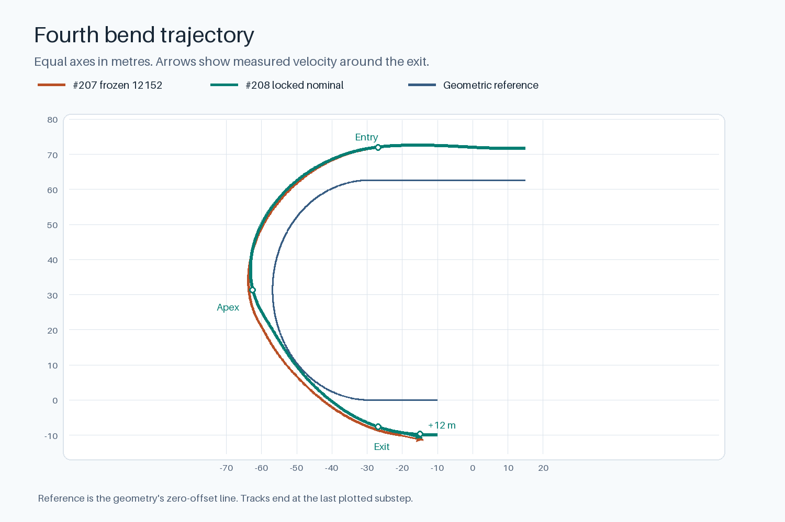
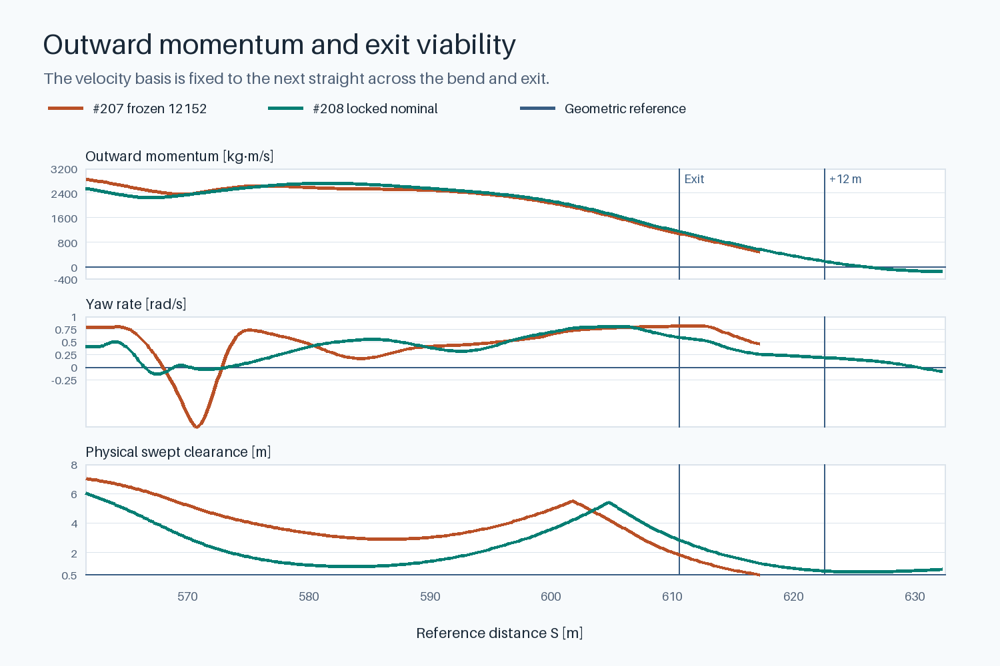

# Study #208 — H29-V fourth-corner exit viability

H29-V plans an entire bend and its following stabilization as one maneuver. It uses the predictor, H28-F contact solver, physical steering and pending queue, and strict observer from the exact #207 parent commit `11e4858dc146098c74a7b90e639bf56a599ced1e`. H25 remains the default. [#207 experiment](../speedway-h29-r/REPORT.md) · [H28-F physics and validation](../speedway-h28-f/REPORT.md)

## Reproducing the frozen fourth-exit failure

A time-zero replay independently reconstructed policy **12152** on all five exact starts. The repository calls the −12 and +12 cm fixtures `C-alt` and `C-alt-plus`. The phase under study runs from fourth entry at S = 513.168 m, through the apex at 561.863 m, to the exit at 610.557 m and the straight core at 622.557 m. The audit begins at S = 428.168 m, before the preceding bend’s exit and more than one full straight before the fourth entry.

The five prior results all fail swept at 617.197–617.498 m, with first rejected swept values 0.4751–0.4985 m. Worst last legal S is 616.960 m. On nominal, exit clearance was 1.957 m at S = 610.626 m and the instantaneous swept certificate was 1.829 m. The bike still traveled outward at 7.311 m/s relative to the **next straight**, with course +17.33°, yaw +0.807 rad/s, and lateral momentum 1,075 kg·m/s. At S = 615.100 m, negative moment had reached −117 N·m and the clearance had already fallen to 0.929 m. At the failed S = 617.229 m, body yaw was down to +0.454 rad/s and course to +7.68°. Swept was 0.493716 m, before the straight core began. The temporal window had no chance to accept that state because the swept predicate failed first. [All five reconstructed traces and their control history](../../../data/experiments/speedway208/fourth-exit-audit.json.gz)

## State-dependent viability

The diagnostic projects each accepted state’s world velocity and resulting force onto the tangent and outward normal of the following straight. That fixed basis includes the effect of the road’s curvature changing during the corner. The trace also stores body heading, direction, sideslip, steering saturation, the crank and wheel, forces, dynamic loads, losses, and the full technique observer checkpoint. It separately records reference distance and the motorcycle’s actual travel distance.

For an outward-moving state, the constant-acceleration estimate is **d = vₒᵤₜ² / (2 aᵢₙ)**. Its interpretation depends on the source of the inward acceleration. A proved upper bound over the relevant path gives a lower bound on stopping distance. This experiment uses observed acceleration and a local illustrative grip envelope. Neither supplies a certificate of the whole future reachable set. The strict H28-F rollouts decide acceptance.

At 12 anchors, 35 paired control perturbations varied throttle and steering for 0.95 s with the actual state, load, wheel and crank, observer, pending queue, and geometric projection. They use the physically admissible H28-F combined-slip contact solution on each step. The audit also solves the local contact state and sweeps the front steering-accommodation bound at the resulting normal load. All of these tests use the 50 ms review grid, scheduled latency and finite ±35° and 90°/s steering. The authority relevant to an exit includes yaw inertia and contact moments, but positive yaw by itself does not identify the sign or magnitude of velocity-normal acceleration.

| Baseline anchor | Outward velocity [m/s] | Swept room above 0.50 m | Largest observed inward acceleration [m/s²] | Estimated stop distance [m] | Strict 0.95 s trials |
|---|---:|---:|---:|---:|---:|
| Apex, 561.993 m | 19.242 | 6.480 | 10.580 | 17.498 | 33/35 |
| Late slide, 579.718 m | 17.603 | 2.850 | 14.182 | 10.924 | 35/35 |
| Exit preparation, 593.635 m | 16.323 | 2.959 | 15.077 | 8.835 | 23/35 |
| Physical exit, 610.626 m | 7.311 | 1.329 | 15.045 | 1.776 | 0/35 |
| Post-exit, 615.100 m | 4.511 | 0.305 | 14.739 | 0.690 | 0/35 |

Before the exit, the next-straight projection can be large simply because the motorcycle is still on a curve. The stop estimate is informative near the outer boundary after the tangent changes. At the physical exit, the next newly requested control cannot take effect for 0.070 s. At the current velocity that alone represents about 0.51 m of transverse travel before allowing for forces already acting. The best accepted probes reduced outward velocity by 4.181 m/s before terminating. None reduced it to zero while remaining legal. By the exit checkpoint, the finite late control family has no legal successor of the required duration. Shape changes much earlier can still alter the velocity and line at that checkpoint. There is no finding of mathematical impossibility. [State-dependent envelopes and every perturbation](../../../data/experiments/speedway208/fourth-exit-audit.json.gz)

## Geometry-relative feedback and controlled predecessors

A maneuver has joint parameters for the approach blend and pace, entry offset and rotation, apex shift and yaw, slide targets, exit offset, flattening distance, course and yaw targets, and the throttle ramp plus straight recovery. Bounded smooth functions of distance from entry, normalized bend progress and distance from exit produce the state-feedback references. The control law sees the measured velocity, yaw, β, offset and current curve. It can reshape the reference or blend in H25’s observed line and course. H25’s power, commands, speed and dynamics are outside the transfer. All state changes result from the original steering and throttle actuators. The online law evaluates one maneuver with an exact 0.25 s continuation guard. All search runs offline.

Each candidate changes multiple phases together. A state can be used as a controlled predecessor of a legal straight checkpoint only when the exact suffix succeeds. E explicitly searches alternative **common** post-exit recovery commands for the three paired training states, starting from each candidate’s recorded exit checkpoint and pending queue. A suffix has no independent prefix status. The archive records the root identity, full exit checkpoint and each attempted successor. A demonstrated successor to exit +28 m certifies that controlled trajectory for the tested start and horizon. Its sampled range does not cover every admissible state. [Controller](../../../tools/speedway-h26/ExitPolicy208.cs) · [Exact rollout search](../../../tools/speedway-h26/Study208.cs)

Ablations used the same frozen contact solver and strict observer. B started at the frozen exit and only changed post-exit commands. C varied full-corner steering and line with the inherited speed feedback channel. D also changed pace and throttle. E added tested continuation quality and alternate common recovery commands. Before evaluation all horizons, modes and CPU/step/wall caps were set in the experiment source. The separate paired interventions keep the C, D, or E steering recipe fixed while toggling its pace channel or changing only the preparation length. The X runs apply the same geometry-relative mechanism to the fifth and sixth bends, preserving independent C, D and E histories and replaying every upstream prefix from the original start.

| Fourth-corner arm | Distinct proposals | Per-start calls | Integration steps | CPU [s] | Best result on the three development starts |
|---|---:|---:|---:|---:|---|
| A, frozen reference | 1 | 5 | — | — | Fourth stabilization 0/5 on the official replay. Worst first rejection at 617.197 m. |
| B, late commands | 100 | 300 | 8,011 | 1.00 | Fourth stabilization 0/3. Worst last legal S = 617.172 m. |
| C, full-corner steering and line | 384 | 1,152 | 623,555 | 82.33 | 3/3 to +28 m. Worst future swept 0.654 m. |
| D, full-corner joint pace | 384 | 1,152 | 657,919 | 62.89 | 3/3 to +28 m. Worst future swept 1.056 m. |
| E, exact continuation-aware selection | 832 | 5,517 | 1,945,277 | 146.13 | 3/3 to +28 m. Worst future swept 1.408 m. |

The C result entered at 23.52 m/s and could exit with 7.76–7.80 m/s outward velocity and yaw +0.585–0.589 rad/s. Its larger available clearance and faster alignment carried it through stabilization even though the exit velocity was outward. The D result exited at 2.929–2.939 m/s outward and +0.264 rad/s yaw. E reduced outward velocity to 1.859 m/s, yaw to +0.081–0.082 rad/s and nominal lateral momentum to 273 kg·m/s, with 1.408 m or more swept over the certified continuation. These are demonstrated combinations of clearance, course, yaw and speed. A scalar cap on outward velocity would have missed the C witness.

C and E each retained 3/3 continuation with a 6 m lead before entry in the paired tests. That is about 103 m before the fourth physical exit, versus B at the exit itself. For the original D recipe the earliest-start question is coupled to the preceding core. It passed with 12–19 m lead, failed after reducing to 6 m, and also failed when moved 24–50 m upstream without retuning. E passed at selected leads between 6 and 28.56 m and at 50 m, while several intermediate lengths changed the preceding straight enough to violate its core. Disabling pace on the same D or E frozen geometry failed on all three development starts. C supplies a steering-only alternative to early speed reduction. D and E show that earlier or stronger slowing can buy additional room when co-designed with the line. [Paired interventions](../../../data/experiments/speedway208/paired-training.json.gz) · [Counts, envelopes and exact success/failure records](../../../data/experiments/speedway208/summary.json)

## Search bounds and final screening

| Search | Per-arm proposal cap | Integration-step cap | CPU s cap | Wall s cap |
|---|---:|---:|---:|---:|
| B | 100 | 620,000 | 120 | 90 |
| C | 1,088 | 3,300,000 | 420 | 260 |
| D | 1,456 | 4,100,000 | 510 | 315 |
| E | 1,872 | 5,400,000 | 650 | 380 |
| X, up to three roots per bend for the next two bends | 832 | 3,300,000 | 450 | 260 |

The caps sum to 9,508 proposals, 33.22 million steps, 4,400 CPU seconds and 2,605 s of summed wall time. Actual search consumed 5,604 unique proposals, **30,819 per-start calls**, **12,341,950 integration steps**, **1,122.59 CPU s** and 240.35 s of summed arm wall time. Several independent arms ran concurrently. E checked 1,007 alternative common fourth-exit suffixes. Of those, 54 reached +28 m on all three training starts. C, D and E each retained nine candidates with seven, seven and six immediate parent identities respectively. All three X5 roots reached the next straight. Their X6 archives contain 156, 136 and 138 candidates that completed on all three training starts. Optional arm F was unnecessary once exact E and X continuations established feasibility. [All proposals and outcomes](../../../data/experiments/speedway208/README.md)

A first X6 score could place incomplete stabilization ahead of a full continuation. The published ranking uses separate feasibility tiers. Before running any official holdout, screening reconsidered the original exact-finish archive, with up to 12 highest-reserve complete candidates from each X6 root. Forty-one distinct finalists ran from time zero. Screening added ±6 and ±16 cm to the original nominal and ±1 cm development starts. Thirty-six finalists passed all seven checks. Worst full-route progress, completion count, legal reserve and time selected **C → X5-C → X6-C/442**. This policy preserves the fourth maneuver’s speed feedback and shapes speed and throttle for bends five and six. The same parameters were frozen before the five-start evaluation. [Selection archive](../../../data/experiments/speedway208/training-selection.json.gz)

## Strict MODEL and Box2D results

The frozen fourth maneuver began its blend 38.38 m before entry. Compared with #207, nominal fourth-entry speed changed by +0.006 m/s and offset by +0.0055 m. Entry yaw fell from +0.619 to +0.577 rad/s. The apex ran 1.05 m farther inside and 1.63 m/s slower through the altered trajectory, using the inherited speed feedback. At exit the nominal static outer clearance increased from 1.957 to 2.961 m and yaw fell from +0.807 to +0.586 rad/s. The bike still moved outward at 7.788 m/s. It reached the core at S = 622.613 m with +1.198 m/s outward, +0.188 rad/s yaw and +2.85° course. The five starts reached the technique observer’s settled state 0.830–0.850 s after the exit.

| Start | MODEL finish [s] | MODEL min swept [m] | Box2D finish [s] | Box2D min swept [m] | Contacts |
|---|---:|---:|---:|---:|---:|
| Nominal | 51.853248 | 0.595854 | 51.878036 | 0.593939 | 0 |
| −2 cm | 51.882078 | 0.594837 | 51.881195 | 0.594381 | 0 |
| +2 cm | 51.865243 | 0.595350 | 51.867334 | 0.595759 | 0 |
| −12 cm | 51.870619 | 0.595286 | 51.870059 | 0.595182 | 0 |
| +12 cm | 51.868291 | 0.596317 | 51.868171 | 0.596090 | 0 |

Every run started at the original grid and completed three laps under the unified strict profile. All native runs passed the independent strict audit of their recorded substeps. The central ledger recorded five reservations in the prescribed order. At matched decision times, nominal had the largest MODEL-to-Box2D body separation of 0.594 m and a 0.025 s difference at the finish. The largest separation on the other four was 0.050 m. Peak native speeds were 96.78–96.89 km/h. The fastest new native result was 51.867334 s, about 5.48 s slower than the established 46.386863 s strict H25 archive on its own physics. [MODEL results](../../../data/experiments/speedway208/official) · [Native recordings and independent audits](../../../data/experiments/speedway208/native) · [World ledger](../../../data/experiments/speedway208/world-ledger.jsonl)

### Runtime performance

| Box2D start | Decisions | p50 [ms] | p95 [ms] | p99 [ms] | Max [ms] | Above 50 ms |
|---|---:|---:|---:|---:|---:|---:|
| Nominal | 1,038 | 1.8663 | 6.1932 | 6.7018 | 7.0493 | 0 |
| −2 cm | 1,038 | 1.8971 | 6.2505 | 6.7178 | 7.1290 | 0 |
| +2 cm | 1,038 | 1.8926 | 6.2180 | 6.8128 | 7.2452 | 0 |
| −12 cm | 1,038 | 1.8923 | 6.1819 | 6.7177 | 7.0693 | 0 |
| +12 cm | 1,038 | 1.8698 | 6.1998 | 6.7261 | 7.0597 | 0 |
| Pooled | **5,190** | **1.8843** | **6.2123** | **6.7406** | **7.2452** | **0** |

The measured decision includes state feedback, the inherited queue and a full 0.25 s strict forecast triggered by Box2D. Per-decision records include solver work and certificate counters. All five native runs used 17.16 CPU seconds. The three separate MODEL timing passes each measured 1,038 decisions, p99 6.70–6.73 ms, a maximum of 7.225 ms, zero decisions above 50 ms and zero guard rejections. [Native decision records](../../../data/experiments/speedway208/native) · [MODEL timing](../../../data/experiments/speedway208/model-timing.json.gz)

## Regression and verdicts

Release builds of the tool and solution passed with warnings treated as errors. All 122 original targeted .NET tests and the seven newly focused tests passed. They cover projection and signed acceleration, stopping estimates and curvature, geometric blend continuity, strict physical continuation near tyre saturation and with front-load loss, pending and checkpoint identity, viability ranking, five-start selection and deadline recording. Every native run also passed the independent strict observer through the finish. The 124 replay-viewer tests and seven CI-policy tests passed locally. Contact parity matched all 72,949 archived comparisons, 16,200 synthetic states and 2,346 deterministic repetitions. The three embedded model policies passed. Fresh Python runs on exact #207 and #208 returned 400 passes, 45 failures and three errors across 448 tests, with the same failure and error identities.

The experiment-branch push triggers no GitHub Actions workflow under the repository’s rules. Local validation is recorded separately. [Validation](../../../data/experiments/speedway208/validation.json) · [Contact parity](../../../data/experiments/speedway208/parity.json)

| Criterion | Verdict | Evidence |
|---|---|---|
| Diagnostic | **PASS** | Outward momentum, loaded contact authority, pending delay and the swept failure measured across the bend. |
| Planner | **PASS** | Exact continuations progress from 0/3 late to 3/3 full-corner. E improves post-exit swept reserve. |
| Fourth-exit functional | **PASS** | One policy reaches strict stabilization. |
| Robust fourth exit | **PASS** | All five exact starts pass that section. |
| Strict S3 | **PASS** | Five full MODEL finishes with the same frozen controls. |
| Native | **PASS** | Five Box2D finishes, zero contacts, min swept 0.593939 m. |
| FAST50 | **PASS** | 5,190 native decisions, zero overruns, p99 6.7406 ms and max 7.2452 ms. |
| Sporting | **FAIL** | The shared native policy remains about 5.48 s slower than the H25 archive. |

**Overall verdict** · Robust strict H28-F S3 feasibility and native FAST50 are established. The sporting target remains unmet.

## Answers

1. **Minimum entry changes demonstrated.** On nominal, steering-only C preserved entry speed and offset within 0.006 m/s and 0.006 m. Entry yaw was 0.041 rad/s lower. The reshaped inside apex left about 1.00 m more static outer clearance at exit. The experiment identifies a working combination and leaves the physical minimum open.
2. **Preparation timing.** The fixed C and E recipes achieved a legal continuation with a 6 m lead before entry in the paired tests, about 103 m before exit. The frozen fourth maneuver began its blend 38.38 m before entry. Corrections started at the exit failed around the same place as the baseline.
3. **Need for speed reduction.** Steering and line solved the fourth exit with the inherited speed reference. D and E bought extra reserve with joint pace changes. The selected full S3 also uses pace changes in bends five and six.
4. **Demonstrated exit states.** The frozen policy passed with +7.772–7.806 m/s outward velocity, +0.581–0.590 rad/s yaw and 2.924–3.002 m static outer clearance. The slower E training policy passed at about +1.859 m/s outward and +0.081–0.082 rad/s yaw with more future swept reserve.
5. **Full S3.** The same geometry-relative method carried the selected policy through the last two bends and completed five MODEL and five native races.
6. **Remaining limitation.** Rejected variants exhausted the sampled controller’s corridor, technique or clearance margin. The successful races demonstrate compatibility of H28-F physics and the strict rules. Controller pace is the remaining limitation of the selected runs.
7. **Study #209.** Start from the frozen robust solution. Restore throttle and speed across bends five and six in bounded increments with reserve measured through each following straight, then recheck the full five-start series. Keep the contact and body models as they are and use the established H25 result to track the sporting gap.
