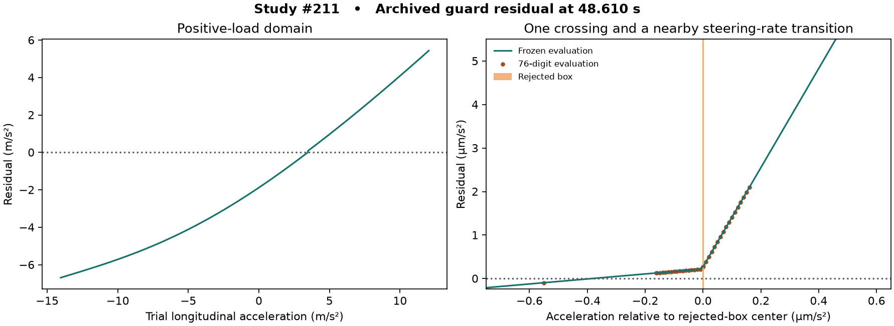
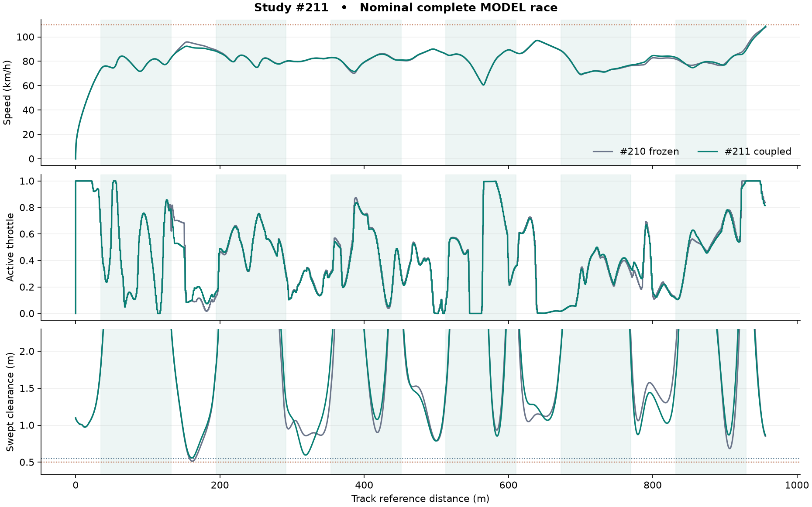

# Study #211 — H30-C: Coupled corner-to-corner planning and high-speed entry

The frozen controller finished all five strict three-lap Box2D races. Best S3 was **48.931163 s**, **0.045407 s recovered** against #210. Minimum native swept was **0.552499 m**. The complete-race peak was **108.747 km/h**. The numerical audit found one isolated physical crossing and excluded the archived unresolved interval with a tighter case-specific enclosure. The original H28-F solver ran the sporting experiment.

Parent `490e3578e7e67c837da88c2788857e49d136991d`. Final frozen controller SHA-256 `72A0D94DF62B90B571FA8AF44E184AF4D89C1C9B64D97A4EFF735C616241D735`. The experiment remains unmerged and H25 remains the default. [Frozen inputs and protocol](../../../data/experiments/speedway211/freeze.json)

## Immutable baselines

Independent archive replays match **4,985 #209** and **4,900 #210** native requests and the same number of corresponding strict observer checkpoints. All ten time-zero MODEL races reproduced. Accepted native records were rechecked against strict technique, physical actuators and swept clearance. #210 had five repaired finishes and one separate historical DNF. These replays constructed zero worlds. [#209 replay](../../../data/experiments/speedway211/reference/209/frozen-reference.json) · [#210 replay](../../../data/experiments/speedway211/reference/frozen-210.json)

## Numerical root investigation

The first #210 nominal request at **48.450 s** was withheld by the native prediction guard. Its MODEL forecast stopped at **48.610 s**, S=**945.508215 m**, with 28.724741 m/s, yaw 0.45206657 rad/s, active drive 0.7062487 and swept 1.739622 m. The affected contact was a forecast, so the native world never committed that trial. Reconstruction starts at the recorded native review and preserves wheel and crank speeds, posture, steering, active control, ordered queue and technique history. [Guard replay, physical constants, queue, loads, brackets and trial samples](../../../data/experiments/speedway211/root/root-audit.json.gz)

The search domain for positive axle loads was approximately **-14.042663 to 12.036569 m/s²**. The continued interval traversal recorded 91 boxes and one monotone sign bracket. It found one unresolved box, [3.4631920415553603, 3.4631920423143079], despite positive endpoint residuals 2.678e-07 and 2.765e-07 m/s². The frozen derivative enclosure spans -8.452 to 20.441 at that box. The two thin positive-load strips outside the solver’s inherited 0.001 m/s² reserve also exclude zero on opposite signs.

The independent 76-digit implementation gives the isolated crossing at **3.463191656428 m/s²** with local derivative **0.575476**. Its local enclosure anchors wheel and clutch at the midpoint, uses the passive contact sensitivity bound and propagates the steering, tyre and load intervals. It bounds the rejected box residual to **[1.904e-07, 3.535e-07] m/s²**, wholly positive. The tighter steering interval stays inside the active rate travel, whereas the original padded enclosure admits both sides of the nearby rate clamp. The physical crossing is transverse. There is no evidence of a discontinuity or a second admissible root on the captured query. Both the H28-C and H28-F certificates reject the original query. The twelve listed signed drive and steering perturbations converge. The new enclosure uses this fixed query’s independently solved anchor and remains a diagnostic. There is no solver subvariant in the race. [Decimal residuals and the local interval witness](../../../data/experiments/speedway211/root/decimal.json)

## Coupled control and bounded comparisons

One link starts at the previous apex. Steering and gas change through exit, straight acceleration, anticipatory release, next turn-in, apex and stabilization. Steering corrections use measured course, yaw and the available track offset. The search changes requests only. The original actuator, contact forces and 50 ms queue determine the actual motion. A verified continuation must traverse the incoming corner and reach the real S3 finish. A training checkpoint is reused only before its first editable link and includes mechanical state, posture, queue and strict history. Screened and official runs restart independently.

| Arm | Rows | Winner | Strict / 7 | Worst s | Swept m | Nominal early peak km/h | Scored steps | CPU s | Wall s |
| --- | --- | --- | --- | --- | --- | --- | --- | --- | --- |
| A | 1 | 1 | 7 | 48.985048 | 0.512258 | 96.992 | 14697 | 8.8 | 9.0 |
| B | 86 | 71 | 7 | 48.931016 | 0.512258 | 97.270 | 304346 | 104.6 | 69.2 |
| C | 86 | 55 | 7 | 48.979467 | 0.512258 | 96.992 | 165837 | 74.4 | 53.2 |
| D1 | 85 | 33 | 7 | 49.040250 | 0.625391 | 97.062 | 380987 | 136.2 | 77.6 |
| D3 | 86 | 1 | 7 | 48.985048 | 0.512258 | 96.992 | 188354 | 43.3 | 25.9 |
| D4 | 86 | 1 | 7 | 48.985048 | 0.512258 | 96.992 | 182428 | 35.4 | 23.8 |
| D6 | 86 | 81 | 7 | 48.982558 | 0.512258 | 96.992 | 101565 | 125.0 | 77.0 |
| E | 85 | 14 | 7 | 49.037977 | 0.625391 | 97.062 | 892055 | 228.6 | 137.9 |
| E2 | 85 | 68 | 7 | 48.877661 | 0.512258 | 97.170 | 1014054 | 278.5 | 132.5 |
| R | 85 | 74 | 7 | 48.949736 | 0.556227 | 97.150 | 1116861 | 261.6 | 126.2 |

A freezes #210. B and C target the two priority links. D1, D3, D4 and D6 address the remaining links. E combines separately screened components and replays their whole races. E2 was authorized by the measured joint improvement and explores smaller paired adjustments. R targets clearance after the first selection showed a time-reserve tradeoff. Each focused stage had at most 84 new proposals, four workers, a 12-trial batch, and search limits of 3 million outer steps, 420 CPU s and 540 wall s. The archived rows include the baseline and any prefix identity control. End-of-batch checks allow one bounded batch of overshoot. [Trials, exact prefixes and first rejection outcomes](../../../data/experiments/speedway211/search)

| Engineering target m | Strict candidates | Fastest trial | Worst s | Min swept m | Min time >105 km/h (s) |
| --- | --- | --- | --- | --- | --- |
| 0.50 | 52 | 31 | 48.877661 | 0.512258 | 0.210 |
| 0.52 | 24 | 64 | 48.916663 | 0.521348 | 0.200 |
| 0.55 | 13 | 36 | 48.949736 | 0.556227 | 0.200 |
| 0.59 | 4 | 27 | 49.037977 | 0.625391 | 0.290 |

Selection trial **36** passed seven time-zero development runs with worst 48.949736 s and 0.556227 m. The selection compares clearance and worst time independently of the 0.50 m strict rule. The full Pareto set also retains sustained-speed differences. Online execution uses the chosen feedback and bounded native-style guard. Terminal-state witnesses record observed envelopes, including wheel, crank, steering authority, pending commands and observer history. Combining extrema from different witnesses does not make a certified terminal state. [Pareto and guard trials](../../../data/experiments/speedway211/search/final-selection/selection.json.gz) · [Observed terminal-state envelopes](../../../data/experiments/speedway211/terminal-envelopes.json)

## Six transitions and high-speed entry evidence

| Outgoing bend | #210 km/h | #211 km/h | Corner gain s | Following straight gain s | Baseline straight req / active | Baseline peak rear use | Baseline front min N |
| --- | --- | --- | --- | --- | --- | --- | --- |
| 1 | 73.69 / 74.00 / 82.87 / 95.54 / 89.24 | 73.69 / 74.00 / 82.80 / 92.20 / 88.28 | -0.000 | -0.056 | 0.27 / 0.28 | 0.677 | 383 |
| 2 | 89.24 / 79.65 / 79.79 / 79.78 / 83.16 | 88.28 / 79.54 / 80.07 / 79.90 / 82.95 | 0.016 | -0.001 | 0.23 / 0.23 | 0.658 | 581 |
| 3 | 83.16 / 79.95 / 80.66 / 83.65 / 85.91 | 82.95 / 80.30 / 81.05 / 83.95 / 85.99 | 0.037 | 0.007 | 0.27 / 0.28 | 0.834 | 500 |
| 4 | 85.91 / 63.14 / 87.05 / 92.58 / 88.75 | 85.99 / 63.00 / 87.02 / 92.85 / 88.85 | 0.007 | 0.005 | 0.28 / 0.28 | 0.912 | 409 |
| 5 | 88.75 / 72.20 / 76.42 / 77.84 / 81.80 | 88.85 / 72.02 / 76.92 / 79.89 / 83.18 | 0.004 | 0.052 | 0.27 / 0.27 | 0.683 | 441 |
| 6 | 81.80 / 78.28 / 91.54 / 105.14 / 107.82 | 83.18 / 79.48 / 89.13 / 104.23 / 108.55 | -0.021 | -0.012 | 0.97 / 0.98 | 0.856 | 279 |

Speeds correspond to entry, geometric apex, exit, exit+20 m and the next entry or finish. The exact five-metre audit includes request, activation, step steering headroom, outward velocity, heading, velocity course, yaw, tyre forces, front load, wheelspin, work and losses. Bend 2 and bend 5 still carry narrow direction or position margins in the following core. Higher gas moves the entrance state as well as the speed. The inherited #207 drive bias is prominent on straight 2; #208’s pace cap dominates much of straight 5. Their removal needs an admissible next-bend state. The actuator path uses the original coast, scrub, drag and drivetrain. It has no active brake command. [Five-metre full-state audit](../../../data/experiments/speedway211/reference/transition-5m.json)

| Transition | Proposals | Fastest entry km/h | Highest entry with stabilization km/h | Highest full-race entry km/h | 95 / 100 / 105 / 110 / 115 / 120 bins (entered/stabilized/full) |
| --- | --- | --- | --- | --- | --- |
| 1 | 54 | 109.56 | 89.65 | 89.65 | 1/0/0 · 1/0/0 · 1/0/0 · 2/0/0 · 0/0/0 · 0/0/0 |
| 2 | 54 | 124.53 | 83.91 | 83.91 | 2/0/0 · 3/0/0 · 1/0/0 · 2/0/0 · 2/0/0 · 1/0/0 |
| 3 | 54 | 124.27 | 86.86 | 86.86 | 2/0/0 · 3/0/0 · 2/0/0 · 2/0/0 · 3/0/0 · 1/0/0 |
| 4 | 54 | — | — | — | 0/0/0 · 0/0/0 · 0/0/0 · 0/0/0 · 0/0/0 · 0/0/0 |
| 5 | 54 | — | — | — | 0/0/0 · 0/0/0 · 0/0/0 · 0/0/0 · 0/0/0 · 0/0/0 |

Each bin is ±2.5 km/h around the stated center. States come from 54 bounded joint proposals per transition using the full original contact integration. The bin counts distinguish reaching entry, clearing the next bend plus 12 metres, and finishing the entire race. Changing release distance, entry steering and turn-in together can move the best valid state even when the higher-speed sample fails later. [Entry checkpoints, first failures and bounded release interventions](../../../data/experiments/speedway211/entry/entry-search.json.gz)

The 124.53 and 124.27 km/h entries after straights 2 and 3 lost swept clearance in the incoming bend. All 54 exploratory variants after straight 4 and all 54 after straight 5 stopped at the direction gate before entry. The selected policy's regular entries for those links were 88.85 and 83.18 km/h. No surveyed trajectory entering above 100 km/h completed the following bend. The selected link’s drive transition is centered 30.68 m before bend 3 and 32.64 m before bend 6. Its steering preparation begins about 55 m before each of those entries, after earlier steering changes in the outgoing bend. Those distances describe the converged policy on these straights.

| Same delayed single request | Probes | 0.25 s accepted | 1.2 s accepted | Through next bend | Full finish |
| --- | --- | --- | --- | --- | --- |
| Selected policy | 40 | 40 | 39 | 37 | 33 |

F compares the short and terminal-aware decisions from identical checkpoints with the original delayed command. The longer check was applied offline across the whole next bend, followed by a full-race test. A short local pass cannot replace either. The final policy keeps online computation bounded by compiling its selected link into feedback. A rejected online guard stops actuation.

## Admission, native results and FAST50

Established starts are regression fixtures. The four fresh offsets (±3.5 and ±14.5 cm) and two request disturbances were declared before development. All registered and fresh runs recompute the native-style guard at their actual MODEL reviews. The failed #210 native review and its eight neighbours are independent stress inputs to the admission check. [Candidate hash, guard receipts and holdouts](../../../data/experiments/speedway211/official/admission.json)

| Fresh or disturbed start | Outcome | Time s | Swept m | Peak km/h |
| --- | --- | --- | --- | --- |
| fresh-minus-3.5 | goal | 48.943604 | 0.552622 | 108.744 |
| fresh-plus-3.5 | goal | 48.942634 | 0.562769 | 108.962 |
| fresh-minus-14.5 | goal | 48.954417 | 0.556662 | 108.727 |
| fresh-plus-14.5 | goal | 48.949539 | 0.564270 | 108.629 |
| stress-launch | goal | 48.936994 | 0.553853 | 109.026 |
| stress-running | goal | 48.953501 | 0.564270 | 108.729 |

| Start | #210 native s | #211 MODEL s | #211 native s | Paired gain s | Swept m | Contacts | Result |
| --- | --- | --- | --- | --- | --- | --- | --- |
| Nominal | 48.980637 | 48.942880 | 48.943059 | 0.037577 | 0.556936 | 0 | completed |
| −2 cm | 48.981634 | 48.943310 | 48.943698 | 0.037936 | 0.553844 | 0 | completed |
| +2 cm | 48.980598 | 48.942323 | 48.942701 | 0.037897 | 0.559801 | 0 | completed |
| −12 cm | 48.976570 | 48.935844 | 48.931163 | 0.045407 | 0.552499 | 0 | completed |
| +12 cm | 48.984204 | 48.948642 | 48.949633 | 0.034571 | 0.563520 | 0 | completed |

| Start | Decisions | p50 ms | p95 ms | p99 ms | Max ms | >50 ms | Controller CPU s | Native and observation CPU s | Max MODEL XY m | Native−MODEL s |
| --- | --- | --- | --- | --- | --- | --- | --- | --- | --- | --- |
| Nominal | 979 | 2.2120 | 6.7407 | 10.3900 | 24.0186 | 0 | 2.953 | 0.953 | 0.0271 | 0.000179 |
| −2 cm | 979 | 2.2107 | 6.9882 | 10.1160 | 23.8316 | 0 | 2.982 | 0.752 | 0.0282 | 0.000388 |
| +2 cm | 979 | 2.1828 | 6.8910 | 9.9686 | 24.0299 | 0 | 2.947 | 0.803 | 0.0310 | 0.000378 |
| −12 cm | 979 | 2.1859 | 6.7918 | 10.0740 | 23.0110 | 0 | 2.934 | 0.769 | 0.1599 | -0.004681 |
| +12 cm | 979 | 2.2296 | 6.8331 | 9.6434 | 24.3787 | 0 | 2.948 | 0.724 | 0.0369 | 0.000992 |
| Pooled | 4895 | 2.1981 | 6.8509 | 10.3900 | 24.3787 | 0 | 14.764 | 4.001 | — | — |

The ledger records **5/8** construction reservations. The native series uses 18.766 process CPU seconds. Each recorded world replay was checked separately by the strict observer. [Immutable world ledger](../../../data/experiments/speedway211/world-ledger.jsonl)

| Start | Peak km/h | >100 | >105 | >110 | >115 | >120 |
| --- | --- | --- | --- | --- | --- | --- |
| Nominal | 108.640 | 0.500 s / 14.48 m (straight 6) | 0.197 s / 5.84 m (straight 6) | — | — | — |
| −2 cm | 108.637 | 0.499 s / 14.45 m (straight 6) | 0.196 s / 5.82 m (straight 6) | — | — | — |
| +2 cm | 108.596 | 0.502 s / 14.52 m (straight 6) | 0.196 s / 5.81 m (straight 6) | — | — | — |
| −12 cm | 108.747 | 0.513 s / 14.87 m (straight 6) | 0.209 s / 6.20 m (straight 6) | — | — | — |
| +12 cm | 108.679 | 0.495 s / 14.32 m (straight 6) | 0.196 s / 5.81 m (straight 6) | — | — | — |

Intervals use interpolation at accepted speed crossings and clip at the actual finish. Physical distance follows the travelled path. [Full splits, utilization, peak, sustained intervals and trajectory differences](../../../data/experiments/speedway211/race-metrics.json)

Compared with #210, the peak increased from 107.867 to 108.747 km/h while the native duration above 100 km/h fell from 0.599–0.608 s to 0.495–0.513 s. The above-105 interval shrank too. The faster race gains in several bends and especially on straight 5 while spending less reserve on straight 1. The only strict-race intervals above 100 km/h remain on the final straight. Sub-48 s and a complete race with an earlier 110 km/h witness remain open.

## Regression and publication

Release solution and H26 builds treated warnings as errors. The focused suites passed 56/56. Full core parent/current passes were 2062/2283 and 2065/2286. The comparison records 219 world-budget exclusions and exact inherited or added failure identities. Python parent/current reported 404/39/5 and 404/39/5 passes/failures/errors. Viewer passed 237/237 and CI policy passed 7/7. All 72,949 archived contact comparisons, 16,200 synthetic state checks and 2,346 deterministic rechecks matched. The frozen source and historical evidence seal covers 576 files. [Local logs and source integrity](../../../data/experiments/speedway211/validation)

GitHub returned **0 workflow runs, 0 check runs and 0 status contexts** for implementation commit `992a611389e3f689a1a5385f61bbda5f822b6fb7`. Its combined status is `pending`. The repository push workflow targets main. The validation results above were measured locally. [Dated GitHub API snapshot](../../../data/experiments/speedway211/validation/hosted-ci.json).

## Answers

1. **Contact root.** Insufficient enclosure certification on the archived guard query. The local independent enclosure excludes the extra box and the original scan isolates one physical crossing. Keep the frozen general solver.
2. **Acceleration.** Baseline clamps reduce requests, but full gas with the same line can overrun the next swept, yaw or course envelope. The audit separates actuator travel and contact forces from the controller cap.
3. **Preparation.** Plan it from the preceding apex. Tested release leads and steering outcomes are recorded per transition. They are finite witnesses, and permit no universal latest safe release distance.
4. **High-speed entry.** The highest sampled entry that also completed the entire strict MODEL race was 89.65 km/h. The entry table shows the faster failed or partial continuations.
5. **Race speed.** The complete native peak was 108.747 km/h. The sustained-interval table identifies every earlier or final straight above each requested threshold.
6. **Time.** The best native comparison is 48.931163 s versus 48.976570 s. The signed best-to-best gain is 0.045407 s.
7. **Reserve.** The chosen measured minimum is 0.552499 m. The Pareto table gives the 0.52, 0.55 and 0.59 m tradeoff.
8. **Bottleneck.** Controller preparation and the resulting yaw, course and swept state limit repeatable faster entries. Numerical certification is a separate demonstrated guard failure mechanism. The measured results do not require new engine or tyre physics.
