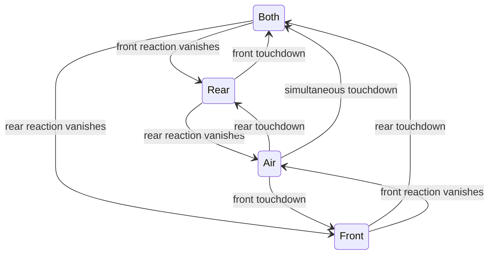

# Study #213 — H32-P dynamic pitch and unilateral wheel contact

H32-P resolves powered front-wheel lift and inelastic touchdown from reachable states. In the rearward start probe the front lifts at 0.260 s, drive is reduced at 0.390 s, then both wheels recover support at 0.6533 s. Both archived #212 no-root queries admit short front-lift continuations. The matched longer rearward trajectories exhaust their clearance reserve. H32-P remains a research MODEL with zero native worlds.

## Mechanical definition

H32-P is an opt-in reduced MODEL. It resolves vertical displacement, pitch and two wheel contacts on a level plane. The planar state resolves translation and yaw. Roll is constrained and the front wheel is a massless steered contact, consistent with the inherited front tyre approximation. The rear wheel and crank have independent spin inertia. Airborne wheels retain their steering or rotational state.

Use positive pitch for nose-up and positive relative crank and wheel speed for forward rotation. From the combined center of mass, the upright axle centers are `(a_f,R_f−h)` and `(−a_r,R_r−h)`. Rotation through pitch θ yields horizontal lever `x_i` and relative height `y_i`. A flat ground plane gives `g_i=z+y_i−R_i`, `u_i=ż+x_i θ̇` and `g̈_i=z̈+x_i θ̈−y_i θ̇²`. The longitudinal tyre force acts at the bottom of the wheel. Its lever about the center of mass is `R_i−y_i`, which equals `z` at a supported contact. Drag acts through the center of mass. Gravity acts vertically through the center of mass.

For rotor relative speeds `ω_c,ω_r`, absolute forward speeds are `ω_c−θ̇,ω_r−θ̇`. The rotor equations are

```text
I_c (ω̇_c−θ̈) = T_engine,net − T_clutch
I_r (ω̇_r−θ̈) = T_transmission − T_bearing − R_r F_x,rear
m z̈ = N_f + N_r − mg
I_pitch θ̈ = Σ [x_i N_i + (R_i−y_i) F_x,i]
             + I_c (ω̇_c−θ̈) + I_r (ω̇_r−θ̈)
m V̇_xy = F_xy,f + F_xy,r + drag
I_yaw ψ̈ = Σ x_i F_y,i
```

The pitch equation is the balance of whole-system angular momentum `I_pitch θ̇ − Σ I_j(ω_j−θ̇)`. No algebraic longitudinal load-transfer formula is also applied. Pitch inertia excludes the rotor self inertias. Axle-center translation remains part of the supported structure's mass and inertia. The traction slip uses the absolute rear rim speed and the rotating axle’s ground-relative longitudinal velocity.

## Contact and impact

At a supported wheel `g_i≥0, N_i≥0, g_i N_i=0`. For zero gap and normal velocity, solve `0≤N ⟂ (b+A N)≥0`, with `A_ij=1/m+x_ix_j/I_pitch` and `b_i=−g+x_i τ_free/I_pitch−y_i θ̇²`. Here `τ_free` contains longitudinal contact and rotor moments. Each active set supplies a candidate reaction. It is accepted only if both the active equality and inactive inequality hold. The outer force iteration couples those reactions back to the tyre forces and drivetrain. Crank and rear spin use the inherited midpoint drive equations with a pitch-acceleration term in the relative-speed midpoint, keeping the powertrain map and clutch law intact.



When a flight segment closes a gap, split it at the first event. An impulse `J_i≥0` at each eligible contact changes vertical and pitch velocities by `ΣJ_i/m` and `Σx_iJ_i/I_pitch`. The perfectly inelastic normal condition is `0≤J ⟂ (u^-+AJ)≥0`. Rotor absolute speeds, horizontal momentum and yaw are continuous at this frictionless instantaneous impact. Post-impact relative rotor speeds therefore change by the pitch-rate jump. Lost kinetic energy is `−J·(u^-+u^+)/2≥0`. No tangential landing impulse, restitution calibration or suspension compliance is assumed.

Continuous normal work is `ΣN_i u_i=0`. Engine, pump, mechanical, clutch, transmission and bearing work use relative midpoint speeds. Tyre work uses the contact point’s velocity including the rim and chassis pitch. With a stationary track, tyre slip removes mechanical energy. The ledger tracks translational and rotational kinetic energy, gravitational potential, work and residuals through free motion and impacts.

## Parameter provenance

The 147 kg nominal combined mass, yaw inertia, upright axle distances, rear wheel radius, engine curve, clutch, wheel/crank inertia, steering bounds, baseline effective grip and tyre coefficients come from the frozen H28-F fixtures. The representative rider's mass is read from the exact fixture. Bike mass is the difference. Upright `h=.55 m`, bike-only COM height `.45 m`, rider shifts up to `±.18 m` and lowered travel `.14 m` inherit provisional #212 hypotheses. Equal front and rear rolling radii and separate sagittal radii of gyration of `.50 m` for the bike and `.32 m` for the rider are explicit estimates for the reduced demonstrator. Component inertias are combined with the parallel-axis rule. They are uncalibrated and held fixed over each trajectory.

With both wheels resting, `N_f=mg a_r/(a_f+a_r)`. A steady longitudinal ground force with settled rotor speeds gives `N_f=(mg a_r−h ΣF_x)/(a_f+a_r)` from the dynamic equations with zero pitch acceleration. This yields a lift threshold `ΣF_x/m = g a_r/h` under those analytical conditions. Transient rotor reaction and yaw/tyre coupling can change the instantaneous threshold. The threshold refers to ground force and therefore separates a drag force through the center of mass from a tyre force of the same magnitude.

## Execution and frozen evidence

Study #212 was published at `3c6e445c9e07e84ca2e96716ca711c0482c15627` before this branch was created. H32-P is invoked by the research entry point. The default H25, H28-F solver and strict technique observer retain their original paths.

| Mechanism | Frozen implementation |
| --- | --- |
| Loads and transfer | `HandlingContact.Prepare` initializes the support domain. `ContactQuery64` solves the acceleration and tyre residual with positive two-wheel support. |
| Rider mass and COM | Fixture C contains a 70 kg rider in a 147 kg combined body. H27 links crouch to Drive. The optional #212 command shifts the axle arms about the combined planar COM and supplies a separate crouch request. |
| Wheelbase and inertias | `TwoContactBikeParameters` supplies .70 m front and .60 m rear neutral arms. `RearWheelParameters` and `LaunchParameters144` give .90 and .01 kg·m² spin inertias. Planar yaw inertia is 52.72097 kg·m². |
| Steering and tyre forces | `HandlingContact64` inverts the yaw request and rate-limits steering. `RearWheelDynamics` couples rear longitudinal and lateral slip under one force budget. |
| H28-F certification | `ContactLoadSolver64` distinguishes no root, ambiguity and numerical boundary mismatch inside the two-positive-load domain. |
| MODEL integration | `Predictor198` updates planar rider, clock, wheel and shaft using original clearance and technique gates. |
| Native integration | `HandlingRig` prepares the same planar law. `ContactAdapter` applies the forces once at their horizontal contact locations and advances Box2D. |

The frozen #211 nominal MODEL finish, minimum swept reserve, last reference and step count reproduced exactly with H32-P disabled. [Disabled parity](../../../data/experiments/speedway213/disabled.json)

H32-P reduces each supported segment to its contact manifold and integrates the remaining pitch coordinate with RK4. The planar, drivetrain and contact forces are coupled at each accepted interval. A damped fixed-point pass can switch to a safeguarded Newton correction. A convergence failure can shorten the interval and retry at the same residual tolerance. At touchdown the integrator splits at the geometric event. Supported positions use the reduced geometric coordinates and the impulse changes velocities only. The nominal contact-gap tolerance is 2 nm. This is an offline accepted-trajectory check, with no global enclosure of competing force roots.

## Reachable starts and landing

Launch scenarios begin at the frozen stationary gate state with its original crank speed and wheel state. One arm requests 45% drive and a separate mechanical stress arm requests full drive. The landing arm requests 20% drive after 0.13 s accumulated front-wheel flight.

| Fixed rider shape | Static front load | Steady lift threshold | Full-drive minimum front load | Full-drive front flight |
| --- | ---: | ---: | ---: | ---: |
| Neutral | 665.6 N | 10.70 m/s² | 0.0 N | 0.454 s |
| Forward | 760.7 N | 12.23 m/s² | 35.9 N | 0.000 s |
| Rearward | 570.5 N | 9.17 m/s² | 0.0 N | 0.930 s to the pitch-domain limit |
| Lowered | 665.6 N | 12.18 m/s² | 26.8 N | 0.000 s |

Neutral full drive lifts at 0.300 s and lands at 0.754 s. The rearward landing arm reaches 3.514° peak pitch. Landing applies 56.33 N·s to the front and 24.96 N·s to the rear and dissipates 39.38 J. Both gaps and vertical/pitch velocities return to numerical zero. At 45% Drive, neutral and rearward lift briefly for 0.018 s and 0.167 s. The unmodulated rearward full-drive launch reaches the 60° validity boundary. The demonstrator does not resolve chassis strikes, roll or suspension beyond that boundary.

Analytical tests exercise front-only support under an imposed nose-down moment, synthetic free flight and a two-contact inelastic impact. The ordinary powered trials used two-wheel and rear-only support. The synthetic flight verifies steering motion with exactly zero front tyre force or steerable yaw authority. The rear wheel can change speed in flight while aerodynamic drag still slows the planar body.

## Reconstruction of low-load rejections

| Frozen query | H28-F diagnosis | H32-P from the same recorded planar, wheel and crank state |
| --- | --- | --- |
| #212 bend 3 at 20.810 s | Certified no positive two-contact root. Sampled residual range −8.997 to −0.03971 m/s². | Brief front-wheel lift for 0.079 s, recontact at 20.8994 s and 0.25 s local continuation. |
| #212 bend 5 at 36.100 s | Certified no positive two-contact root. Sampled residual range −9.151 to −0.18607 m/s². | Brief front-wheel lift for 0.106 s, recontact at 36.2107 s and 0.25 s local continuation. |
| #211 terminal certificate at 48.610 s | Insufficient numerical enclosure. The #211 independent audit finds a unique positive-load root. | No lift. The 0.25 s local probe retains at least 337.0 N front load. |

The #212 classifications use the original interval certifier plus a 4,097-point residual scan per query. The H32-P direct handoffs place the new vertical coordinates on the geometrically supported flat pose for the recorded sagittal configuration. The planar, engine, wheel and steering state comes from the exact reached query. This is a local counterfactual. From earlier shared states, both longer rearward bend trajectories lift and run out of planar swept reserve.

## Matched exit probes

The H28-F reference uses the original strict observer. The H32-P arms replay the recorded active commands at their respective activation times. The new vertical state starts on the supported manifold. The archived steering authority is a nine-point local sample of reachable half-step angles converted to the front tyre's yaw moment at the current load.

| Probe | Configuration | Peak actual acceleration | Minimum front load | Front flight | Minimum swept or planar proxy |
| --- | --- | ---: | ---: | ---: | ---: |
| #211 exit | H28-F | 3.76 m/s² | 437.1 N | 0 | 1.355 m |
| #211 exit | H32 neutral | 3.40 m/s² | 364.0 N | 0 | 0.873 m |
| #211 exit | H32 forward | 3.82 m/s² | 442.4 N | 0 | 1.693 m |
| #211 exit | H32 rearward | 4.63 m/s² | 216.1 N | 0 | 0.485 m, stopped |
| #212 bend 3 | H28-F | 9.95 m/s² | 108.0 N | 0 | 4.944 m |
| #212 bend 3 | H32 neutral | 9.43 m/s² | 61.2 N | 0 | 0.726 m |
| #212 bend 3 | H32 forward | 8.22 m/s² | 216.6 N | 0 | 2.698 m |
| #212 bend 3 | H32 rearward | 9.94 m/s² | 0.0 N | 0.252 s | 0.437 m, stopped |
| #212 bend 5 | H28-F | 10.32 m/s² | 85.4 N | 0 | 5.183 m |
| #212 bend 5 | H32 neutral | 9.17 m/s² | 76.5 N | 0 | 2.946 m |
| #212 bend 5 | H32 forward | 8.02 m/s² | 227.0 N | 0 | 4.659 m |
| #212 bend 5 | H32 rearward | 9.83 m/s² | 0.0 N | 0.169 s | 0.463 m, stopped |

The complete matrix includes the lowered stance. Forward posture preserves front tyre budget while reducing rear support. At the #211 exit the largest sampled front moment band was 17.21 N·m forward and 7.46 N·m neutral. During front flight it is exactly zero. The matched runs show additional limits on usable acceleration, alongside local physical continuations through states H28-F could no longer resolve.

The separately tuned neutral H32 corner-exit sweep tried 60 drive, dwell and steering proposals. Thirty reached the horizon with the required planar reserve. The best reached 624.520 m of track reference at 88.38 km/h, with 0.780 m planar reserve and 354.2 N minimum front load. H28-F reached 624.839 m in the frozen comparison. This is a local envelope measurement, outside an official race result.

The matched neutral #211 exit contains 0.756 s in the bend and 0.594 s on an ordinary straight, with zero WOT in both. The rearward #212 bend-five probe has 1.359 s WOT within 1.449 s of bend before the clearance stop. The terminal certificate probe uses 0.250 s of finishing straight with zero WOT. Launch and terminal evidence is separate from ordinary-straight and repeatable race pace.

## Convergence, assumptions and native interface

The rearward landing benchmark at 10, 5, 2.5 and 1.25 ms reaches touchdown at 0.65413, 0.65331, 0.65705 and 0.65484 s, respectively. Peak pitch lies within 3.514–3.589°. Contact sequences and completion agree. Sampled command activation and unilateral switching give nonmonotone timing error. The supported-coordinate unit test independently checks error reduction under subdivision with a continuous applied moment.

Separate processes produced 39 byte-identical H32-P artifacts. Independent ledger checks covered 31 trajectories and 11,646 accepted steps. The worst gap was −9.11×10⁻¹¹ m. Airborne tyre force and impact-induced absolute rotor-speed errors were exactly zero. Maximum continuous normal work magnitude was 6.08×10⁻¹⁶ J, and the maximum impact energy-identity error was 7.11×10⁻¹⁵ J. The largest per-step planar, vertical and pitch impulse residuals were 3.68×10⁻⁴ N·s, 1.20×10⁻³ N·s and 2.89×10⁻⁴ N·m·s. The maximum total energy remainder was 0.00522 J per step.

The current Box2D adapter owns horizontal state. A native bridge would need to share an immutable substep state and one clock with the vertical/pitch solver, apply each projected tyre force once at its current yaw lever arm, and return the actual horizontal impulses to that solver. Landing boundaries would advance both state owners together. Collision response and projected occupancy would have to follow the contact state. The existing planar adapter cannot make those guarantees on its own. The study therefore uses the coupled reduced MODEL with zero native world constructions. H32-P has no official strict or FAST50 qualification. The original profile and controller qualification remain in effect.

Dynamic rider movement requires a separate moving mass with coupled generalized inertia and an internal actuator work ledger. Roll and camber require a physical roll coordinate and tyre coordinate frame. Left-foot support requires a third unilateral gap, bounded friction and a contact work and impact ledger. No external force from rider movement or footrest pressure appears in this demonstrator.

## Regression and publication

The locked restore used the local package cache with advisories disabled for that command because the NuGet service was unreachable. Release builds treated warnings as errors. All 16 focused tests passed, including seven new sagittal/contact tests. The separately built exact #212 parent passed 2,066 of 2,287 core tests. H32-P passed 2,073 of 2,294. The same 221 cases failed in both runs. They comprise 219 native cases excluded by the Box2D construction guard and two inherited frozen-source assertions. There were zero new failures. The protected H28-F, strict observer and native-adapter source blobs match the parent. [Regression comparison](../../../data/experiments/speedway213/regression.json) · [Construction ledger](../../../data/experiments/speedway213/world-ledger.json)

GitHub confirmed implementation commit `70efbf4505897b342e7fff474f95947ad5b4d0df` and returned zero workflow runs, check runs and status contexts. The combined status at the 2026-11-24 snapshot was `pending`. The push CI workflow targets `main`. The build and test results above are local. [Hosted CI snapshot](../../../data/experiments/speedway213/hosted-ci.json)

## Reproduce and inspect

```powershell
$env:SPEEDWAY_BOX2D_NO_WORLDS='1'
dotnet build tools/speedway-h26/H26.csproj -c Release -m:1
dotnet run --project tools/speedway-h26/H26.csproj -c Release --no-build -- pitch-213 . out213
python tools/speedway-h26/verify213.py out213 out213/trajectory-validation.json
```

[Geometry and thresholds](../../../data/experiments/speedway213/protocol.json) · [All run results](../../../data/experiments/speedway213/mechanical-summary.json) · [Convergence](../../../data/experiments/speedway213/convergence.json) · [Trajectory validation](../../../data/experiments/speedway213/trajectory-validation.json) · [Corner envelope](../../../data/experiments/speedway213/corner-envelope.json)

[Bend 3 reconstruction](../../../data/experiments/speedway213/bend-3-212-reconstructed.json) · [Bend 5 reconstruction](../../../data/experiments/speedway213/bend-5-212-reconstructed.json) · [Terminal numerical comparison](../../../data/experiments/speedway213/terminal-certification-211.json) · [Lift, throttle reduction and landing](../../../data/experiments/speedway213/launch-lift-reduce-rearward-5000.json.gz)
