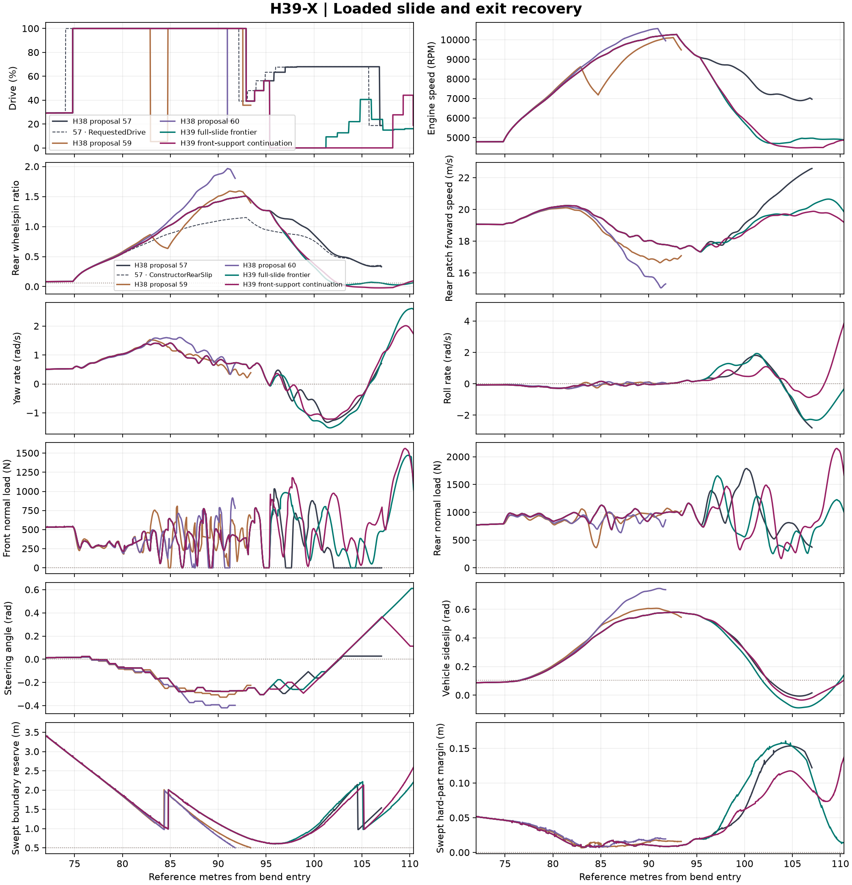
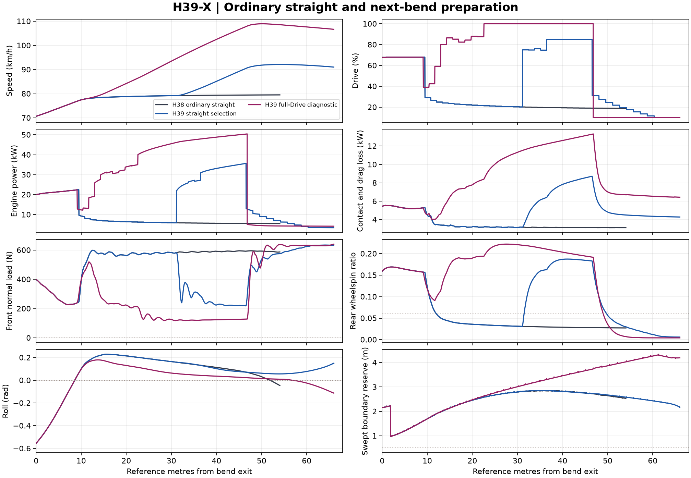

# Study #220 · H39-X · Full-Drive slide and ordinary-straight recovery

Base **422504e34dc09462bf10ea7b204ba5221349878c**. The study uses the stock H38 combined-slip law (effective μ = 1.605625), engine, gearing, rider supports, boot contact, reaction delay and spatial certification. H25 remains the default. The strict sporting qualification and native collision contract are unchanged.

**MODEL mechanical result.** The reproduced witness sustained 1.0725 s of loaded full-Drive sliding. The independently reverified first-stage full-slide continuation reached +16.94 m. The second stage did not qualify the full nominal continuation. **Sporting result.** The 6.095 s complete-bend benchmark stands. The separate exact ordinary-straight intervention reached 91.59 km/h and met both balance gates nominally. **Native result.** No qualification.

## Baselines and proposal 57

The original H36/H37 controller reconstructed the 6.095 s #217 bend and 6.125 s #218 bend, including the latter's continuation to 82.48 km/h. The #219 nominal 6.491 s bend and four published perturbations were replayed through the original later horizon. Their handoffs match the entire serialized mechanical state and pending command prefix. Recourse runs 24, 57, 59 and 60 matched recorded seeds, forks, complete command arrays and summaries.

Proposal 57 entered at 78.68 km/h, reached 65.58 km/h and exited at 72.62 km/h in 6.374 s. Full-Drive overlap ran continuously from 76.71 to 92.90 reference metres for 1.0725 s. It decelerated during 0.403 s of that interval. The rear wheel stayed loaded during the slide. Proposals 59 and 60 stopped under the swept boundary gate at 93.39 and 91.76 m, respectively, before the 97.39 m exit.

At 91.52 m the witness had −0.920 rad roll, +0.576 rad vehicle sideslip, 432 N front load and 1.475 rear wheelspin ratio. Swept reserve narrowed to 0.603 m at 96.01 m. At 101.01 m roll rate had reversed to +1.81 rad/s and yaw rate was −1.23 rad/s. At 106.01 m roll rate reversed again to −2.15 rad/s with zero front load. The last accepted state at 107.03 m (+9.64 m) had −0.738 rad roll, −2.81 rad/s roll rate and zero front load. The old inverse roll controller tried steering endpoints and the held angle and rejected the candidates at the orientation envelope. The unloading and angular reversals were observed mechanical effects. The forecast stop measures local candidate exhaustion.

The matched probes preserved pre-existing commands and used requested recovery Drive goals of 0, 0.50 and 1.00. The controller can reduce the goals using actual contact slip and candidate feasibility. Outcomes refer to up to 0.42 s of continued propagation.

| Matched station (m) | Beginning roll rate (rad/s) | 0 / 0.50 / 1.00 goals, distance advanced (m) |
| --- | ---: | --- |
| 74.00 | -0.062 | 6.00 / 6.14 / 6.26 |
| 83.00 | -0.051 | 6.30 / 6.32 / 6.38 |
| 91.50 | -0.008 | 7.12 / 7.12 / 7.16 |
| 96.00 | 0.334 | 8.37 / 8.39 / 8.46 |
| 101.00 | 1.805 | 6.17* / 4.94* / 4.97* |
| 107.03 | -2.809 | 0.00* / 0.00* / 0.00* |

An asterisk marks candidate exhaustion or a physical/integration gate within the probe. The complete independent replays are the evidence for later recoverability.

## Wheelspin feedback

The old feedback uses horizontal COM speed and absolute rotor rate. The two quantities omit local contact motion and rotation of the frame. H39 uses signed rear contact-frame forward speed \(u_r\) and rotor rate relative to the frame \(\Omega_r-\omega_y\). The H38 longitudinal slip input is \([R(\Omega_r-\omega_y)-u_r]/\sqrt{u_r^2+u_0^2}\). The rear tyre slip angle uses the patch velocity in its own plane. Vehicle sideslip is frame yaw relative to COM velocity direction.

| Window (reference metres) | Old feedback RMS discrepancy | Old peak discrepancy | Contact reconstruction peak discrepancy |
| --- | ---: | ---: | ---: |
| 74.00–92.00 | 0.2066 | 0.3483 | 0.00e+00 |
| 92.00–97.39 | 0.3092 | 0.3621 | 0.00e+00 |
| 97.39–107.03 | 0.1210 | 0.2456 | 0.00e+00 |

The discrepancy reflects pitch-rate contribution to rotor speed, local patch motion and the difference between chassis heading and velocity direction. The largest yaw and roll transients occur after the exit. Their joint effect is measured on the trajectory without assigning causal percentages to correlated motions.

The trajectory archives include full mechanical states and rider internal momentum. The force vectors use world axes. Plotted boundary values use the conservative approximation, while selection also rechecks exact geometry. Active Drive is the command used in the substep. The requested command and FIFO counters describe the accepted endpoint. The contact forces and wheelspin use the integration midpoint.

## Independent recovery and qualification

The 70 exit trials comprise 30 forks of proposal 57 and 40 combinations of onset (55, 64, 74, 83 and 90 m), full and partial Drive, a ramp or a short release, and an early or late recovery switch. Every fork inherits the mechanical state and irrevocable FIFO. Recovery varies steering, exit line and rider position, including fore-aft, lateral and vertical targets. The pending boot command progressively unloads and retracts. The recovery objective scores projected roll, angular velocity, sideslip, velocity direction against track ahead, swept reserve, front loading and actual acceleration. The original inverse roll calculation contributes one steering candidate. The accepted steps still satisfy the stock constraints.

The +20 m gate requires balance at both +8 and +20 m (\(|\phi|\le0.22\) rad and \(|\dot\psi|\le0.28\) rad/s) and speed at +20 m at least 0.5 km/h above exit. The later gate independently measures 2.10 s from +8 m and checks the last 0.25 s for the same angular limits, a gain of at least 1 km/h from +8 m, and non-decreasing speed across that final quarter-second. Next-bend preparation requires propagation 4 m into the subsequent bend, plus front load above 80 N, sideslip under 0.34 rad and roll under 0.72 rad at entry. It establishes physical entry and initial preparation on this line.

Loaded slide requires more than 20 N of rear load and vehicle sideslip of at least 6°. Powered overlap additionally requires longitudinal rear slip of at least 0.06. Drive thresholds refer to active commands. The selected control and fresh perturbations were serialized before evaluating the four holdouts. Compact and large geometries were then replayed with the same tape.

| Replay | Bend (s) | Min / exit / +20 / +40 / +60 / next entry (km/h) | +20 | Later | Next | Full slide / straight (s) |
| --- | ---: | --- | --- | --- | --- | ---: |
| H39 nominal | 6.483 | 65.65 / 72.84 / 80.67 / 96.82 / — / — | FAIL | FAIL | FAIL | 0.0000 / 0.000 |
| Fresh holdout 1 | — | 77.51 / — / — / — / — / — | FAIL | FAIL | FAIL | 0.0000 / 0.000 |
| Fresh holdout 2 | — | 76.89 / — / — / — / — / — | FAIL | FAIL | FAIL | 0.0000 / 0.000 |
| Fresh holdout 3 | — | 77.28 / — / — / — / — / — | FAIL | FAIL | FAIL | 0.0000 / 0.000 |
| Fresh holdout 4 | — | 76.53 / — / — / — / — / — | FAIL | FAIL | FAIL | 0.0000 / 0.000 |

The frozen proposal was **66** with its recovery switch at 95.0 m. Loaded / ≥25% / ≥50% / ≥85% / full slide durations were 2.9175 / 1.9925 / 0.0000 / 0.0000 / 0.0000 s. The longest full overlap was 0.0000 s. The selected replay's cumulative energy defect peaked at 0.00068 J against 158.21 kJ engine work and 102.93 kJ dissipated. Peak rider and boot combined use was 693.2 N and 72.7 W.

Exact compact, nominal and large geometry results follow. Boundary and ground refer to swept reserves.

| Geometry | Boundary / hard part (m) | Last reference m | +20 / later / next |
| --- | ---: | ---: | --- |
| compact | 1.19226 / 0.00720 | 151.49 | FAIL / FAIL / FAIL |
| nominal | 1.13574 / 0.00715 | 151.49 | FAIL / FAIL / FAIL |
| large | 1.07923 / 0.00710 | 151.49 | FAIL / FAIL / FAIL |

0 of 70 satisfied all continuation checks. The frozen first-stage diagnostic maximised accepted progress when the gates failed, so it differs from the dedicated full-slide continuation. That continuation retained 1.0725 s, finished the bend in 6.374 s and advanced 7.30 m farther than #219 proposal 57. Its minimum exact swept boundary and hard-part reserves were 0.60349 and 0.00655 m.

## Front-support continuation

The first-stage forecast and recorded unloading motivated 27 additional continuations at 92.91, 94.50 and 97.20 m. They hold requested Drive at zero through +5, +9 or +13 m, evaluate steering under that same anticipated Drive and rider command, and limit torque reapplication while the front patch is airborne or moving rapidly away from the surface. The roll target unfolds gradually during this intervention. The constraints and original reaction FIFO remain active. 27 completed the bend with the full 1.0725 s overlap, 0 also met all three continuation checks, and 0 in total met all three. The four fresh perturbations hit the swept hard-part gate between 2.37 and 13.62 m in the fixed witness prefix, before they reached the recovery controller. The initial-stage frozen prefix had the same transfer issue. These replays measure the sensitivity of the retained approach tape. The separate adaptive-prefix straight runs below do exercise the final continuation controller.

| Replay | Bend (s) | Min / exit / +20 / +40 / +60 / next entry (km/h) | +20 / later / next | Full slide (s) | Last reference m |
| --- | ---: | --- | --- | ---: | ---: |
| Nominal | 6.373 | 65.58 / 72.58 / — / — / — / — | FAIL / FAIL / FAIL | 1.0725 | 113.56 |
| Fresh holdout 1 | — | 77.47 / — / — / — / — / — | FAIL / FAIL / FAIL | 0.0000 | 2.37 |
| Fresh holdout 2 | — | 76.81 / — / — / — / — / — | FAIL / FAIL / FAIL | 0.0000 | 13.62 |
| Fresh holdout 3 | — | 76.95 / — / — / — / — / — | FAIL / FAIL / FAIL | 0.0000 | 5.03 |
| Fresh holdout 4 | — | 76.34 / — / — / — / — / — | FAIL / FAIL / FAIL | 0.0000 | 12.97 |

| Geometry | Boundary / hard part (m) | Last reference m | +20 / later / next |
| --- | ---: | ---: | --- |
| compact | 0.60657 / 0.00660 | 113.56 | FAIL / FAIL / FAIL |
| nominal | 0.60657 / 0.00655 | 113.56 | FAIL / FAIL / FAIL |
| large | 0.60657 / 0.00650 | 113.56 | FAIL / FAIL / FAIL |

The selected recovery used plan 115 from 94.50 m with zero Drive through +9 m. Its loaded / ≥25% / ≥50% / ≥85% / full slide was 3.5042 / 2.4749 / 1.1079 / 1.0725 / 1.0725 s and fully open Drive on the straight was 0.000 s. The maximum accumulated energy discrepancy was 0.00298 J. Peak muscle force and power were 700.0 N and 350.0 W.

[Continuation evidence](../../../data/experiments/speedway220/settle/qualification.json) · [Complete full-slide frontier tape and replay](../../../data/experiments/speedway220/full-slide-frontier.json.gz)

## Ordinary straight

The original #219 suffix uses an 81 km/h speed reference. Its feedback averaged 19.85% active Drive from +20 m through the recorded +54 m. Average 5,254 RPM and 7.11 N·m net torque showed genuine engine delivery, while the engine's gross 5.79 kW was largely accounted for by engine loss (1.88 kW), transmission loss (0.24 kW) and contact/drag dissipation (3.16 kW). The straight averaged 586 N front load, 0.030 wheelspin ratio, 0.010 rad absolute sideslip, 0.136 rad RMS roll and 0.132 rad/s absolute steering rate. Recorded steering power was below 0.001 W. These values and matched alternatives support controller suppression as the dominant observed restriction. Engine ratio was 8:1 in every comparison.

The 60 straight comparisons at +8, +15, +20, +30 and +40 m use four requested Drive levels and three recovery setups. All operate after a real bend. The prepared next entry is +62 m from the previous exit.

| Replay | Exit / +20 / +40 / +60 / next entry (km/h) | Later speed (km/h) | +20 / later / next | Full Drive on straight (s) |
| --- | --- | ---: | --- | ---: |
| #219 original suffix | 70.67 / 78.82 / 79.39 / — / — | 79.52 | PASS / PASS / FAIL | 0.000 |
| H39 straight selection | 70.67 / 78.82 / 85.16 / 91.81 / 91.59 | 92.06 | PASS / PASS / PASS | 0.000 |
| Faster full-Drive diagnostic | 70.67 / 84.24 / 102.50 / 107.64 / 107.33 | 107.13 | PASS / FAIL / PASS | 0.900 |

The exact faster diagnostic used a matched fork at +8 m and crossed +60 m at 107.64 km/h. It used 0.900 s of full active Drive and entered the next bend at 107.33 km/h. The later gate remains distinct. The fully accepted straight-only run selected among the same-bend forks shows acceleration without hard-coding the speed. A four-metre entry check does not establish completion of the next bend.

28 of the 60 tested straight-only plans met all three checks. In the fastest full-Drive diagnostic, the final-quarter speed fell from approximately 108.28 to 107.13 km/h while roll and yaw stayed within their limits. The controller was already reducing torque for next-bend preparation, so the failure concerns the requested acceleration horizon.

The 3.16 kW contact and drag aggregate resolves into 3016.6 W of air/rolling drag, 19.4 W of front scrub, 18.9 W of lateral rear scrub and 105.0 W from driving rear slip. Front scrub and steering actuator power are separate ledger terms.

Four additional fresh starts used new lane, speed and FIFO offsets. The #219 bend controller responded online from its original fork, then passed the settled state to the frozen H39 straight policy at +30 m.

| Fresh straight holdout | Bend (s) | Exit / +20 / +40 / +60 / next entry (km/h) | +20 / later / next | Swept boundary / hard part (m) |
| --- | ---: | --- | --- | ---: |
| 1 | 6.492 | 70.49 / 78.62 / 84.85 / 91.51 / 91.30 | FAIL / PASS / PASS | 2.0257 / 0.00770 |
| 2 | 6.482 | 70.58 / 78.91 / 84.98 / 91.65 / 91.44 | FAIL / PASS / PASS | 2.0564 / 0.00623 |
| 3 | 6.487 | 70.66 / 78.75 / 84.94 / 91.60 / 91.39 | PASS / PASS / PASS | 2.1152 / 0.00628 |
| 4 | 6.494 | 69.99 / 78.44 / 84.44 / 91.14 / 90.94 | FAIL / PASS / PASS | 1.7372 / 0.00625 |

All four fresh trajectories met the later check and entered the next bend at 90.94–91.44 km/h. One of four also passed +20 m. At +20 m the three failed trajectories had 0.238, 0.232 and 0.291 rad roll, above the 0.22 rad limit. That checkpoint precedes the new straight policy's +30 m switch. [Adaptive-prefix straight holdouts](../../../data/experiments/speedway220/straight-holdouts.json)

## Tyre and rider mechanics

The H38 force law remains the qualification baseline. The matched #219 slice gives about 30% less inward rear lateral force and about 49% less rear yaw-moment magnitude when rear wheelspin moves from 0 to 0.55. The effects reduce mechanical authority under power in this model.

| Isolated sensitivity on the #57 replay | Maximum absolute yaw / body-roll change | Calibration |
| --- | ---: | --- |
| Camber thrust, gains 0.10 and 0.25 of available force per radian | 122 / 83 and 305 / 207 N·m | Motorcycle laboratory tests establish camber load and combined-slip interaction. The gains are assumed and specific speedway tyre data are unavailable. [Rotating-disc measurements](https://www.research.unipd.it/handle/11577/2486330) · [Combined camber measurement](https://research.unipd.it/retrieve/8c3f4fc8-f37d-4551-86af-f31cd08846c1/machines-10-00921-v2.pdf) |
| Twisting moment, 0.020 m effective arm | 18 / 0.3 N·m | Laboratory tests establish tyre moments. The arm and dependence on unused force are assumptions. |
| Independent 55 ms longitudinal and 100 ms lateral response | 405 / 312 N·m | The different time constants are engineering assumptions. The speedway response, relaxation lengths and hysteresis are unknown. |
| Loose-surface direction, up to 15% added lateral component before projection | 179 / 101 N·m | Sand measurements establish dependence on slip and terrain. The perturbation is an assumed direction bracket under the stock force cap. [Loose-surface measurements](https://doi.org/10.1016/j.jterra.2014.08.001) |
| Front rotor gyroscopic reaction, hypothetical inertia 0.50 kg·m² | 69 / 75 N·m | The coupling follows rotating-wheel dynamics. The rig needs a calibrated inertia and coupled rotor, chassis and steering momentum. Isolated chassis work reached 81 W in this screen. [Sharp's motorcycle model](https://doi.org/10.1243/JMES_JOUR_1971_013_051_02) |

The 14,175 shadow evaluations share the original force cap. None showed slip dissipation below −0.1 W in these samples. The screen shows local moment sensitivity. A coupled replacement needs tests for transient storage/dissipation, linear and angular momentum and the rotor/steering energy ledger. Effects on completed maneuver time remain unknown.

Rider support used 54 interventions across three dynamically reached stations and three Drive levels. It included direct posture requests and matched two-stage sequences with initial vertical unloading. Thirty-six completed 0.61 s and eighteen encountered the hard-part gate. At 51 m and 85% Drive, a direct 85 mm forward target increased mean front load from 348 to 389 N. Actual net forward travel was 9.6 mm, and the force actuator spent 0.560 s at the 700 N limit. Seat/peg/grip loads rose from 550/193/12 N to 591/213/33 N. A staged 33 mm vertical unload followed by the same forward target reduced mean seat load to 518 N, gave 9.0 mm forward travel and yielded 356 N front load. Thus support geometry and timing strongly constrain travel, and this unloading sequence gave less front support than the direct command. The active 700 N and 350 W limits were preserved.

## Nine conclusions

1. **Why did 57 stop after the bend?** Front support fell away as the chassis began pitching up while roll rate reversed rapidly. The roll predictor's candidates then crossed its orientation envelope. Attempts 59 and 60 instead hit the boundary reserve before completing the bend.
2. **Can 1.0725 s be preserved with balance recovery?** It survived through a longer exact continuation. The nominal full-witness objective did not satisfy the complete recovery contract.
3. **Does earlier preparation help?** Yes. Moving recourse to 94.5 m preserved the full overlap and added 7.30 m of mechanically accepted travel. Earlier approaches at 83 m could achieve over 75 km/h exit, with shorter or absent full overlap and without successful complete continuation.
4. **Why 78.82 to 79.52 km/h?** The inherited 81 km/h governor requested roughly 20% Drive over the plateau, leaving little mechanical power over losses. Rear slip, yaw and steering effort were low and the front was loaded.
5. **Was the original wheelspin physically correct?** The COM feedback was a biased proxy. Contact-frame reconstruction matched the solver at every archived sample used in the audit. RMS discrepancy of the old proxy reached 0.309 between 92 m and the exit.
6. **Can an ordinary straight run faster?** The nominal straight won both gates at 91.59 km/h into the next bend. The full-Drive diagnostic reached 107.64 km/h at +60 m and failed the later acceleration check. The 110–120 km/h goal remains open.
7. **Which omissions matter?** Independent transient response, camber thrust and loose-surface force direction gave the largest changes in available yaw and roll moments in isolated comparisons. Front-wheel gyro coupling also matters near loading and steering transitions. The sensitivity does not establish which stock-model omission prevents a robust full-Drive line.
8. **What is the fastest robust bend and continuation?** The fastest reproduced balanced bend remains #217 at 6.095 s. The prior #218 combined result remains 6.125 s with an 82.48 km/h straight suffix. The reproduced #219 powered bend remains 6.491 s with all four inherited perturbations reaching the later horizon. The 91.59 km/h H39 straight extension met all gates on the nominal bend and one of four fresh adaptive-prefix holdouts. No H39 full-witness replacement met the complete continuation contract.
9. **What remains near 90 km/h?** Establish a wider joint margin for yaw/roll, front load and swept clearance after powered slip. The higher-speed next-entry probes cover only the first 4 m. A complete next bend, with another recoverable exit and independent perturbations, is still required.

## Validation and reproduction

| Stage | Offline CPU (s) | Wall time (s) | Forecast steps |
| --- | ---: | ---: | ---: |
| Exit search, 70 proposals | 1620.84 | 574.85 | 659,481 |
| Exit search, replay, freeze, and holdouts | 1930.45 | 862.80 | — |
| Straight search, 60 proposals and verification | 1052.22 | 359.93 | 1,113,972 |

One serial online segment at 60 ms cadence used 12.34 CPU s, 12.33 wall s and 47 decisions, with 16,164 forecast steps. Its sum of per-decision elapsed times was 11.39 s. The complete solo-race 40–60 CPU s budget, real-time latency and FAST50 are unqualified.

The 27 front-support continuations used 592.62 CPU s, 125.39 wall s and 259,734 forecast steps for search. That stage spent 923.08 CPU s including exact selection, geometry and holdouts.

The targeted parent/current runs each returned 40 passes and ten identical failures caused by the Box2D construction guard. The verifier compares both test outcomes, checks forces, step size, command ordering and prefixes, re-derives powered durations, checks clearances and accumulated energy discrepancy, and emits SHA-256 evidence digests. No native world was constructed in the MODEL study.

Hosted status is recorded separately for the exact published SHA. The core workflow triggers on main pushes, pull requests and manual dispatch.

~~~powershell
$env:SPEEDWAY_BOX2D_NO_WORLDS = '1'
dotnet build tools/speedway-h26/H26.csproj -c Release -m:1
$dll = 'tools/speedway-h26/bin/Release/net8.0/H26.dll'
dotnet $dll exit-220 . out220 all
New-Item -ItemType Directory out220-tape
Copy-Item out220/straight-experiment.json out220-tape
Copy-Item out220/exit-command-histories.json.gz out220-tape
dotnet $dll exit-220 . out220-tape tape
dotnet $dll exit-220 . out220/settle settle
New-Item -ItemType Directory out220-straight-holds
Copy-Item out220/straight-experiment.json out220-straight-holds
dotnet $dll exit-220 . out220-straight-holds straight-holds
python tools/speedway-h26/plot220.py data/experiments/speedway220 --exit 97.38937497138977
python tools/speedway-h26/verify220.py data/experiments/speedway220
~~~

[Baseline and matched diagnosis](../../../data/experiments/speedway220/baseline-and-diagnosis.json) ·
[70 exit tapes](../../../data/experiments/speedway220/exit-command-histories.json.gz) ·
[60 straight tapes](../../../data/experiments/speedway220/straight-experiment.json.gz) ·
[Rider support](../../../data/experiments/speedway220/rider-support.json.gz) ·
[Tyre sensitivities](../../../data/experiments/speedway220/tyre-shadow.json.gz) ·
[Frozen qualification](../../../data/experiments/speedway220/qualification.json) ·
[Verifier and regression](../../../data/experiments/speedway220/verification.json) ·
[Evidence manifest](../../../data/experiments/speedway220/manifest.json) ·
[Guarded parent tests](../../../data/experiments/speedway220/parent.trx.gz) ·
[Guarded current tests](../../../data/experiments/speedway220/current.trx.gz) ·
[#219 inherited replays](../../../data/experiments/speedway219)
