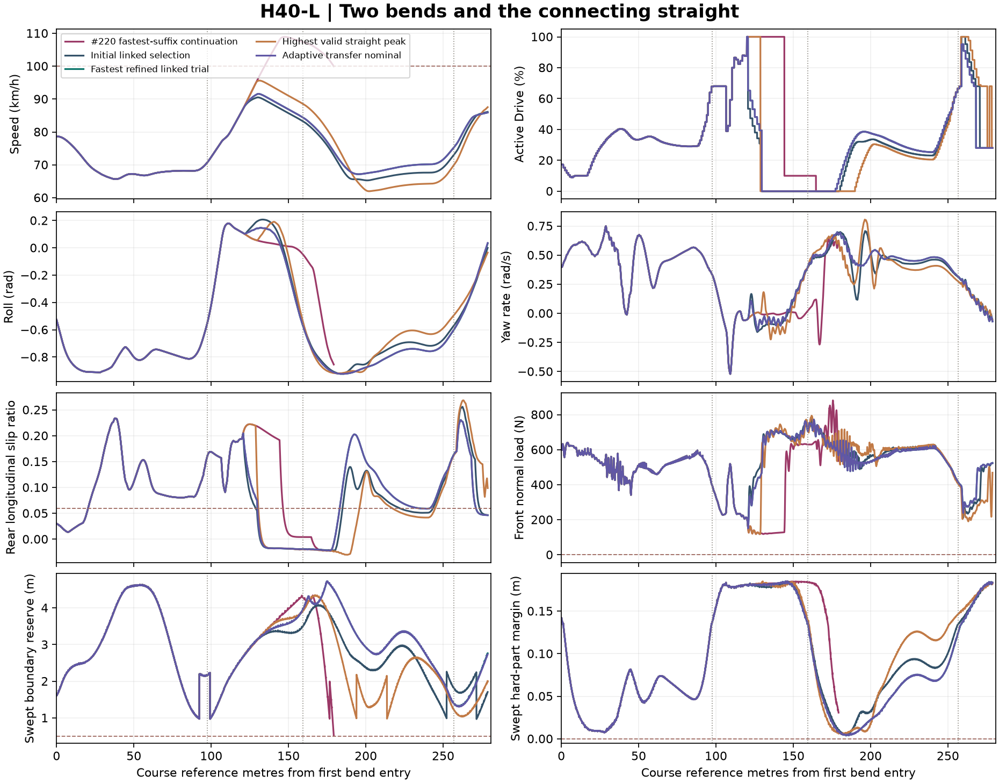
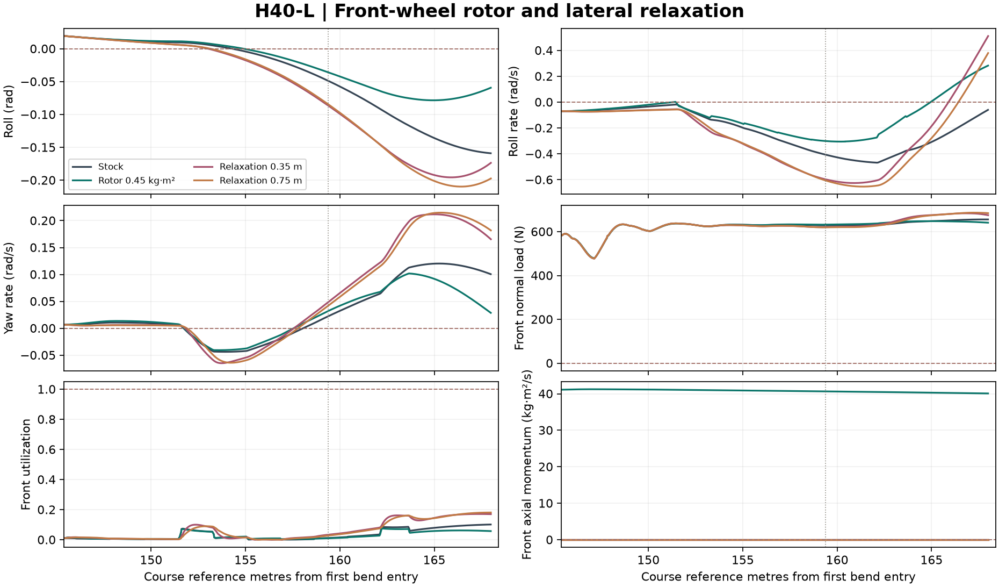

# Study #221 · H40-L · Linked corners and high-speed preparation

Base **48d2e517b4e1a7780fbe1aabbeecf4ab5e8094cc**. This is a research-only spatial MODEL investigation. The stock linked controller uses the H38 effective friction coefficient of 1.605625, stock engine and gearing, the 0.50 m swept boundary requirement, hard-part ground protection, and the same rider, boot and steering constraints. H25 remains the default.

**Linked MODEL milestone passed nominally.** Verified two bends and the connecting straight in 16.359 s from first entry through second exit +22 m. The highest verified straight speed followed by complete second cornering was **95.63 km/h**. The adaptive carrier transfer policy passed nominal plus all four fresh holdouts. The strict sporting and native qualification gates are separate.

## Reproduction and the unchanged gates

The frozen #217 and #218 command histories reproduced the 6.095 s and 6.125 s bends. The latter reproduced its accepted straight suffix to 82.48 km/h. From #220, eight whole-prefix replays covered the inherited 6.491 s #219 bend, its updated straight continuation, the 1.0725 s full-Drive frontier, the 107.64 km/h +60 m diagnostic, and the four adaptive-prefix holdouts. Seven terminal states compared exactly. The fast straight replay differed in position by 2.13×10⁻¹⁴ m. It retained the full end-state fields, pending FIFO, rider and crank/rear-wheel momenta and accepted wheel/boot reaction evidence. [Reference receipts](../../../data/experiments/speedway221/references.json)

The #220 nominal straight entered the next bend at 91.59 km/h. Proposal 12 entered at 107.33 km/h after reaching 107.64 km/h at +60 m. It passed the original +20 m gate. The separate later gate failed because speed during the final quarter-second fell from about 108.28 to 107.13 km/h while roll and yaw met their thresholds. This was already in the next-bend preparation phase. Both original predicates remain recorded verbatim as booleans in the comparison outputs.

The linked MODEL predicate requires uninterrupted first bend, usable-straight acceleration, complete second bend, and recovery through +22 m beyond the second exit. The terminal quarter-second must stay within 0.22 rad roll and 0.28 rad/s yaw rate, with +20 m speed at least 0.5 km/h faster than second exit +8 m. Track and hard-part certification remain active at every step. Preparation between the acceleration zone and second bend permits coasting or measured speed loss. “Repeatable” below requires the adaptive nominal and all four fresh perturbations. Straight distance above thresholds is integrated horizontally on the actual trajectory in the independent verifier.

## Direct continuation from the exact +4 m checkpoint

Starting with both loaded wheels, the 107.33 km/h state reached 19.87 m into bend two before the swept outer clearance rejection under the H40 continuation with the inherited Drive cap. The front normal load at its last accepted state was 594 N, rear 540 N, tyre utilizations 0.686 and 0.821, roll −0.854 rad, yaw rate +0.615 rad/s, rear longitudinal slip −0.024 and velocity-heading error −0.501 rad. An alternative physical preparation policy armed at the same checkpoint reached 19.84 m and also stopped at the boundary, with 753 N front load. The first observed constraint in both cases was swept clearance, with the velocity direction still outside the turn. These two continuations do not establish a universal tyre saturation or recoverability limit.

The 91.59 km/h case entered with the opposite roll sign on its inherited line. It lost both wheel loads during rapid reversal, reached −4.21 rad/s roll rate and exhausted orientation-feasible candidates 10.54 m into the bend. The faster diagnostic and this failure therefore require different interpretations. [Direct trials](../../../data/experiments/speedway221/links/direct.json)

## Joint preparation and two-bend performance

The first 64 matched alternatives compare leads of 10, 20, 30 and 40 m, two lines, two source tapes and four controller strategies. One retains the #220 final-17 m speed-dependent cap of 0.10–0.42 Drive. The alternatives use available front support, simplified recoverable lateral force, actual rear contact slip, roll development, the trajectory's direction, and smoothly changing preview curvature to choose torque release and countersteer. The 64 follow-up trials concentrate on the early coasting mechanism and usable offsets identified from the first training stage. Pace settings are controller references. The simulation integrates speed and lean under contact forces.

| Exact replay | Total through +22 m (s) | First / second bend (s) | Peak / average straight (km/h) | Actual next entry (km/h) | Original +20 / later | Linked |
| --- | ---: | ---: | ---: | ---: | --- | --- |
| Initial selection | 16.671 | 6.491 / 6.531 | 90.53 / 83.75 | 83.21 | PASS / FAIL | PASS |
| Fastest refined | 16.359 | 6.491 / 6.250 | 91.59 / 84.31 | 84.36 | PASS / FAIL | PASS |
| Highest linked peak | 16.845 | 6.491 / 6.761 | 95.63 / 86.30 | 88.50 | PASS / FAIL | PASS |

Four of the initial 64 completed both bends and recovered. All four selected coasting. None of the matched candidates with the inherited final-17 m cap completed. This shows that the retained rule and tested preparation geometry failed jointly, while earlier torque release and interior lines worked. The second stage has 22 linked passes out of 64. Plan 251 starts at 40 m before entry and uses lane offset 5.6 m. The speed-frontier case uses a shorter lead. It reaches a higher peak with higher actual entry speed and spends more time in the linked maneuver.

| Fastest refined trace | Entry / minimum / midpoint / exit (km/h) | Loaded / ≥25 / ≥50 / ≥85 / full slide (s) | Front unloaded (s) |
| --- | --- | ---: | ---: |
| First bend | 78.68 / 65.65 / 67.23 / 70.67 | 2.9175 / 1.9925 / 0.0000 / 0.0000 / 0.0000 | 0.0000 |
| Second bend | 84.36 / 67.14 / 67.99 / 75.22 | 2.3450 / 1.5175 / 0.0000 / 0.0000 / 0.0000 | 0.0000 |

The fastest refined replay reached second exit in 15.393 s. On the ordinary straight it averaged 36.2% active Drive and spent 0.030 s at full Drive. Its minimum exact swept boundary and hard-part reserves were 2.1447 m and 0.00377 m. The engine delivered 200.70 kJ with 164.45 kJ of modelled dissipated work. The accumulated energy residual was bounded by 0.00092 J. The highest-peak linked candidate recorded zero time and distance above each of 100, 110, 115 and 120 km/h.

| Incomplete #220 high-speed continuation | Straight seconds | Actual travelled metres |
| --- | ---: | ---: |
| At or above 100 km/h | 0.843 | 24.95 |
| At or above 110 km/h | 0.000 | 0.00 |
| At or above 115 km/h | 0.000 | 0.00 |
| At or above 120 km/h | 0.000 | 0.00 |

The plots use the sampled conservative boundary estimate, while the tables use the independently certified swept footprint.

## Frozen adaptive transfer and qualification

The first two searches use archived nominal prefixes for exact matched experiments. Their adaptive suites have fresh equilibria and delayed FIFO, with H38 feedback through the first +20 m. The transfer suite also adapts the acceleration from first exit +8 m, using the H39 force and roll feedback that produced the fast nominal approach. It selects the phase-matched policy on adaptive nominal trials, freezes it, then evaluates four fresh starts. Each trajectory is replayed independently from before the first bend.

| Policy | Adaptive nominal | Fresh linked holds | Worst completed straight peak (km/h) |
| --- | --- | ---: | ---: |
| Initial adaptive | PASS | 3/4 | 85.94 |
| Refined adaptive | PASS | 2/4 | 87.39 |
| Adaptive carrier transfer | PASS | 4/4 | 90.54 |

| Transfer trial | First +20 / original later | Linked | Entry two (km/h) | End station (m) |
| --- | --- | --- | ---: | ---: |
| Nominal | PASS / FAIL | PASS | 84.36 | 278.80 |
| Fresh 1 | PASS / FAIL | PASS | 84.01 | 278.81 |
| Fresh 2 | PASS / FAIL | PASS | 84.22 | 278.81 |
| Fresh 3 | PASS / FAIL | PASS | 83.86 | 278.83 |
| Fresh 4 | PASS / FAIL | PASS | 83.88 | 278.82 |

The four fresh carrier runs reached 90.54–91.46 km/h on the ordinary straight. Their combined minimum reserves including nominal were 1.8599 m to the boundary and 3.36 mm to a hard part. The margin is positive in the tested MODEL geometry.
| Fastest refined exact replay geometry | Boundary / hard-part reserve (m) | Linked |
| --- | ---: | --- |
| compact | 2.1447 / 0.00382 | PASS |
| nominal | 2.1447 / 0.00377 | PASS |
| large | 2.1447 / 0.00372 | PASS |

## Full-Drive exit recovery and adaptive approach

In #220 proposal 57, the rider entered the final full-Drive window with nonzero rear slip. Rear slip climbed to approximately 1.475 while the body yawed substantially across the direction of travel. At the original exit the rear wheel was still spinning faster than its contact demand and the front unloaded. Later steering commands arrived while front contact could deliver little roll or yaw authority, followed by large reversals of roll rate. Exact replay and the earlier interventions distinguish this sequence from a universal mechanical impossibility.

The early-power search varies onset at 55/64/70/74 m, interval length, shorter pulses, separated releases and rear-contact-slip feedback. It compares rider/boot combinations and early torque reduction on low front load or excessive roll momentum. After a first-exit screen, the leading candidates are continued into the second bend and independently replayed. Final perturbations start from equilibria with fresh lane/speed shifts and command delays. The first-bend feedback runs from its approach fork during these holdouts, before the experimental pulse begins.

5 of 64 early interventions reached and passed the original first-exit +20 m balance gate. The selected 55 m onset uses an early short pulse. It produces 0.7200 s of full-Drive loaded slide, completes the first bend in 6.310 s and stops under hard-part clearance before completing the linked maneuver. 0/4 adaptive trials completed both bends. The full-duration #220 frontier preserves 1.0725 s and reaches the longer first-exit position, but still lacks full first-exit recovery. In the matched exit window from reference metre 74 through +20 m where it exists, the selected shorter run had 0.000 s unloaded front time and peak roll rate 1.120 rad/s. Proposal 57 recorded 0.319 s unloaded and peaked at 2.809 rad/s before its earlier stop. Early timing therefore improves measured recovery for shorter pulses. The combination of full-duration sliding, bounded roll motion, and a complete two-corner maneuver remains unresolved.

| Powered transfer | Full slide (s) | Peak straight (km/h) | +20 / later | Outcome |
| --- | ---: | ---: | --- | --- |
| Nominal | 0.7200 | 83.31 | PASS / FAIL | hard-part clearance |
| Fresh 1 | 0.4525 | 83.30 | PASS / FAIL | hard-part clearance |
| Fresh 2 | 0.3975 | 0.00 | FAIL / FAIL | controller candidate exhaustion |
| Fresh 3 | 0.6600 | 83.73 | PASS / FAIL | boundary clearance |
| Fresh 4 | 0.4100 | 83.02 | PASS / PASS | hard-part clearance |

## Front wheel rotational mechanics and one transient tyre law

The opt-in front rotor carries an independent axial momentum \(p_f\) relative to the inertial frame. At each coupled step the chassis rates follow spatial total angular momentum after subtracting the rotor's vector \(p_f\hat a_f\), the crank, rear rotor and rider contributions. Steering rotates \(\hat a_f\) and induces an internal reaction without modifying the external angular momentum ledger. The axle coordinate integrates the actual ground torque \((r_f\times F_f)\cdot\hat a_f\). Relative rotation at the patch subtracts the steered frame's angular velocity component. When airborne, zero contact force leaves \(p_f\) constant, including through countersteer. Prescribed steering contributes the reaction work \(-p_f\omega\cdot(\hat z_{\rm frame}\times\hat a_f)\dot\delta\). Kinetic energy includes \(p_f^2/(2I_f)\), and slip dissipation uses the front patch material velocity.

An effective rotating mass radius of 0.28 m and masses of approximately 3.2/5.7/8.3 kg furnish the 0.25/0.45/0.65 kg·m² brackets. These are engineering estimates, with existing front wheel mass treated as already contained in the base body. The simulated contact radius stays 0.33 m. The FIM rules specify a front rim up to 23 inches, and Sharp supplies the mechanical rotor and steering basis. Neither source measures the speedway assembly used in this model. [FIM Track Racing technical regulations](https://www.fim-moto.com/fileadmin/user_upload/Documents/2025/2025_V2_TRACK_RACING_Technical_Regulations_10.05.2025.pdf?t=1747307974) · [Sharp, *The Stability and Control of Motorcycles*](https://doi.org/10.1243/JMES_JOUR_1971_013_051_02)

The separate tyre variant integrates one finite front lateral shear strain \(q\). Its capped force is \(F_y=-kq\,s\) for load factor \(0\le s\le1\). The evolution \(\dot q=s\,v_y-\lambda q\) stores \(kq^2/2\) and dissipates \(k\lambda q^2\), so mechanical contact work balances storage and loss even as load changes or vanishes. Transport rate \(\lambda\) grows with frozen-patch forward speed divided by the relaxation length. Lengths of 0.35 and 0.75 m and an effective small-slip slope of 750 N·s/m at 20 m/s are sensitivity assumptions. Rotating-disc measurements establish transient motorcycle tyre response, but they do not calibrate this loose-track surface. The longitudinal rotor response above and the lateral relaxation variant are evaluated independently. Longitudinal carcass relaxation, camber force, and loose-surface combined-slip direction still lack validated coupled comparisons in this study. [Cossalter and Doria, motorcycle tyre relaxation measurements](https://www.research.unipd.it/handle/11577/2462460)

All independently recorded lab gates passed at two step sizes (2.5 ms and 1.25 ms). Zero-parameter parity was exact. Across 48 rigs the maximum cumulative energy defect was 0.001070 J and maximum angular momentum ledger discrepancy 1.63e-12 kg·m²/s. The axial spin-state difference minus integrated contact torque was at most 7.42e-14 kg·m²/s. The steady-circle equilibria converged for stock, all three front inertias and both relaxation lengths. Airborne steering and loaded countersteering changed frame motion while conserving the relevant momentum and actuator work. The drop retained axial momentum in flight and transferred a genuine contact impulse during touchdown.

| Matched dynamic probe | Stock | Rotor 0.45 kg·m² | Relaxation 0.75 m |
| --- | --- | --- | --- |
| Powered bend exit | 1.535 rad/s · verified interval | 1.020 rad/s · verified interval | 4.221 rad/s · swept hard-part ground |
| Full-Drive slide | 0.221 rad/s · verified interval | 0.682 rad/s · swept hard-part ground | 3.974 rad/s · orientation envelope |
| Full-Drive exit | 3.353 rad/s · orientation envelope | 3.530 rad/s · orientation envelope | 4.384 rad/s · orientation envelope |
| High-speed preparation | 0.468 rad/s · verified interval | 0.305 rad/s · verified interval | 0.653 rad/s · verified interval |
| Next-entry continuation | 0.468 rad/s · swept boundary clearance | 0.463 rad/s · swept boundary clearance | 1.326 rad/s · swept boundary clearance |

The front rotor damped peak roll rate in the ordinary #219 exit and the high-speed approach, while it brought the hard-part gate earlier in the full-Drive slide under identical commands. The lateral transient materially altered yaw/roll response and generated earlier failures under the old tape. These are integrated causal comparisons under fixed controls. Neither sensitivity was retuned into the stock qualification.

## Controller cost and verification

| Refined decision policy | Segment CPU (s) | Decision wall P50 / P95 / P99 / max (ms) | Forecast steps | Linked |
| --- | ---: | ---: | ---: | --- |
| Original online inverse | 11.859 | 46.87 / 130.24 / 156.93 / 166.96 | 14,373 | PASS |
| Local approximation | 1.766 | 33.19 / 85.46 / 103.40 / 103.40 | 2,698 | FAIL |
| Warm-started feedback | 3.609 | 0.00 / 47.90 / 100.43 / 107.56 | 1,349 | PASS |

The verified-state cache had 133 hits. It uses the stored command only within its state and FIFO envelope, makes a small local roll correction, and falls back to the spatial inverse outside that envelope. Measured serial CPU reduction was 69.6% for the matched segment. The warm run completed the nominal linked maneuver. The standalone approximate controller sacrificed validity, so its cost reduction cannot qualify. Both retain 60 ms simulated decisions and the independent 50 ms physical reaction time. A complete race was not timed, and FAST50 remains unqualified.

Initial experiment evaluated 64 proposals offline in 429.5 CPU s and 72.7 wall s. Refined experiment evaluated 64 proposals offline in 684.0 CPU s and 150.7 wall s. The powered experiment took 1315.8 CPU s including validation and holdouts.

The guard prohibits construction of native Box2D worlds. The parent and current targeted regression use the same prior test filter. The current run adds six front-contact invariant cases. The independent verifier checks chronological accepted commands, active force and power limits, contact budgets, time steps, accepted state histories, energy reconstruction and original checkpoint metrics, and generates SHA-256 evidence digests.

Verified 56 trajectories. The parent reported 40 passes. The current reported 46 passes. The ten failures in both runs were identical, caused by the native-world guard. The current build was compiled locally. NuGet vulnerability metadata retrieval emitted NU1900 with the cached restore.

GitHub Actions status and the exact remote branch SHA are checked after publication. The repository workflow does not automatically run for experimental branch pushes under its current main/PR event filters.

## Ten conclusions

1. **Can the 107.33 km/h state complete the second turn?** Neither direct controller reached its midpoint. They reached approximately 19.85 m into it.
2. **What stopped it?** Swept boundary clearance with loaded wheels and approximately −0.50 rad velocity-heading error. The measured tyres had remaining capacity in their present slip directions. For the separate 91.59 km/h tape, angular-state recovery and front contact failed instead.
3. **Did earlier preparation help?** Yes. A 32 m lead on the high-speed reference converted the trajectory into a complete corner. Longer preparation gave lower actual entry and the fastest elapsed linked result. The old later speed-gain rule still failed.
4. **Highest straight speed followed by a complete bend?** 95.63 km/h with 88.50 km/h at actual next entry. None of the linked successes reached 100 km/h.
5. **Was full-Drive exit instability resolved?** A shorter 0.7200 s pulse passed first-exit +20 in the selected nominal run. Full witness recovery without unstable roll/front unloading is still open.
6. **Does front rotor inertia materially change the result?** It reduces the roll-rate peak of some approach and ordinary exit probes, but changes clearances adversely in the full-Drive replay. Its integrated moment and energy are accounted for.
7. **Which tyre-law omissions materially change a dynamic trajectory?** Front lateral relaxation changes roll, heading and the failure station under identical controls. Independent rear/longitudinal carcass relaxation, camber and loose combined-slip direction remain unvalidated in coupled dynamics.
8. **Fastest robust two-corner result?** Adaptive carrier transfer passed nominal and 4/4 with 16.359 s nominally through +22 m. The fastest exact nominal replay took 16.359 s through second exit +22 m.
9. **How much runtime cost was removed?** Warm start used 3.61 CPU s versus 11.86 CPU s on the matched segment. Full-race real-time performance remains unmeasured.
10. **What remains limited?** Fast direct entries ran out of swept track room for their actual velocity direction, and several perturbed exits exhausted ground clearance or moment authority. The candidate generator and sensitivity of the preparation line remain controller limitations. The accepted rotor and relaxation rigs conserved force, momentum and energy within their recorded tolerances. Numerical safeguards and native collision qualification remain separate.

## Reproduce

~~~powershell
$env:SPEEDWAY_BOX2D_NO_WORLDS = '1'
dotnet build tools/speedway-h26/H26.csproj -c Release -m:1
$dll = 'tools/speedway-h26/bin/Release/net8.0/H26.dll'
dotnet $dll linked-221 . out221 references
dotnet $dll linked-221 . out221 stationing
dotnet $dll linked-221 . out221/links links
dotnet $dll linked-221 . out221/refined refine
dotnet $dll linked-221 . out221/powered powered
dotnet $dll linked-221 . out221/mechanics mechanics
New-Item -ItemType Directory out221/transfer
Copy-Item data/experiments/speedway221/transfer/transfer-training-set.json out221/transfer
dotnet $dll linked-221 . out221/transfer transfer
python tools/speedway-h26/plot221.py data/experiments/speedway221
python tools/speedway-h26/verify221.py data/experiments/speedway221
~~~

[Matched linked candidates and exact trajectories](../../../data/experiments/speedway221/links) ·
[Refined searches and speed frontier](../../../data/experiments/speedway221/refined) ·
[Adaptive transfer](../../../data/experiments/speedway221/transfer) ·
[Early powered interventions](../../../data/experiments/speedway221/powered) ·
[Mechanical sensitivities and energy accounting](../../../data/experiments/speedway221/mechanics) ·
[Parent regression](../../../data/experiments/speedway221/parent.trx.gz) ·
[Current regression](../../../data/experiments/speedway221/current.trx.gz) ·
[Evidence manifest](../../../data/experiments/speedway221/manifest.json)
