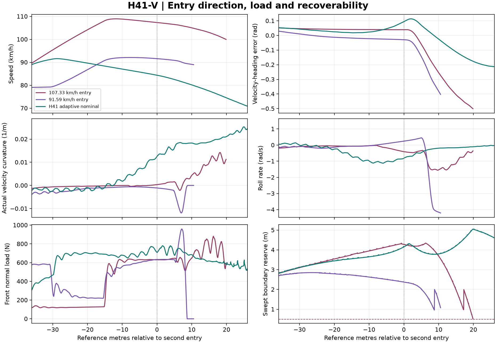
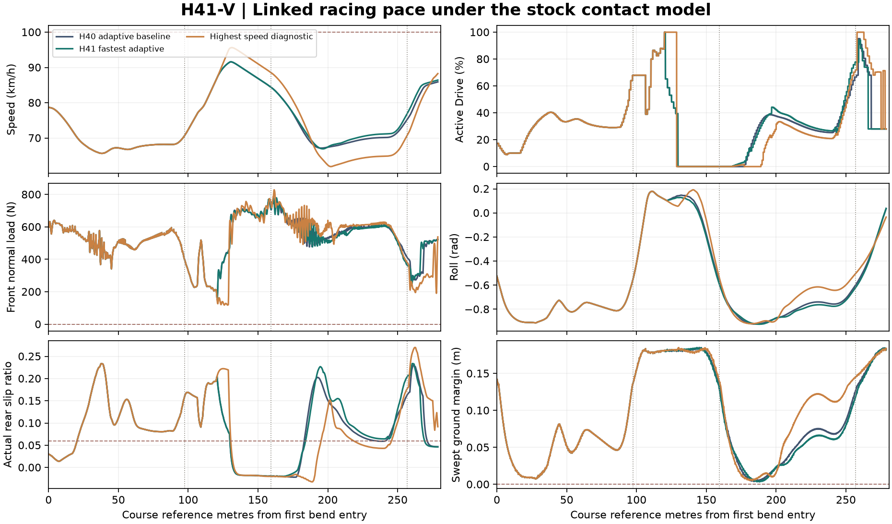

# Study #222 · H41-V · Physical speed envelope and continuous racing pace

Base **7f71af085c9e3bcff1b2a19447cb654f27f13a09**. The primary tests use the stock spatial MODEL, effective tyre coefficient 1.605625, unchanged engine/gearing, unilateral contacts, original rider limits, and the 0.50 m swept boundary requirement. The native gate and original sporting qualification remain in force. H25 remains the default.

**Linked MODEL PASS.** Policy 58 completed both bends nominally and in 4/4 fresh holdouts. Nominal elapsed time from first bend entry to second exit +22 m was **16.271 s**, 0.089 s faster than the reproduced 16.359 s baseline. The top verified straight peak followed by full next cornering was **95.63 km/h**. No tested run combined a 100 km/h straight with complete second cornering. The linked result has its own gates. Original strict sporting and native qualification remain separate.

## Reference reproduction

The #217 MODEL bend reproduced at 6.095 s. Complete full-state and FIFO replays recovered the #219 6.491 s powered bend, the #220 107.33 km/h next entry, 1.0725 s full-Drive frontier, both #221 fast manoeuvres, its four frozen carrier holdouts, and the 0.720 s full-Drive experiment. Nine of the eleven motion terminals are exactly equal to the recorded state. The other two differed in position by less than 3×10⁻¹⁴ m. The comparison covers orientation, linear and angular momentum, crank, wheels, rider and leg momenta, steering, active command and the FIFO cursor. The pending payloads and activation times are carried through each checkpoint. [Reference receipts](../../../data/experiments/speedway222/references.json)

## Directional envelope and the high-speed entry failure

A static projection holds the rear tyre vector, contact loads, drag and current boot reaction fixed, then reevaluates the stock front lateral law at five steers within 100 ms of actuator travel. It gives paired inward/outward acceleration and yaw and roll moment spans without assigning them as independently available. The dynamic test propagates each matched state with its pending FIFO and physical 50 ms reaction. Nine independent Drive/steer commands were propagated for up to 160 ms with actual loads, rear combined slip, roll, yaw and swept checks. This bounds the tested local response. It cannot establish the optimum over all controls.

The geometry map evaluates 240 combinations over 70–120 km/h, five track offsets and six stations, using finite differences of the actual offset paths. The independent heading audit derives curvature from the velocity vector and centimetre-resolved path travel. The equilibrium screen compares eight straight and sixteen constant-curvature states. Full racing claims require transient continuity.

At the recorded 107.33 km/h entry, the velocity heading was initially close to the road heading. The velocity heading fell 0.10 rad outside the road heading at +6.05 m. Velocity curvature lagged the rapidly increasing demand of the road transition. The last accepted state held 594 N front load and had -0.501 rad heading error at +19.87 m. The separate 91.59 km/h continuation lost front load and had -4.21 rad/s roll rate when the orientation forecast stopped at +10.54 m.

| Metres into the second bend, 107.33 km/h tape | Speed (km/h) | Travel curvature (m⁻¹) | Measured inward acceleration / fixed-rear projection / best propagated mean (m/s²) | Certified 160 ms trials |
| ---: | ---: | ---: | ---: | ---: |
| 0.07 | 107.33 | 0.0004 | 0.32 / 5.73 / 2.79 | 9/9 |
| 4.02 | 106.66 | 0.0015 | 1.32 / 6.43 / 3.72 | 9/9 |
| 8.03 | 105.68 | 0.0021 | 1.85 / 5.62 / 5.41 | 9/9 |
| 12.03 | 104.26 | 0.0047 | 3.92 / 8.92 / 13.15 | 9/9 |
| 17.04 | 101.86 | 0.0103 | 8.27 / 11.68 / 15.09 | 3/9 |

At +24 m the five line hypotheses require 23.23–27.34 m/s² if the 107.33 km/h speed is held. The rigid steady wheel-friction bound at the same load is approximately 15.75 m/s², before enforcing the force direction and roll state. The dynamic state need not hold that speed, radius or normal force. At +17 m three checked actions are still locally valid and much of the lateral room has already been consumed. The late increase in measured force does not undo the preceding displacement.

All eight synthetic straight equilibria converged, including 120 km/h. The sixteen requested constant-curvature equilibria did not qualify within the historical steady solver's bank and initialization limits. That screen does not prove a transient corner impossible. The nine-action sweeps and continuous passing runs supply separate reachable evidence. Five offsets expose the effect of widening the line and the timing of the curvature increase. [Directional maps and equilibrium receipts](../../../data/experiments/speedway222/maps)

## Matched controller interventions

Each row changes one term in the frozen controller at the same stock state. This includes the 11.4 m/s² cap, scalar reserve term, curvature floor, coast deceleration estimate, corner ceiling, bend pace reduction, 94 km/h exit reference, binary Coast decision, rear-slip drive rule and requested 9 mm ground reserve. The geometric hard-part gate remains active throughout. The scalar replacement uses projected forces at reachable steering angles and fixed rear/boot forces, with short-window validation kept as a separate measurement.

| Single change | Peak straight (km/h) | Linked time (s) | Outcome |
| --- | ---: | ---: | --- |
| Uncapped 11.4 term | 91.59 | 16.359 | completed linked horizon |
| Directional projection replaces scalar reserve | 87.93 | 16.428 | completed linked horizon |
| Curvature floor 0.001 m⁻¹ | 91.59 | 16.359 | completed linked horizon |
| Measured drag/front-force deceleration | 89.71 | 16.393 | completed linked horizon |
| Remove compatibility corner ceiling | 108.14 | — | swept hard-part ground |
| Remove 5 km/h bend drop | 91.59 | — | swept hard-part ground |
| Replace 94 km/h exit reference | 91.59 | 16.347 | completed linked horizon |
| Remove binary Coast rule | 92.59 | — | swept hard-part ground |
| Remove rear-slip drive factor | 91.59 | 16.359 | completed linked horizon |
| Request 1 mm static ground reserve | 91.59 | 16.359 | completed linked horizon |

Freeing the 11.4 m/s² term produced the same time and peak speed to recorded precision. Other ceilings and the Coast branch still governed the chosen command. Replacing the scalar reserve gave a more restrictive result at this matched fork. Removing the corner compatibility ceiling permitted over 108 km/h and hit hard-part protection. This is a controlled failure, with the original physical gate active.

## Continuous preparation and sporting pace

The initial search tests 65 proposals. It includes the frozen Coast action, a distinct full-Drive-until-preparation law, progressive Drive with line/posture preparation, directional force feedback and a selected spatial schedule that varies Drive, steering and posture independently. The phase conditions use measured load, actual rear slip, track-offset curvature, physical roll rate and available tyre vectors. The approximate lookahead authority and deceleration estimates remain controller choices. The stock integrator still enforces all actual contacts, forces and travel.

| Initial method | Proposals | Linked in search | Fastest exact nominee (s) |
| --- | ---: | ---: | ---: |
| A · Frozen Coast | 1 | 1 | 16.359 |
| B · Full Drive followed by active preparation | 16 | 8 | 16.299 |
| C · Concurrent acceleration, line and posture | 16 | 8 | 16.299 |
| D · Directional force feedback | 16 | 8 | 16.299 |
| E · Offline whole-manoeuvre schedule with feedback | 16 | 9 | 16.271 |

The fastest B, C and D proposals selected identical commands under the physical guard and had identical outcomes. Their winning times provide one shared result. The search-stage counts use the proposal integration. The nominal and holdout scores below use full replay.

The speed-frontier follow-up starts near the verified #221 95.63 km/h reference. Its 17 trials vary anticipatory lean, rider preload, controlled torque overlap and velocity-heading feedback around dynamically reached checkpoints. They keep the same engine, friction and corner reference speed.

| Trial | Total (s) | Straight peak / average (km/h) | Next entry (km/h) | First +20 / original later / linked |
| --- | ---: | ---: | ---: | --- |
| #221 matched nominal | 16.359 | 91.59 / 84.31 | 84.36 | PASS / FAIL / PASS |
| H41 adaptive nominal | 16.271 | 91.59 / 84.32 | 84.36 | PASS / FAIL / PASS |
| H41 peak frontier | 16.797 | 95.63 / 86.30 | 88.50 | PASS / FAIL / PASS |
| H41 fresh 1 | 16.280 | 91.23 / 84.03 | 84.43 | PASS / FAIL / PASS |
| H41 fresh 2 | 16.270 | 91.41 / 84.12 | 84.17 | PASS / FAIL / PASS |
| H41 fresh 3 | 16.285 | 90.87 / 83.73 | 84.12 | PASS / FAIL / PASS |
| H41 fresh 4 | 16.303 | 90.38 / 83.37 | 84.78 | PASS / FAIL / PASS |

Both the nominal and all four holdouts passed the original +20 m gate. The original later acceleration gate failed in all five. The adaptive nominal first-bend time was 6.491 s and its entry/minimum/midpoint/exit speeds were 78.68 / 65.65 / 67.23 / 70.67 km/h. Bend two took 6.175 s at 84.36 / 66.94 / 68.45 / 76.87 km/h. The straight used 36.18% mean active Drive and 0.030 s of full Drive. The selected gain was mainly in second-turn and exit timing. 16 accepted proposals used Drive above 20% while rolled inward during the prep window with a maximum counted overlap of 0.180 s. 4 of the stock proposals in the two searches went over 100 km/h. Their continuations did not complete both bends. The time ranking uses the complete two-bend distance. The speed ranking uses the highest straight speed among trajectories that complete it.

| Geometry sensitivity | Minimum swept track reserve (m) | Minimum hard-part reserve (mm) | Linked |
| --- | ---: | ---: | --- |
| compact | 2.1447 | 3.409 | PASS |
| large | 2.1447 | 3.311 | PASS |
| nominal | 2.1447 | 3.360 | PASS |

The independent nominal energy ledger recorded 203.14 kJ of engine work and 166.33 kJ of losses. The maximum accumulated defect was 0.00095 J. Peak active rider force was 693.2 N and power 72.7 W.

## Powered sliding and flying continuity

The independent powered stage adapts before the slide and tests full-Drive interventions during initiation, established slide, late bend and exit. It retains the original first-exit checkpoints and verifies the second bend separately. The selection uses continuous elapsed time when the linked gate passes, and accepted progress when it fails. Holds use a fresh frozen protocol relative to #221.

The 16 trials covered eight onset stations from 16 to 98 m. The frozen exact selection began at 55 m and recorded 0.5400 s loaded full-Drive slide. Its first-bend time was 6.316 s versus 6.491 s for the fastest linked policy. Exit speed increased from 70.67 to 71.33 km/h and the bend minimum stayed at 65.65 km/h. Its full linked result was FAIL. The longest sampled powered overlap was 0.5400 s with PASS at +20 m. The frozen selection achieved 0/4 linked holdouts. The 0.720 s prior result remains the direct comparison for first-exit balance. A pulse only counts as useful sporting improvement when its continuous manoeuvre time and recovery qualify.

| Powered run | Full slide (s) | First-bend time (s) | +20 / later / linked | Status |
| --- | ---: | ---: | --- | --- |
| Nominal | 0.5400 | 6.316 | PASS / FAIL / FAIL | boundary clearance |
| Fresh 1 | 0.3775 | 6.332 | PASS / FAIL / FAIL | hard-part clearance |
| Fresh 2 | 0.2925 | 6.334 | PASS / FAIL / FAIL | hard-part clearance |
| Fresh 3 | 0.2150 | 6.340 | PASS / FAIL / FAIL | hard-part clearance |
| Fresh 4 | 0.1293 | 6.352 | PASS / FAIL / FAIL | hard-part clearance |

The flying continuation uses the same race feedback with a cyclic bend map. The velocity, rider and rotor momenta, pose, steering and FIFO carry through each bend transition. The controller prepares for the next bend beyond the timing marker.

The captured linked controller by itself stopped 0.101 m short of its first flying marker under swept hard-part ground. The targeted continuation varied the post-exit switch point, rider/line lead and a roll stopping-distance term derived from the directional moment envelope. All 12/12 reduced-step proposals reached first-lap +22 m. The selected policy switched 7 m after the second exit, keeping the complete state and pending FIFO from the original run. The exact replay reached the first 318.78 m flying marker in **17.901 s** from first entry at 83.07 km/h and crossed +22 m at 73.87 km/h. One flying lap with continued corner preparation is **PASS**. The uninterrupted next lap is **FAIL**. The replay ended at station 348.25 m, 29.47 m into the following lap. The stop was **candidate exhaustion: roll forecast: chassis-ground envelope**, with 1.3102 m minimum swept track reserve and 1.01 mm minimum hard-part clearance. The recovery extension used 5.484 CPU s in the measured phase and missed 50 ms on 17/68 decisions. The exact one-lap result is a nominal MODEL witness. The fresh holdouts qualify only the two-corner distance. [Targeted search, frozen policy and exact trajectory](../../../data/experiments/speedway222/cycle)

## Front contact isolation and rear uncertainty

The front-rotor bracket of 0.25/0.45/0.65 kg·m² remains an engineering sensitivity. Stock front contact is free rolling with zero longitudinal force. Finite inertia adds transient longitudinal front contact because ground longitudinal force produces axle torque. The paired accounting separates the longitudinal contact impulse, axial spin torque, chassis and steering transport \( -p_f \dot a_f \), steering reaction work, and whole-system angular momentum. The airborne rig measures rotor transport with zero ground force. The matched ground probes report both transport and contact contributions. All integrated gyro cases include the compensating momentum and energy. [Sharp, *The Stability and Control of Motorcycles*](https://doi.org/10.1243/JMES_JOUR_1971_013_051_02)

The memoryless controls share the exact steady lateral curve of the matching 0.35 m and 0.75 m transient tyre. For \(F_y=-kqs\), \(\dot q=s v_y-\lambda q\), \(s=\min(1,C/|kq|)\), eliminating \(q\) gives \(F_{y,\mathrm{eq}}=-\operatorname{clip}(k v_y/\lambda,-C,C)\). The transient stores \(kq^2/2\) and dissipates \(k\lambda q^2\). The memoryless comparison dissipates contact work directly. Four invariant tests exercise the unsaturated, saturated, signed and unloaded cases. The comparison of matched dynamics distinguishes a change in the steady force curve from lateral memory. [Motorcycle relaxation-length measurements](https://www.research.unipd.it/handle/11577/2462460)

The lab fixtures conserved both linear and angular momentum across all eight variants. Maximum absolute angular ledger error was 3.39e-13 kg·m²/s. At the matched fast entry, the 0.45 kg·m² rotor transmitted 3.002 N·s front longitudinal impulse and 60.746 N·m peak internal transport moment. Stock front longitudinal impulse was 0.000 N·s. The airborne rotor trials retain spin momentum while the steered chassis responds, so that component is present without front longitudinal contact. The coupled ground comparison includes both mechanisms.

| Plant | Retuned choices | Farthest selected exact station (m) | Complete second bend and exit |
| --- | ---: | ---: | --- |
| Stock | 6 | 278.80 | PASS |
| Rotor 0.25 kg·m² | 6 | 188.72 | FAIL |
| Rotor 0.45 kg·m² | 6 | 210.67 | FAIL |
| Rotor 0.65 kg·m² | 6 | 216.97 | FAIL |
| Static match 0.35 m | 6 | 278.79 | PASS |
| Relaxation 0.35 m | 6 | 278.79 | PASS |
| Static match 0.75 m | 6 | 278.79 | PASS |
| Relaxation 0.75 m | 6 | 178.12 | FAIL |

Both 0.35 m variants completed the retuned run. The 0.75 m memoryless control completed and the corresponding transient hit ground protection. This isolates a meaningful effect of memory in the tested plant/controller family, without relying on a change in the steady lateral curve. The rotor variants remained incomplete after separate local retuning.

The stock rear combined-slip law couples the directional shear budget to drive and lateral slip. The observed high-speed failure precedes any proof that a particular missing rear constitutive term is the decisive constraint. Loose-soil data vary with sinkage, load and slip direction. Camber tests on other motorcycle tyres do not calibrate this speedway surface. The stock rear law remains the primary model, so the sensitized front cases carry no sporting claim about an altered rear model. [Combined slip on dry sand](https://doi.org/10.1016/j.jterra.2014.08.001) · [Motorcycle camber reduction measurements](https://research.unipd.it/retrieve/8c3f4fc8-f37d-4551-86af-f31cd08846c1/machines-10-00921-v2.pdf)

## Runtime cache and verification

The #221 cache keyed on simulated time and a subset of state. It did not compare full pose, crank, active command, rider and leg momentum, the complete pending payloads and activation times, wheel contact, or the geometry/physics instance. The H41 diagnostic cache finds a certified progress sample and requires full state equality, pending FIFO equality, identical last contact receipt and the same physics/geometry instance. Any mismatch runs the normal state-dependent feedback. The mutation tests exercise cases that preserve a command index while changing the true physical continuation.

| Replay mode | Segment CPU (s) | Decisions | Hits | P50 / P95 / P99 / max (ms) | Missed 50 ms |
| --- | ---: | ---: | ---: | ---: | ---: |
| spatial feedback | 10.562 | 146 | 0 | 32.27 / 88.75 / 109.88 / 111.26 | 42 |
| verified station cache | 4.312 | 146 | 146 | 0.00 / 0.01 / 0.03 / 2.11 | 0 |
| fresh state and FIFO fallback | 10.828 | 147 | 0 | 34.86 / 85.33 / 101.07 / 101.52 | 47 |

The old cache accepted 13/13 changed-state or changed-context probes. The exact cache rejected all thirteen and allowed the identical control. The fresh-start result includes actual fallback work. Segment CPU includes carrier preparation, integration and decision work. Cumulative decision wall time was 6.258 s without cache, 0.0027 s on verified hits and 6.365 s in fresh fallback. Offline screening and exact shortlist replay used 1,410.641 CPU s in the initial search and 498.391 CPU s at the speed frontier. Deadline percentiles use per-decision wall time. The physical 50 ms reaction and 60 ms review cadence remain independent. FAST50 and total full-race CPU are unqualified.

The independent verifier checked 35 recorded trajectories and 120 proposal tapes. Parent/current local results were 46/50 passes and ten identical expected guard failures. The failures are the explicit Box2D construction block, and no native world was constructed. The current build adds four steady-equivalence cases. The compile used a cached restore and emitted NU1900 for disconnected NuGet vulnerability metadata. The repository's Core Simulation CI triggers on pushes to main, pull requests, a schedule or manual dispatch. This study publishes only the experiment ref. Hosted status is reported for that exact SHA.

## Ten conclusions

1. **Effect of the 11.4 m/s² limit.** Removal alone changed neither recorded speed nor elapsed time in the matched nominal. The reserve projection and remaining policies matter more than that scalar ceiling in this run.
2. **Why the 107.33 km/h entry failed.** Velocity curvature lagged the required change of direction before the track boundary closed. The front remained loaded. The lower-speed contrast instead exhausted the roll forecast during unloading and reversal.
3. **Acceleration during preparation.** Qualified overlaps exist in the search, typically short. The fastest variant improved linked time while keeping peak and mean straight Drive close to the baseline.
4. **Complete second bend after 100 km/h.** None was verified. The highest verified complete continuation reached 95.63 km/h with an actual next entry of 88.50 km/h.
5. **Fastest robust linked result.** Frozen policy 58 ran 16.271 s and passed 4/4 fresh holdouts, with separate original gate results.
6. **Useful full-Drive sliding.** The selected powered run used 0.5400 s of full overlap and scored FAIL for the linked manoeuvre. The project has yet to show a robust full-Drive slide that beats the selected two-corner time.
7. **Front inertia specifically.** Airborne tests prove transport and compensating chassis reaction with zero contact torque. The ground cases show an additional longitudinal response and steering work. Local retuning did not recover a complete rotor-equipped continuation.
8. **Constitutive effects.** Matched 0.75 m lateral memory changes recovery enough to change the gate outcome at the same steady force curve. Stock rear combined slip caps directional authority. The rear calibration remains unresolved.
9. **Continuous flying lap.** First lap with recovery PASS. Second consecutive lap with recovery FAIL. Both use one uninterrupted physical history.
10. **Runtime evidence.** Exact nominal reuse changed segment CPU from 10.562 to 4.312 s. The fresh-start fallback incurred 47 misses of 50 ms. Whole-race latency qualification remains open.

## Reproduce

~~~powershell
$env:SPEEDWAY_BOX2D_NO_WORLDS = '1'
dotnet build tools/speedway-h26/H26.csproj -c Release -m:1
$dll = 'tools/speedway-h26/bin/Release/net8.0/H26.dll'
dotnet $dll envelope-222 . out222 references
dotnet $dll envelope-222 . out222/maps maps
dotnet $dll envelope-222 . out222/race race
dotnet $dll envelope-222 . out222/frontier frontier
New-Item -ItemType Directory out222/qualification
Copy-Item out222/race/race-selection.json out222/qualification
dotnet $dll envelope-222 . out222/qualification complete
New-Item -ItemType Directory out222/cycle
Copy-Item out222/qualification/nominal.json.gz out222/cycle
dotnet $dll envelope-222 . out222/cycle cycle
dotnet $dll envelope-222 . out222/mechanics mechanics
python tools/speedway-h26/diagnose222.py data/experiments/speedway222
python tools/speedway-h26/plot222.py data/experiments/speedway222
python tools/speedway-h26/verify222.py data/experiments/speedway222
~~~

[Directional force maps](../../../data/experiments/speedway222/maps) ·
[Matched interventions and race traces](../../../data/experiments/speedway222/race) ·
[Speed frontier](../../../data/experiments/speedway222/frontier) ·
[Frozen policy, flying telemetry and runtime](../../../data/experiments/speedway222/qualification) ·
[Flying lap and attempted second lap](../../../data/experiments/speedway222/cycle) ·
[Isolated physics and independent retuning](../../../data/experiments/speedway222/mechanics) ·
[Evidence manifest](../../../data/experiments/speedway222/manifest.json)
