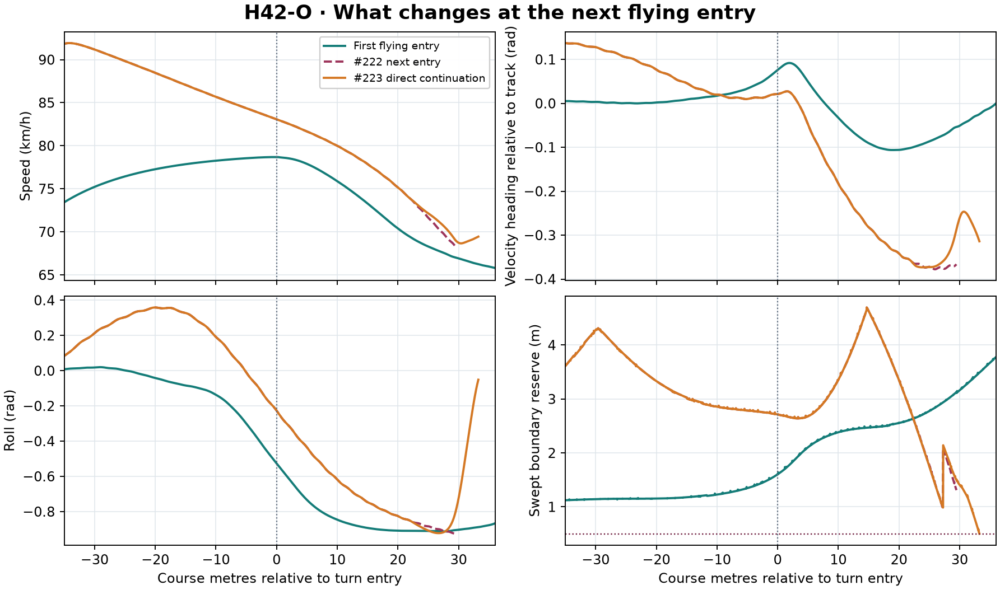

# Study #223 · H42-O · Independent trajectory optimization and periodic racing

**Base** 150aafb128e47bbac4bf6fb19a22ac3b5bb5ba42

**Branch** experiment/speedway-223

**Offline linked MODEL PASS, 16.255 s.** Independent commands improved the reproduced 16.271 s result by 0.015 s. The previously verified 95.63 km/h still leads complete faster-straight continuations. The periodic tests completed one timed lap. The second lap remained incomplete, so the four-lap attempt was gated out. The frozen feedback result was PASS nominally and 0/4 fresh linked passes.

H25 remains the default. The experimental entry point runs the stock spatial MODEL with the #222 engine, gearing, effective tyre coefficient 1.605625, combined slip, passive rider supports, left-foot contact and force and power limits. The integrator carries the physical states of the crank, wheels, rider and boot through every transition. The 0.50 m swept boundary requirement, unilateral contacts, hard-part ground protection, work ledger and 50 ms reaction are active. Native Box2D was outside this study.

## Frozen reference trajectories

The #217 6.095 s bend and #219 6.491 s powered bend reproduced. The replays recovered the #220 107.33 km/h second entry, the #221 95.63 km/h complete-speed frontier, #222 policy 58 and its four held starts, and the 0.5400, 0.7200 and 1.0725 s powered witnesses. Eight of the nine additional archive terminals are bitwise equal. The position difference on the remaining terminal is 1.78 × 10⁻¹⁴ m. The receipts include complete terminal records and every command already submitted and awaiting activation. [Parent and historical reproduction](../../../data/experiments/speedway223/references.json) · [#222 held and cycle reference receipts](../../../data/experiments/speedway223/reference-continuity.json)

## Independent shooting and race time

The offline solver composes executable six-channel controls directly. Its variables are Drive, requested steering angle, three rider targets and left-foot extension. The initial command history supplies a feasible centre for the control knots. Each raised-cosine knot changes commands in a spatial window of that history. The resulting schedule is integrated with the original actuators and request-to-activation delay. The search evaluates elapsed time and validity of the physical trajectory and has no target corner speed or prescribed roll or line regulator. The directed repair pass also retimes requests and their activations together.

The screen starts from the ancestor state at the first altered request and integrates the suffix. The prefix carries the active command, crank and wheel momenta, rider and support state, and pending FIFO. Nominees are reintegrated with exact swept certification. The evidence verifier independently replays the complete selected command histories from their original roots. Only trajectories which pass the whole-distance linked gate compete on elapsed time. Clearance provides the tie-break. Early interventions must remain viable through the remaining race.

| Stage | Focus | Proposals | Complete linked in screen | Exact linked / exact replays | Promoted |
| --- | --- | ---: | ---: | ---: | --- |
| A | First corner and exit | 64 | 0 | 0/5 | no |
| B | Straight and preparation | 64 | 0 | 0/10 | no |
| C | Second bend and exit | 64 | 7 | 5/5 | yes |
| D | Coupled whole-manoeuvre edit | 64 | 0 | 0/5 | no |

The joint edits in stage D magnified small steering and posture errors before their later knots could correct them. The C-stage winner ran 16.263272 s. After the initial search we fitted small recovery patches to local full-state derivatives. The solver repropagated each trial from the unchanged prefix. It used the local defect only to construct a candidate and ranked that candidate on the complete replay. 1/12 repairs passed the linked gates. The selected second-exit repair reduced its local weighted defect from 0.609 to 0.056. The trajectory travelled 331.734 m from first entry to the linked endpoint. It used 2.145 m minimum swept boundary reserve and 3.360 mm minimum hard-part reserve. Peak rider force and power were 693.2 N and 72.7 W. Maximum accumulated work error was 0.000947 J. The original first-exit +20 m and later gates scored PASS and FAIL respectively. The independent complete trace and the sampled track-frame data include path length, heading curvature, longitudinal acceleration, actual line, wheelspin, tyre and vehicle sideslip, roll, moments and contact loads. [Selected exact trajectory](../../../data/experiments/speedway223/shoot-repair-selected.json.gz) · [Track-frame profile](../../../data/experiments/speedway223/path-profile.json.gz)

The first bend is unchanged in the fastest trajectory. It takes 6.491 s with 65.65 km/h minimum and 70.67 km/h exit. The best trajectory makes its gain at the second exit and recovery. The ordinary straight remains at 91.59 km/h peak, 36.18% mean active Drive and 0.030 s at full Drive. [Stage metrics, telemetry and thresholds](../../../data/experiments/speedway223)

| Investigated speed label (km/h) | Proposals | Highest detected straight peak (km/h) | Full next bend plus recovery |
| ---: | ---: | ---: | ---: |
| 95 | 11 | 100.81 | 0 |
| 100 | 11 | 104.31 | 0 |
| 105 | 11 | 108.13 | 0 |
| 110 | 11 | 113.54 | 0 |
| 115 | 10 | 115.25 | 0 |
| 120 | 10 | 115.63 | 0 |

The speed labels are trial settings for early Drive and preparation-knot placement. The actual peak came from the integrator. At 115.63 km/h the fastest exact diagnostic stopped at reference station 165.76 m, 6.37 m into the bend, under boundary clearance. The 120 km/h target group stayed below 120 km/h. At the final accepted sample the heading error was −0.278 rad, front/rear loads were approximately 409/178 N and active Drive was zero. Rear slip had fallen from +0.070 at peak straight speed to −0.008 at the stop. The line ran out of swept room before enough inward velocity developed. The 95.63 km/h exact #222 witness remains the highest verified coupled result. [Highest-speed failed replay](../../../data/experiments/speedway223/speed-highest.json.gz)

The searches included graded Drive and full-Drive pulses on the ordinary straight, at slide initiation, in established and late sliding and through exits. The 0.5400, 0.7200 and 1.0725 s traces remain separate reached references. The fastest H42 linked trajectory used 0.000 s and 0.000 s of full-Drive loaded sliding in bends one and two. The extra Drive in the high-speed samples did not yield a faster complete run. In the selected linked trial the second-bend entry/minimum/exit were 84.36, 66.94 and 78.22 km/h. [Targeted powered and acceleration repairs](../../../data/experiments/speedway223/shoot-repair.json.gz)

## Cyclic racing and the seam state

The #222 cycle reproduces a 17.900920 s first lap, 318.77875 m marker, 348.24991 m final station and 1.009 mm minimum hard-part reserve. It stops after exhausting the candidates permitted by the chassis-ground forecast. The entry states below come from the actual marker crossings.

| Observable | First crossing | Second crossing |
| --- | ---: | ---: |
| Track offset (m) | 7.709 | 3.394 |
| Velocity along track (m/s) | 21.792 | 23.070 |
| Velocity toward inside (m/s) | 1.672 | 0.491 |
| Velocity heading relative to track (rad) | 0.07656 | 0.02129 |
| Frame yaw relative to track (rad) | 0.09065 | 0.01494 |
| Roll (rad) | −0.52864 | −0.22710 |
| Body roll rate (rad/s) | −0.93927 | −1.09883 |
| Body yaw rate (rad/s) | 0.34473 | 0.13893 |
| Crank momentum (kg·m²/s) | 5.48617 | 5.48986 |
| Rear-wheel momentum (kg·m²/s) | 61.53053 | 61.76986 |
| Steering angle (rad) | 0.01180 | −0.02136 |

At the second crossing the bike is 4.31 m farther inside. It enters faster, with less lean and much less inward velocity and yaw. In the turn it reaches −0.366 rad of heading error with 6.80 m/s outward lateral velocity. The seam receipt also includes pitch, rider position, momentum and velocity, wheel state, boot contact force and the pending FIFO relative to crossing time. [Frozen seam and stop receipts](../../../data/experiments/speedway223/reference-continuity.json)

Stage E evaluated 64 submitted-command continuations. It ranks completed laps with post-marker recovery first, then progress with a penalty for track-relative seam error. The selected trajectory took 17.901 s for the first lap, crossed +22 m, and continued to 352.035 m, 33.256 m into lap two. Its first stop was **swept boundary clearance**. The inherited approach does not fit a periodic state: the phase error is unchanged in these post-seam splices. The follow-up tried 10 pre-seam fits and 6 smaller trust-region fits. None improved their weighted seam residual inside the propagated feasible neighbourhood. The best exact runs grew no farther than 334.632 m for these two schedules. Two uninterrupted laps with +22 m remain **FAIL**. The four-lap test was gated on the two-lap witness. [Periodic stage and trials](../../../data/experiments/speedway223/periodic-search.json.gz) · [Reduced trust-region probes](../../../data/experiments/speedway223/periodic-closure-local.json.gz)

## Online feedback and cost

The online tracker uses a phase-indexed offline witness and a short physics forecast when actual velocity, orientation, position, rider motion or the pending command differs. It issues a new executable control with physical delay. The lookup caches only the midpoint interval of a reference index. The elapsed-time distributions include every decision. Controller CPU includes forecasting on the executing thread. Integration CPU counts actual propagation on that thread. Total wall time covers the complete run. The measurements are local to this environment.

| Frozen run | Accepted station (m) | +20 / later / linked | One / two / four laps +22 |
| --- | ---: | --- | --- |
| nominal | 313.22 | PASS / FAIL / PASS | FAIL / FAIL / FAIL |
| fresh inward slower | 182.67 | PASS / FAIL / FAIL | FAIL / FAIL / FAIL |
| fresh outward faster | 176.40 | PASS / FAIL / FAIL | FAIL / FAIL / FAIL |
| fresh outward slower | 15.41 | FAIL / FAIL / FAIL | FAIL / FAIL / FAIL |
| fresh inward faster | 55.69 | FAIL / FAIL / FAIL | FAIL / FAIL / FAIL |

| Frozen run | P50 / P95 / P99 / max (ms) | 50 ms misses / reviews | Forecast steps | Spatial hits / misses | Controller / integration CPU (s) | Wall (s) |
| --- | --- | --- | ---: | --- | --- | ---: |
| nominal | 0.12 / 363.96 / 459.12 / 579.69 | 25/354 | 15320 | 0 / 354 | 9.859 / 61.484 | 71.520 |
| fresh inward slower | 254.38 / 610.59 / 763.56 / 787.94 | 232/232 | 112383 | 0 / 232 | 69.469 / 39.391 | 109.576 |
| fresh outward faster | 232.70 / 717.17 / 923.44 / 1205.76 | 200/227 | 94697 | 0 / 227 | 63.094 / 37.656 | 101.378 |
| fresh outward slower | 368.11 / 435.14 / 438.00 / 438.00 | 62/74 | 39843 | 0 / 74 | 21.781 / 6.688 | 28.589 |
| fresh inward faster | 413.54 / 670.55 / 727.40 / 735.15 | 119/120 | 69835 | 0 / 120 | 41.641 / 20.969 | 63.123 |

The tracker was frozen around the first improved offline continuation, 16.263 s. Its two-turn geometry checks were nominal PASS, compact PASS, large PASS. It issued 275 adapted commands across the five frozen runs. Forecast truncation and rejection reasons are retained in the decision logs. All five runs logged zero reference-cache hits. FAST50 requires every qualifying run to respect the deadline. The measured runs cover less than one lap. Offline screening plus shortlist replay used 315.094 CPU s across stages A–D, the targeted repair used 274.281 CPU s and the initial periodic stage used 73.109 CPU s. [Frozen policy and holdout parameters](../../../data/experiments/speedway223/feedback-freeze.json) · [Online qualification and timing](../../../data/experiments/speedway223/feedback-qualification.json)

The offline witness and closed-loop tests use the same physical restrictions. The original +20 m and later acceleration gates are reported independently. The offline complete trajectory provides a reachability result. Autonomous qualification comes from executing the frozen state-dependent policy. Native S, four-rider readiness and production policy remain outside this study.

## Reproduction and regression

~~~powershell
$env:SPEEDWAY_BOX2D_NO_WORLDS = '1'
dotnet build tools/speedway-h26/H26.csproj -c Release -m:1
$dll = 'tools/speedway-h26/bin/Release/net8.0/H26.dll'
dotnet $dll trajectory-223 . out223 all
python tools/speedway-h26/verify223.py out223
~~~

Use a new output directory for the CLI. The verifier expects the filtered parent and current TRX files beside the simulation receipts under the names parent.trx.gz and current.trx.gz. The versioned evidence bundle contains both. All 50 selected MODEL tests pass in each tree and the same ten native-required cases encounter the Box2D guard. The verify CLI mode performs independent exact replays before the Python evidence check.

The supplied brief ends mid-sentence in section 11 after “Maintain the”. This report covers the requirements present in that attachment.

[Full evidence](../../../data/experiments/speedway223) · [Independent MODEL replays](../../../data/experiments/speedway223/independent-proof.json) · [Evidence digests](../../../data/experiments/speedway223/manifest.json)
