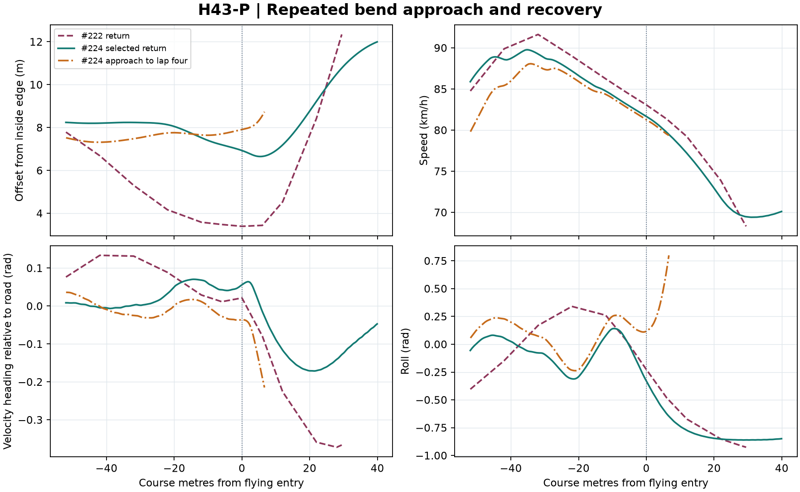

# Study #224 · H43-P · Periodic racing line and adaptive trajectory optimization

**Base** 3d44ba9fea8a030b61f5d40b425fef38b96ac2a9

**Branch** experiment/speedway-224

**Two continuous flying laps MODEL PASS in 35.947 s.** The replay reaches the second marker and crosses +22 m in 37.153 s from the first marker. The four-lap +22 m gate is FAIL. The longest exact continuation reached 970.902 m. The highest verified straight peak with complete following bend and recovery is 95.63 km/h. The H41 carrier and the early H43 continuation each passed 4/4 fresh linked tests. Early H43 completed two laps plus recovery on 3/4 fresh starts.

All trials use the stock spatial MODEL, effective friction 1.605625, original engine and gearing, physical 50 ms command reaction, 700 N and 350 W actuator caps, unilateral contacts, 0.50 m swept boundary, and hard-part ground protection. The branch uses the same rider supports and contact laws. The front rotor and tyre variants remain separately available. The experiment runs through an explicit tools command. H25 remains the production default.

## Where the inherited approach breaks

The #222 and #223 flying traces replay continuously from their original roots. The #222 run reaches 348.24991 m and refuses its next control under the chassis-ground forecast. #223 keeps the same preceding approach and reaches 352.03482 m before the swept boundary. The reconciled receipts include full angular and translational momentum, crank and wheel state, rider and leg state, the active command and pending payloads with activation times.

| Course station | Original first approach, relative to entry | Following approach, relative to entry | Observed divergence |
| --- | ---: | ---: | --- |
| About −42 m | 8.25 m offset, −0.011 rad roll | 6.69 m offset, −0.147 rad roll | The return is already drifting toward the inside |
| About −32 m | 8.20 m offset, +0.016 rad roll | 5.30 m offset, +0.169 rad roll | Coast begins while the roll is reversing outward |
| About −22 m | 8.18 m offset, −0.023 rad roll | 4.16 m offset, +0.340 rad roll | The next entry needs inward preparation while the chassis is still banked outward |
| Entry | 7.71 m offset, 78.68 km/h, −0.529 rad roll | 3.39 m offset, 83.07 km/h, −0.227 rad roll | Inward velocity falls from 1.672 to 0.491 m/s and body yaw rate from 0.345 to 0.139 rad/s |

The first operational intervention point is the preceding exit. Policy 301 switches at exit +7 m. At exit +10 m the bike is still around 7.8 m offset and has already reduced Drive to 0.28. The new aim draws it inward, then the velocity heading and roll reverse at an unsuitable time on the straight. The mismatch is observable at −42 m and develops before the next tangent-to-bend transition. The samples do not establish a point of irreversible failure.

| Single matched intervention at second exit +7 m | Entry offset (m) | Entry roll (rad) | Entry heading error (rad) | Last station (m) |
| --- | ---: | ---: | ---: | ---: |
| matched 301 | 3.394 | -0.227 | 0.021 | 348.250 |
| wider lookahead line only | 5.828 | -0.291 | -0.027 | 341.681 |
| earlier setup only | 3.914 | -0.284 | 0.032 | 347.915 |
| less speed demand only | 3.467 | -0.239 | 0.024 | 347.888 |
| line and heading preconditioning | 5.827 | -0.297 | -0.032 | 341.476 |

Widening the target alone raised the entry offset but reduced available outward swept room while the trajectory was still turning too late. Earlier preparation or lower requested speed alone left the entry substantially inside the original first-lap line.

[Full state and FIFO reference audit](../../../data/experiments/speedway224/reference-phases.json) · [Matched exit interventions](../../../data/experiments/speedway224/matched-seam.json)

## Adaptive line optimization and periodic feasibility

The planning variable is a continuous periodic line guide with independently varied outside approach, apex and exit coordinates. Quintic transitions change the guide and derivative smoothly over the second half of the bend and the straight. Four guide families vary how strongly to pursue this path, how much to use its measured curvature, and whether actual lane or directional forces modify the target. The realized offset can differ from the guide. Actual speed enters a downstream curvature/coast envelope, followed by a delayed physically integrated steering and posture decision.

Every review updates the control from the current mechanical state and submitted FIFO. The short model forecast allows 65 ms of action after reaction. A 155 ms medium forecast chooses an alternative drive, lean or steering response when the normal short stabilization forecast cannot retain viability. The offline stage searches and ranks realized trajectories. The recourse stage reuses an integrated checkpoint from an incumbent, tries revised entry and recovery guides on a common origin, then updates all subsequent actions from the newly reached state. Selection uses complete time through a common finish for passes and lawful progress for failures. Seam mismatch is diagnostic and helps break ties. Every nominated trajectory is repropagated continuously from the root with exact swept certification.

| Focused stage | Screened proposals | Physical passes in screen | Passes / exact replays | CPU seconds |
| --- | ---: | ---: | ---: | ---: |
| Periodic line | 64 | 10 | 5/6 | 2790.6 |
| Downstream recourse | 64 | 14 | 3/6 | 3827.2 |
| Progressive speed | 64 | 0 | 0/12 | 1882.8 |

The selected initial exact line reached 659.572 m in 37.624 s. The recourse winner reached 659.572 m in 37.153 s. The overall selected proof uses a minimum exact boundary margin of 1.7071 m and hard-part margin of 3.36 mm. Its momentum and work are evaluated by the original MODEL. The maximum accumulated work residual measured in the exact replay was 0.001004 J. The original +20 m / later acceleration / linked gates are PASS / FAIL / PASS.

The sampled per-lap reserves below use the local footprint approximation at every sixteenth step. The exact whole-run bounds are those in the replay receipts.

| Run | Lap | Lap time (s) | Travelled metres | Bend 1 entry / minimum / exit (km/h) | Straight 1 peak | Bend 2 entry / minimum / exit (km/h) | Straight 2 peak | Sampled swept reserve (m) | Sampled hard reserve (mm) |
| --- | ---: | ---: | ---: | --- | ---: | --- | ---: | ---: | ---: |
| Two-lap selection | 1 | 17.929 | 371.80 | 78.68 / 65.65 / 70.67 | 91.59 | 84.36 / 66.94 / 77.18 | 89.77 | 0.985 | 3.64 |
| Two-lap selection | 2 | 18.018 | 380.88 | 81.66 / 65.34 / 73.78 | 89.19 | 81.43 / 69.33 / 77.91 | 93.45 | 0.990 | 13.81 |
| Initial line repetition | 1 | 17.929 | 371.80 | 78.68 / 65.65 / 70.67 | 91.59 | 84.36 / 66.94 / 77.18 | 89.77 | 0.985 | 3.64 |
| Initial line repetition | 2 | 18.360 | 380.65 | 81.66 / 65.34 / 73.78 | 89.19 | 81.44 / 65.45 / 73.69 | 89.21 | 0.992 | 19.54 |
| Refined line repetition | 1 | 17.929 | 371.80 | 78.68 / 65.65 / 70.67 | 91.59 | 84.36 / 66.94 / 77.18 | 89.77 | 0.985 | 3.64 |
| Refined line repetition | 2 | 18.018 | 380.88 | 81.66 / 65.34 / 73.78 | 89.19 | 81.43 / 69.33 / 77.91 | 93.45 | 0.990 | 13.81 |
| Rider travel recourse | 1 | 17.929 | 371.80 | 78.68 / 65.65 / 70.67 | 91.59 | 84.36 / 66.94 / 77.18 | 89.77 | 0.985 | 3.64 |
| Rider travel recourse | 2 | 18.360 | 380.65 | 81.66 / 65.34 / 73.78 | 89.19 | 81.44 / 65.45 / 73.69 | 89.21 | 0.992 | 19.54 |
| Rider travel recourse | 3 | 18.530 | 381.06 | 81.35 / 64.78 / 71.50 | 87.82 | 80.46 / 65.46 / 72.02 | 88.08 | 1.002 | 20.98 |
| Additional rider travel certification | 1 | 17.929 | 371.80 | 78.68 / 65.65 / 70.67 | 91.59 | 84.36 / 66.94 / 77.18 | 89.77 | 0.985 | 3.64 |
| Additional rider travel certification | 2 | 18.360 | 380.65 | 81.66 / 65.34 / 73.78 | 89.19 | 81.44 / 65.45 / 73.69 | 89.21 | 0.992 | 19.54 |
| Additional rider travel certification | 3 | 18.615 | 380.88 | 81.35 / 65.38 / 70.95 | 86.80 | 80.38 / 65.38 / 70.91 | 86.63 | 0.974 | 24.40 |

The continuous four-lap attempt finished at 674.943 m under **swept hard-part ground**. The exact minimum margins over its whole history were 1.7071 m swept and 0.276 mm hard-part. The refined line's four-lap +22 m gate is **FAIL**. [Entire four-lap attempt, including submitted controls](../../../data/experiments/speedway224/four-attempt.json.gz)

The initial line on its own reached 746.225 m. Its repeated-lap gate is **FAIL**. The final accepted rider position was X = −0.353 m with −180.3 kg·m/s fore-aft rider momentum. The next step violated the travel envelope. [Exact initial line repetition](../../../data/experiments/speedway224/initial-four.json.gz)

The matched rider-travel follow-up varied when the controller starts its exit intervention. It reduces requested Drive and moves the rider target forward as the measured rearward reserve contracts. The fastest screened rider-travel proposal exact-replayed to 962.996 m and scored **FAIL** at four laps plus recovery. The recorded stop was **swept hard-part ground**. [Rider-travel interventions](../../../data/experiments/speedway224/support-recourse.json)

All 3 rider interventions reached 4 laps +22 m in screening. The exact checks confirmed 0/3. The best additional exact run reached 970.902 m with **swept hard-part ground**. The full exact replay controls the four-lap gate. [All exact rider travel checks](../../../data/experiments/speedway224/support-certification.json) · [Longest continuous trajectory and commands](../../../data/experiments/speedway224/support-certification-selected.json.gz)

| Entry crossing for selected pair | Offset (m) | Speed (km/h) | Inward velocity (m/s) | Roll (rad) | Body yaw rate (rad/s) | Pending requests |
| ---: | ---: | ---: | ---: | ---: | ---: | ---: |
| 0 | 7.709 | 78.683 | 1.672 | -0.5286 | 0.3447 | 0 |
| 1 | 6.929 | 81.664 | 1.267 | -0.3302 | 0.3349 | 0 |
| 2 | 6.375 | 85.697 | 2.037 | -0.3840 | 0.3448 | 0 |

[Line search and convergence](../../../data/experiments/speedway224/line-search.json.gz) · [Downstream recourse search](../../../data/experiments/speedway224/recourse-search.json.gz) · [Continuous replay and phase samples](../../../data/experiments/speedway224/replay-proof.json)

## High-speed preparation

At the successful frontier the actual bend-entry speed was 88.50 km/h after peaking at 95.63 km/h on the preceding straight. At 4 m before entry it already had 0.0051 m⁻¹ of inward velocity curvature. Its heading and curvature develop progressively through the transition. The 107.33 km/h entry carries nearly zero curvature at the marker and reaches −0.501 rad of heading error at the +19.87 m boundary stop. The #223 115.63 km/h straight enters at a wider offset of 8.62 m, already heading outward by 0.110 rad and carrying negative curvature. It stops after +6.37 m. Wider lane position alone cannot replace earlier turning, a suitable state of front load and angular momentum, and sufficient remaining swept room.

| Tested speed band (km/h) | Proposals | Actual maximum peak (km/h) | Next bend and recovery passes |
| ---: | ---: | ---: | ---: |
| 98 | 10 | 96.66 | 0 |
| 100 | 9 | 97.55 | 0 |
| 103 | 9 | 98.39 | 0 |
| 106 | 9 | 104.45 | 0 |
| 110 | 9 | 99.93 | 0 |
| 115 | 9 | 98.90 | 0 |
| 120 | 9 | 97.65 | 0 |

The initial stage reached 104.45 km/h in the tested high-speed plans. Goals were guide ranges and every recorded speed comes from the plant. Follow-up recovery launched from physically reached 100 km/h crossings. It tried 16 adaptive continuations. The selected exact continuation reached 193.732 m at a previous peak of 102.06 km/h. Its full linked gate is FAIL and the stop receipt is adaptive candidate exhaustion: swept boundary clearance. The incomplete tests limit these starts, lines and candidate actions. [Reached-speed recourse trials](../../../data/experiments/speedway224/speed-recourse.json.gz)

[Three matched speed references](../../../data/experiments/speedway224/matched-speed-references.json) · [Progressive speed search](../../../data/experiments/speedway224/speed-search.json.gz)

## Autonomous checks and runtime

The short #223 tracker forecast exposed about 70 ms of response after the 50 ms reaction delay. We compared common physical states first at review and then after a command has actually entered the FIFO. Each tested action faces 120, 240 and 360 ms horizons. A locally verified alternative says that the candidate library has usable control room at that checkpoint. Completion still requires linking recovery through the remaining bend.

All five queued checkpoints include irrevocable pending payloads. The 20 ms offset from review samples their queue in flight. At 120, 240 and 360 ms the tests verified 20/20, 20/20 and 13/20 alternatives respectively. The survival horizon and achieved heading differ even when the initial decision-level constraint appears satisfied.

| Frozen condition | H41 carrier linked | H43 earlier +20 / later / linked | Early station (m) | Early two-lap +22 | Carrier retained linked | Carrier-retained station (m) | Retained two-lap +22 |
| --- | --- | --- | ---: | --- | --- | ---: | --- |
| nominal | PASS | PASS / FAIL / PASS | 659.57 | PASS | PASS | 355.80 | FAIL |
| new inside lower | PASS | PASS / FAIL / PASS | 659.56 | PASS | PASS | 349.52 | FAIL |
| new outside faster | PASS | PASS / FAIL / PASS | 659.56 | PASS | PASS | 355.80 | FAIL |
| new outside lower | PASS | PASS / FAIL / PASS | 482.16 | FAIL | PASS | 348.93 | FAIL |
| new inside faster | PASS | PASS / FAIL / PASS | 659.57 | PASS | PASS | 357.18 | FAIL |

| H43 early stage | P50 / P95 / P99 / max (ms) | Misses / decisions | Controller / integration CPU (s) | Wall (s) |
| --- | --- | --- | --- | ---: |
| nominal | 53.74 / 183.67 / 249.62 / 294.48 | 202/385 | 27.219 / 20.641 | 50.448 |
| new inside lower | 49.01 / 167.33 / 200.13 / 203.85 | 190/385 | 24.859 / 19.047 | 45.655 |
| new outside faster | 50.43 / 161.25 / 191.18 / 205.30 | 193/385 | 24.656 / 18.938 | 45.397 |
| new outside lower | 49.40 / 179.00 / 202.81 / 230.38 | 191/385 | 25.609 / 18.984 | 46.971 |
| new inside faster | 51.50 / 173.58 / 206.03 / 219.12 | 197/385 | 26.578 / 18.734 | 47.153 |

On the nominal paired carrier, the H41 P99 was 118.27 ms and maximum was 118.52 ms, with 51/146 reviews over 50 ms. The full carrier calculation used 23.031 CPU s. The retained continuation had a P99 of 2229.72 ms, with 64/70 reviews over 50 ms. It used 16.281 controller and 16.062 integration CPU seconds after handoff.
The frozen H43 schedule uses the initially exact two-lap line. Later offline recourse does not change that policy. The retained variant runs policy 58 through the original linked endpoint. The earlier variant hands off before that gate. The H43 controller books stabilization and recovery forecast CPU separately from integration. The benchmark replay covers a nominal early combined CPU observation of 70.891 s when including the full matched carrier calculation. This sums the separately measured parts and includes a carrier suffix that the earlier fork replaces. Online timing was measured during the investigation. Four fresh tests ran across at most four workers, alongside some offline studies. P99 is a measured wall-clock statistic under that workload. The timing ledger covers submitted decisions before exact replay. The outside-lower run reached the horizon in that ledger and the exact replay rejected a later hard-part step at 482.16 m. The phase-indexed controller creates new commands from the measured state and current FIFO. FAST50 and the 40–60 s full-race CPU target remain unqualified. The independently executed nominal feedback trace has the same canonical bytes as the initial exact motion, including its seed, requests and every accepted state. The bundle stores that full motion once. [Nominal trace identity](../../../data/experiments/speedway224/feedback-nominal-equivalence.json)

[Matched tracker probes](../../../data/experiments/speedway224/matched-tracker.json) · [Probes with pending commands](../../../data/experiments/speedway224/queued-tracker.json) · [Frozen carrier and new holdouts](../../../data/experiments/speedway224/feedback-qualification.json)

## Answers

1. **Why the second entry diverges.** The exit +7 m switch pulls an inward line during the straight. Before the next bend the bike has already moved inward and must undo outward roll before building lateral curvature.
2. **Cyclic line feasibility.** The two-lap +22 m gate is **PASS** under continuous closed-loop propagation. The four-lap +22 m gate is **FAIL**.
3. **Fastest observed two-lap time.** 35.947 s at the second marker, with 37.153 s measured through the selected endpoint at 659.572 m.
4. **Above 100 km/h and complete next bend.** No qualifying witness in these tests. The highest verified complete speed is 95.63 km/h.
5. **Plant and optimizer.** Ground clearance, swept footprint, contact load, force direction and steering rate restrict the propagated motion. The old fixed downstream commands and limited forecast also lost options upstream, and the new recourse succeeds or fails only on the observed branches.
6. **Frozen feedback.** Early H43 reached two laps plus recovery on 3/4 fresh attempts. Keeping the carrier reached that distance on 0/4, and preserved linked completion on 4/4 fresh starts.

## Reproduction and regression

~~~powershell
$env:SPEEDWAY_BOX2D_NO_WORLDS = '1'
dotnet build tools/speedway-h26/H26.csproj -c Release -m:1
$dll = 'tools/speedway-h26/bin/Release/net8.0/H26.dll'
dotnet $dll periodic-224 . out224 all
python tools/speedway-h26/verify224.py data/experiments/speedway224
~~~

The stage emits one result per screened proposal before aggregation. Resume the relevant mode in the same output directory if its aggregate is absent. The versioned examples include complete chosen command histories, exact root replays, measured line profiles and filtered parent/current TRX receipts. Both trees passed the same 50 MODEL tests. The ten native-required tests hit the same Box2D construction guard. GitHub Actions status is checked for the exact published SHA.

[Evidence index](../../../data/experiments/speedway224) · [Checksums](../../../data/experiments/speedway224/manifest.json)
