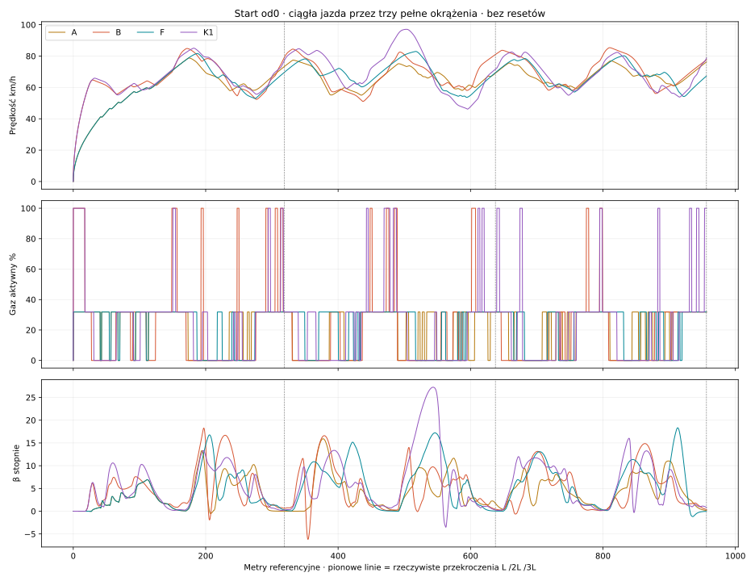

# #144 — Standing Start + 3 Full Laps

**PARTIAL. Etap A: PASS. Etap B: PARTIAL.** Baza `a6b301c6bf8a2854a6963a849b3944b435734f60`, domyślnie OFF, bez CEM i bez merge.

Pełne przejazdy zaczynają się przy v=0, ω tylnego koła=0, w polu B pod linią startu. Jedna ciągła integracja Box2D obejmuje3×318,78m referencji; rzeczywista droga wynika z jazdy. Nie uruchamiano starego HeatSimulator. Źródłowa krzywa500cc, opony, masa/I korpusu, przyczepność i geometria #143 są zachowane. Nowy skończony wał i sprzęgło pozostają aktywne do mety także w prognozach.

## Pełny dystans — właściwy zamrożony model

|Sterownik / pole B|Wynik|Czas3 okrążeń s|Różnica czasu względem A|Okr.1 s|Okr.2 s|Okr.3 s|Okr.2+3 s|Zysk okr.2+3 vs A|
|---|---|---:|---:|---:|---:|---:|---:|---:|
|A|completed · 3/3|60.058|0.00%|24.070|18.388|17.600|35.988|0.00%|
|B|completed · 3/3|55.512|7.57%|19.738|18.126|17.649|35.775|0.59%|
|F|completed · 3/3|58.866|1.98%|23.951|17.355|17.560|34.915|2.98%|
|K1|completed · 3/3|54.795|8.76%|19.318|18.027|17.450|35.477|1.42%|

Powtórka A zachowuje identyczny fingerprint całej historii stanów i kolejki: **True**. Są to pojedyncze porównania tego samego początku, a nie odłożona wielorodzinna walidacja #143. Procent nie dowodzi ogólnej przewagi ani niezawodności innych pól.

B: zysk całego dystansu 7.57%, ale na okrążeniach2+3 0.59%. K1: 8.76% całego dystansu, 1.42% na2+3; F: 1.98% całego dystansu, 2.98% na2+3. Nie przedstawiamy tych wyników jako ogólnej poprawy jazdy rozpędzonego zawodnika o5%.

## Każde okrążenie osobno

### Sterownik A — pole B

|Metryka|Okrążenie1|Okrążenie2|Okrążenie3|
|---|---:|---:|---:|
|Czas okrążenia s|24.07|18.39|17.60|
|Maksymalna prędkość km/h|78.74|77.43|76.95|
|Średnia fizyczna prędkość km/h|48.99|65.08|67.37|
|Wejście łuk1 km/h|37.81|74.62|74.01|
|Minimum łuk1 km/h|37.81|55.05|59.16|
|Wyjście łuk1 km/h|64.71|61.01|62.68|
|Wejście łuk2 km/h|72.07|72.43|72.73|
|Minimum łuk2 km/h|57.95|58.12|61.09|
|Wyjście łuk2 km/h|63.67|61.16|67.15|
|Pełny gaz aktywny %|0.00|0.00|0.00|
|Max |β| °|13.30|15.92|11.04|
|Rzeczywista droga m|327.56|332.40|329.38|

### Sterownik B — pole B

|Metryka|Okrążenie1|Okrążenie2|Okrążenie3|
|---|---:|---:|---:|
|Czas okrążenia s|19.74|18.13|17.65|
|Maksymalna prędkość km/h|84.84|84.45|85.36|
|Średnia fizyczna prędkość km/h|59.23|66.70|69.05|
|Wejście łuk1 km/h|63.87|78.18|80.11|
|Minimum łuk1 km/h|55.77|51.09|58.15|
|Wyjście łuk1 km/h|63.76|58.28|63.78|
|Wejście łuk2 km/h|76.72|75.44|82.02|
|Minimum łuk2 km/h|52.37|58.08|56.13|
|Wyjście łuk2 km/h|58.50|70.16|68.77|
|Pełny gaz aktywny %|19.25|5.52|2.27|
|Max |β| °|18.28|16.61|14.87|
|Rzeczywista droga m|324.74|335.84|338.51|

### Sterownik F — pole B

|Metryka|Okrążenie1|Okrążenie2|Okrążenie3|
|---|---:|---:|---:|
|Czas okrążenia s|23.95|17.36|17.56|
|Maksymalna prędkość km/h|81.67|82.96|80.22|
|Średnia fizyczna prędkość km/h|48.81|67.46|67.35|
|Wejście łuk1 km/h|37.81|77.42|77.07|
|Minimum łuk1 km/h|37.81|60.38|57.06|
|Wyjście łuk1 km/h|64.71|64.56|61.95|
|Wejście łuk2 km/h|79.37|82.60|80.20|
|Minimum łuk2 km/h|52.93|53.69|54.24|
|Wyjście łuk2 km/h|59.47|59.19|56.64|
|Pełny gaz aktywny %|0.00|0.00|0.00|
|Max |β| °|16.78|17.22|18.34|
|Rzeczywista droga m|324.72|325.21|328.51|

### Sterownik K1 — pole B

|Metryka|Okrążenie1|Okrążenie2|Okrążenie3|
|---|---:|---:|---:|
|Czas okrążenia s|19.32|18.03|17.45|
|Maksymalna prędkość km/h|85.04|97.08|82.63|
|Średnia fizyczna prędkość km/h|59.84|68.69|67.28|
|Wejście łuk1 km/h|65.61|80.95|79.38|
|Minimum łuk1 km/h|55.20|59.26|55.03|
|Wyjście łuk1 km/h|65.25|72.74|61.44|
|Wejście łuk2 km/h|80.72|93.89|78.58|
|Minimum łuk2 km/h|55.66|46.16|53.86|
|Wyjście łuk2 km/h|60.48|52.59|59.04|
|Pełny gaz aktywny %|15.53|6.66|7.76|
|Max |β| °|13.34|27.25|16.03|
|Rzeczywista droga m|321.10|343.97|326.12|

Prędkości porównano w jednakowych referencyjnych przekrojach, nie w jednakowym czasie. Średnia = rzeczywista droga / czas, z reakcją w okrążeniu1. Gaz żądany i aktywny są osobne w JSON/CSV; frakcje są całkami po czasie rzeczywiście obowiązujących komend. Referencja startu jest środkiem COM w modelu, nie pomiarem przedniego koła pod taśmą.

## Start i przygotowanie zakrętów

|Sterownik|Reakcja s|Pierwszy ruch s|0–30m fizyczne s|0–60m fizyczne s|0–70km/h s|Przed pierwszym łukiem km/h|
|---|---:|---:|---:|---:|---:|---:|
|A|0.24|0.25|6.19|8.79|14.38|37.81|
|B|0.24|0.25|3.39|5.14|10.48|63.87|
|F|0.24|0.25|6.19|8.79|14.38|37.81|
|K1|0.24|0.25|3.39|5.10|10.21|65.61|

Przed reakcją wszystkie v i ω koła są dokładnie0, sprzęgło przenosi0Nm. Pierwszy ruch to pierwszy natywny stan spełniający próg1µm i10µm/s; przy kroku10ms różni się od chwili aktywacji. Nie ustawiano prędkości docelowej. Pełna historia zmian gazu/skętu, ich aktywacji i metrów do obu łuków, offsety, minima gapów i korekty są w [lap-metrics.json](lap-metrics.json); identyczne przekroje i środki prostych w [same-sections.csv](same-sections.csv). Zmiana komendy nie jest automatycznie dowodem intencji przygotowania.

## Sprzęgło i zachowane próby wstępne

Pierwszy techniczny model miał dodatkowy opór wału0,015Nm·s i słabe sprzęgło lepkie0,2Nm·s. Bilans wykazał, że w późniejszej jeździe A sam dodany opór zabierał ponad połowę pracy. Takiej nowej straty nie uzasadnia oryginalna mapa momentu netto. Pięć tych przejazdów, ich źródła i koszty zachowano w [preliminary](preliminary/README.json); nie są łączone z głównymi wynikami ani ukryte jako nieistniejące światy.

Przed właściwym A usunięto dodatkowy opór i zamknięto sprzęgło20Nm·s według kryterium stanowiskowego: przy57Nm maksymalnego oryginalnego momentu nominalny poślizg jest mniejszy niż0,5% z8500RPM. To regularizacja prawie zamkniętego sprzęgła, nie dopasowanie do czasu, łuku, okrążenia lub prędkości100/120. I wału0,01kgm², RPM początkowe4000 i capacity80Nm są prowizoryczne. Pierwotnej mapy silnika nie podniesiono. Bilans obejmuje początkową skończoną energię obracającego się wału, ciepło sprzęgła i dwukierunkowe straty przekładni.

Nie jest to kalibracja realnego sprzęgła ani opony. Stan silnika zmienia dynamikę również po ruszeniu; nie wolno przypisywać różnicy względem #143 wyłącznie zmianie liczby okrążeń. [Pełny audyt architektury i równań](AUDIT.md).

## Cztery motocykle — osobny etap B

Jeden wspólny świat, cztery rzeczywiste ciała i osobne historie sterowania. Wynik: **experimental beta45 envelope**, koniec zapisu 22.510s. Kontakty begin: 1, suma zarejestrowanych impulsów begin 284.54N·s; minimalny gap kapsuł -0.026873m, ujemnych próbek par: 20. Ujemnego gapu nie zamieniamy na deklarację braku przenikania.

|Zawodnik|Pole|Okrążenia|Wynik|Meta s|
|---|---|---:|---|---:|
|1|A|0/3|interrupted by another rider stop|N/D|
|2|B|0/3|interrupted by another rider stop|N/D|
|3|C|0/3|experimental beta45 envelope|N/D|
|4|D|0/3|interrupted by another rider stop|N/D|

H09 nadal prognozuje własny motocykl bez reakcji rywali; wspólna symulacja nie jest dowodem gotowego AI ruchu w stawce. Pierwsze zatrzymanie przerywa wspólny capture; pozostałe motocykle są oznaczone interrupted, nie fikcyjnym ukończeniem/DNF. Brakuje predykcji przeciwników i kompletnego zachowania po wypadku. Nie użyto czterech sklejonych przejazdów solo. Impulsy pozostają własnością Box2D.

## Odpowiedzi1–9

1. Startuje przez fizycznie sprzężony napęd po reakcji0,24s; prędkości przed pierwszym łukiem i czasy rozpędzania są powyżej. Nie ma podmiany v=0 na rolling start.

2. A ma średnią48,99→65,08→67,37km/h i wejście w pierwszy łuk37,81→74,62→74,01km/h. Maksimum78,74→77,43→76,95km/h nie rośnie. Krótszy czas po starcie nie oznacza wyższego rekordu prędkości na każdym następnym okrążeniu.

3. Redukcje na rozpędzonych okrążeniach nadal występują. Ich obecność sama nie dowodzi zbędności: należy zestawić ją z wejściem, gapem, yaw i późniejszym przejazdem. A/B/F/K1 wybierają gaz samodzielnie, bez wymuszenia100%.

4. Dane Preparation podają moment żądania i rzeczywistej aktywacji oraz metry do łuku. To obserwacja zachowania, nie nowy skrypt przygotowania ani gwarancja, że wszystkie decyzje są optymalne.

5. A ma maksymalne |β|13,30→15,92→11,04°, bez monotonicznego narastania. K1 osiąga27,25° na okrążeniu2 i16,03° na3. Wszystkie solo kończą dystans, bez resetowania błędów. To nie dowodzi stabilności dowolnie długiej jazdy; w stawce po kontakcie C przekracza eksperymentalneβ45.

6. A i F nie wybrały pełnego gazu nawet raz w tym przejeździe. B używa go przez19,25/5,52/2,27% czasu okrążeń, K1 przez15,53/6,66/7,76%. Różne β i korekty są realnymi skutkami modelu, ale nie certyfikatem empirycznego ślizgu prawdziwego motocykla. Nie wymuszano gazu ani prędkości.

7. Rzeczywiste różnice A/B/F/K1 podają wspólne czasy, trzy osobne okrążenia i identyczne przekroje. B usuwa tylko preferencję gazu, F geometrię, K1 oba składniki; zestaw działań, horyzont i parametry fizyczne są wspólne.

8. Test dwóch łuków nie wystarcza do oceny startu, następnych okrążeń i skumulowanych skutków. Dawne wyniki zachowują swój zakres; nie są dowodem trzech okrążeń. Nowy stan wału i początek v=0 są dodatkowymi różnicami metodologicznymi, więc nie izolowano samej długości testu.

9. Kontaktowy wspólny świat wymaga i otrzymał osobne stany/komendy oraz wspólną integrację. Pozostałe bariery są jawne powyżej: prognozy ignorujące rywali, kontrola zajętego miejsca i zachowanie po wypadku. Wyniku solo nie utożsamiamy z pełnym biegiem czterech zawodników.

## Koszt i weryfikacja

Łącznie **11 światów**: 5 zachowanych technicznych prób wstępnych, 5 właściwych solo (w tym jedna powtórka) i 1 wspólny. Całe rezerwacje kosztowały 500.844 CPU-s. Nie stosowano odcięcia0,2 CPU-s/dec ani CEM.

|Właściwy przejazd|CPU sterownika+prognoz s|CPU native+obserwacja s|Cały Run CPU s|
|---|---:|---:|---:|
|A|27.688|8.594|36.281|
|B|28.109|8.953|37.062|
|F|27.094|8.906|36.000|
|K1|27.031|8.453|35.484|
|A-repeat|27.234|8.922|36.156|
|shared-A|45.672|14.719|60.391|

Koszty setupu/serializacji są dodatkowo ujęte w rezerwacjach; native+obserwacja nie jest samym wewnętrznym czasem solvera. [Koszty](cost.json), [walidacja](validation.json), [zgodność predyktora z native](native/predictor-check.json), [ledger/protokół](native/study.json), [CSV i SHA](telemetry-manifest.json).

Odtwarzanie: z katalogu repo `powershell -File tools/standing-start-three-laps/run.ps1 -Evidence work/repro144`. Wymaga .NET8, Python oraz matplotlib/numpy do wykresów. Domyślny program i produkcja pozostają bez zmian. [Replay całych trzech okrążeń](http://127.0.0.1:8018/tools/replay-viewer/?case=standing144&run=A), z wyborem wariantu/zawodnika, markerami i skokami do okrążeń2/3.

**Werdykt: PARTIAL.**
