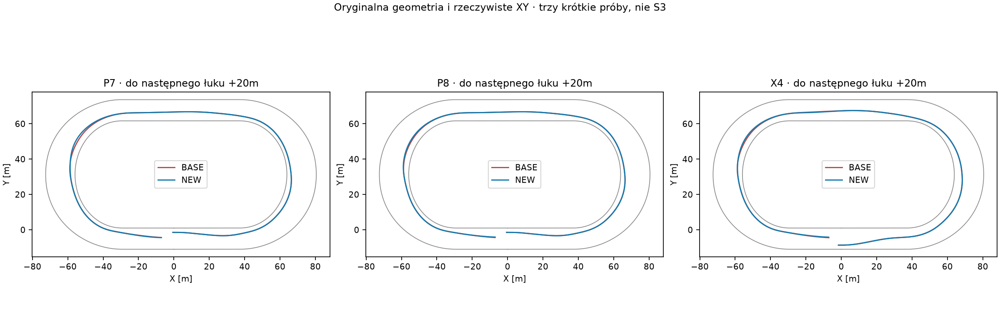
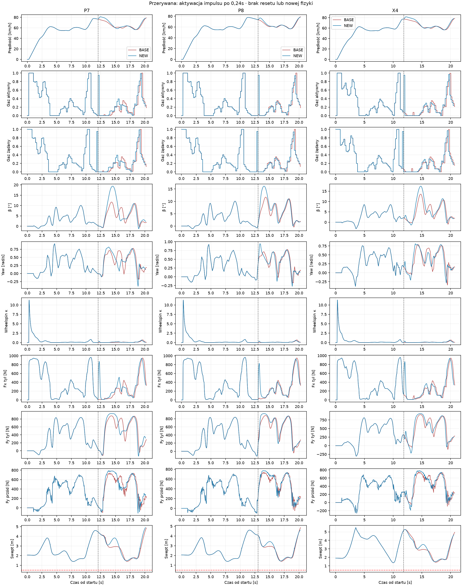
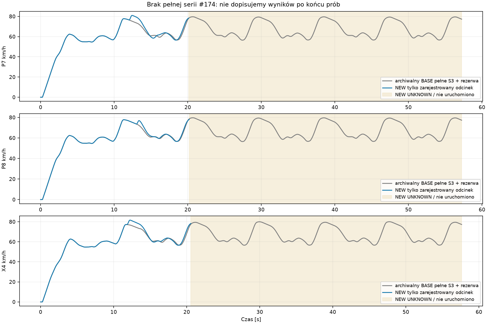
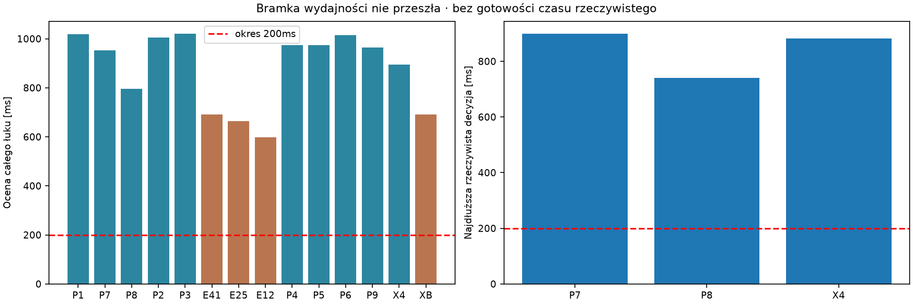

# Badanie #174 — PARTIAL

Status: eksperyment lokalny zakończony po fazie D, bez pełnego S3. Baza #173:
`b306ffec897d11e291d3a90662c9d03b10285391`; zamrożony S3-K4 #172:
`c5f0a4cc4de34fc4c8c47ef912cafabf34055f29`. Osobny program, domyślnie OFF.
Nie zmieniono fizyki ani historycznych plików. Draft PR do gałęzi #173, bez merge.

**Wynik funkcjonalny: NIE POTWIERDZONO pełnego wymagania.** Trzy kontrolowane
manewry są legalne, lecz nie wykonano 8/8 NEW i 8/8 BASE, trzech okrążeń ani
jednosekundowej rezerwy. Nie ma pomiaru regresji mediany S3.

**Wynik sportowy: NIE BADANO.** Próg 5% mediany pełnego S3 pozostaje bez zmian.
**Wydajność: FAIL dla okresu 200 ms.** Ciepłe decyzje z dopuszczeniem trwały
741–899 ms. Zgodnie z sekcją 7 zlecenia nie uruchomiono fazy E. PARTIAL nie
oznacza gotowości do jazdy w czasie rzeczywistym. Zielone CI tego nie zmienia.

## 1. Zastąpienie weta czy zmiana progu?

`StateFeasibility174` nie zmienia `SpeedHeadroom`, 0,65 m/s² ani historycznej
prędkości wejścia. Selektywna nakładka może uchylić odmowę K4, jeśli konkretny
impuls przejdzie krótką prognozę oraz porównanie dwóch przyczynowych kontynuacji
do wspólnego celu. Stare `CanPrepare` jest w tej ocenie wyłącznie zapisywaną
informacją. Nie jest warunkiem przyjęcia.

To **częściowe zastąpienie sposobu dopuszczania**, a nie usunięcie heurystyki
z całego K4. Na stanach nieocenianych oraz w późniejszej kontynuacji działa
zamrożony K4 z dotychczasowymi ograniczeniami. Brak wiarygodnej ścieżki modelu
oznacza odmowę dodatkowego impulsu. Powrót do K4 nie jest dowodem odzyskania
bezpieczeństwa z dowolnego stanu.

## 2. Wykonalność pojedynczego impulsu

Pierwsza warstwa porównuje gaz historyczny, +20 punktów procentowych (do 94%),
95% i 100%, z historycznym skrętem. Horyzont 0,44 s obejmuje opóźnienie 0,24 s
i jeden okres aktywnego impulsu. Predyktor otrzymuje rzeczywisty stan ciała,
heading, wektor prędkości, β/yaw, wał, sprzęgło, tylne koło, aktywną komendę
i całą kolejkę pending. Używa oryginalnych modeli opon, Fx/Fy i geometrii obrysu.

Kandydatem długiej oceny jest 95%. Jeżeli krótka prognoza go odrzuca, dopuszczono
dwie osobne korekty skrętu ±0,01 rad w oryginalnych ograniczeniach. W zapisanych
14 ocenach wystarczył skręt historyczny; korekty nie potwierdzono natywnie.
100% jest diagnostycznym kandydatem, nie automatycznie wybieranym impulsem.

Model wymaga pose i swept ≥0,65 m oraz |β|≤45°. 0,65 m jest konserwatywnym
marginesem oceny modelowej, a nie nową definicją legalności czy współczynnikiem
hamowania. Natywne progi pozostają pose/swept ≥0,5 m. Każda odmowa i jej pierwszy
modelowy punkt naruszenia pozostają w dowodach.

## 3. Następny cały łuk

Druga warstwa rozwidla prywatny stan K4 po aktualnej historycznej decyzji.
Osobno integruje bazę i kandydata, krokami po 0,20 s. Po każdym kroku następna
decyzja zamrożonego K4 wynika wyłącznie z uzyskanej obserwacji modelowej.
Przenosi wał, koło, aktywną komendę i kolejkę, bez resetów. Nie odczytuje
rzeczywistej przyszłej trajektorii do wybrania przyszłych komend.

Celem jest koniec całego następnego łuku (wszystkie trzy sekcje, około 97 m)
plus 20 m następnej prostej. Limit horyzontu wynosi 15 s. P7 wymaga około
8,47 s i 42 przyszłych przeglądów dla samej gałęzi bazowej. Przyjęcie wymaga
legalnych obu ścieżek modelu, osiągnięcia wspólnego celu i przewidywanego zysku
>0,005 s. Oceniany jest czas manewru, nie samo Vmax.

To pełna **prognoza modelowa** następnego łuku, nie certyfikat Box2D ani
niezależny dowód odzyskiwalności. Krótka prognoza 0,44 s nie zastępuje tej oceny.
Po przyjęciu nakładka zobowiązuje się do K4 aż do celu; nie nakłada kolejnego
nowego impulsu w środku analizowanej kontynuacji.

Przesiew kosztu obejmuje proste po pierwszym łuku, odległość 8–45 m do wejścia,
prędkość ≥12 m/s i historyczny gaz <95%. Maksymalnie trzy oceny na następny łuk,
po odmowie co najmniej 8 m odstępu. To ograniczenia zakresu obliczeń, nie granice
fizyki. Zapisane P1–P6 i P9 leżą poza oknem automatycznej oceny; ich hipotetyczne
wyniki nie oznaczają interwencji automatycznej w tych miejscach.

## 4. P7 — archiwum i nowe dopuszczenie

Faza A nie uruchomiła świata. Odczytano wszystkie cztery ramiona #173, pełny
stan wału, koła, sprzęgła i pending. Wspólny fizyczny prefiks zawiera 1206 próbek
ściśle przed aktywacją impulsu. Historyczne 1207 obejmowało próbkę graniczną;
używamy jawnego warunku t<aktywacja−1e−8. Pending jest identyczny przy rozwidleniu,
ale po wysłaniu innej komendy celowo się różni, jeszcze przed jej aktywacją.
Nie utożsamiamy równości fizycznego prefiksu z równością późniejszego pending.

Stan P7: t=11,8 s, s=163,587013 m, V=77,059 km/h, do wejścia 30,802362 m,
historyczny gaz 0, skręt −0,000849764 rad. Stare `CanPrepare` porównuje po
aktywacji i zapasie prędkości v²≈480,927 z budżetem ≈446,303 m²/s². W budżecie
jest historyczne wejście 73,656 km/h i wytracanie 0,65 m/s². Stąd odmowa.
Krótki predyktor nie wykazywał tego naruszenia; jest to weto heurystyki.

Nowa pełna prognoza przewiduje zysk 0,135768 s. Nowa próba natywna potwierdza
dopuszczenie oraz zysk 0,137937 s: BASE 20,274179 s, NEW 20,136242 s do tego
samego celu. Wejście 72,655→78,491 km/h; swept po aktywacji ≥1,469953 m.
Natywne maksimum |β| wzrasta do 19,394°. Dalsze odpuszczanie i korekty wynikają
z niezmienionego K4. Ten nowy świat sprawdza rzeczywisty mechanizm dopuszczenia,
fork i pending, nie służy ponownemu uzyskaniu samych liczb z archiwum #173.

## 5. Inne autentyczne sytuacje

Oceniono P1–P9 oraz pięć dodatkowych stanów #172, bez nowych światów. Przy
odtwarzaniu historii każda decyzja, propozycja i gate są równe zamrożonemu K4;
w 14 punktach kopia prywatnego stanu odtwarza również kolejną decyzję.

Model przyjął 10/14 stanów. W ośmiu stanach stare `CanPrepare` odmawiało;
model uchylił cztery odmowy: P7, P8, P9 i X4. Zatem poza P7 są trzy dodatkowe
modelowe przykłady, z których **dwa** potwierdzono natywnie (P8 i X4).
Sześć innych przyjęć nie jest dowodem zbędnej odmowy `CanPrepare`, ponieważ
ta konkretna reguła ich nie odrzucała.

E41 i E25 odrzucono przez modelowy swept 0,65 m, E12 przez β>45°, XB przez
modelowy swept. Krótkie prognozy przechodzą; długi horyzont ujawnia ryzyko.
Nie wykonano natywnych kontrprób dla tych odmów: ich rzeczywista konieczność
pozostaje UNKNOWN. Nie nazywamy tych czterech odmów udowodnionymi fizycznymi
limitami. Pełne hashe stanów, działania, przyczyny i koszty są w `summary174.json`
oraz skompresowanych rekordach diagnostycznych.

## 6. Legalność natywna

Trzy nowe światy P7, P8 i X4: **3/3 legalne do końca następnego łuku +20 m**,
0 DNF. Wszystkie zaczynają ze swoich oryginalnych zatrzymanych startów.
Nie wstrzyknięto stanu na rozwidleniu. Prefiksy pełnych obserwacji i pending
przy przeglądach porównano z bazą do rozwidlenia; pełny fizyczny prefiks aż
do aktywacji jest równy (1206/1306/1186 próbek). Hashe stanu są równe między
oceną i natywnym wywołaniem. W każdym świecie występuje jedno przyjęcie.

Bazy to oryginalne, zapieczętowane przebiegi K4 #172, bez nowego świata bazowego.
Audyt aktywacji potwierdza opóźnienie 0,24 s i przeglądy 0,20 s. Wspólna
część świata nie jest składaniem trajektorii; NEW jest ciągłym oryginalnym
światem Box2D od startu do celu. Globalne minimalne pose NEW wynoszą
1,479/1,479/1,451 m, swept 1,393/1,393/1,369 m. Minima swept po impulsie:
1,470/1,438/1,491 m. Żadna próba nie osiąga pierwszej mety ani pełnego S3.

## 7. Czas aktywnego gazu ≥95%

Na badanej prostej BASE ma 0,40 s w jednym odcinku 100%; NEW ma łącznie
0,60 s, w dwóch oddzielnych odcinkach. Dodatkowy impuls 95% trwa dokładnie
0,20 s: P7 12,04–12,24 s, P8 13,04–13,24 s, X4 11,84–12,04 s.
Nie uzyskano ciągłego 0,60 s pełnego gazu ani potwierdzenia całych trzech
okrążeń. Żądanie i aktywacja są osobnymi seriami na wykresie.

## 8. Prędkości wejścia i wyjścia

| Próba | Wejście BASE→NEW [km/h] | Minimum łuku BASE→NEW | Wyjście BASE→NEW | Vmax prostej BASE→NEW |
|---|---:|---:|---:|---:|
| P7 | 72,655→78,491 (+5,836) | 56,597→56,550 | 63,095→63,510 (+0,415) | 77,738→80,975 |
| P8 | 72,655→76,289 (+3,634) | 56,597→56,618 | 63,095→63,342 (+0,247) | 77,738→77,738 |
| X4 | 72,854→77,227 (+4,373) | 56,596→56,553 | 62,992→63,264 (+0,272) | 77,231→81,621 |

To wyniki jednego wybranego łuku w krótkich próbach rozwojowych, nie sześciu
łuków niezależnej serii walidacyjnej. P8 poprawia manewr bez wyższego Vmax prostej.

## 9. Czy pełne S3 jest szybsze?

**Nie wiadomo.** Bramka kosztu nie przeszła. Nie wykonano prób integracyjnych
ani 16 światów walidacji. Osiem nowych odłożonych startów ustalono przed
diagnostyką i zapieczętowano hashem protokołu; żaden nie był wejściem kontrolera
ani nowego świata. Każda para w `TABELE.md` ma BASE=NOT_RUN, NEW=NOT_RUN.
Liczba legalnych walidacji to 0 wykonanych z wymaganych 8 dla każdego ramienia,
a nie osiem nielegalnych ukończeń. Wszystkie mediany, czasy trzech okrążeń,
regresja 1% i poprawa 5% pozostają UNKNOWN.

## 10. Prosta a łuk

| Próba | Zysk do wejścia [s] | Zysk wewnątrz łuku [s] | Zysk do celu +20 m [s] |
|---|---:|---:|---:|
| P7 | 0,077512 | 0,059921 | 0,137937 |
| P8 | 0,005150 | 0,067932 | 0,071889 |
| X4 | 0,104166 | 0,047086 | 0,154043 |

W tych trzech próbach łuk nie pochłania zysku. Pozostała różnica dotyczy
20 m po wyjściu. Minimalna prędkość prawie się nie zmienia, lecz całkowity
czas łuku maleje. NEW pokonuje do celu więcej rzeczywistej drogi:
P7 323,546→324,301 m, P8 323,546→323,995 m, X4 329,212→329,672 m.
Nie wolno ekstrapolować tego zysku na pełny wyścig.

## 11. Cena obliczeniowa

| Próba | Mediana [ms] | p95 | p99 | Max / max po pierwszej | Pierwsza decyzja | CPU oceny [s] | Prognozy K4 + dodatkowe | CPU krótkiego świata [s] |
|---|---:|---:|---:|---:|---:|---:|---:|---:|
| P7 | 9,514 | 39,528 | 453,868 | 899,050 | 14,756 | 0,938 | 1548+1540=3088 | 3,391 |
| P8 | 8,250 | 17,430 | 57,157 | 741,250 | 0,231 | 0,766 | 1599+1418=3017 | 1,875 |
| X4 | 8,750 | 17,110 | 50,508 | 882,346 | 0,214 | 0,891 | 1618+1676=3294 | 1,922 |

Czasy decyzji są mierzone zegarem monotonicznym; CPU jest czasem procesora.
Tabela obejmuje wszystkie decyzje od startu do lokalnego celu. Pierwsza
decyzja P7 jest pierwsza w procesie fazy D; P8/X4 rozpoczynają kolejne światy
w tym samym procesie, więc nie są niezależnymi zimnymi startami JIT. Długa
decyzja występuje później, na już rozgrzanym K4. Jej koszt nie znika po
odrzuceniu pierwszej próbki. Wcześniejsza faza C dodatkowo rozgrzała inne
procesy, nie proces D. Samodzielne oceny 14 zapisanych stanów również
znacząco przekraczały 200 ms.

Selektywne sprawdzanie ogranicza liczbę wywołań, lecz nie koszt pojedynczego
wywołania. Dwie długie kontynuacje wykonują dziesiątki przyszłych przeglądów,
a każdy uruchamia wewnętrzne predykcje K4. Liczba prognoz w starym polu
`Run.Forecasts` obejmuje tylko bazowe K4; raport dodaje aktywację, shortlistę,
kroki kontynuacji i prognozy przyszłych przeglądów. Pełnej sumy zapytań
kontaktowych nie raportujemy, bo osobny krótki forecast aktywacji nie zapisał
licznika zapytań. Nie uzupełniamy go szacunkiem.

CPU całego NEW S3: UNKNOWN. Podane 3,391/1,875/1,922 s to krótkie światy,
nie koszt całego wyścigu. Dla czterech zawodników równoczesna potrzeba takich
ocen jest wyraźnym ograniczeniem: cztery szeregowe oceny o zaobserwowanym
koszcie to około 3–4 s. To ekstrapolacja, nie pomiar czterech motocykli.
Nie ogłaszamy gotowości do czasu rzeczywistego.

## 12. Pozostałe referencje

Zachowano historyczny gaz, ujemną korektę prędkości, docelową prędkość wejścia,
lokalne korekty wheelspin i dotychczasowy globalny planer K4. Jego tempo jest
zamrożone na 0, z dotychczasowym zakresem poprawek. Oceniane kontynuacje wciąż
korzystają z tych referencji; nakładka uchyla wybrane odmowy, nie usuwa
wszystkich przyczyn małego gazu. Modelowe odmowy nie dowodzą uniwersalnej
osiągalnej granicy prędkości motocykla.

## 13. Co ogranicza dalsze przyspieszanie?

Pierwszą wykazaną przeszkodą wdrożenia jest koszt pełnej, zagnieżdżonej oceny.
Kolejne: nieznana odporność pełnych trzech okrążeń, odchylenie modelu od
Box2D, bezpieczna częstotliwość kolejnych impulsów oraz pozostawione
referencje K4. Wyższe wejście zwiększyło β; w czterech innych stanach model
przewidział utratę zapasu. Brak natywnych kontrprób nie pozwala powiedzieć,
czy jest to fizyczny limit, czy ostrożność modelu.

Potrzebna byłaby tańsza, zachowująca przyczynowość ocena oraz jej osobna
walidacja. W tym badaniu nie zmieniano parametrów po wynikach i nie
rozpoczęto #175. Zachowano również wszystkie odmowy oraz niewykonane etapy.

## Dowody i odtwarzanie

- [Tabele wszystkich prób i ośmiu niewykonanych par](TABELE.md),
  [identyfikacja każdej oceny](STANY.md), [dane liczbowe](summary174.json),
  [budżet](BUDGET.json).
- `174-diagnostics.zip`: dowód archiwalny, pełne stany, prognozy, hashe,
  cztery odmowy, protokół, odłożone starty, źródła wykonywanych wersji,
  rezerwacje i rachunki CPU, zamknięcie bramki.
- `174-native.zip`: komplet trzech ciągłych nowych światów, decyzji, planów,
  dopuszczeń, wyników, porównań prefiksów i źródeł wykonania.
- `INPUTS.json`: zamrożone wejścia historyczne. `SHA256SUMS`: nowe źródła,
  raport, tabele, wykresy, testy, workflow i archiwa. Git SHA identyfikuje całość.
- `python tools/state-feasible-throttle/verify174.py` sprawdza zapieczętowane
  dowody bez predykcji lub nowego świata. `generate174.py --check` potwierdza,
  że cztery pochodne #172 dodają wyłącznie funkcje kopiowania stanu.
- Windows CI buduje osobny program, wymaga OFF i uruchamia audyt bez nowych
  prób badawczych. Pełny wynik CI i końcowy SHA są zapisane przy Draft PR
  i w osobnym pokwitowaniu publikacji; nie zmieniają werdyktu badania.

Budżet prób i diagnostyki: 3/24 światy (3/6 rozwojowych, 0 integracyjnych,
0/16 walidacyjnych), poniżej 300 CPU-s. Dokładny końcowy rachunek w
`BUDGET.json` obejmuje też analizę i pakowanie. Kompilacja, testy regresji
i CI nie są kolejnymi próbami tego eksperymentu.

