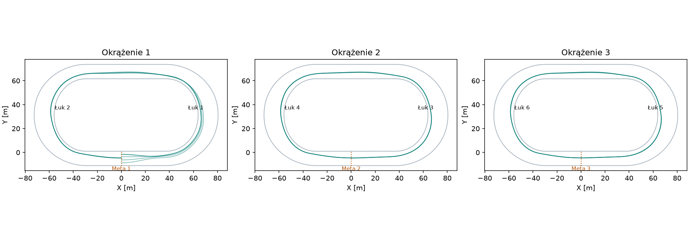
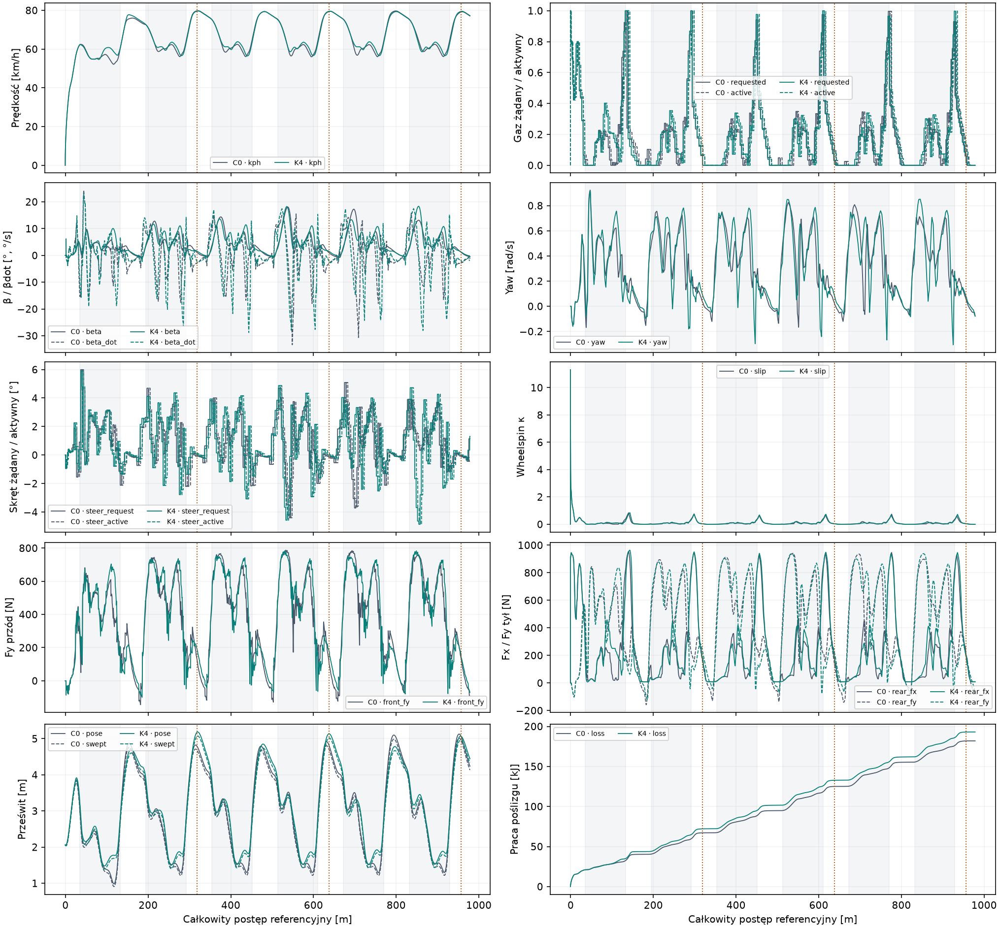
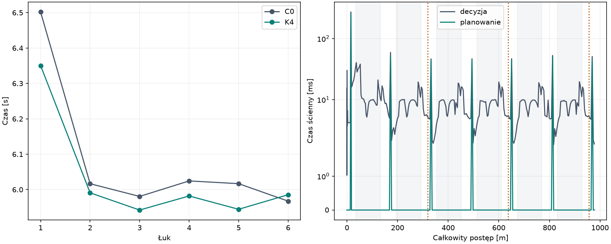

# Badanie #172 — ciągłe trzy okrążenia

Baza: `8fbd10e87b18af79b801c338230619fecebaa7c2`, badanie #171 / Draft PR #170.
Gałąź: `experiment/three-lap-global-planning-172`. Eksperyment jest osobnym CLI,
domyślnie OFF; nie jest włączany w produkcyjnym wyścigu. Bez merge.

**Wynik natywny: 5/5 legalnych S3-K4 i 5/5 dopasowanych S3-C0.**
Każdy bieg obejmuje sześć ukończonych łuków, dokładnie trzy zaliczone mety
i co najmniej sekundę dalszych autonomicznych decyzji w tym samym świecie Box2D.
K4 przyjął plany wszystkich sześciu łuków w każdej próbie. Zero DNF,
zero interwencji awaryjnych w końcowej serii. Formalny **PASS funkcjonalny
oczekuje na pełny Windows CI końcowego SHA**; wynik CI i SHA zostaną zapisane
w opisie Draft PR bez zmiany zamrożonych wyników. **Brak PASS sportowego.**

## Metoda, audyt i ciągłość

Audyt wykonany przed zmianami znajduje się w [AUDYT.md](AUDYT.md).
`BendMap` #171 poprawnie opisuje cykliczną geometrię, lecz warunek `second`
w #170 i końcowe ograniczenie profilu #166 nie obsługiwały całego wyścigu.
Nowe adaptory naprawiają wybór wizyty łuku i referencję prostych. Całkowity
postęp, lokalna pozycja, okrążenie, segment, logiczny łuk i sekcja pozostają
osobnymi polami. Długość okrążenia z rzeczywistego `TrackFrame` wynosi
318,77874994277954 m. Główna prosta ma 62 m; prosta przez metę obejmuje
27 m przed i 35 m po mecie. Żadnej z tych granic nie zastąpiono nową geometrią.

Pierwszy łuk po starcie zachowuje profil startowy. Wszystkie późniejsze łuki
otrzymują nominalny profil lotny drugiego łuku #171, mapowany na rzeczywistą
geometrię i aktualny stan. Plan jest zakotwiczony w przewidywanym położeniu,
kursie, β i yaw przy aktywacji komendy. Korekta Hermite'a płynnie łączy stan
z linią K4; cała rodzina K4 i tempo pozostają z #171. Nie trenujemy nowej polityki.

Pierwsze C1/C2/C3 (`a`) były fizycznie legalne, lecz po pierwszych dwóch łukach
K4 przechodził do cyklicznego C0: dawny filtr 86% budżetu odrzucał plany lotne.
Dlatego `c3a` nie stanowi dowodu pełnego S3-K4. Trzy odczytowe sondy `q1–q3`
na zapisanych stanach wykazały dwie przyczyny: niepełne zakotwiczenie linii
oraz zbyt zachowawczy filtr. Legalny natywny C0 używał około 90–94% budżetu
opon. W adapterze filtr planera używa 100% **tej samej** fizycznej pojemności.
Nie zmieniono μ, sił, silnika ani ograniczeń legalności. Po tej korekcie
ponowne C1/C2/C3 (`b`) zaliczyły wszystkie wymagane fazy i sześć planów K4.

Lokalne prognozy #170 zachowują opóźnienie 0,24 s, decyzje co 0,2 s,
rzeczywisty napęd oraz całą nieodwołalną kolejkę pending. Dodatkowa kontrola
przejścia sprawdza prognozę 0,44 s i skok skrętu względem ostatniej komendy
w kolejce. W końcowej walidacji nie wymagała żadnej naprawy. Zmiana mety
w adapterze świata dotyczy wyłącznie diagnostycznej kontynuacji: zawodnik
pozostaje `Racing`, callback nie ustaje po trzecim przecięciu, a licznik
zaliczonych okrążeń nadal kończy się na trzech. Nie ma resetu ciała, prędkości,
β/yaw, koła, wału, sprzęgła, komend ani historii regulatora.

## Zamrożona seria

Pięć różnych stanów zapisano w `held.json` i zapieczętowano przed rozwojem.
Obejmują pola A–D, ujemny postęp początkowy i różne legalne offsety.
Przed serią `v1` zapisano hashe kodu, parametrów, profili i stanów w `freeze.json`.
Każda para startuje z identycznego spoczynku; wszystkie komendy są autonomiczne.
Po serii nie zmieniano kontrolera, parametrów ani stanów i nie uruchamiano
dalszych światów #172. C0 oznacza eksperymentalną cykliczną adaptację #170
z tą samą naprawioną architekturą i lokalną kontrolą przejść, bez globalnego K4.

| Stan | K4 [s] | C0 [s] | Poprawa |
|---|---:|---:|---:|
| S1 | 56.225152 | 56.520178 | 0.522% |
| S2 | 56.233406 | 56.580226 | 0.613% |
| S3 | 56.434972 | 56.667327 | 0.410% |
| S4 | 56.628495 | 56.997099 | 0.647% |
| S5 | 56.330828 | 56.662016 | 0.584% |

Mediana K4: **56.330828 s**, C0: **56.662016 s**.
Mediana poprawy parami: **0.584%**; stosunek median daje tę samą wartość po zaokrągleniu.
K4 wygrywa we wszystkich pięciu parach, lecz pozostaje poniżej bramki 5%.

| Metryka K4 — mediana pięciu prób | Okr. 1 | Okr. 2 | Okr. 3 |
|---|---:|---:|---:|
| Czas [s] | 20.754 | 17.792 | 17.795 |
| Łuk 1 [s] | 6.350 | 5.950 | 5.956 |
| Łuk 2 [s] | 5.991 | 5.961 | 5.965 |
| Vmax prostej 1 [km/h] | 77.231 | 79.382 | 79.413 |
| Vmax prostej 2 [km/h] | 79.642 | 79.558 | 79.475 |
| Vmin łuku 1 [km/h] | 54.648 | 56.586 | 56.616 |
| Vmin łuku 2 [km/h] | 56.596 | 56.656 | 56.643 |
| V wyjścia 1 [km/h] | 60.674 | 63.201 | 63.321 |
| V wyjścia 2 [km/h] | 63.095 | 63.022 | 62.968 |
| Gaz aktywny ≥95% [% czasu] | 6.746 | 2.248 | 2.248 |
| Max β bezwzględne [°] | 12.075 | 16.929 | 17.550 |
| Min pose [m] | 1.479 | 1.539 | 1.536 |
| Min swept [m] | 1.392 | 1.448 | 1.445 |
| CPU świata z decyzjami [s] | 1.031 | 0.922 | 0.938 |

Tabela [PRZEJAZDY.md](PRZEJAZDY.md) zachowuje każdy z 16 światów oraz osobne
okrążenia. Niepełne końcówki C1/C2 są oznaczone brakiem czasu S3 w pierwszej
tabeli. W tabelach prostych odcinek przez metę obejmuje także początek kolejnego
okrążenia; ostatnia taka prosta jest **niepełna**, bo zapis kończy się po
sekundzie rezerwy. Jej Vmax i gaz opisują wyłącznie zaobserwowany fragment.
CPU okrążenia interpolowano między licznikami procesu, z rozdzielczością Windows
15,625 ms. Median poszczególnych kolumn nie należy sumować jako jednej próby.

## Odpowiedzi na 11 pytań

1. **Sterowanie na kolejnych okrążeniach naprawiono w badanym zakresie.**
   Test bezświatowy pokrywa 18 sekcji, sześć wizyt łuku, trzy mety,
   granice wszystkich segmentów z obu stron i ujemny postęp startu.
   Referencje offsetu, kursu, β, yaw, prędkości i gazu są ciągłe na granicach.
   Odtworzenie każdej próbki sprawdza pełne pending i aktywację po 0,24 s.
2. **Ten sam `CyclicController172` przejechał wszystkie sześć łuków** w każdym
   z pięciu odłożonych biegów. Nie sklejano prefiksów ani światów.
3. **K4 planuje cały łuk na okrążeniach 2 i 3.** Każdy bieg zawiera sześć
   przyjętych planów K4 (`Entry=.8, Middle=.75, Exit=.75`) i siódmy plan
   przygotowujący następny łuk już w rezerwie po mecie. Zero replanowań
   w końcowej serii. Archiwa zawierają wszystkie ocenione kandydaty i linie.
4. **5/5 K4 oraz 5/5 C0 legalne.** Nie było DNF; rejestr `failure` ma wartość
   `null` dla każdego świata. Każdy wynik zachowuje `FirstBadTime` i
   `FirstBadReference`, a audytor ma ścieżkę zapisania pierwszego złego stanu,
   poprzedniej próbki i ostatniej decyzji. Brak porażek nie jest pominięciem prób.
5. **Mediana S3 to 56,331 s.** Rozkład median okrążeń to
   **20,754 / 17,792 / 17,795 s**; każdy indywidualny rozkład jest w tabelach.
6. **Po starcie przyspiesza, potem tempo jest stabilne.** Pierwsze okrążenie
   zawiera rozpędzanie od zera; lotne wejścia zaczynają się około 75 km/h.
   Kolejne dwa okrążenia różnią się w medianie o około 0,002 s, bez oznak
   narastającej degradacji. Powodem różnicy pierwszego okrążenia są widoczne
   w telemetrii warunki startu, a nie reset strategii na mecie.
7. **Pełny aktywny gaz na prostych jest krótki.** Poniżej czasy ≥95%
   z rzeczywistej komendy aktywnej, bez zaliczania samego żądania:

   | Stan K4 | Proste okr. 1 [s] | Proste okr. 2 [s] | Proste okr. 3 [s] |
   |---|---:|---:|---:|
   | S1 | 0.400 / 0.200 | 0.200 / 0.200 | 0.200 / 0.200 |
   | S2 | 0.400 / 0.200 | 0.200 / 0.200 | 0.200 / 0.200 |
   | S3 | 0.200 / 0.200 | 0.200 / 0.200 | 0.200 / 0.200 |
   | S4 | 0.400 / 0.200 | 0.200 / 0.200 | 0.200 / 0.200 |
   | S5 | 0.400 / 0.200 | 0.200 / 0.200 | 0.200 / 0.200 |

   Druga prosta okrążenia 3 jest ucięta po rezerwie. Udział ≥95% na całym
   okrążeniu lotnym wynosi około 2,25%; całe okrążenie obejmuje też łuki.
   Nie jest to dowód długiej jazdy na pełnym gazie ani osiągnięcia 110–120 km/h.
   Proste osiągają około 76–80 km/h. Tempo i Vmin nie regresują względem C0.
8. **Największy spadek prędkości pozostaje w pierwszych sekcjach łuków lotnych**
   (wejście około 75, wyjście sekcji około 59–61 km/h). Końcowe sekcje także
   zawierają lokalne minima około 56,5 km/h przed odzyskaniem około 63 km/h
   na wyjściu. Tabela energii poniżej rozdziela pracę poślizgu i wszystkie
   raportowane straty; nie utożsamia ich z samą zmianą energii kinetycznej.
9. **K4 daje niewielką, spójną przewagę czasową nad C0: 0,584%.**
   Jednocześnie jedzie dłuższą drogą, więc zysk nie wynika ze skrócenia trasy.
   Mediany drogi i prędkości wyliczone z rzeczywistego ruchu:

   | Wariant | Droga do trzeciej mety [m] | Średnia [km/h] |
   |---|---:|---:|
   | K4 | 995.334 | 63.610 |
   | C0 | 992.055 | 63.074 |

10. **Koszt solo jest mały średnio, lecz nie ma gwarancji czasu rzeczywistego.**
    Mediana biegu z rezerwą: 2.969 CPU-s; regulator razem z planowaniem:
    2.609 CPU-s, z czego planer 0.312 CPU-s. Średnia decyzja
    zajmuje 8,74–11,01 ms czasu ściennego. Zimna pierwsza decyzja planująca
    osiągnęła **272,41 ms**, przekraczając okres 200 ms; pozostałe maksima
    to około 51–53 ms. Jest to symulacja offline, bez obietnicy twardego terminu.
    Proste mnożenie kosztu solo przez cztery daje 11.875 CPU-s na wyścig
    i około 35–44 ms na wspólną turę czterech decyzji średnio, lecz zimne
    maksima mogą się sumować do ponad sekundy. Nie testowano czterech rywali
    w jednym świecie; współdzielenie i interakcje mogą zmienić koszt.
    `prediction_wall_ms` obejmuje prognozy wewnętrznego trackera, a dodatkową
    prognozę przejścia zawiera pełny czas decyzji, bez osobnego stopera.
11. **Nie rozstrzygnięto jednego dominującego ograniczenia dalszego przyspieszania.**
    Dowody wskazują zarówno regulator/profil, jak i wykorzystanie przyczepności:
    na prostych gaz zostaje wcześnie ograniczony, a na wejściach lotnych
    wykorzystanie opon dochodzi do około 90–95%. Część środkowych sekcji ma
    wyraźny zapas. Szczytów chwilowego budżetu nie można traktować jako
    dowodu, że cały łuk osiąga granicę fizyczną. Nie wykonano ablacji linii,
    regulatora, przekładni ani modelu napędu. Brak podstaw do twierdzenia,
    że silnik lub μ trzeba zwiększyć. Większa praca poślizgu K4 również
    wymaga dalszej analizy; mniejszy czas nie oznacza mniejszych strat energii.

## Energia sekcji — mediany pięciu K4

Praca z natywnych sił i prędkości poślizgu, sumowana proporcjonalnie na granicy
sekcji. Front Fx jest zerem w oryginalnym modelu; wykres pokazuje front Fy
oraz tylne Fx/Fy. Szczegółowe składowe energii, siły, prędkości i ich ekstrema
dla każdej próby zawiera `summary.json` oraz surowe archiwa.

| Łuk | Sekcja | V wej.→wyj. [km/h] | Poślizg przód/tył boczny/tył wzdłużny [kJ] | Straty netto [kJ] |
|---:|---:|---:|---|---:|
| 1 | 1 | 62.73→54.79 | 1.749 / 2.183 / 0.069 | 7.312 |
| 1 | 2 | 54.79→60.70 | 1.292 / 1.659 / 1.051 | 7.785 |
| 1 | 3 | 60.70→60.67 | 2.227 / 3.073 / 0.962 | 10.082 |
| 2 | 1 | 72.66→61.05 | 3.617 / 4.622 / 0.170 | 12.378 |
| 2 | 2 | 61.05→63.42 | 1.906 / 2.550 / 0.959 | 9.471 |
| 2 | 3 | 63.42→63.10 | 2.496 / 3.398 / 1.477 | 11.369 |
| 3 | 1 | 75.29→60.71 | 4.429 / 5.814 / 0.200 | 14.570 |
| 3 | 2 | 60.71→63.56 | 1.731 / 2.077 / 0.865 | 8.687 |
| 3 | 3 | 63.56→63.20 | 2.538 / 3.476 / 1.566 | 11.619 |
| 4 | 1 | 75.21→59.78 | 4.758 / 6.795 / 0.290 | 15.977 |
| 4 | 2 | 59.78→63.51 | 1.579 / 1.859 / 0.888 | 8.395 |
| 4 | 3 | 63.51→63.02 | 2.497 / 3.400 / 1.438 | 11.345 |
| 5 | 1 | 75.26→60.51 | 4.472 / 5.914 / 0.200 | 14.687 |
| 5 | 2 | 60.51→63.56 | 1.682 / 2.056 / 0.878 | 8.654 |
| 5 | 3 | 63.56→63.32 | 2.543 / 3.457 / 1.587 | 11.608 |
| 6 | 1 | 75.19→59.48 | 4.869 / 7.052 / 0.342 | 16.405 |
| 6 | 2 | 59.48→63.50 | 1.526 / 1.794 / 0.915 | 8.307 |
| 6 | 3 | 63.50→62.97 | 2.492 / 3.381 / 1.435 | 11.273 |

## Dowody, budżet i odtwarzanie

Zużyto **16/30 nowych światów i 59,34375/500 CPU-s** w rejestrowanych fazach
badania: sześć światów rozwojowych i dziesięć zamrożonej walidacji. Zero światów
powstało w audycie mapowania ani trzech sondach. Licznik faz obejmuje kontroler,
natywny świat, obserwacje i zapis archiwów; nie obejmuje kompilatora, testów
regresyjnych ani późniejszego renderowania/analizy Python. Nie należy
przedstawiać 59,34 s jako kosztu całej sesji programistycznej.

`172-development.zip`, `172-validation-K4.zip`, `172-validation-C0.zip`
zawierają wszystkie 16 biegów, pełne native/decisions/plans/cpu/result.
`172-protocol.zip` zawiera rezerwacje, dziennik, mapowanie, geometrię, hashe,
freeze i sondy, także dane z wcześniejszych wersji rozwojowych. Zakończenia
każdego biegu są w `summary.json:rows[].last_state`, a ciągłość na metach
w `finishes` (koło, wał, aktywna komenda i pending). Brak resetu jest dodatkowo
sprawdzany przez zgodność każdego stanu kolejki z całą historią komend.

Dwa niezależnie uruchomione powtórzenia prefiksu wersji końcowej są bitowo
identyczne: C1b→C2b przez 22,89 s (2295 próbek) i C2b→C3b przez 40,70 s
(4080 próbek), wraz z siłami, napędem i decyzjami; hashe zapisano w
`repeated_native_prefixes`. Jest to test deterministycznego odtwarzania
prefiksów. Pięć różnych holdoutów to niezależne testy odporności, a nie
pięciokrotne powtórzenie jednego stanu. Pełnej walidacji nie uruchamiano
ponownie po poznaniu wyniku. Audyt archiwów można odtworzyć bez nowych światów.

Historyczne #161 ma tę samą długość okrążenia i geometrię progressive-b,
lecz inne stany początkowe (postęp 0 i offsety 1,25–9 m), inny kontroler
i inną obsługę zakończenia. Nie ma identycznej pary startowej z #172.
**79,603 s pozostaje wyłącznie kontekstem**, bez procentowego porównania sportowego.

Historyczne pliki #166–#171 oraz produkcyjna fizyka pozostają niezmienione.
Generator z kontrolą dokładnych kotwic i `--check` potwierdza pochodzenie
adapterów; `freeze.PhysicsSha256` oraz `SHA256SUMS` chronią źródła i dowody.
Nowy test Python odtwarza audyt wszystkich kolejek i met z opublikowanych
archiwów. Instrukcja CLI i odtworzenia jest w `tools/three-lap-global-planning/README.md`.

## Wykresy

Na wykresach postępu szare obszary oznaczają sześć łuków, pomarańczowe linie
trzy mety. XY pokazuje wszystkie pięć K4 osobno na każdym okrążeniu;
telemetria i koszt pokazują reprezentatywną parę S1. Wszystkie pozostałe
próbki są zachowane w archiwach.

## Regresja i CI

Lokalnie: restore z lockfile i build Release narzędzia #172 oraz rozwiązania
z `--warnaserror`; 172/172 dobranych testów C# (TwoContact, RearWheel,
FreeRacing, StandingStart); 440/440 testów Python kalibracji; 7/7 testów
polityki CI; 124/124 testy Node. Bezświatowy test nowego kroku CI także
potwierdził 18 sekcji, sześć łuków i trzy mety. Generator `--check` PASS.

NuGet zwracał lokalnie NU1900 z powodu niedostępnej usługi danych podatności.
Lokalny restore wykonano z flagą `-p:NuGetAudit=false`; nie zmienia ona
repozytorium ani fizyki. CI zachowuje zwykły restore i audyt.

Pierwsza seria Python wykryła nieaktualny manifest, gdy analiza była jeszcze
regenerowana równolegle (439 PASS, 1 FAIL integralności summary.json).
Po zakończeniu analizy i aktualizacji manifestu powtórzono całą serię.
Nie zmieniano zamrożonych wyników ani kontrolera.

Pełny Windows CI końcowego SHA jest wymagany przed ostatecznym PASS
funkcjonalnym. Jego końcowy wynik, link i zweryfikowane SHA będą w Draft PR.
Niezależnie od CI poprawa 0,584% pozostaje poniżej 5%, więc sportowy PASS
nie przysługuje. Nie wykonano merge ani kolejnego badania.
