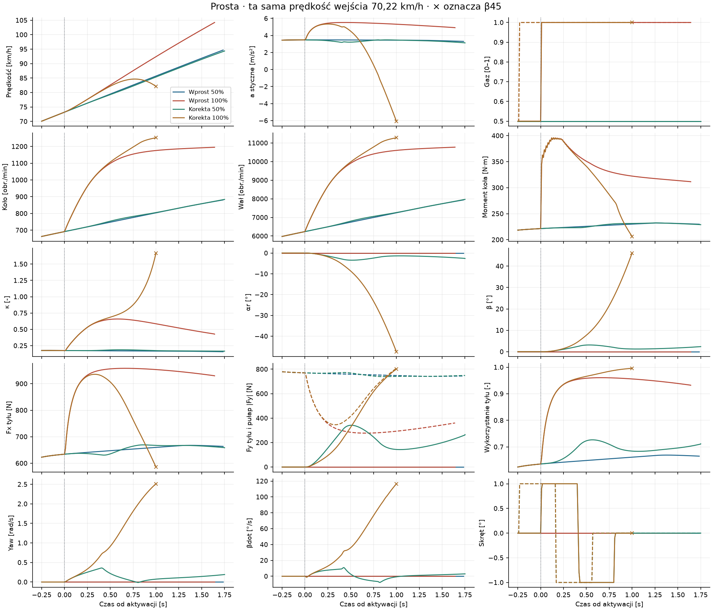
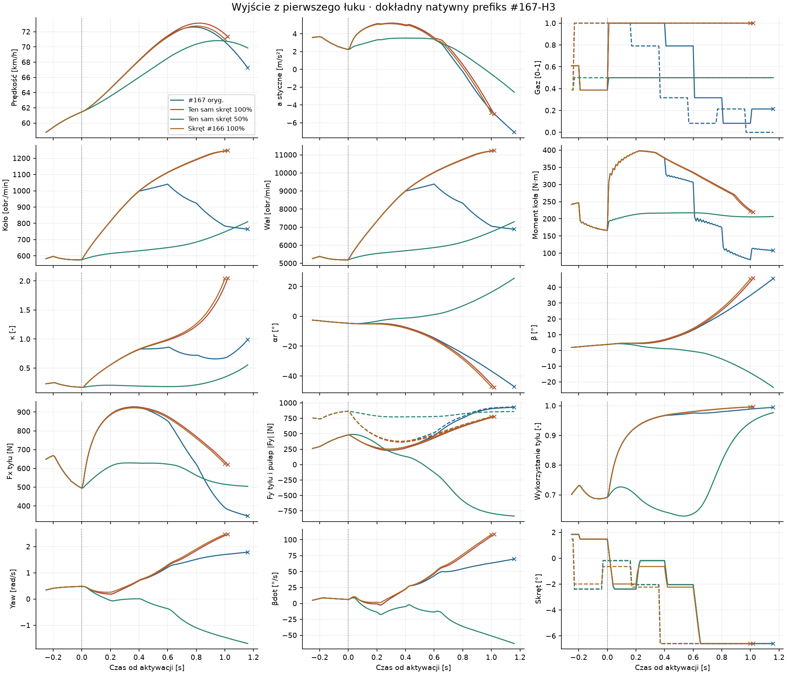
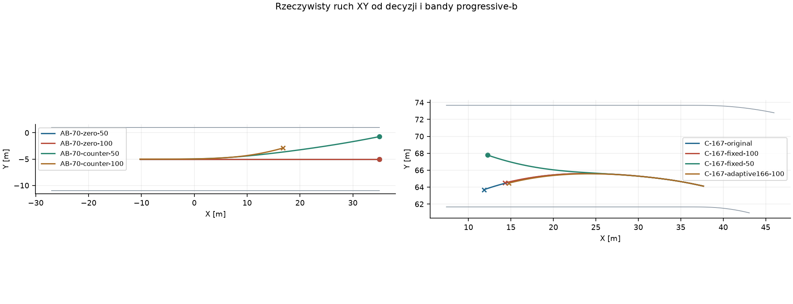
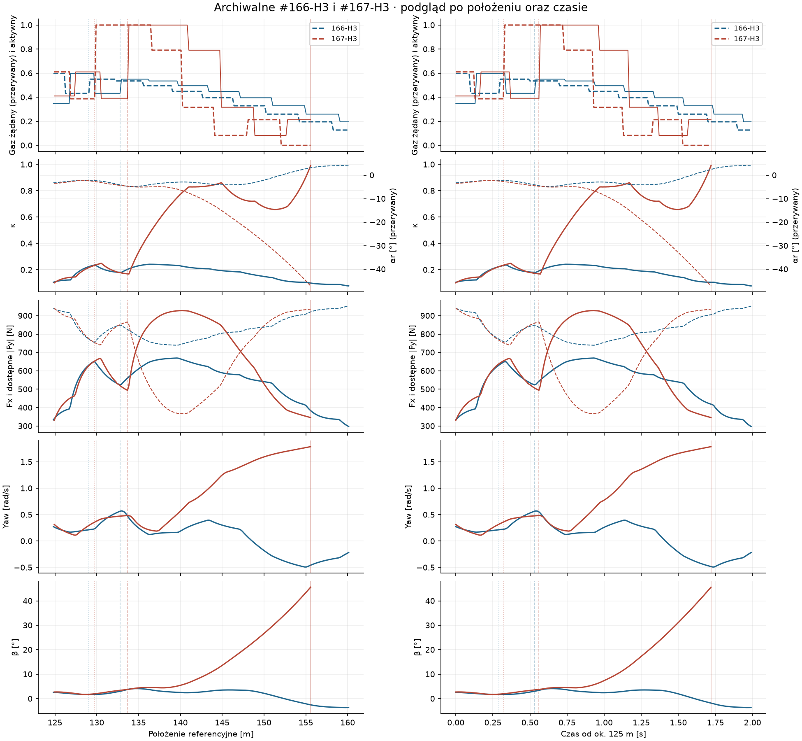
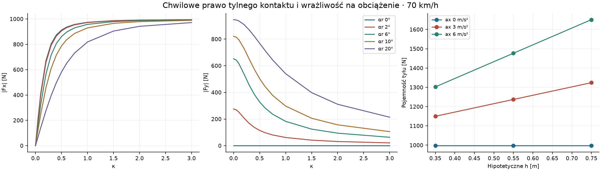

# Badanie #168 · pełny gaz, wheelspin i przyczepność

**PASS diagnostyczny.** Pełny gaz daje napęd na idealnej prostej. Przy nawet małym skręcie obecny model traci stabilność boczną pod dużym obciążeniem napędowym. W H3 #167 decyzja o pełnym gazie zastała jeszcze małe β, ale istniejący yaw i boczny ruch kontaktu. Identyczne powtórzenia odseparowały skutki żądanego momentu od początkowego stanu i późniejszych komend skrętu.

Bazą jest `c66024dfd5905f6120c224ebeeee60e8a866ba20`. Badanie jest odrębnym narzędziem PROVISIONAL uruchamianym jawną komendą. W pomiarach użyto oryginalnego Box2D, progressive-b, tej samej masy, silnika, sprzęgła, opon i nawierzchni oraz bramek β45 i swept 0,5 m.

## Warunki porównania

- **A i B1** korzystają z tych samych sześciu prób wprost. B2 trzyma żądanie +1°. B3 żąda +1° przez 0,4 s, −1° przez 0,4 s, a potem 0°. Kierownica reaguje przez oryginalny aktuator. Prosta przed kresą i za nią ma razem 62 m. Pozycja startowa to −25 m. Oryginalny inicjalizator spina początkowe prędkości nadwozia, koła i wału, po czym każdy motocykl przechodzi 0,8 s natywnego rozpędzania ze wspólnym żądaniem 50%. Prędkości przy rozwidleniu wynoszą 60,24, 70,22 i 80,06 km/h. Okno kończy się po 2 s od żądania, na końcu prostej albo przy pierwszej bramce.

- **C** odtwarza każdy prefiks od zatrzymanego startu w osobnym, ciągłym świecie Box2D. Pierwsza decyzja przy s ≥ koniec łuku minus 4 m wyznacza rozwidlenie. To 129,05 m dla #166 i 129,75 m dla #167. Oryginalne polityki przeliczyły decyzje, a zapis stanu do rozwidlenia oraz dalszy przebieg ramienia oryginalnego zweryfikowano z historią do 11 ms przed końcem okna. W ramionach 50% i 100% składnik skrętu pochodzi z tych samych zarchiwizowanych decyzji. Osobno sprawdzono aktywne sprzężenie kierownicy #166 przy wymuszeniu pełnego gazu na obu stanach. Okno C trwa 1,4 s od żądania.

Wszystkie pary miały zgodne hashe przy rozwidleniu, włącznie z aktywnymi komendami, pending i wałem. Fizyczne próbki do chwili aktywacji były identyczne. Kolejka zachowuje 0,24 s opóźnienia i review co 0,2 s. Polecenie skrętu z archiwum służy jako interwencja przyczynowa w C. Zmiana trajektorii po interwencji zmienia warunki dla dalszych poleceń.

## Wyniki od aktywacji

Prędkość początkowa w tabeli dotyczy rozwidlenia przed opóźnieniem. ΔV liczy się od aktywacji do indywidualnego końca. Maksima αr, β, yaw, Fx i Fy dotyczą wartości bezwzględnych. κ to stosunek poślizgu wzdłużnego w lokalnym kontakcie tylnym. Średnią κ ważono czasem kroku. Przyrosty prędkości przed aktywacją i wspólne okna par są w metrykach.

| Scenariusz | V pocz. [km/h] | Gaz | ΔV [km/h] | Śr./max κ | Max αr [°] | Max β [°] | Max yaw [rad/s] | Max Fx [N] | Max Fy [N] | Status |
|---|---:|---|---:|---:|---:|---:|---:|---:|---:|---|
| AB-60-zero-50 | 60,24 | 50% | 21,94 | 0,175 / 0,182 | 0,00 | 0,00 | 0,00 | 659 | 0 | koniec okna · 1,760 s |
| AB-60-zero-100 | 60,24 | 100% | 34,54 | 0,656 / 0,818 | 0,00 | 0,00 | 0,00 | 967 | 0 | koniec okna · 1,760 s |
| AB-60-one-degree-50 | 60,24 | 50% | 11,98 | 0,247 / 0,506 | 22,00 | 20,44 | 1,33 | 613 | 794 | swept <0,5 m · 1,440 s |
| AB-60-one-degree-100 | 60,24 | 100% | 9,83 | 0,858 / 1,964 | 47,64 | 45,82 | 2,71 | 943 | 783 | β45 · 0,970 s |
| AB-60-counter-50 | 60,24 | 50% | 21,79 | 0,178 / 0,189 | 2,66 | 2,34 | 0,31 | 658 | 280 | koniec okna · 1,760 s |
| AB-60-counter-100 | 60,24 | 100% | 10,80 | 0,860 / 1,917 | 47,24 | 45,49 | 2,62 | 943 | 782 | β45 · 1,030 s |
| AB-70-zero-50 | 70,22 | 50% | 21,48 | 0,168 / 0,175 | 0,00 | 0,00 | 0,00 | 668 | 0 | koniec prostej · 1,735 s |
| AB-70-zero-100 | 70,22 | 100% | 31,02 | 0,540 / 0,659 | 0,00 | 0,00 | 0,00 | 958 | 0 | koniec prostej · 1,641 s |
| AB-70-one-degree-50 | 70,22 | 50% | 8,36 | 0,271 / 0,651 | 29,89 | 28,45 | 1,56 | 637 | 827 | swept <0,5 m · 1,360 s |
| AB-70-one-degree-100 | 70,22 | 100% | 8,49 | 0,727 / 1,627 | 46,48 | 45,02 | 2,58 | 936 | 796 | β45 · 0,940 s |
| AB-70-counter-50 | 70,22 | 50% | 21,16 | 0,175 / 0,188 | 3,45 | 3,14 | 0,36 | 669 | 342 | koniec prostej · 1,751 s |
| AB-70-counter-100 | 70,22 | 100% | 8,91 | 0,740 / 1,670 | 47,49 | 46,12 | 2,51 | 936 | 802 | β45 · 1,000 s |
| AB-80-zero-50 | 80,06 | 50% | 17,70 | 0,160 / 0,168 | 0,00 | 0,00 | 0,00 | 668 | 0 | koniec prostej · 1,472 s |
| AB-80-zero-100 | 80,06 | 100% | 25,58 | 0,449 / 0,529 | 0,00 | 0,00 | 0,00 | 945 | 0 | koniec prostej · 1,413 s |
| AB-80-one-degree-50 | 80,06 | 50% | 5,28 | 0,283 / 0,738 | 35,47 | 34,28 | 1,66 | 657 | 848 | swept <0,5 m · 1,320 s |
| AB-80-one-degree-100 | 80,06 | 100% | 6,99 | 0,622 / 1,414 | 46,58 | 45,44 | 2,47 | 924 | 816 | β45 · 0,940 s |
| AB-80-counter-50 | 80,06 | 50% | 14,87 | 0,190 / 0,254 | 11,98 | 11,24 | 0,80 | 666 | 703 | swept <0,5 m · 1,500 s |
| AB-80-counter-100 | 80,06 | 100% | 7,38 | 0,628 / 1,423 | 46,90 | 45,81 | 2,38 | 924 | 818 | β45 · 0,990 s |
| C-166-original | 56,70 | polityka | 12,83 | 0,193 / 0,242 | 4,81 | 4,13 | 0,57 | 670 | 461 | koniec okna · 1,160 s |
| C-166-fixed-50 | 56,70 | 50% | 13,73 | 0,198 / 0,213 | 4,78 | 4,09 | 0,57 | 650 | 470 | koniec okna · 1,160 s |
| C-166-fixed-100 | 56,70 | 100% | 7,50 | 0,965 / 2,175 | 47,25 | 45,09 | 2,71 | 912 | 767 | β45 · 0,870 s |
| C-166-adaptive166-100 | 56,70 | 100% | 9,31 | 0,993 / 2,169 | 47,88 | 45,98 | 2,50 | 917 | 773 | β45 · 0,990 s |
| C-167-original | 58,91 | polityka | 5,78 | 0,693 / 0,991 | 47,12 | 45,60 | 1,79 | 928 | 929 | β45 · 1,160 s |
| C-167-fixed-50 | 58,91 | 50% | 8,40 | 0,241 / 0,554 | 25,50 | 23,44 | 1,70 | 629 | 834 | koniec okna · 1,160 s |
| C-167-fixed-100 | 58,91 | 100% | 9,87 | 0,943 / 2,048 | 47,58 | 45,81 | 2,47 | 928 | 777 | β45 · 1,020 s |
| C-167-adaptive166-100 | 58,91 | 100% | 9,57 | 0,944 / 2,039 | 47,23 | 45,42 | 2,47 | 923 | 774 | β45 · 1,000 s |

## A/B · prosta i małe korekty

| V nominalna | Wspólny czas po aktywacji [s] | ΔV 50% [km/h] | ΔV 100% [km/h] | Śr. przysp. 100% [m/s²] | Maks. κ 100% |
|---|---:|---:|---:|---:|---:|
| 60 | 1,760 | 21,94 | 34,54 | 5,45 | 0,818 |
| 70 | 1,640 | 20,35 | 30,99 | 5,25 | 0,659 |
| 80 | 1,410 | 17,00 | 25,53 | 5,03 | 0,529 |

W A/B1 pełny gaz przekazał 945–967 N maksymalnego Fx, jednocześnie utrzymując αr, β i yaw przy zerze. Wheelspin był znaczny i kosztował energię. Użyteczne przyspieszenie pełnego gazu przekroczyło 50% przy każdym wspólnym końcu porównania. W B2 i B3 przy 100% β przekroczyło 45° po 0,94–1,03 s. Przy 50% B2 kończy się bramką swept dla wszystkich trzech prędkości, z maksymalnym β 20–34°. B3 przy 50% ukończyło okno dla 60 i 70 km/h. W 80 km/h doszło do bramki swept tuż przed końcem prostej przy β maks. 11,24°. To rozróżnia odchylenie toru i utratę prześwitu od gwałtownego narastania β.

Przykład 70 km/h, B3. W tej samej sekundzie po aktywacji 50% dało +12,15 km/h przy β maks. 3,14°, a 100% dało +8,91 km/h przy β maks. 46,12°. Osiągnięcie wysokiego Fx w początkowej fazie pełnego gazu nie przełożyło się na większy przyrost prędkości podczas korekty.



## C · interwencje przy wyjściu

W #166 z zachowanym skrętem zmiana z 50% na 100% podniosła maksymalne β z 4,09° do 45,09° w ciągu tego samego okna 0,87 s po aktywacji. Pełny gaz skrócił legalny przebieg, a przyrost prędkości spadł z 10,07 do 7,50 km/h. Sprzężenie kierownicy #166 przedłużyło przejazd z pełnym gazem o 0,12 s, do bramki β45. W #167 zachowanie jego skrętu i podstawienie 50% obniżyło β przy wspólnym końcu o około 20,7° względem oryginału i pozwoliło ukończyć okno. Maksymalne β w całym oknie nadal wyniosło 23,44°. Wymuszenie 100% z oryginalnym skrętem przyspieszyło DNF o 0,14 s. Sprzężenie kierownicy #166 przy pełnym gazie na stanie #167 osiągnęło tę samą bramkę po 1,00 s od aktywacji.

Porównania pokazują wrażliwość na moment i skręt. Nie wyznaczają wyniku nieprzetestowanego sterownika, który wcześniej wygasiłby yaw. W dwóch rozwidleniach β było około 2°, więc duże wcześniejsze β nie jest warunkiem zaobserwowanej utraty kontroli.





## Sekwencja zdarzeń w historycznym H3

Żądanie oznacza największy dodatni skok gazu między 125 i 160 m. Kolejne zdarzenia wyznacza pierwszy wzrost κ o 0,10, spadek pułapu |Fy| przy zmierzonym Fx o 10%, wzrost |yaw| o 0,20 rad/s i wzrost |β| o 3° względem próbki aktywacji. Progi służą do opisu czasu. Kolejność chwil zależy od ich wartości. Pułap |Fy| oznacza geometryczny zapas z koła sił przy danym Fx. Rzeczywiste |Fy| może rosnąć wskutek rosnącego αr.

| Zdarzenie | #166-H3 t / s [s / m] | #167-H3 t / s [s / m] |
|---|---:|---:|
| Skok żądania | 10,200 / 129,05 | 10,000 / 129,75 |
| Aktywacja | 10,440 / 132,79 | 10,240 / 133,67 |
| Wzrost κ | — | 10,290 / 134,52 |
| Spadek pułapu |Fy| | 10,640 / 136,11 | 10,280 / 134,35 |
| Wzrost |yaw| | — | 10,640 / 140,82 |
| Wzrost |β| | — | 10,660 / 141,20 |
| Utrata legalności | — | 11,400 / 155,57 |

W #167 gaz wzrósł z 0,387 do 1,000 w żądaniu, a po 0,24 s w napędzie. Wzrost Fx i κ ograniczył dostępną boczną rezerwę. Zanim β przekroczyło próg, rosnący αr wymusił duże rzeczywiste Fy. Koło zaczęło przeznaczać znaczną część dostarczonej pracy na poślizg, a yaw utrzymywał się mimo odjęcia gazu i kontry. Rozdzielenie przyczyn wynika z ramion C o tym samym stanie i skręcie oraz B od idealnej prostej.



## Prawo kontaktu, yaw i energia

`NativeWorld166` wywołuje `Contact144.Forces`. `CrankClutch144.Prepare` rozwiązuje moment sprzęgła pasywnego razem z lokalnym korzeniem koła w `RearWheelDynamics.Evaluate`. Box2D całkuje nadwozie jeden raz, z siłami w dwóch punktach styku. `TwoContactBikeDynamics` opisuje analogiczny układ osi i aktuatora. Starsza gałąź `SlipCoupledDynamics.Forces` z bezpośrednim regulatorem yaw nie działa w tych próbach. Z tego modułu pochodzi skala boczna δy. Tylne Fx w osi nadwozia daje niemal zerowy moment wokół środka masy. Yaw powstaje przez różnicę momentów bocznych przodu i tyłu. Przód ma własny budżet Fy i kąt skrętu.

Dla tylnego kontaktu ur i wr są lokalnymi składowymi prędkości punktu, z wkładem ωyaw × r. αr = atan2(wr, ur), β = θ − χ, κ = (Rωkoła − ur) / √(ur² + 0,5²). Natychmiastowy κ w zapisie należy do początku kroku. Fx i Fy używają poślizgu s w środku kroku. Z kołem Br = μFzr, a = s/δx, b = wr/δy obowiązuje

```text
Fx = Br a / sqrt(1 + a² + b²)
Fy = −Br b / sqrt(1 + a² + b²)
δx² = 0.10² (ur² + 0.5²) + [Br (R²/Iw + 1/m) 0.03]²
δy² = 0.12² (ur² + 0.5²) + [(B/m) 0.03]²
Iw Δω/Δt = Tdrive − R Fx − c ωmid
```

Fx rośnie monotonicznie do nasycenia, bez maksimum ze spadkiem. Przy ustalonym αr, Fx zwiększa się kosztem |Fy|. Przy ur 70 km/h i αr 2° wzrost κ z 0 do 0,60 zmniejsza |Fy| z 275 do 98 N. Przy αr 6° zmiana wynosi 652 → 285 N, przy αr 10° 821 → 446 N. Dla αr 0° Fy = 0. Sztywność boczna małych zaburzeń zależy jednak od κ także wokół tego punktu. W tym samym stanie bezwładność Iw i Br zmieniają skalę konstytutywną δx, poza ich fizyczną rolą w równaniu ruchu koła. To zależność wskazana w #149. Składnik 3,824 m/s od podłogi relaksacyjnej przy 70 km/h przewyższa składnik prędkościowy 1,945 m/s. W nominalnym punkcie δx ≈ 4,29 m/s, ok. 2,2 razy składnik prędkościowy. To zwiększa κ potrzebne do danego Fx przy ustalonym ur i αr, ale nie obniża asymptotycznej pojemności siłowej Br.

Zlinearyzowano tylko planarnego motocykla przy zamrożonych ur i poślizgu koła, 0,4 s po aktywacji w A/B1. Nachylenie Cr = Br ur / (δy√(1+a²)). Cf jest analogicznym nachyleniem z własnym budżetem przodu i a = 0. Macierz dla [β, yaw] uwzględnia ramię osi i rzut Fx na normalną do kierunku ruchu. Dodatnia część rzeczywista wartości własnej oznacza wzrost małego zaburzenia w tym lokalnym przybliżeniu.

| V nominalna | Cr 50% [N/rad] | Cr 100% [N/rad] | λmax 50% [1/s] | λmax 100% [1/s] |
|---|---:|---:|---:|---:|
| 60 | 6423 | 2308 | -0,87 | 4,59 |
| 70 | 6274 | 2465 | 0,07 | 4,85 |
| 80 | 6147 | 2736 | 0,79 | 4,91 |

W 70 km/h przy 100% nachylenie tyłu spada o 61%, przy niemal stałym nachyleniu przodu około 7050 N/rad. To ilościowo wyjaśnia, czemu stan idealny zachowuje symetrię, a małe zaburzenie szybko narasta po obciążeniu napędem. Przybliżenie omija dynamikę sprzęgła i zmianę prędkości, a wyniki natywne mierzą efekt ich współdziałania.

Energia obejmuje pracę spalania, zmianę energii nadwozia, koła i wału, ciepło sprzęgła, transmisję, opór wału i łożyska, opory ruchu i pracę poślizgu obu kontaktów. Straty opon oszacowano z rzeczywistych średnich zaakceptowanych prędkości w kroku i przyłożonych sił. Osobno zachowano stratę wzdłużną z wewnętrznego rozwiązania koła. Dla faz po aktywacji maksymalne niedomknięcie całego bilansu wyniosło 0,243 J. Wspólny B1 przy 70 km/h daje stratę wzdłużną 4,18 kJ przy 50% i 20,62 kJ przy 100%. Wspólny B3 przez 1 s to 2,57 i 12,43 kJ. Bilans sprawdza spójność numeryczną. Empiryczną wiarygodność krzywych ocenią pomiary opony na żużlu.

## Transfer obciążenia i model zawodnika

`LoadBasedTyreGrip.Budget` wylicza statyczne Fz z masy i ramion 0,70/0,60 m. Dla m = 147 kg i μ = 1,2845 tył ma 776,5 N nacisku i 997,4 N budżetu, a przód 665,6 N i 854,9 N budżetu. `DynamicAxleLoad` istnieje jako osobny eksperyment quasi-statyczny. `Contact144` wyklucza włączenie go razem z aktywną gałęzią silnika 500 cm³ lub statycznym `LoadBasedTyreGrip`. W obecnym przebiegu sprzęgło nie zmienia nacisku. Zawodnik należy do jednego sztywnego ciała z ustalonym COM i bezwładnością. Brak stanu pozycji jego ciała, przechyłu, pochylenia, ugięcia podłoża i siły camber. Zmiana ułożenia zawodnika może zmieniać obciążenia w rzeczywistości. Wheelspin w tym modelu wywołuje nierównowaga momentu napędu i reakcji kontaktu.

Czułość wyliczono z ΔFz = m·ax·h/L dla L = 1,30 m. Wysokości 0,35/0,55/0,75 m to warianty analityczne. Br = μ(Fzr + ΔFz), a budżet przodu maleje o tę samą μΔFz. Tabela stosuje aktualne prawo kontaktu bez całkowania świata przy ur 70 km/h, κ 0,60 i αr 6°.

| ax [m/s²] | h [m] | ΔFz tyłu [N] | Br [N] | Fx [N] | Fy bez znaku [N] |
|---:|---:|---:|---:|---:|---:|
| 0 | 0,55 | 0 | 997 | 897 | 285 |
| 3 | 0,35 | 119 | 1150 | 1009 | 360 |
| 3 | 0,55 | 187 | 1237 | 1070 | 406 |
| 3 | 0,75 | 254 | 1324 | 1128 | 454 |
| 6 | 0,35 | 237 | 1302 | 1113 | 442 |
| 6 | 0,55 | 373 | 1477 | 1222 | 542 |
| 6 | 0,75 | 509 | 1651 | 1321 | 648 |

Większy nacisk zwiększa dostępny tylny Fx i Fy w tej sondzie, a zmniejsza zdolność przodu. Zmienia też regularizację δx w obecnym prawie. Sama czułość nie rozstrzyga natywnej stabilności po dodaniu transferu. Przykładowe 6 m/s² mieści się w zmierzonym rzędzie wielkości przyspieszeń na prostej przy 100%.



## Następny etap · ścieżka B

Obie przyczyny współwystępują. #167 wymusił wysoki moment podczas niedogaszonego yaw, a obecne prawo kontaktu silnie obniża małosygnałową zdolność stabilizacji tyłu nawet po zaburzeniu idealnej prostej. Wyniki 100% ze sprzężeniem kierownicy #166 wzmacniają potrzebę weryfikacji prawa opony. Wielkość sprzężenia jest zmierzona w symulatorze. Jej adekwatność do nawierzchni żużlowej wymaga pomiaru.

Następny eksperyment powinien zidentyfikować izolowaną mapę Fx/Fy z opony żużlowej na reprezentatywnym podłożu. Zmierzyć równocześnie ur, wr, ω, Fx, Fy i Fz przy 60–80 km/h, zmieniając κ około 0–1, αr około 0–15° i nacisk w zakresie z analizy wrażliwości. Oddzielić sztywność materiałową od bezwładności w solverze. Potem porównać oryginał i eksperymentalną mapę na tej samej macierzy A/B/C, z osobno kontrolowanym transferem obciążenia i zamrożonymi komendami. Mierzyć nachylenia Fy blisko αr = 0, zmianę stateczności, pracę poślizgu i legalne tempo, obok błędu sił na odłożonych punktach pomiarowych. Publikacja Bartolozziego i współautorów pokazuje metodykę identyfikacji opony motocyklowej z pomiarów jazdy i porównań stanowiskowych. Jej współczynniki nie kalibrują żużla. [Bartolozzi i in., pomiary opon motocyklowych](https://doi.org/10.1177/09544070241247239)

## Dowody i budżet

26 nowych rolloutów (18 A/B, 8 C), z pełnymi natywnymi prefiksami. Uruchomienia i zapis dowodów zużyły 5,969 CPU-s. Dodatkowe sondy sił są bezkrokowymi wywołaniami prawa kontaktu, ujętymi w tym koszcie. Pomiar analizy i weryfikacji dowodów znajduje się w `analysis-receipt.json` wewnątrz pakietu. Lokalne i zdalne testy zgodności uruchomiono osobno od budżetu eksperymentalnego.

Pakiet zawiera natywne przebiegi, metryki przed i po aktywacji, wspólne okna, moment i rezerwę Fx/Fy, pełny bilans energii, siatkę kontaktu, geometrię, rejestr oraz SHA256. Przebiegi C wykorzystują istniejące archiwa H3 jako źródło porównań.
