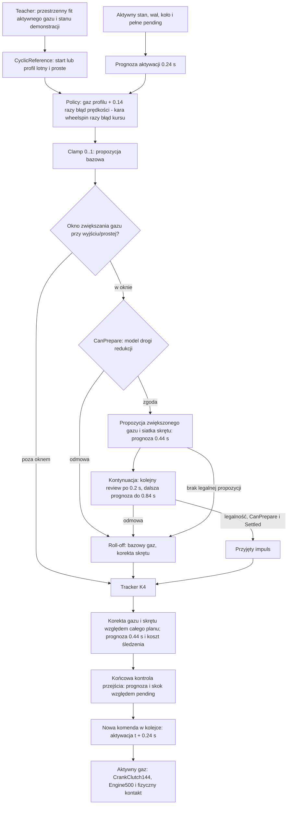

# Audyt przed rekonstrukcją #173

Baza #172: c5f0a4cc4de34fc4c8c47ef912cafabf34055f29. Diagnostyka OFF,
bez treningu i zmian historycznych źródeł. Domyślnie zero nowych światów.
Limit całej nowej diagnostyki kontrolera: 100 CPU-s. Analiza odczytuje
archiwa; instrumentowane odpowiedniki klas nie zapisują do ciała Box2D.

## Łańcuch wynikający z kodu

Kara wheelspin w Policy nie działa samodzielnie: mnoży ją
min(1, abs(courseError)*5). Błąd pozycji i orientacji wpływa na skręt;
nie ma osobnego bezpośredniego mnożnika gazu od offsetu lub samego β.
β/yaw/kurs i prześwit wpływają później na odrzucanie i ocenę kandydatów.
Tracker nie szuka dowolnego gazu 0..1: porównuje bazowy gaz z jedną
wartością bazowy + 0.24*speedDelta. Przy tempo=0 speedDelta zależy od
różnicy wykonalnych profili K4/K0. Końcowa kontrola może wybrać propozycję,
jej połowę lub zero, lecz w archiwach K4 wszystkie 1438 przejść są continuous.

CanPrepare nie odejmuje gazu od bazowej propozycji. Blokuje późniejsze
zwiększenie gazu do mix(original,1,blend). W fazie impulsu zakłada dodatkowe
0.2 s przyspieszania po 3.5 m/s², odejmuje przebytą drogę i stosuje
v² <= (FlyingEntrySpeed+1.6)² + 2*0.65*remaining. Na końcu kontynuacji
pomija dodatkowy impuls. PrepareMeters pochodzi z #166; poza oknem pełny
gaz może w ogóle nie być kandydatem. Progi prognozy swept: Exit .65 m,
Tracker .60 m, końcowa kontrola .55 m; właściwa legalność natywna .50 m.

Nie znaleziono uzasadnienia pomiarowego stałej 0.65 m/s² w źródłach #170.
Jest jawną hipotezą modelu przygotowania, a nie wynikiem pomiaru hamowania.
SpeedHeadroom=1.6 wybrano w rozwojowych próbach #170 jako szybszy wariant;
nie jest dowodem optymalnego lub maksymalnego fizycznie wejścia. Archiwa
#172 pozwolą porównać założenie z rzeczywistym odpuszczaniem i obecną kolejką.

Engine500 nie zmniejsza komendy gazu. Dostarcza zależny od RPM moment;
odcina go dopiero przy 12000 RPM. Sprzęgło i koło wyznaczają rzeczywisty
moment i Fx/Fy w oryginalnym wspólnym budżecie opony. Nasycenie kontaktu
nie jest równoznaczne z decyzją AI o zmniejszeniu gazu. PredictorA153 ma
osobny integrator prognozy; jego wynik nie jest natywnym przejazdem.

## Co zachowują stare dane

Zapis zawiera końcową propozycję, Action, Tracking.Baseline (wynik Exit),
tryb K4, stan natywny i wszystkie aktywacje. Tracking.Gate nadpisuje powód
Exit podczas śledzenia K4. Brakuje pierwotnej Policy, wyniku CanPrepare
i odrzuconych kandydatów. Nie przypiszemy ich przez korelację.

Odczytowy adapter odtworzy stan kontrolera kolejno na zaakceptowanych
obserwacjach. Każda końcowa akcja oraz liczniki prognoz muszą odpowiadać
archiwum, zanim pośrednie logi zostaną uznane za rekonstrukcję. Stan t=0
wymaga usunięcia pierwszej komendy dodanej do próbki po callbacku.
Pozostałe próbki na review są sprzed następnego callbacku.

## Kontekst bez nowych reprodukcji

#164 dotyczy innego wolniejszego kontrolera i pokazał pogorszenie S3 przy
podwyższeniu profilu. #168 odseparował gaz od skrętu; idealna prosta nie
reprezentuje wyjścia. #169 wykazał krótką stabilizację pełnego gazu na
oryginalnej fizyce, bez następnego łuku. #170 wprowadził impuls i legalną
kontynuację oraz CanPrepare. #171 wykazał poprawę linii łuku, a #172 pełne
S3 z cykliczną adaptacją. Nie powtarzamy tych eksperymentów.
