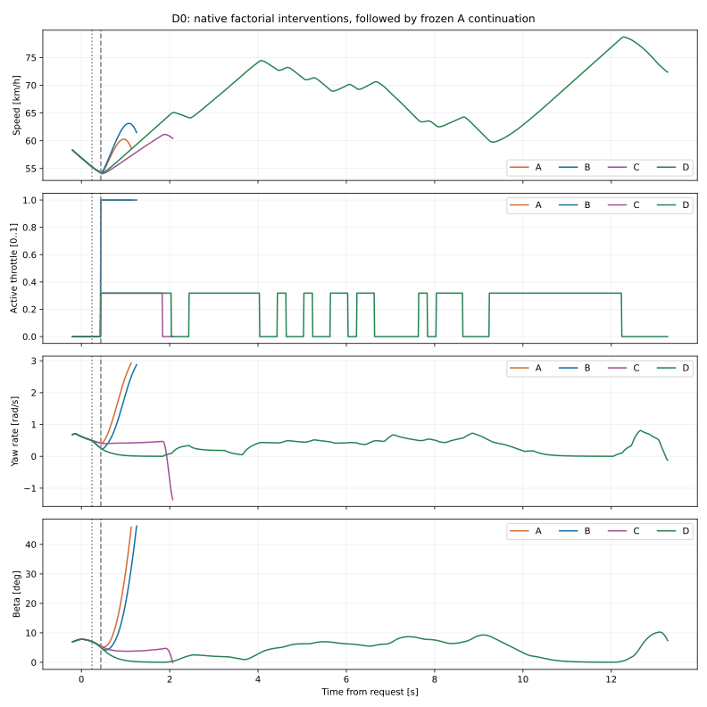
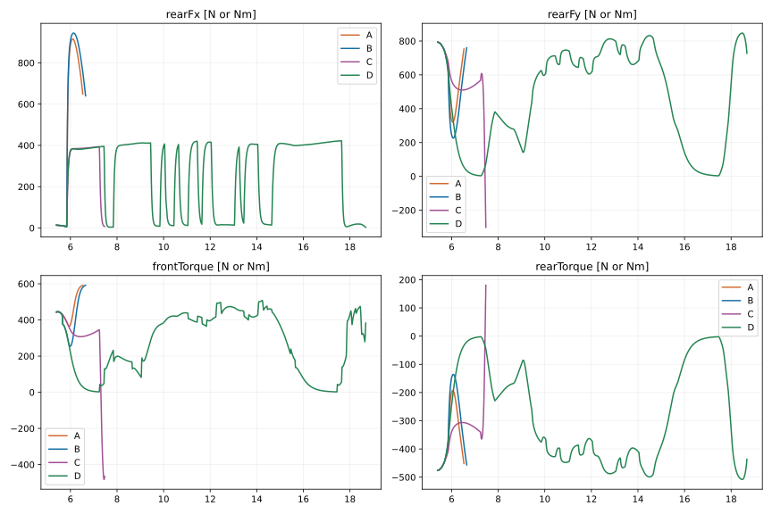
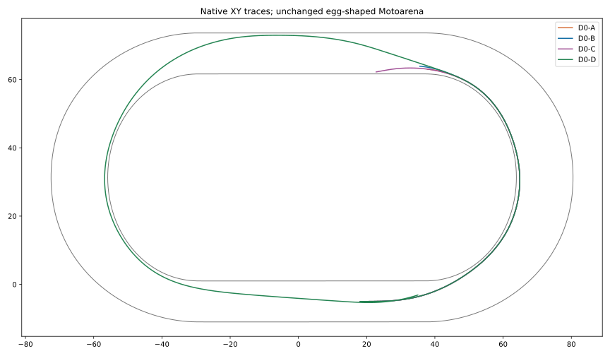

# #138 — Throttle–Steering Decoupling & Controlled Slide

**PHYSICS LIMITATION · PROVISIONAL · domyślnie OFF.**

Baza dokładnie `53e2c00de383fa51930d8a3888b296ca4f7e2b16`; protokół i progi zamrożone w `dded3ec` przed nowymi światami. Bez CEM, merge, zmian silnika, opon, aktuatora, geometrii i #16015.

**40 nowych światów; 373.359375 s CPU epizodów i wyszukiwania; 6,350,251 ocen kontaktu; 69,665 prognoz.** Limity 48/650 s niezmienione. Analiza/serializacja/build/testy osobno.

## Jak czytać dowód

Poziom 1: prognozy H09, w tym 18 dawnych stanów. Poziom 2: kontrolowane interwencje Box2D z pełną późniejszą kontynuacją. Poziom 3: autonomiczny zawodnik — bramka prototypu nie została spełniona, więc prototyp nie powstał. Żaden sampled oracle nie steruje motocyklem.

W t0 każde ramię żąda dotychczasowego aktywnego gazu. Kierownica przygotowawcza przechodzi przez kolejkę i aktywuje się po 0,24 s. Gaz docelowy jest żądany w t+0,2 s i aktywny od t+0,44 s. Żądania interwencji trwają 1,6 s; powrót #134 A przechodzi przez tę samą kolejkę i aktywuje się od t+1,84 s. A/C mają te same kąty żądane, B/D również. B wybiera parę kątów wyłącznie z początkowej prognozy; wszystkie ramiona zachowują stare pending.

Natywna próba zaczyna się od historycznego fizycznego początku i biegnie ciągle przez dwa łuki oraz pełną następną prostą 62 m lub do pierwszego DNF. Historyczna bramka pełnego obrysu +1 s jest osobna. β45° jest obecną eksperymentalną obwiednią kontroli, a nie zweryfikowanym progiem upadku prawdziwego motocykla.

## A/B/C/D — wszystkie wyniki

|Stan / pula|Ramię|Korekta|Dwa łuki legalnie|Całe +62m|Wyjście badane km/h|Gaz wyjścia|Bramka s|Vmax km/h|Wynik|
|---|---|---|---|---|---:|---:|---:|---:|---|
|D0-A / diagnostic|A|hold-active|False|False|N/D|N/D|N/D|67.90|control envelope|
|D0-B / diagnostic|B|early-prepare|False|False|N/D|N/D|N/D|67.90|control envelope|
|D0-C / diagnostic|C|hold-active|False|False|58.42|0.32|N/D|67.90|uncertified interval|
|D0-D / diagnostic|D|early-prepare|True|True|60.02|0.32|15.83|78.69|completed|
|D1-A / diagnostic|A|hold-active|False|False|66.96|1.00|N/D|78.12|control envelope|
|D1-B / diagnostic|B|early-prepare|False|False|69.79|1.00|N/D|78.12|uncertified interval|
|D1-C / diagnostic|C|hold-active|True|True|62.20|0.32|16.87|78.12|completed|
|D1-D / diagnostic|D|early-prepare|False|False|62.60|0.32|N/D|78.12|uncertified interval|
|S0-A / selection|A|hold-active|False|False|66.20|1.00|N/D|70.92|control envelope|
|S0-B / selection|B|early-prepare|False|False|70.42|1.00|N/D|70.92|control envelope|
|S0-C / selection|C|hold-active|True|True|63.35|0.32|16.18|78.72|completed|
|S0-D / selection|D|early-prepare|False|False|64.61|0.32|N/D|70.92|uncertified interval|
|S1-A / selection|A|hold-active|False|False|N/D|N/D|N/D|77.54|control envelope|
|S1-B / selection|B|early-prepare|False|False|68.30|1.00|N/D|77.54|control envelope|
|S1-C / selection|C|hold-active|True|True|63.84|0.32|15.75|77.54|completed|
|S1-D / selection|D|early-prepare|False|False|65.84|0.32|N/D|77.54|uncertified interval|
|H0-A / confirmation|A|hold-active|False|False|68.38|1.00|N/D|68.54|control envelope|
|H0-B / confirmation|B|increase|False|False|69.85|1.00|N/D|71.55|control envelope|
|H0-C / confirmation|C|hold-active|True|True|64.31|0.32|15.56|78.27|completed|
|H0-D / confirmation|D|increase|False|False|64.39|0.32|N/D|67.53|confirmed crossing|
|H1-A / confirmation|A|hold-active|False|False|68.38|1.00|N/D|68.54|control envelope|
|H1-B / confirmation|B|increase|False|False|69.85|1.00|N/D|71.55|control envelope|
|H1-C / confirmation|C|hold-active|True|True|64.31|0.32|15.56|78.27|completed|
|H1-D / confirmation|D|increase|False|False|64.39|0.32|N/D|67.53|confirmed crossing|
|H2-A / confirmation|A|hold-active|False|False|65.23|1.00|N/D|78.25|control envelope|
|H2-B / confirmation|B|early-prepare|False|False|69.33|1.00|N/D|78.25|control envelope|
|H2-C / confirmation|C|hold-active|True|True|61.77|0.32|15.70|78.25|completed|
|H2-D / confirmation|D|early-prepare|False|False|62.38|0.32|N/D|78.25|uncertified interval|
|H3-A / confirmation|A|hold-active|False|False|65.23|1.00|N/D|78.25|control envelope|
|H3-B / confirmation|B|early-prepare|False|False|69.33|1.00|N/D|78.25|control envelope|
|H3-C / confirmation|C|hold-active|True|True|61.77|0.32|15.70|78.25|completed|
|H3-D / confirmation|D|early-prepare|False|False|62.38|0.32|N/D|78.25|uncertified interval|
|T0-A / transfer|A|hold-active|False|False|N/D|N/D|N/D|72.34|control envelope|
|T0-B / transfer|B|early-prepare|False|False|70.27|1.00|N/D|72.34|control envelope|
|T0-C / transfer|C|hold-active|False|False|65.29|0.32|N/D|72.34|uncertified interval|
|T0-D / transfer|D|early-prepare|False|False|67.22|0.32|N/D|72.34|uncertified interval|

A=pełny/utrzymana kierownica; B=pełny/korekta; C=31,82%/utrzymana; D=31,82%/dokładnie kąty B. Vmax sprzed interwencji może być wyższe od prędkości manewru; nie jest dowodem korzyści.

## Punkty obu wyjść

|Przejazd|Łuk|−20|−15|−10|−5|0|+10|+20|+40|+62 m km/h|
|---|---:|---:|---:|---:|---:|---:|---:|---:|---:|---:|
|D0-A|1|56.56|54.52|57.63|60.19|N/D|N/D|N/D|N/D|N/D|
|D0-A|2|N/D|N/D|N/D|N/D|N/D|N/D|N/D|N/D|N/D|
|D0-B|1|56.56|54.59|58.21|62.86|N/D|N/D|N/D|N/D|N/D|
|D0-B|2|N/D|N/D|N/D|N/D|N/D|N/D|N/D|N/D|N/D|
|D0-C|1|56.56|54.52|54.98|56.71|58.42|61.05|N/D|N/D|N/D|
|D0-C|2|N/D|N/D|N/D|N/D|N/D|N/D|N/D|N/D|N/D|
|D0-D|1|56.56|54.59|55.46|57.70|60.02|64.37|64.43|71.57|73.17|
|D0-D|2|61.81|59.76|60.66|62.27|64.11|67.97|71.67|78.49|72.36|
|D1-A|1|58.05|58.52|60.07|62.01|63.95|67.88|71.59|78.11|74.52|
|D1-A|2|55.86|56.14|57.94|62.89|66.96|N/D|N/D|N/D|N/D|
|D1-B|1|58.05|58.52|60.07|62.01|63.95|67.88|71.59|78.11|74.52|
|D1-B|2|55.86|56.14|58.00|63.31|69.79|74.16|N/D|N/D|N/D|
|D1-C|1|58.05|58.52|60.07|62.01|63.95|67.88|71.59|78.11|74.52|
|D1-C|2|55.86|56.14|57.94|60.07|62.20|66.23|69.90|76.35|71.36|
|D1-D|1|58.05|58.52|60.07|62.01|63.95|67.88|71.59|78.11|74.52|
|D1-D|2|55.86|56.14|58.00|60.33|62.60|N/D|N/D|N/D|N/D|
|S0-A|1|58.94|59.65|60.15|65.05|66.20|N/D|N/D|N/D|N/D|
|S0-A|2|N/D|N/D|N/D|N/D|N/D|N/D|N/D|N/D|N/D|
|S0-B|1|58.94|59.65|60.27|65.91|70.42|N/D|N/D|N/D|N/D|
|S0-B|2|N/D|N/D|N/D|N/D|N/D|N/D|N/D|N/D|N/D|
|S0-C|1|58.94|59.65|60.13|61.84|63.35|65.62|64.96|64.64|63.99|
|S0-C|2|59.81|60.19|60.10|62.04|64.10|67.95|71.57|78.33|73.56|
|S0-D|1|58.94|59.65|60.25|62.39|64.61|68.79|N/D|N/D|N/D|
|S0-D|2|N/D|N/D|N/D|N/D|N/D|N/D|N/D|N/D|N/D|
|S1-A|1|58.94|59.65|58.57|60.32|62.43|66.46|70.10|77.02|72.59|
|S1-A|2|61.35|59.94|63.81|66.00|N/D|N/D|N/D|N/D|N/D|
|S1-B|1|58.94|59.65|58.57|60.32|62.43|66.46|70.10|77.02|72.59|
|S1-B|2|61.35|60.03|64.48|69.18|68.30|N/D|N/D|N/D|N/D|
|S1-C|1|58.94|59.65|58.57|60.32|62.43|66.46|70.10|77.02|72.59|
|S1-C|2|61.35|59.94|60.85|62.46|63.84|65.71|63.93|69.12|67.35|
|S1-D|1|58.94|59.65|58.57|60.32|62.43|66.46|70.10|77.02|72.59|
|S1-D|2|61.35|60.03|61.33|63.59|65.84|69.34|N/D|N/D|N/D|
|H0-A|1|59.67|59.33|60.54|64.85|68.38|N/D|N/D|N/D|N/D|
|H0-A|2|N/D|N/D|N/D|N/D|N/D|N/D|N/D|N/D|N/D|
|H0-B|1|59.67|59.33|60.54|65.05|69.85|N/D|N/D|N/D|N/D|
|H0-B|2|N/D|N/D|N/D|N/D|N/D|N/D|N/D|N/D|N/D|
|H0-C|1|59.67|59.33|60.54|62.27|64.31|68.26|71.86|74.54|72.66|
|H0-C|2|59.25|59.21|60.92|62.84|64.79|68.59|72.17|78.12|71.87|
|H0-D|1|59.67|59.33|60.54|62.41|64.39|66.88|N/D|N/D|N/D|
|H0-D|2|N/D|N/D|N/D|N/D|N/D|N/D|N/D|N/D|N/D|
|H1-A|1|59.67|59.33|60.54|64.85|68.38|N/D|N/D|N/D|N/D|
|H1-A|2|N/D|N/D|N/D|N/D|N/D|N/D|N/D|N/D|N/D|
|H1-B|1|59.67|59.33|60.54|65.05|69.85|N/D|N/D|N/D|N/D|
|H1-B|2|N/D|N/D|N/D|N/D|N/D|N/D|N/D|N/D|N/D|
|H1-C|1|59.67|59.33|60.54|62.27|64.31|68.26|71.86|74.54|72.66|
|H1-C|2|59.25|59.21|60.92|62.84|64.79|68.59|72.17|78.12|71.87|
|H1-D|1|59.67|59.33|60.54|62.41|64.39|66.88|N/D|N/D|N/D|
|H1-D|2|N/D|N/D|N/D|N/D|N/D|N/D|N/D|N/D|N/D|
|H2-A|1|56.37|56.12|57.38|59.13|61.09|65.14|68.99|75.46|68.98|
|H2-A|2|56.12|56.34|57.87|63.02|65.23|N/D|N/D|N/D|N/D|
|H2-B|1|56.37|56.12|57.38|59.13|61.09|65.14|68.99|75.46|68.98|
|H2-B|2|56.12|56.34|58.00|63.81|69.33|N/D|N/D|N/D|N/D|
|H2-C|1|56.37|56.12|57.38|59.13|61.09|65.14|68.99|75.46|68.98|
|H2-C|2|56.12|56.34|57.87|59.80|61.77|65.68|69.42|75.64|72.22|
|H2-D|1|56.37|56.12|57.38|59.13|61.09|65.14|68.99|75.46|68.98|
|H2-D|2|56.12|56.34|58.00|60.25|62.38|66.35|N/D|N/D|N/D|
|H3-A|1|56.37|56.12|57.38|59.13|61.09|65.14|68.99|75.46|68.98|
|H3-A|2|56.12|56.34|57.87|63.02|65.23|N/D|N/D|N/D|N/D|
|H3-B|1|56.37|56.12|57.38|59.13|61.09|65.14|68.99|75.46|68.98|
|H3-B|2|56.12|56.34|58.00|63.81|69.33|N/D|N/D|N/D|N/D|
|H3-C|1|56.37|56.12|57.38|59.13|61.09|65.14|68.99|75.46|68.98|
|H3-C|2|56.12|56.34|57.87|59.80|61.77|65.68|69.42|75.64|72.22|
|H3-D|1|56.37|56.12|57.38|59.13|61.09|65.14|68.99|75.46|68.98|
|H3-D|2|56.12|56.34|58.00|60.25|62.38|66.35|N/D|N/D|N/D|
|T0-A|1|62.70|62.90|64.48|67.84|N/D|N/D|N/D|N/D|N/D|
|T0-A|2|N/D|N/D|N/D|N/D|N/D|N/D|N/D|N/D|N/D|
|T0-B|1|62.70|62.94|64.90|69.72|70.27|N/D|N/D|N/D|N/D|
|T0-B|2|N/D|N/D|N/D|N/D|N/D|N/D|N/D|N/D|N/D|
|T0-C|1|62.70|62.90|62.71|64.08|65.29|66.61|63.67|N/D|N/D|
|T0-C|2|N/D|N/D|N/D|N/D|N/D|N/D|N/D|N/D|N/D|
|T0-D|1|62.70|62.94|63.09|65.14|67.22|71.19|68.96|N/D|N/D|
|T0-D|2|N/D|N/D|N/D|N/D|N/D|N/D|N/D|N/D|N/D|

Wartości pochodzą z pierwszego rzeczywiście zaakceptowanego stanu na/dalej niż dany metr. Dokładne przesunięcie pomiaru i flaga „przed interwencją” są w checkpoints.json. N/D oznacza, że świat nie dotarł legalnie do punktu; nie interpolujemy brakującego przejazdu.

## Odpowiedzi na 20 pytań

1. W #137 gaz0 wybrano 13/18 razy przy tej samej klasie H09 we wszystkich 18. Funkcja celu premiowała końcowy yaw/kierunek i ma preferencję częściowego gazu. Średnia utrata prędkości to 6.43 km/h. Te dane nie dowodzą fizycznej konieczności gaz0.

2. W ograniczonej prognozie sama kierownica przy gaz1 zmniejsza terminalny koszt yaw w 10/18 stanów względem utrzymania tej samej pierwszej akcji. To poziom1, nie certyfikat długiej jazdy.

3. W 12/18 prognoz korekta zachowuje co najmniej prędkość utrzymanej pierwszej akcji (tolerancja0,0001km/h). Pełne pary kosztów/prędkości są w offline-18-complete.json.

4. B kończy legalnie długą kontynuację w 0/9 badanych stanów. Powtórzenia profili o identycznych śladach są zależne; nie oznaczają niezależnego potwierdzenia.

5. β, yaw, ψ i χ są zapisane osobno w każdym natywnym kroku. factorial-effects.json podaje efekty samej kierownicy, samego gazu i interakcję w H09. Mniejszy yaw bez oceny rzeczywistego kierunku χ nie stanowi sukcesu.

6. Sprawdzenie kontrolowanego uślizgu przy pełnym gazie wymaga legalnego całego zakresu i zysku prędkości. Krótki poprawny prefiks sond B/D tego nie dowodzi; legalne przypadki i wszystkie przekroczenia obwiedni są w tabeli.

7. Większy uślizg nie otrzymuje premii. Jego wynik określają rzeczywisty postęp, prędkość, kierunek ruchu, prześwit i późniejszy DNF. Wystąpienie dużego β przed DNF pozostaje porażką.

8. W 2/18 prognoz #137 zamyka gaz mimo pełnego gazu z co najmniej tą samą klasą H09 i mniejszym kosztem yaw w nowej siatce. To dowód wpływu decyzji/rankingu lokalnego; nie dowód zbędności gaz0 w całym przejeździe. Po zamrożeniu kierownicy zmienny gaz wybiera gaz0 w 2/18 stanów.

9. Wcześniejsze przygotowanie jest osobnym kandydatem: kierownica aktywuje się0,20s przed gazem docelowym. Aktywny gaz w geometrycznym wyjściu podano dla każdego ramienia; nie ma reguły cornerExit→throttle1.

10. Prędkości badanych wyjść podaje główna tabela. Oba wyjścia i stan przed interwencją są rozdzielone w tabeli punktów.

11. Prędkości +20/+40/+62m podano dla obu łuków. Brak odczytu po DNF pozostaje N/D; krótkotrwałe duże prędkości nie są ukończeniem.

12. Legalne przejście drugiego łuku i dodatkowej prostej mają oddzielne kolumny. Nie ma resetów prędkości, β, yaw, wheelspin, kierownicy ani kolejki.

13. Porównanie czasu jest dopuszczalne tylko dla par legalnie kończących ten sam zakres. B nie kończy żadnego długiego przejazdu, więc korelacja jego mniejszego yaw z legalnym pełnym czasem jest nieoznaczona; nie przypisujemy jej wartości0 ani sukcesu. Ścisłe bramki B vsD są w analysis.json/PhysicalTests.

14. Pula końcowa zawiera dwie wcześniej wydzielone rodziny V0/V1 na progressive-b/c. Dokładną równość wykonanych śladów sprawdzono; nie liczymy jej podwójnie. Opcjonalny transfer jest osobno oznaczony, jeśli wykonano.

15. Nie zbudowano prototypu autonomicznego: zamrożona bramka diagnostyczna/selekcyjna nie została spełniona. Kontrolowane interwencje nie są polityką wyścigową.

16. W #138 druga akcja interwencji jest rzeczywiście wykonanym żądaniem przez kolejkę, nie autonomiczną obietnicą planu. Nie ma telemetrii zgodności nowego autonomicznego prototypu, bo nie powstał. #137 replanuje i nie zobowiązuje się do drugiej akcji.

17. Wszystkie 28 DNF są niżej i w dnf.json wraz z ostatnimi dwoma stanami i siłami ostatniego przedziału. „uncertified interval” oznacza brak certyfikacji, nie dowiedziony kontakt z bandą.

18. Obecne wyniki nie identyfikują globalnej wady fizyki. Kolejną empiryczną kalibrację powinny zasilać zmierzone Fx/Fy vs kąt/slip, yaw moment przedniego/tylnego kontaktu i RPM pod obciążeniem. Nie zmieniamy modelu dla uzyskania oczekiwanego rezultatu.

19. Łączny koszt epizodów i wszystkich nowych prognoz: 373.359375CPU-s. Pełna jednorazowa tabela to≤7par kierownicy ×2gazy, czyli14prognoz, średnio0,291667CPU-s/stan (0,140625–0,484375). Wybór B rankinguje tylko7pełnych; D ma dokładnie jego kierownicę. Nie jest to zmierzony koszt autonomicznego zawodnika. Oddzielne rezerwacje są w attempts.json, a wszystkie wykonania raportowania w report-cost-history.json.

20. Kolejny krok: porównać mierzoną odpowiedź obu kontaktów z empirycznymi próbami motocykla i rozważyć przyczynowe przygotowanie całego stanu przed gazem. Nowy ograniczony eksperyment powinien mieć własny protokół; nie stroić na tej puli końcowej.

## Wszystkie DNF i mechanizm ostatniego przedziału

|Próba|Przyczyna|t od interwencji s|β°|yaw rad/s|Moment przód/tył Nm|Fx tył N|Fy tył N|Rear use|Slip|ω rad/s|
|---|---|---:|---:|---:|---|---:|---:|---:|---:|---:|
|D0-A|control envelope|1.13|45.90|2.93|592.01/-451.72|649.01|752.87|1.00|2.70|130.76|
|D0-B|control envelope|1.25|46.25|2.87|591.94/-456.23|640.16|760.38|1.00|2.56|130.89|
|D0-C|uncertified interval|2.07|-0.09|-1.36|-465.76/180.47|7.86|-300.78|0.30|0.00|50.96|
|D1-A|control envelope|1.22|45.53|2.84|592.03/-457.85|636.59|763.08|1.00|2.30|130.94|
|D1-B|uncertified interval|1.58|-42.08|-2.71|-590.95/455.21|640.33|-758.68|1.00|1.76|130.92|
|D1-D|uncertified interval|1.69|-2.98|-0.32|-254.00/249.15|401.91|-415.25|0.58|0.11|62.45|
|S0-A|control envelope|1.12|45.29|2.86|592.12/-456.39|639.46|760.64|1.00|2.31|130.90|
|S0-B|control envelope|1.31|45.34|2.77|591.96/-461.43|629.13|769.06|1.00|2.12|131.06|
|S0-D|uncertified interval|2.02|2.09|0.98|525.34/-264.18|15.19|440.31|0.44|0.00|58.71|
|S1-A|control envelope|1.13|45.52|2.86|592.19/-456.70|638.93|761.16|1.00|2.35|130.90|
|S1-B|control envelope|1.29|45.53|2.79|591.99/-460.89|630.34|768.15|1.00|2.18|131.04|
|S1-D|uncertified interval|2.07|3.84|1.16|523.08/-371.15|17.31|618.58|0.62|0.01|57.75|
|H0-A|control envelope|1.20|45.94|2.77|591.91/-460.89|630.50|768.15|1.00|2.26|131.04|
|H0-B|control envelope|1.35|45.26|2.66|590.76/-461.51|628.90|769.19|1.00|2.09|131.08|
|H0-D|confirmed crossing|1.99|-12.58|-0.31|-56.58/530.47|75.83|-884.12|0.89|0.04|56.67|
|H1-A|control envelope|1.20|45.94|2.77|591.91/-460.89|630.50|768.15|1.00|2.26|131.04|
|H1-B|control envelope|1.35|45.26|2.66|590.76/-461.51|628.90|769.19|1.00|2.09|131.08|
|H1-D|confirmed crossing|1.99|-12.58|-0.31|-56.58/530.47|75.83|-884.12|0.89|0.04|56.67|
|H2-A|control envelope|1.17|46.02|2.85|592.15/-457.72|637.05|762.86|1.00|2.43|130.93|
|H2-B|control envelope|1.48|45.74|2.72|591.70/-464.16|623.59|773.60|1.00|2.10|131.14|
|H2-D|uncertified interval|2.00|-1.49|0.87|470.69/34.70|12.58|-57.84|0.06|0.00|56.54|
|H3-A|control envelope|1.17|46.02|2.85|592.15/-457.72|637.05|762.86|1.00|2.43|130.93|
|H3-B|control envelope|1.48|45.74|2.72|591.70/-464.16|623.59|773.60|1.00|2.10|131.14|
|H3-D|uncertified interval|2.00|-1.49|0.87|470.69/34.70|12.58|-57.84|0.06|0.00|56.54|
|T0-A|control envelope|1.11|45.75|2.83|592.39/-459.60|633.10|766.00|1.00|2.28|130.99|
|T0-B|control envelope|1.24|46.22|2.78|592.35/-464.77|622.52|774.62|1.00|2.18|131.14|
|T0-C|uncertified interval|2.46|-24.30|-2.11|-538.86/579.34|98.86|-965.57|0.97|0.10|53.56|
|T0-D|uncertified interval|2.48|14.71|0.56|462.36/-542.60|155.11|904.33|0.92|0.08|60.31|

Siły/momenty odnoszą się do ostatniego ukończonego przedziału, a stan do jego końca. Dane pozwalają oddzielić moment przedniego kontaktu od tylnego, nasycenie budżetu od niskiego Fx, wheelspin od prędkości postępowej oraz opóźnienie aktuatora. To lokalne mechanizmy badanych manewrów, nie dowód globalnej niemożliwości.

## Artefakty i odtwarzanie

[Replay A/B/C/D i klipy](../../../tools/replay-viewer/throttle-steering.html) · [Konkretny mechanizm fizyczny](MECHANISM.md) · [Protokół](protocol.json) · [Blokada przed finałem](selection-lock.json) · [Pełne wyniki](analysis.json) · [Natywne hashe](raw-manifest.json) · [Walidacja](validation.json)

Pełne natywne rekordy są w native/, CSV w telemetry/, wszystkie stany i siły do viewer w viewer/. Żadne XY nie zostało wymyślone. Standardowy Windows CI końcowego HEAD jest wskazany w Draft PR.

Odtworzenie do świeżych katalogów: `tools/run-throttle-steering.ps1 -Evidence <nowy-katalog> -Raw <nowy-katalog-raw>`. Raportowanie wymaga `python -m pip install -r tools/throttle-steering-requirements.txt`; klipy tworzy osobno `tools/render-throttle-steering-clips.py`. Serwer repozytorium `python -m http.server 8018 --bind 127.0.0.1` udostępnia replay pod `/tools/replay-viewer/throttle-steering.html`.

Gotowe MP4: [pełny bez korekty](clips/01-full-no-correction.mp4) · [pełny z korektą](clips/02-full-corrected.mp4) · [częściowy, ta sama korekta](clips/03-partial-same-correction.mp4) · [najszybszy legalny zapis](clips/04-fastest-legal.mp4) · [nieudany duży gaz](clips/05-failed-full.mp4) · [ciągle dwa łuki i prosta](clips/06-continuous-two-bends.mp4). Najszybszy zapis jest retrospektywnym sampled oracle do prezentacji, nie samodzielnym wyborem nowej AI.

