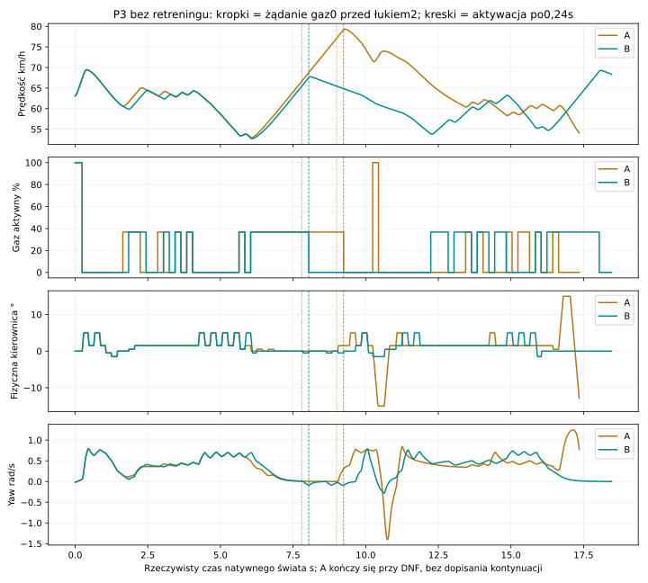
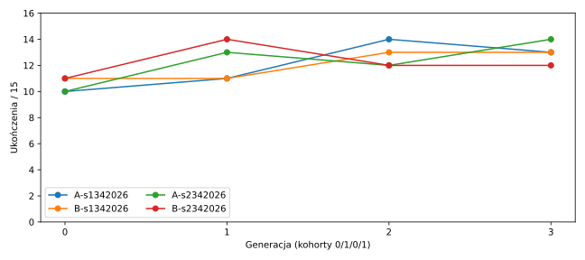
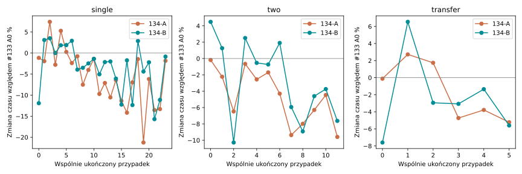

# PR #134 — Track Awareness & Anticipatory Riding

Werdykt **PARTIAL**. Status **PROVISIONAL**, eksperyment domyślnie OFF. Wynik nie zmienia produkcyjnej polityki. Klasy H09, certyfikat obrysu, Box2D, opony, silnik, kolejka, reakcja i osiem granic parametrów pozostają takie jak w dokładnej bazie `5ed4499b2118ca8206bf8dcaf9741dc0790c01ac`. #133 ma Draft PR i potwierdzone [Windows CI #369](https://github.com/arturgladysz91/zuzel/actions/runs/40231976774).

B #17015 uzyskał 24/24 pojedynczych i12/12 dwóch łuków. Mediana dwóch względem133A0 zmieniła się o -2.23%, pojedynczego o -2.17% (najgorsza para +3.51%). Jednak wobec nowo wytrenowanego A #16015 B jest wolniejszy: +2.12% na dwóch łukach i +2.14% na transferze. Oba ramiona mają 11/12 transferu, przy 10 wspólnych ukończeniach. Warunek dodatkowej korzyści transferowej nie przeszedł. Nie podmieniono zamrożonego B na szybsze A. Wynik nie dowodzi przewagi nowego modułu nad samym ponownym treningiem.

## 1. Co zawodnik wiedział przed zmianą?

`TrackFrame`, `ExperimentalTrackShape` i topologia udostępniają całą pętlę, początek/koniec obu łuków, szerokość i ciągły profil κ. Dostęp nie oznacza wykorzystania. A0 wybierał kierunek χ końca H09 względem stycznej w `endpointReference + max(0.1, ReferenceSpeed(endpoint)*PreviewSeconds)`. Dla #12023 PreviewSeconds=0.69293657s. W audycie co dziesiątej decyzji historycznego natywnego X00 całkowity dystans zapytania wyniósł 19.23–33.61m; pełne stany i odległości są w `old-knowledge-audit.json.gz`. Przebieg zależy od przewidywanej prędkości oraz projekcji na tor, nie od jednej stałej odległości. ψ nie jest χ. H09 zna zdarzenia zmiany odcinka i siły, ale nie ocenia całego przyszłego profilu. Nie dowodzimy, że sam krótki H09 był głównym problemem.

| Czas s | Prędkość m/s | Odcinek | Koniec H09 Δref m | Podgląd za H09 m | Całe zapytanie Δref m |
| --- | --- | --- | --- | --- | --- |
| 0 | 9.625 | 0 | 10.351 | 8.878 | 19.229 |
| 1.9999999999999998 | 15.184 | 1 | 14.446 | 11.667 | 26.113 |
| 4 | 17.223 | 2 | 14.101 | 10.393 | 24.493 |
| 6 | 15.616 | 3 | 11.698 | 8.847 | 20.545 |
| 8 | 18.460 | 4 | 17.507 | 14.304 | 31.811 |
| 9.999999999999996 | 21.527 | 4 | 18.133 | 12.188 | 30.321 |
| 11.99999999999999 | 17.770 | 5 | 16.472 | 12.903 | 29.375 |
| 13.999999999999982 | 16.744 | 6 | 12.913 | 9.433 | 22.346 |
| 15.999999999999975 | 15.460 | 7 | 11.297 | 9.178 | 20.475 |
| 17.999999999999968 | 19.590 | 8 | 18.566 | 15.042 | 33.608 |

Stary sterownik rozpoznawał prosta–łuk–prosta poprzez geometrię zapytania i prognozę; brakowało mu jawnego opisu czasu do łuku oraz zakresu kierownicy osiągalnego przed nim. Nie był pozbawiony wiedzy o torze.

## 2. Co dodaje moduł?

`TrackAwareness134.Observe` zwraca niezmienne fakty geometryczne: aktualny odcinek, następny łuk, długość/kierunek/koniec, koniec bieżącego, prostą za łukiem, następny początek, κ i szerokość co2m oraz na złączeniach. Zasięg adaptuje się do prędkości, reakcji, szybkości kierownicy i odpowiedzi opon:20–60m plus opis/próbki wejścia następnego łuku, gdy jest dalej. Odległość po stałym obecnym offsecie i czas przy obecnej prędkości są przybliżeniami; nie są przyszłymi stanami. Punkty XY w profilu oznaczają geometrię referencyjną, nie wybraną linię.

`Evaluate` zastępuje tylko składnik GeometrySpeed tą samą wagą × kwadrat reszty prędkości oszacowanej na profilu. Korzysta z istniejącej prognozy kandydata H09 oraz już obliczonego H09 gaz0 przy tym samym skręcie: spadku prędkości, yaw authority, przyczepności, opóźnienia i optymistycznego obszaru na zewnątrz. Nie dodaje prognoz ani sił, nie zmienia DirectionWeight/ThrottleWeight/rankingu R0. Ekstrapolacja hamowania silnikiem i miejsca na zewnątrz pozostaje miękką heurystyką. Stan zagrożony na końcu H09 zachowuje dawny koszt. Heurystyka nigdy nie nadaje klasy Unsafe.

**Ograniczenie interpretacji:** zamrożone pole `TyreResponseSeconds` jest sumą starych ustawień regulatora LateralResponseSeconds+SlipYawResponseSeconds. W tym trybie `steeringOverride` pomija ich wpływ na fizyczne siły opon. Test zmienia wszystkie trzy ustawienia odpowiedzi i otrzymuje identyczne punkty H09 oraz liczbę obliczeń sił. Dlatego tej sumy nie traktujemy jako rzeczywistego opóźnienia opony: to nieskalibrowany miękki margines przygotowania. Żaden wynik Native, koszt, checkpoint ani zamrożony plik źródłowy nie został podmieniony; [wyjaśnienie i zakres korekty](mechanism-interpretation.json) pozostają jawne.

## 3. Czy zawodnik myśli wcześniej?

Poniższa tabela rozdziela obserwację/żądanie, aktywację i fizyczną odpowiedź. Pierwsze przygotowanie oznacza pierwsze żądanie gaz0 lub |skrętu|≥0,5° przed danym wejściem (dla drugiego łuku od początku prostej po pierwszym). Skręt wykonany: zmiana≥0,1°, yaw≥0,01rad/s i χ≥0,5° względem próbki przed aktywacją. To progi pomiarowe i współwystępowanie, nie niezależny dowód przyczynowy.

| Przejazd | Łuk | Gaz0 żąd. | Gaz0 akt. | Skręt żąd. | Skręt akt. | Skręt fiz. | Yaw | χ | Wejście | T1 bramka | T oba |
| --- | --- | --- | --- | --- | --- | --- | --- | --- | --- | --- | --- |
| profile-A-P1 | 1 | — | — | 0.000 | 0.240 | 0.250 | 0.260 | 0.340 | 1.063 | 6.970 | 16.420 |
| profile-A-P1 | 2 | 7.200 | 7.440 | 7.200 | 7.440 | 7.450 | 7.450 | 7.490 | 9.744 | 6.970 | 16.420 |
| profile-B-P1 | 1 | — | — | 0.000 | 0.240 | 0.250 | 0.260 | 0.340 | 1.063 | 7.290 | 16.510 |
| profile-B-P1 | 2 | 7.200 | 7.440 | 7.200 | 7.440 | 7.850 | 7.470 | 7.470 | 10.417 | 7.290 | 16.510 |
| profile-A-P2 | 1 | 0.000 | 0.240 | 0.000 | 0.240 | 0.250 | 0.260 | 0.340 | 0.981 | 7.750 | 16.610 |
| profile-A-P2 | 2 | 9.000 | 9.240 | 9.200 | 9.440 | 9.450 | 9.460 | 9.530 | 10.587 | 7.750 | 16.610 |
| profile-B-P2 | 1 | 0.000 | 0.240 | 0.000 | 0.240 | 0.250 | 0.260 | 0.340 | 0.995 | 7.450 | 17.060 |
| profile-B-P2 | 2 | 7.800 | 8.040 | 9.200 | 9.440 | 9.450 | 9.460 | 9.570 | 10.635 | 7.450 | 17.060 |
| profile-A-P3 | 1 | 0.000 | 0.240 | 0.000 | 0.240 | 0.250 | 0.250 | 0.310 | 0.839 | 7.520 | — |
| profile-A-P3 | 2 | 9.000 | 9.240 | 8.800 | 9.040 | 9.050 | 9.060 | 9.190 | 10.391 | 7.520 | — |
| profile-B-P3 | 1 | 0.000 | 0.240 | 0.000 | 0.240 | 0.250 | 0.250 | 0.310 | 0.839 | 7.550 | 17.460 |
| profile-B-P3 | 2 | 7.800 | 8.040 | 9.400 | 9.640 | 9.650 | 9.660 | 9.800 | 10.793 | 7.550 | 17.460 |

Te same chwile żądań przy innych komendach nie są wcześniejszym myśleniem. Pierwsze decyzje mogą wypaść już w0,00s, więc nie da się wykazać ich wyprzedzenia poza początek obserwacji. W P3 bez uczenia B odpuszcza przed drugim łukiem w7,8s zamiast9,0s, lecz pierwsze żądanie skrętu pojawia się później (9,4s zamiast8,8s). To wcześniejsze przygotowanie prędkości, a nie wcześniejszy skręt. Pełne pola, odległości i stan są w `native-quality.json.gz` i reprezentatywnych replayach; nie zastępujemy ich samym czasem końca H09.

| Pula | Referencja | Metryka | Liczba par | Mediana B−ref |
| --- | --- | --- | --- | --- |
| single | 133-A0 | Bend1FirstCoastRequest | 12 | 0.000 |
| single | 133-A0 | FirstWholeGateTime | 24 | -0.160 |
| single | 133-A0 | SecondGateIncrement | 24 | 0.000 |
| single | 133-A0 | DistanceMeters | 24 | -1.817 |
| single | 133-A0 | MeanDrive | 24 | 0.001 |
| single | 134-A | Bend1FirstCoastRequest | 12 | 0.000 |
| single | 134-A | FirstWholeGateTime | 24 | 0.145 |
| single | 134-A | SecondGateIncrement | 24 | 0.000 |
| single | 134-A | DistanceMeters | 24 | 2.655 |
| single | 134-A | MeanDrive | 24 | 0.000 |
| two | 133-A0 | Bend1FirstCoastRequest | 5 | 0.000 |
| two | 133-A0 | Bend2FirstCoastRequest | 12 | -1.000 |
| two | 133-A0 | Bend2FirstSteeringRequest | 12 | 0.100 |
| two | 133-A0 | FirstWholeGateTime | 12 | -0.365 |
| two | 133-A0 | PreparationSeconds | 12 | 0.098 |
| two | 133-A0 | SecondGateIncrement | 12 | -0.060 |
| two | 133-A0 | DistanceMeters | 12 | -12.155 |
| two | 133-A0 | MeanDrive | 12 | 0.001 |
| two | 134-A | Bend1FirstCoastRequest | 5 | 0.000 |
| two | 134-A | Bend2FirstCoastRequest | 12 | -0.800 |
| two | 134-A | Bend2FirstSteeringRequest | 12 | 0.600 |
| two | 134-A | FirstWholeGateTime | 12 | 0.215 |
| two | 134-A | PreparationSeconds | 12 | 0.087 |
| two | 134-A | SecondGateIncrement | 12 | 0.295 |
| two | 134-A | DistanceMeters | 12 | 4.536 |
| two | 134-A | MeanDrive | 12 | -0.001 |
| transfer | 133-A0 | Bend1FirstCoastRequest | 1 | 0.000 |
| transfer | 133-A0 | FirstWholeGateTime | 6 | -0.230 |
| transfer | 133-A0 | SecondGateIncrement | 6 | 0.000 |
| transfer | 133-A0 | DistanceMeters | 6 | -0.850 |
| transfer | 133-A0 | MeanDrive | 6 | 0.002 |
| transfer | 134-A | Bend1FirstCoastRequest | 4 | 0.000 |
| transfer | 134-A | Bend2FirstCoastRequest | 4 | -1.100 |
| transfer | 134-A | Bend2FirstSteeringRequest | 4 | 0.900 |
| transfer | 134-A | FirstWholeGateTime | 10 | 0.095 |
| transfer | 134-A | PreparationSeconds | 4 | 0.201 |
| transfer | 134-A | SecondGateIncrement | 10 | 0.000 |
| transfer | 134-A | DistanceMeters | 10 | 0.774 |
| transfer | 134-A | MeanDrive | 10 | -0.013 |

`behavior-pairs.json` zachowuje wszystkie pary tych pomiarów oraz wejście/minimum/wyjście, β, yaw, certyfikat i oscylacje. Czas ujemny oznacza wcześniejsze zdarzenie lub krótszy odcinek; dodatni gaz/prędkość nie jest samodzielnym kryterium sukcesu.

## 4. Jaki dystans zabiera reakcja?

70km/h ×0,24s=4,667m. Sama zmiana15° przy90°/s trwa0,1667s; w tym czasie model zaczyna już rozwijać siły. W historycznych obserwacjach rzut drogi przy stałej prędkości na styczną toru (v·tangent ×0,24s) wynosił 2.31–5.16m; nie jest to pomiar całej późniejszej drogi XY. Poprawna diagnostyka kierownicy najpierw realizuje znane pending, a od0,24s utrzymuje każdą ze skrajnych akcji dotychczasowego gridu. Respektuje90°/s i fizyczne±35°, nie odczytuje przyszłych nieznanych decyzji. Czas dojazdu w viewerze nadal jest oszacowaniem przy obecnej prędkości; `QueueAwareActuatorAtActualEntry` w raporcie używa rzeczywistego czasu wejścia wyłącznie jako pomiaru po przejeździe. Test JS sprawdza kontynuacje0,23s względem natywnych próbek, przed aktywacją nowej komendy.

Oryginalne pola `ReachableSteeringLow/High` zachowano w raw: idealizowały zmianę od obecnego kąta i nie uwzględniały aktywacji już oczekujących komend. Nie są certyfikatem i nie wpływają na koszt `Evaluate`; nie używamy ich w końcowym odczycie dostępności manewru. Poprawiona diagnostyka jest dodatkowym odczytem zapisów, bez zmiany fizyki lub sterowania. Zakres kierownicy nie jest granicą yaw/χ. Yaw authority pochodzi z rzeczywistych próbek H09, β z wektora prędkości; nie dokładamy hamulca5/8m/s².

## 5. Jak późno dało się jeszcze zareagować?

| Stan | Obserwacja | Aktywacja | Komenda | Wynik | Czas oba | Zmiana względem A s |
| --- | --- | --- | --- | --- | --- | --- |
| P1 | 0 | 0.24 | 5° gaz0 | completed | 17.320 | 0.900 |
| P1 | 0 | 0.24 | 15° gaz polityki | completed | 16.640 | 0.220 |
| P1 | 0.2 | 0.44 | 5° gaz0 | completed | 16.670 | 0.250 |
| P1 | 0.2 | 0.44 | 15° gaz polityki | completed | 16.690 | 0.270 |
| P1 | 0.4 | 0.64 | 5° gaz0 | completed | 16.450 | 0.030 |
| P1 | 0.4 | 0.64 | 15° gaz polityki | uncertified interval | — | — |
| P1 | 0.6 | 0.84 | 5° gaz0 | completed | 17.780 | 1.360 |
| P1 | 0.6 | 0.84 | 15° gaz polityki | completed | 16.480 | 0.060 |
| P3 | 0 | 0.24 | 5° gaz0 | uncertified interval | — | — |
| P3 | 0 | 0.24 | 15° gaz polityki | control envelope | — | — |
| P3 | 0.2 | 0.44 | 5° gaz0 | uncertified interval | — | — |
| P3 | 0.2 | 0.44 | 15° gaz polityki | uncertified interval | — | — |
| P3 | 0.4 | 0.64 | 5° gaz0 | uncertified interval | — | — |
| P3 | 0.4 | 0.64 | 15° gaz polityki | completed | 17.680 | — |
| P3 | 0.6 | 0.84 | 5° gaz0 | uncertified interval | — | — |
| P3 | 0.6 | 0.84 | 15° gaz polityki | completed | 16.980 | — |

Ostatni skuteczny spośród próbek0/0,2/0,4/0,6s dla obu stanów to0,6s dla komendy15°+gaz polityki; to prawy kraniec zbadanej siatki, nie globalna granica. Dla P3 skręt15° w0,2s kończy się DNF, w0,4s udaje się przejazd: wynik nie jest monotoniczną funkcją czasu. Rozdzielamy poprawną wiedzę geometryczną, miękkie ostrzeżenie i rzeczywisty wynik kontynuacji. Brak udanej próbki nie dowodzi, że żadna inna akcja nie mogła pomóc. Replaye pokazują nieskuteczny manewr pomimo poprawnej geometrii, bez nadawania mu fałszywego certyfikatu nieosiągalności.

W P3 żądanie z0,6s aktywuje się dopiero0,84s, a rzeczywisty początek łuku wypada0,838966s. Zachowany identyczny prefiks potwierdza, że ta nowa komenda nie mogła przygotować samego wejścia, choć może zmienić dalszy przejazd i próba ostatecznie kończy się sukcesem. To ścisły przykład zbyt późnego wpływu na konkretny punkt; nie twierdzenie o niemożności ukończenia całego łuku. Odczyt geometrii i osiągalność zmiany przed wejściem to różne fakty.

## 6. Czy wzrosła skuteczna prędkość?

| Wariant | Pula | Ukończenia | DNF |
| --- | --- | --- | --- |
| 131-H09 | single | 24/24 | {} |
| 131-H09 | two | 12/12 | {} |
| 131-H09 | transfer | 10/12 | {"uncertified interval": 2} |
| 133-A0 | single | 24/24 | {} |
| 133-A0 | two | 12/12 | {} |
| 133-A0 | transfer | 6/12 | {"uncertified interval": 6} |
| 134-A | single | 24/24 | {} |
| 134-A | two | 12/12 | {} |
| 134-A | transfer | 11/12 | {"uncertified interval": 1} |
| 134-B | single | 24/24 | {} |
| 134-B | two | 12/12 | {} |
| 134-B | transfer | 11/12 | {"uncertified interval": 1} |

| Pula | Porównanie | Wspólne ukończenia | Mediana zmiany | Najgorsza zmiana |
| --- | --- | --- | --- | --- |
| single | 134-A vs 131-H09 | 24 | -6.65% | -0.84% |
| single | 134-A vs 133-A0 | 24 | -5.09% | +7.41% |
| single | 134-B vs 131-H09 | 24 | -4.57% | +6.43% |
| single | 134-B vs 133-A0 | 24 | -2.17% | +3.51% |
| single | 134-B vs 134-A | 24 | +2.06% | +21.41% |
| two | 134-A vs 131-H09 | 12 | -6.47% | -3.54% |
| two | 134-A vs 133-A0 | 12 | -4.38% | -0.18% |
| two | 134-B vs 131-H09 | 12 | -4.24% | -0.46% |
| two | 134-B vs 133-A0 | 12 | -2.23% | +4.49% |
| two | 134-B vs 134-A | 12 | +2.12% | +6.48% |
| transfer | 134-A vs 131-H09 | 10 | -9.40% | -3.16% |
| transfer | 134-A vs 133-A0 | 6 | -1.95% | +2.72% |
| transfer | 134-B vs 131-H09 | 9 | -7.63% | -2.02% |
| transfer | 134-B vs 133-A0 | 6 | -3.01% | +6.54% |
| transfer | 134-B vs 134-A | 10 | +2.14% | +5.27% |

Każdy iloraz jest parą tego samego stanu/geometrii. DNF nie otrzymuje fikcyjnego czasu; warunek niezawodności oceniany jest osobno. Wejście/minimum/wyjście każdego łuku, gaz/reaktywacje, β, yaw, certyfikat, rzeczywista długość XY i oscylacje są w `native-quality.json.gz`; metryki wszystkich światów w `attempts.csv` i agregatach generacji.

## 7. Co z drugim łukiem?

Każdy przypadek two i T06–T11 jedzie w jednym świecie bez resetu. `FirstWholeGateTime` mierzy cały mechaniczny obrys3m za końcem pierwszego łuku na rzeczywistej geometrii, `SecondGateIncrement` to pozostały czas do bramki drugiego, a `PreparationSeconds` obejmuje prostą pomiędzy. Te pola oraz oba zestawy prędkości pozwalają odróżnić poprawę wejścia1 od szkody na łuku2. Wynik pełnych dwóch łuków B vs A0: mediana -2.23%; nie zastępujemy go lepszym lokalnym minimum ani samym T1.

## 8. Czy wiedza przenosi się na inny tor?

| Geometria | Kontrola | κ max 1/m | Szerokość m | Błąd projekcji m |
| --- | --- | --- | --- | --- |
| progressive-b | True | 0.041 | 12.00–16.60 | 0.000002471 |
| progressive-c | True | 0.041 | 12.00–17.00 | 0.000002471 |
| egg-mild | True | 0.041 | 12.00–16.60 | 0.000002471 |
| egg-medium | True | 0.046 | 12.00–16.60 | 0.000002627 |
| egg-asymmetric | True | 0.049 | 12.00–16.60 | 0.000002088 |

Trening/selekcja używały progressive-b i egg-medium, różniących się także κ. Progressive-b/c różnią się szerokością, więc nie traktujemy ich jako dwóch różnych profili κ. Główna nowa geometria końcowa to progressive-c; transfer to niewidziana egg-asymmetric (inne oba łuki),6single+6two. Krótkie0,02s próby wszystkich5geometrii sprawdzały runner, bez decyzji i wyniku sportowego. Uszkodzony tor zatrzymałby eksperyment jako błąd konfiguracji. Transfer B vs trenowana A: mediana +2.14%, ukończenia 11/12 vs 11/12. Sam odczyt nowej geometrii nie dowodzi przewagi sportowej.

## 9. Ile daje wiedza, a ile ponowny trening?

Bez uczenia: A3/4, B4/4; mediana wspólnych dwóch łuków +1.63%. W P1/P2 B może wykonać inne komendy na tych samych chwilach, ograniczając β, ale nie daje to automatycznie szybszego przejazdu. Trening obu ramion zaczynał dokładnie od #12023, z identycznymi seedami, początkową populacją, przestrzenią działań i R0. A mierzy efekt ponownego treningu, B łączy go z nową wiedzą. Porównanie B–A na niezależnym finale jest właściwą kontrolą, B–A0 pokazuje łączny efekt. Brak pełnego faktorialnego treningu innych funkcji celu.

Czy wybrane A i B mają dokładnie ten sam końcowy wektor ośmiu parametrów: **False**. Różne identyfikatory kandydatów same w sobie nie dowodzą innych wag; zapisano pełne wektory w `choices.json`.

| Ramię/seed | Ukończenia treningu | Światy |
| --- | --- | --- |
| A-s1342026 | 48 | 60 |
| B-s1342026 | 48 | 60 |
| A-s2342026 | 49 | 60 |
| B-s2342026 | 49 | 60 |

## 10. Jak zamrożono porównanie parami?

Pule G/K/P/M/N/T i geometrie zapisano przed pierwszym nowym światem. M00–M23/N00–N11 to36 nowych stanów, T00–T11 dodatkowe12. Nie powtarzają finałów130–133. Selekcja R0 wybiera tylko z zapisanej krótkiej listy na K0–K5. A/B i aliasy zamrożono przy0 finałów w `winner-lock.json`; wynik nie zmienia polityki po otwarciu finału. Wybrane ID: 134-A #16015, 134-B #17015. Referencje131#4061 i133A0#12023 mają właściwą dawną przestrzeń/full throttle. Jawne aliasy: `{"131-H09": "131-H09", "133-A0": "133-A0", "134-A": "134-A", "134-B": "134-B"}`.

## 11. Ile światów faktycznie uruchomiono?

| Kategoria | Światy | CPU s | Prognozy | Oceny kontaktów |
| --- | --- | --- | --- | --- |
| offline | 0 | 4.156 | 554 | 49988 |
| geometry | 5 | 0.141 | 0 | 10 |
| diagnostic | 31 | 215.672 | 58434 | 5329957 |
| train-ab | 240 | 1872.469 | 492060 | 44857624 |
| selection | 36 | 227.922 | 67344 | 6145805 |
| final | 192 | 1025.531 | 277565 | 25336099 |

Łącznie 504 natywnych światów. Pięć to próby0,02s, cztery to kontrolowane H09; rozliczamy je jawnie. Offline nie tworzy świata Box2D. Powtórzenia i kontrfaktyczne manewry są wliczone. Agregaty zawierają każdą politykę i każdy wynik, hashe całego raw są w `raw-manifest.json`. Pełne raw pozostają lokalne, wybrane rzeczywiste trajektorie w jednym `selected-replays.json.gz`.

## 12. Ile kosztuje eksperyment?

CPU epizodów i audytów 3345.891s /6500s, prognozy 895957/1400000, kontakty 81719483/125000000; światy /600. To ta sama definicja CPU co w133: pomiar natywnego epizodu kończy się przed kompresją raw. Osobny CPU generacji obejmuje także serializację w pętli; nie sumujemy go ponownie z CPU epizodów. Generacja≤600s, epizod≤30s. Przed generacją próg3800CPU/70Mkontaktów/800kprognoz chroni rezerwę2700CPU/55M/600k na selekcję i finał. Nie zwiększano limitów ani liczby generacji. Geometria statyczna ma osobno rozliczony CPU, nie jest ukrytą prognozą fizyki. Koszt raportowania Python/rysowania nie jest kosztem uczenia ani prognozy; szersze dostępne pomiary procesów zapisano oddzielnie w `validation.json`.

## 13. Co obecnie najbardziej ogranicza jazdę?

Miękka osiągalność w dalszej geometrii nie jest rozwiązaniem pełnego problemu sterowania. Optymistyczny obszar na zewnątrz może być nieosiągalny dynamicznie, a ekstrapolowane odpuszczenie i obserwowana authority nie gwarantują przyszłej przyczepności. H09 jest lokalnym certyfikatem kandydatów; późniejsze DNF pozostaje możliwe. Dodatkowa informacja nie usuwa konfliktu wag i nie uczy sama doboru skutecznego manewru. Wynik PARTIAL wynika z jawnych kryteriów: `{"Valid": true, "Single24": true, "Two12": true, "TwoTime": true, "SingleMedian": true, "SingleMaximum": true, "TransferReliability": true, "TransferMeasurableBenefit": false}`.

Szczególnym ograniczeniem jest nieskalibrowany margines legacy opisany w punkcie2. Wyniki sportowe oceniamy na Native, ale nie ogłaszamy fizycznego dowodu dalszej osiągalności z tego marginesu. Uproszczony zakres kierownicy w pierwotnej telemetrii również wymagał odróżnienia od kontynuacji z pending; końcowy viewer stosuje tę drugą. Są to jawne ograniczenia i korekty diagnostyki, nie zmiany mechanizmu po finale.

## 14. Jeden kolejny eksperyment

Zamrozić mały zestaw stanów na prostej przed drugim łukiem i porównać profilową heurystykę z empiryczną tabelą osiągalności kilku istniejących manewrów, mierzoną w natywnych kontynuacjach przy tych samych wagach. Nie wydłużać H09 ani zmieniać opon. Sprawdzić przede wszystkim kalibrację reszty prędkości wobec późniejszego wyniku, zanim dodamy kolejne generacje.

## 15. Powtarzalność, replay i walidacja

`tools/run-track-awareness.ps1 -Data <nowy-katalog> -Raw <pusty-katalog> -Python <python>` odtwarza zamrożone etapy; odmawia nadpisania dowodów. C# testuje readonly geometrię, dokładne OFF, identyczne akcje/prognozy/klasy oraz odtworzenie CEM; Python kontroluje hashe, niezależność pul, pary i koszty; Node sprawdza rzeczywiste trajektorie i geometrię wybranego przejazdu. Dodatkowa warstwa `source-extensions.json` zachowuje dokładne stare źródła dla audytów130–133. Produkcyjna fizyka nie uległa zmianie.

Viewer: `/tools/replay-viewer/?case=track-awareness&group=N00` (dwa łuki), M00 (pierwszy), T06 (inna geometria), AB-P1/P2/P3 (sam moduł), timing-P3-020-drive (nieskuteczny manewr) i timing-P3-040-drive (skuteczny spośród badanych). Suwak obejmuje całość świata; prosta przed drugim łukiem zachowuje pending i stan. Różowy obszar to brzegi/profil wiedzy, zielone przekroje to początek/koniec nadchodzącego łuku. Wykres κ i osobne czasy żądania/aktywacji/wykonania zapobiegają pomyleniu znajomości geometrii z przyszłą trajektorią.

[Protokół](protocol.json) · [końcowe wagi](choices.json) · [wszystkie epizody](attempts.csv) · [pary czasów](paired-times.json) · [pary zachowania](behavior-pairs.json) · [pełne metryki jazdy](native-quality.json.gz) · [natywne replaye](selected-replays.json.gz) · [hash przed finałem](winner-lock.json) · [odtworzenie CEM przed finałem](pre-final-reproduction.json) · [integralność raw](raw-manifest.json) · [runner odtwarzający](../../../tools/run-track-awareness.ps1).

Dokładne wyniki lokalnej walidacji zapisano w `validation.json`. Potwierdzony wynik Windows Draft CI dla opublikowanego HEAD jest wskazany w opisie PR. Bez merge.
