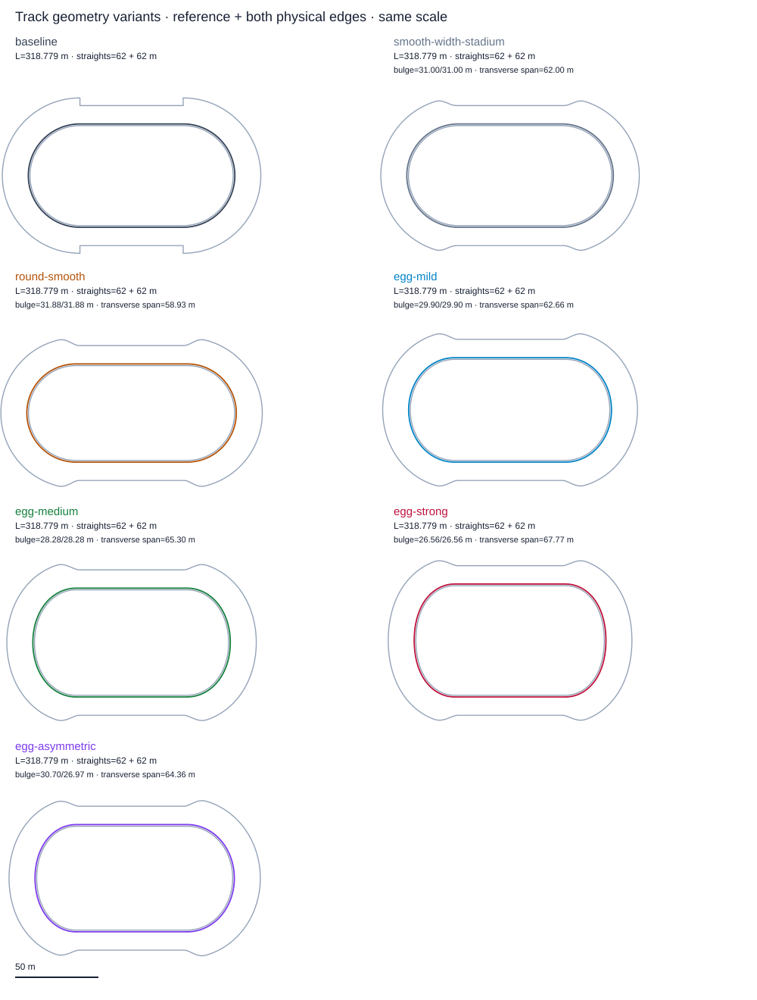
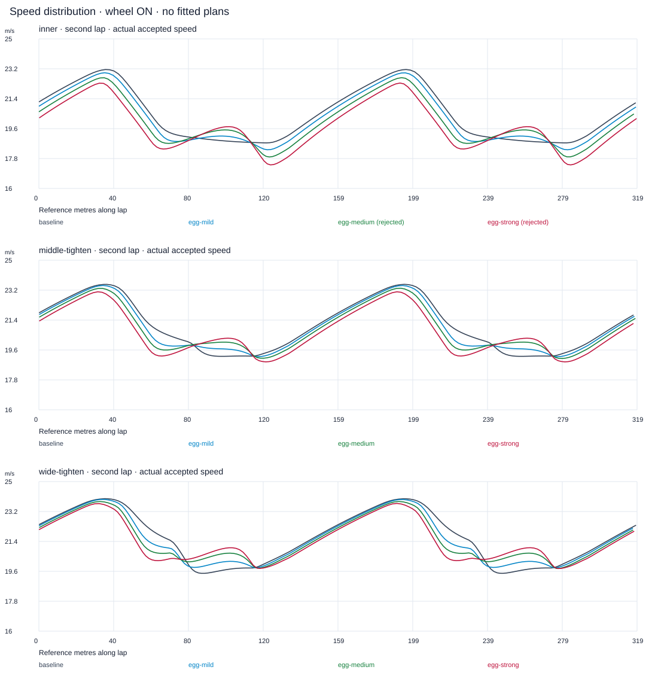
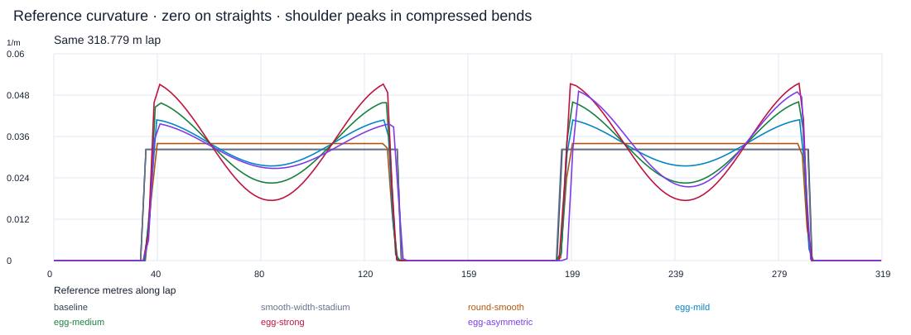

# Track Geometry Variants (#101)

**A — poprawny, ograniczony eksperyment geometrii; brak empirycznego potwierdzenia realizmu toru.** Baza #100 `e2498f457e0eab672f3ada8008f4329efd2d701c`. Geometria wpływa na przewagę inner, ale nie wykazuje, że prawdziwy tor powinien dawać inne proporcje. Najlepszym bezpiecznym kandydatem w głównej próbie jest **Egg Mild**. Nie zmieniono domyślnego toru.

## Zakres i zamrożenie

[freeze.json](track-geometry-variants/freeze.json) powstał przed pierwszym przejazdem. 7 geometrii × 5 planów = **35 światów**: neutralny zawodnik/setup, jednolity Grip1, wilgotność0,5, bez kolein, 3 okrążenia, stały krok docelowy10ms. Start: reference0, offset5m, v18m/s, yaw zgodny z tangent; plany aktywują target na t0. Cel to Lap2+Lap3, bez nagrody za linię. Oba flagi #100 ON. Bez optymalizacji planów, zmiany gazu, AI, umiejętności, zużycia, opony, ω, yaw, masy lub wymiarów. Produkcyjne `src/CoreSim` pozostaje nietknięte.

Plany `inner`=1/1/1/1, `middle-tighten`=5/3/1/5, `wide-tighten`=9,5/7/2/9,5 to te same plany #99–#100. Nowe `speedway-wide-entry`=9/9/2/7 (apex komenda50%, exit85%) i `speedway-open-exit`=9/6/1/9,5 (40%/65%) są jawnymi hipotezami, nie rekonstrukcją jazdy zawodnika. Wszystkie przygotowują entry15m przed łukiem; drive1. Komenda apex i rzeczywisty offset przy geometrycznym środku nie są tym samym.

## Jawna geometria

Baseline zachowuje dokładny dziewięciosegmentowy `TrackMetricEmbedding`: proste35+27m przez metę i62m, Rref31m, po3×float(π/3) na łuk; lap318,778749943m. Fizyczny kerb leży offset−1m, banda11m na prostej i15,6m w łuku. Dotychczasowe skoki szerokości4,6m pozostają w baseline.

Nowe łuki są krzywymi parametryzowanymi długością referencyjną. Dla t=s/L:

`g(t)=r(t)·(1+c cos(2πt)); I=∫₀¹g(t)dt; κ(t)=πg(t)/(L I); θ(t)=∫κ ds; P'= (cosθ,sinθ)`.

`r=S(min(t,1−t)/0,05)` do1, `S(z)=10z³−15z⁴+6z⁵`. Krzywizna i jej pochodna przy łączeniu ze straight są zerowe; środek łuku jest coraz bardziej płaski, ramiona ciaśniejsze. Żaden wariant nie ma spiczastego środka. Całka Simpsonem na4096 interwałach/łuk; druga połowa jest lustrzana. Piątego stopnia Hermite łączy pozycję, tangent i κ w węzłach. To C2 w XY, z bardzo małym błędem parametryzacji; nie normalizujemy ciał ani ich prędkości.

| Geometria | c₁/c₂ | zasięg x łuk1/2 m | rozstaw y m | κmax 1/m | Rmin m |
|---|---|---|---|---|---|
| baseline | — | 31 / 31 | 62 | 0.032258 | 31 |
| smooth-width-stadium | 0/0 | 31.000 / 31.000 | 62.000 | 0.032258 | 31.000 |
| round-smooth | 0/0 | 31.885 / 31.885 | 58.929 | 0.033956 | 29.450 |
| egg-mild | 0.2/0.2 | 29.895 / 29.895 | 62.663 | 0.040852 | 24.478 |
| egg-medium | 0.35/0.35 | 28.281 / 28.281 | 65.299 | 0.046126 | 21.680 |
| egg-strong | 0.5/0.5 | 26.564 / 26.564 | 67.774 | 0.051486 | 19.423 |
| egg-asymmetric | 0.2/0.4 | 30.703 / 26.971 | 64.356 | 0.049233 | 20.312 |

Łączna długość łuków i oba straight62m są zachowane; zmienia się poprzeczny rozstaw prostych. Mild ściska zasięg x o3,56%, Medium8,77%, Strong14,31%. Asymmetric zachowuje wspólny rozstaw y64,356m; łuki mają100,020 i94,758m (inne długości są konieczne dla domknięcia). To kontrolowane kształty modelowe, bez pomiarów geodezyjnych Motoareny.

Kontrole: `smooth-width-stadium` zachowuje kołowy kształt z nową reprezentacją i samymi gładkimi krawędziami (odziedziczony skok krzywizny circle/straight jest tu zamierzony). `round-smooth` dodaje rampę κ, c=0. Oddzielają wpływ szerokości i wygładzenia od dalszego ściśnięcia.

Szerokość we wszystkich nowych geometriach wynosi12m na prostej i16,6m w środku łuku, z C2 taperem przez pierwsze/ostatnie10m łuku. Bez zwężenia poniżej12m, bez rozszerzenia do nowych targetów. Maksymalny dopuszczony target nadal9,5m. Ograniczenie pełnej szerokości planów z #99 nadal istnieje. Przy jednolitej nawierzchni zachowano próbkowanie i bazowy budżet sił #100: jego `v_safe²/R` jest algebraicznie niezależne od R; stały promień w tej kalibracji nie jest używany jako krzywizna drogi. Heading, preview, reference speed i metry planu pochodzą z nowej krzywej. Nie deklarujemy obsługi AI ani porównania niejednolitej nawierzchni na tych kształtach.

## Wynik wszystkich planów

| Geometria | inner s | middle s | wide s | wide-entry s | open-exit s |
|---|---|---|---|---|---|
| baseline | 31.771572 | 32.082181 | 33.137874 | 34.130016 | 33.322550 |
| smooth-width-stadium | 31.771577 | 32.082185 | 33.137875 | 34.130018 | 33.322551 |
| round-smooth | 32.240352 | 32.483421 | 33.493585 | 34.518360 | 33.602283 |
| egg-mild | 32.176386 | 32.267617 | 33.125616 | 34.139354 | 33.319144 |
| egg-medium | 32.486363 † | 32.423005 | 33.131727 | 34.067034 | 33.397449 |
| egg-strong | 32.965408 † | 32.719182 | 33.262338 | 34.240063 | 33.642259 |
| egg-asymmetric | 32.407069 † | 32.384749 | 33.149133 | 34.118751 | 33.372878 |

† Pełny plan odrzucony geometrycznie; czas pozostawiony diagnostycznie. Nie używamy go w rankingu wykonalnych. Wszystkie35 światów ukończyły3 okrążenia, **32/35** przeszły kryteria. Pozycje poza torem są zachowane w danych, bez korekty i bez dodanej bandy w solverze.

| Geometria | middle−inner s | wide−inner s | ranking wykonalnych |
|---|---|---|---|
| baseline | +0.310608 | +1.366302 | inner / middle-tighten / wide-tighten / speedway-open-exit / speedway-wide-entry |
| smooth-width-stadium | +0.310608 | +1.366299 | inner / middle-tighten / wide-tighten / speedway-open-exit / speedway-wide-entry |
| round-smooth | +0.243069 | +1.253233 | inner / middle-tighten / wide-tighten / speedway-open-exit / speedway-wide-entry |
| egg-mild | +0.091231 | +0.949230 | inner / middle-tighten / wide-tighten / speedway-open-exit / speedway-wide-entry |
| egg-medium | -0.063358 | +0.645364 | middle-tighten / wide-tighten / speedway-open-exit / speedway-wide-entry |
| egg-strong | -0.246226 | +0.296930 | middle-tighten / wide-tighten / speedway-open-exit / speedway-wide-entry |
| egg-asymmetric | -0.022321 | +0.742064 | middle-tighten / wide-tighten / speedway-open-exit / speedway-wide-entry |

Mild zmniejsza stratę middle0,310608→0,091231s (**70,6%**), a wide1,366302→0,949231s (**30,5%**). Inner sam zwalnia0,404814s, middle0,185436s, wide przyspiesza0,012258s. To częściowo utrudnienie jazdy przy kredzie, a nie duży zysk szerokiej. Kontrola taperu zmienia czasy o kilka mikrosekund; samo C2 przejście zmniejsza middle−inner do0,243070s, ściśnięcie Mild dalej do0,091231s. Główne zmiany nie pochodzą od taperu.

W Medium/Strong/Asymmetric middle jest najszybszym **wykonalnym** planem, lecz inner odrzucono. Nie traktujemy tego jako dowodu, że geometria uczciwie „odwróciła” przewagę bez kosztu bezpieczeństwa.

Nie znika matematyczny koszt stałego offsetu: dla wypukłej zamkniętej krzywej `dl=(1+κd)ds`, więc po pełnym obrocie dodatkowa droga wynosi `2πd`, niezależnie od tego, czy łuk jest kołem. Zmiana kształtu zmienia rozkład wymaganych sił/prędkości i koszt zmiennego offsetu, nie usuwa samego kosztu jazdy na zewnątrz.

## Prędkości, rzeczywiste trajektorie i wyjście

| Geometria/plan | d dwóch lotnych m | vmin łuku m/s | entry / middle / exit m/s | vout exit m/s | Δoffset pierwsze12m | min gap inner/outer m |
|---|---|---|---|---|---|---|
| baseline/inner | 645.118 | 18.742 | 23.149 / 19.038 / 19.157 | 1.758 | 0.358 | 0.3992 / 5.5999 |
| baseline/middle-tighten | 671.494 | 19.217 | 23.549 / 19.761 / 19.978 | 3.288 | 1.229 | 2.2851 / 5.5999 |
| baseline/wide-tighten | 711.938 | 19.476 | 23.970 / 19.558 / 20.722 | 4.509 | 1.919 | 3.8741 / 1.8266 |
| egg-mild/inner | 646.497 | 18.326 | 22.962 / 18.981 / 18.802 | 1.351 | 0.228 | 0.1426 / 5.5992 |
| egg-mild/middle-tighten | 672.034 | 19.191 | 23.475 / 19.842 / 19.823 | 2.952 | 1.091 | 2.1785 / 5.5992 |
| egg-mild/wide-tighten | 709.382 | 19.809 | 23.922 / 19.838 / 20.609 | 4.255 | 1.839 | 3.6291 / 1.8360 |
| egg-medium/inner † | 645.849 | 17.893 | 22.658 / 19.142 / 18.369 | 1.473 | 0.274 | 0.0029 / 5.5992 |
| egg-medium/middle-tighten | 672.103 | 19.078 | 23.284 / 19.950 / 19.631 | 3.131 | 1.162 | 2.0408 / 5.5992 |
| egg-medium/wide-tighten | 708.412 | 19.766 | 23.773 / 20.230 / 20.478 | 4.458 | 1.936 | 3.4594 / 1.8531 |
| egg-strong/inner † | 645.654 | 17.416 | 22.298 / 19.097 / 17.870 | 1.572 | 0.298 | -0.1020 / 5.5992 |
| egg-strong/middle-tighten | 671.765 | 18.884 | 23.015 / 19.906 / 19.340 | 3.306 | 1.210 | 1.8951 / 5.5992 |
| egg-strong/wide-tighten | 708.600 | 19.765 | 23.611 / 20.440 / 20.357 | 4.647 | 1.964 | 3.3265 / 1.8451 |
| egg-asymmetric/inner † | 646.272 | 17.512 | 22.722 / 19.089 / 18.494 | 1.422 | 0.256 | -0.1110 / 5.5992 |
| egg-asymmetric/middle-tighten | 672.009 | 18.794 | 23.311 / 19.911 / 19.673 | 3.069 | 1.137 | 2.0267 / 5.5992 |
| egg-asymmetric/wide-tighten | 709.062 | 19.539 | 23.805 / 20.088 / 20.513 | 4.381 | 1.894 | 3.4582 / 1.8377 |

Entry/middle/exit to średnie z czterech łuków Lap2–3, middle oznacza geometryczne50% łuku. Exit to pierwsza rzeczywiście zaakceptowana prosta; wynik nie jest przenoszony na hipotetyczny stan w dokładnym s=end. Długość lotnej trajektorii pochodzi z wykonanej drogi i interpolacji przekroczeń. Prześwity oraz max slide/κ obejmują cały przejazd3lap, także wejście w stan ustalony. κ w [results.csv](track-geometry-variants/results.csv) jest maksymalnym chwilowym κ przed zaakceptowanym interwałem, nie κ punktu środkowego z innej tabeli #100. Wszystkie offsety straight/entry/apex/exit, minima, slide i κ są w CSV; [corners.csv](track-geometry-variants/corners.csv) zachowuje każdy łuk osobno.

Mild: szeroki exit zyskuje nad inner1,807m/s wobec1,565m/s baseline; następna prosta1,246 wobec1,085m/s. Middle exit zyskuje1,021 wobec0,820m/s. Jednocześnie absolutne exit speed nie rosną: inner19,158→18,802m/s, wide20,722→20,609m/s. Rzeczywista droga wide skraca się711,938→709,382m; inner wydłuża645,118→646,497m. Względny zysk szerszych planów jest mierzalny, bez deklaracji poprawności empirycznej.

Na wyjściu Mild vout inner maleje1,758→1,352m/s, poszerzenie0,358→0,228m; wide4,509→4,256m/s i1,918→1,839m. Gładkie κ nie tworzy nagłego zaniku wymagania skrętu jak circle/straight. Nadal występuje wczesne wychodzenie na zewnątrz i późniejsze prostowanie. Nowe plany „speedway” nie wygrały; wide-entry jest najwolniejszy. Nazwa planu nie zastępuje rzeczywiście osiągniętego apexu.

## Geometria bezpieczeństwa i sanity bez wheelspin

Audyt liczy odległość **całej chassis i handlebar capsule** od obu krawędzi, z ich rzeczywistym yaw. Polilinia brzegu ma odstęp≤5cm; dla C2 kształtów ograniczenie |edge''|<2/m daje sag<0,625mm. Odejmujemy0,7mm oraz istniejące0,1mm zapasu numerycznego. Kołowa kontrola ma skok szybkości parametru offsetu przy łączeniu; jej geometryczny sag także sprawdzono niezależnie. Największa zmierzona odległość brzegu od cięciwy pozostaje poniżej0,7mm. BVH przyspiesza obliczenie odległości; nie zastępuje testu samym offsetem środka.

Medium/inner: minimum **+0,002927m**, narusza wymagane0,05m, bez ujemnych próbek. Strong/inner: **−0,102027m**,156 ujemnych próbek. Asymmetric/inner: **−0,111026m**,96 ujemnych próbek. Najgorsze stany są na pierwszym okrążeniu, na wejściu w drugi łuk (t10,53/10,61/10,48s); także transient od wspólnego offsetu5m jest częścią wykonalności. [rejected-details.json](track-geometry-variants/rejected-details.json) zawiera stan, obrysową ocenę i sąsiednie kroki. Nie rozszerzono toru ani nie zmieniono targetów po pomiarze.

Audyt obejmuje każdy zaakceptowany stan10ms oraz podziały istniejącego runnera. To nie jest nowa certyfikacja ciągłego CCD pomiędzy stanami; zapas5cm i krok≤0,24m są jawne. Brak dowodu, że na tym torze nie wystąpi błąd przy dowolnej prędkości lub planie.

Zamrożona reguła wyboru dopuściła tylko Mild spośród4 egg z wszystkimi3 bazowymi planami wykonalnymi. Wykonano zatem krótki sanity tylko baseline+Mild, po3 plany, bez wheelspin:

| Geometria | plan | bez koła s | inner gap m | wykonalny |
|---|---|---|---|---|
| baseline | inner | 31.198531 | 0.26051 | True |
| baseline | middle-tighten | 31.461462 | 2.05834 | True |
| baseline | wide-tighten | 32.480999 | 3.69972 | True |
| egg-mild | inner | 31.563550 | -0.00969 | False |
| egg-mild | middle-tighten | 31.659694 | 1.97954 | True |
| egg-mild | wide-tighten | 32.491225 | 3.43710 | True |

Bez koła surowa strata middle do inner także maleje0,262932→0,096144s, więc efekt czasu nie jest wyłącznie wheelspin. **Jednak Mild/inner przecina kerb o9,691mm** w historycznym modelu. Nie nazywamy tego bezpieczną poprawą ani niezależnością od opony. Mild z modelem #100 pozostaje kandydatem do dalszej pracy; oba modele nie mają identycznego marginesu.

## Koszt i deterministyczność

Projekcja używa statycznego BVH nad4096 kawałkami/łuk, następnie najwyżej5 kroków Newtona na odwiedzonym kawałku i porównania z prostymi. Bez linearnego przeszukiwania wszystkich węzłów, przebudowy drzewa, RNG, zegara domenowego lub alokacji w zapytaniu. Podziały siatki nie tworzą nowych kroków fizyki; istniejący scheduler nadal widzi tylko koniec logicznego straight/turn.

| Geometria | projekcja mediana µs | alokacje / 10000 |
|---|---|---|
| baseline | 0.893 | 0 |
| smooth-width-stadium | 2.625 | 0 |
| round-smooth | 2.683 | 0 |
| egg-mild | 2.586 | 0 |
| egg-medium | 2.516 | 0 |
| egg-strong | 2.511 | 0 |
| egg-asymmetric | 2.522 | 0 |

5 powtórzeń po warmup, po10000 zapytań, ten sam Release; czasy hosta są diagnostyką. BVH ma zauważalny koszt≈2,8–3,0× native inverse, nie ukrywamy go.

| 3 okrążenia inner | mediana ms | solver / force | oceny granicy | commit koła |
|---|---|---|---|---|
| baseline | 28.728 | 4815 | 18 | 4815 |
| egg-mild | 38.847 | 4869 | 14 | 4869 |

3 powtórzenia pełnego, nieobserwowanego3lap inner po warmup: baseline28,728ms→Mild38,847ms (**+35,2%**); koszt obejmuje utworzenie geometrii i świata. Solver4815→4869 (**+1,12%**), tyle samo pojedynczych force/commit. Zmiana wynika z czasu jazdy i istniejących granic, nie z tysięcy dodatkowych korekt kontaktu. Offline audyt geometrii nie działa w zwykłym ticku. Każda geometria ma dokładnie zgodny fingerprint zwykłego i obserwowanego wykonania; w próbach kosztu wszystkie powtórzenia także zgodne.

Wykonano35 głównych światów,6 historycznych,7 prostych powtórzeń,3 celowane powtórzenia odrzuceń i8 prób kosztu z warmup. Nie uruchamiano szerokiego benchmarku ani ponownie głównej macierzy. Eksport geometrii ma camelCase wymagane przez viewer; korekta samej serializacji nie liczyła fizyki ponownie.

## Walidacja i odtwarzanie

Release całego rozwiązania z warnings-as-errors:0 ostrzeżeń/błędów. **32/32** celowanych testów (8 nowych geometrii + istniejące #99/#100/sterowanie/replay), **9/9 Node**. Testy obejmują domknięcie, długość, finity, normalne, roundtrip reference/offset, porównanie projekcji z niezależną gęstą próbką także daleko od toru, C2, krawędzie, brak alokacji i powtórzenie świata. Max roundtrip reference=0.000003165m. Max |whole-system ΔE−W|=1.272002J. Solver=wheel commit we wszystkich nowych głównych przejazdach, bez podwójnego napędu.

6 fingerprintów i czasów baseline (#100 normalgrip,3 plany×2 modele) jest zgodnych **bitowo**. Native geometry.json jest identyczny bajtowo. Manifesty #95/#97/#98/#99/#100 pozostają bez zmian: {'autonomous-racing-line': 34, 'slip-coupled-dynamics': 63, 'slip-control-validation': 42, 'physics-driven-racing-line': 21, 'rear-wheel-dynamics': 88}. [validation.json](track-geometry-variants/validation.json), [TRX](track-geometry-variants/targeted-release.trx), [geometry-validation.json](track-geometry-variants/geometry-validation.json), [performance.json](track-geometry-variants/performance.json). Standardowe Draft Windows CI sprawdza końcowy HEAD; link/status w PR i dostarczeniu. Bez merge.

Viewer dostał wyłącznie wybór zapisanych #101 przejazdów i ładowanie ich własnego `*-geometry.json`. Stare replaye wracają do starej geometrii. CSV≈0,1s, bez projekcji/zmiany yaw dla wyglądu; pozycje każdej zapisanej próbki są testowane. Dostępne inner i wide dla baseline i czterech egg, także odrzucone. [Dane](track-geometry-variants/) zawierają pełne tabele i lekki ślad drugiego okrążenia. `track-geometry DIR freeze`, potem `measure`, `verify`; `export` tylko odtwarza pliki geometrii. Helper `track-geometry-report.py` nie liczy ruchu ani nie stroi.

## Sześć odpowiedzi i jeden następny PR

1. **Czy stadium nadmiernie premiuje inner?** W tym modelu kształt stanowi część przewagi; brak danych prawdziwych przejazdów, by rozstrzygnąć słowo „nadmiernie”. Nie usuniemy geometrią kosztu2πd stałej zewnętrznej linii.
2. **Który ogranicza przewagę?** Mild jest najlepszym bezpiecznym porównaniem wszystkich3 bazowych planów przy #100. Strong najbardziej zmniejsza surowe różnice, ale inner jest niewykonalny; nie jest zwycięzcą porównania bezpieczeństwa.
3. **Realistyczniejszy charakter?** Mild jest najmocniej uzasadnionym kandydatem dzięki C2 i mniejszemu wyrzutowi na prostą. Realizm empiryczny pozostaje nierozstrzygnięty. Medium ma ciekawy kompromis z ciaśniejszymi ramionami; Strong jest zbyt agresywny dla zamrożonego inner i jego regulatora, mimo gładkiej geometrii. Asymmetry nie daje tu dodatkowej korzyści bezpieczeństwa. Sam taper jest za słaby.
4. **Odzysk na entry/exit?** Tak względnie: Mild podnosi przewagę exit/straight speed middle i wide nad inner; absolutne prędkości nie rosną. Wide nadal przegrywa0,949s i pozostaje dłuższy o62,885m na2lap.
5. **Do dalszej pracy?** Mild nadaje się do dalszego eksperymentu, jeszcze nie do zastąpienia Motoareny: brak geodezji, mapy gripu, pełnej szerokości planów i zgodnego marginesu historycznej opony. Nie deklarujemy rozstrzygnięcia AI/czteroosobowej walki.
6. **Jeden następny PR:** walidacja **Egg Mild na podstawie rzeczywistych danych geometrii i trajektorii jednego toru**, z zamrożonymi równaniami #100. Porównać pomierzone współrzędne/krawędzie oraz entry/apex/exit i sprawdzić margines kerbu, zanim zaczniemy kalibrować wybór linii. Nie uruchamiać kolejnego szerokiego przeszukiwania planów pod założonego zwycięzcę.
