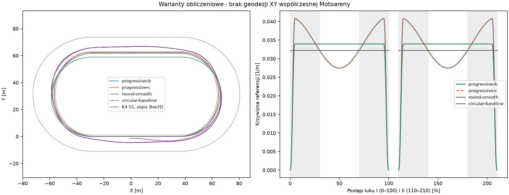
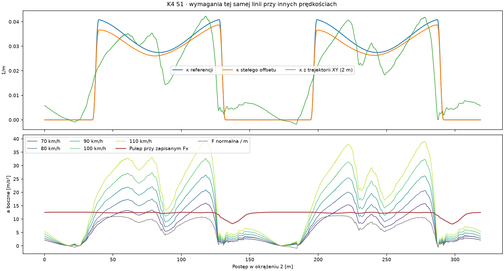
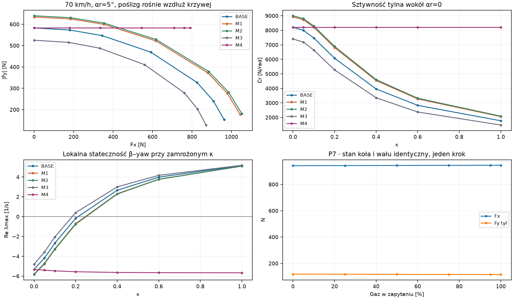
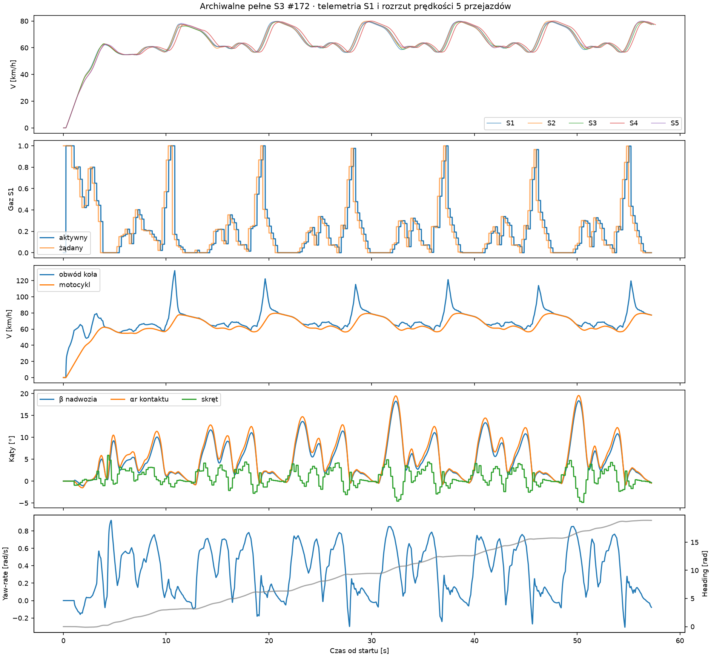
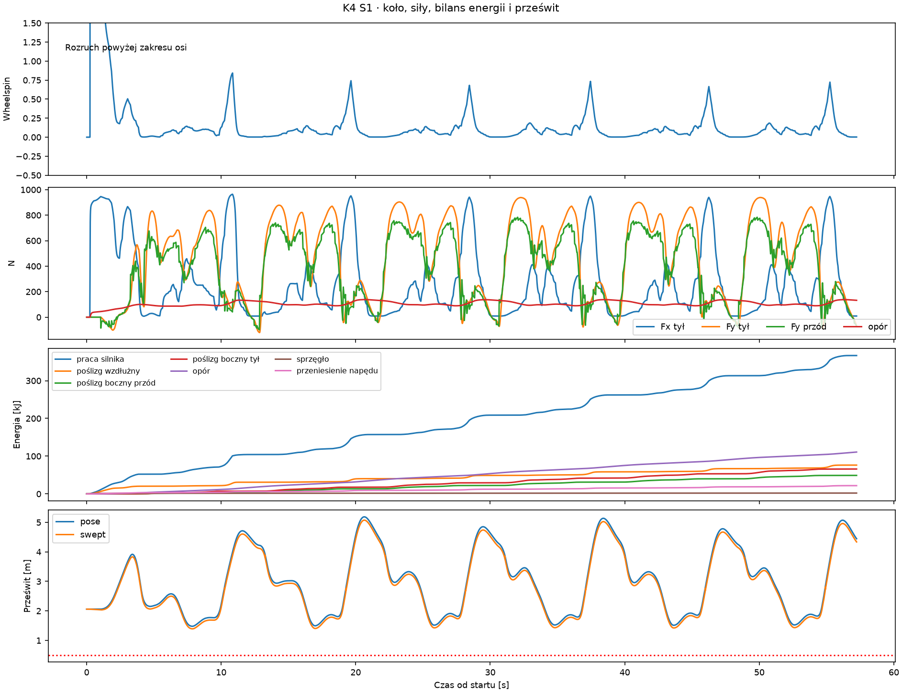
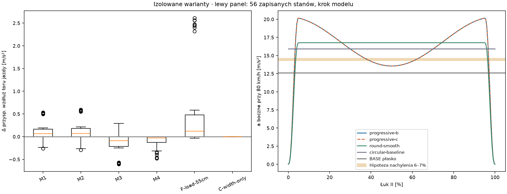

# Badanie #175 · co ogranicza prędkość

Audyt diagnostyczny, PROVISIONAL, domyślnie OFF. Baza #174 `cf585987374e0673e3f0cf89df636d20bf524af5`. Kontroler porównawczy S3-K4 z #172 `c5f0a4cc4de34fc4c8c47ef912cafabf34055f29`. Nowe narzędzie nie jest podłączone do produkcji. **Wynik nowego pełnego S3: UNKNOWN. Wyniku sportowego nie badano.**

K4 ogranicza dopływ energii przed łukiem. W pierwszych 30% lotnych łuków boczna praca opon i opór odbierają więcej energii, niż dostarcza napęd. Utrzymanie wyższej prędkości na tej samej linii wymaga większej siły bocznej, której model często nie ma nawet przy pominięciu warunku momentu yaw. Przy ponownym otwarciu gazu wysoki wheelspin osłabia reakcję boczną tyłu. Te trzy mechanizmy działają na różnych odcinkach. Nie da się przypisać im udziałów procentowych w czasie całego wyścigu.

## 1. Długość i linia pomiarowa

Ekstraliga podaje 318 m, a FIM mierzy tor 1 m od krawędzi wewnętrznej. `progressive-b` stosuje tę konwencję i ma **318,778750 m**. Dwie proste mają 62 m, start dzieli jedną na 35 i 27 m, łuki mają po 97,389375 m w trzech sekcjach po 32,463125 m. Nominalna długość wynika z konstrukcji 124 + 2π·31 m. Położenie kresy 35/27 jest założeniem zgodnym z kryterium projektowym, którego nie potwierdzono pomiarem obiektu. Model skręca w lewo, zgodnie z kierunkiem wyścigu. [Karta Ekstraligi 2026](https://ekstraliga.pl/se/druzyny/1/2026/info) · [FIM STRC 2026, §§79.3.2 i 79.3.3](https://www.fim-moto.com/fileadmin/user_upload/Documents/2026/2026_FIM_standards_Track_Racing_circuits.pdf?t=1774086483)

| B, zamknięta krzywa | Długość całkowana [m] | Niezależna suma cięciw XY [m] |
|---|---:|---:|
| Linia pomiarowa | 318,778750 | 318,778744 |
| Wewnętrzna krawędź | 312,495565 | 312,495559 |
| Zewnętrzna krawędź | 402,482589 | 402,482581 |
| Środek lokalnej szerokości | 357,319405 | 357,319398 |
| Stały offset +3,5 m od referencji | 340,769899 | 340,769892 |

Całkowanie odtwarza rampę krzywizny i profil szerokości bez współrzędnych z kolektora. Dla offsetu d(s) całkuje `sqrt((1+κd)² + d'²)`. Linia wewnętrzna ma d=−1, a zewnętrzna d=width−1. Suma cięciw korzysta z odrębnego eksportu oryginalnych punktów XY co około 0,025 m. Różnice są mniejsze niż 0,01 mm. `TrackMetricEmbedding` i `TrackGeometry` definiują bazowy łańcuch łuków kołowych. `ExperimentalTrackShape` zastępuje go w `TrackFrame` ciągłą krzywą. `CurveBoundaryAudit` i `RacingLineGeometry` używają osobno rzeczywistych krawędzi i obrysu. `BendMap` oraz planer #172 otrzymują początki sekcji z tej samej ramy.

| Archiwum K4 | Okr. 1 [m] | Okr. 2 [m] | Okr. 3 [m] | Czas S3 [s] |
|---|---:|---:|---:|---:|
| S1 | 330,550 | 331,599 | 331,617 | 56,225 |
| S2 | 331,012 | 331,745 | 331,757 | 56,233 |
| S3 | 332,664 | 331,614 | 331,602 | 56,435 |
| S4 | 336,214 | 331,764 | 331,756 | 56,628 |
| S5 | 331,801 | 331,771 | 331,762 | 56,331 |

Pierwsze okrążenie liczy drogę od zatrzymanego startu za kresą. Kolejne okrążenia są fizycznie o około 12,8–13,0 m dłuższe niż referencja. Sumy cięciw trajektorii potwierdzają licznik drogi z dokładnością około 2 μm w audytowanych przebiegach. Prędkość jest modułem prędkości ciała. Referencyjny postęp ma Jacobian `v·T/(1+κd)`. Na zapisach K4 p95 bezwzględnego błędu numerycznego oszacowania tej pochodnej względem kroków projekcji wynosi około 0,007 m/s. Czas mety pochodzi z interpolacji przekroczenia L/2L/3L, a przygotowanie zakrętu z postępu w tej samej geometrii. Nie wykryto pomylenia metrów referencji z metrami drogi w mechanizmie prędkości. Sama różnica 0,779 m na okrążenie to 0,245% dystansu i około 0,14 s dla trzech okrążeń przy identycznej średniej prędkości referencyjnej. To rachunek skali, bez uruchamiania skróconej trasy.

## 2. Zgodność kształtu z Motoareną

**Niepotwierdzona.** Sezon 2026 podaje szerokości 12/12 m na prostych i 17/16,2 m na łukach. Klub potwierdza 318 m i granit. Liga opisuje zmianę drugiego łuku przed sezonem 2017, która zmniejszyła długość z 325 do 318 m. Artykuł ligi podaje też proste po 62 m oraz nominalne 31 m. Starszy opis miejski łączy te wymiary z długością 325 m i szerokością 18 m, więc nie jest aktualnym pomiarem krzywizny ani przekroju. [Klub](https://speedway.torun.pl/) · [Historia geometrii według Ekstraligi](https://ekstraliga.pl/se/news/czy-podczas-pge-imme-im-zenona-plecha-padnie-nowy-rekord-toru) · [Opis miasta](https://torun.pl/pl/print/node/41225?entity_type=node)

`progressive-b` ma oba łuki i ich szerokości symetryczne. `progressive-c` dopasowuje 17/16,2 m, zachowując identyczny przebieg referencji. Brakuje współrzędnych i aktualnych przekrojów z homologacji. Zmiana samej szerokości nie odwzorowuje udokumentowanej zmiany drugiego łuku. Wykres pokazuje wyłącznie jawne warianty modelu. Dla odniesienia rekord w karcie ligi wynosi 56,500 s na czterech okrążeniach. Średnia z 1272 m pomiarowych to 81,05 km/h. Mediana S3 #172 odpowiada 61,12 km/h po referencji na 956,34 m. Są to średnie z różnych dystansów, startów i warunków. [Karta Ekstraligi](https://ekstraliga.pl/se/druzyny/1/2026/info) · [Organizator o czterech okrążeniach](https://ekstraliga.pl/se/news/nowe-tory-nowe-rekordy)

## 3. Czy 24,48 m wymusza zwalnianie?

**W modelu tak, na tej części krzywej i przy tym budżecie.** Czy zwalnianie jest nadmierne względem współczesnej Motoareny, pozostaje nierozstrzygnięte. Krzywizna jest gładka przy złączach, ale rośnie przez pierwsze 5% łuku. Maksima leżą blisko 4,9% i 95,1% postępu. Trzydziestoprocentowe fragmenty wejścia i wyjścia mają Rmin 24,4784 m. Środkowe 40% ma Rmin 31,0631 m. Na stałym offsecie +3,5 m najbardziej ciasny fragment ma R≈27,98 m i pułap skalarny 67,6 km/h przy pełnym budżecie bocznym. Pułap dla samej referencji wynosi 63,2 km/h. Założenie zerowego Fx czyni oba pułapy optymistycznymi.

Przy 80 km/h na +3,5 m minimum R żąda 17,65 m/s² w B, 14,99 m/s² w `round-smooth` i 14,31 m/s² w bazie kołowej. Dostępny skalarny pułap BASE wynosi 12,60 m/s². Łagodniejszy profil zmniejsza skrajne żądanie na wejściu i wyjściu, ale podnosi krzywiznę w środku względem B. Kształty porównano przy tym samym odcinku i stałym offsecie. Nie uruchomiono K4 na obcej geometrii i nie użyto różnej długości przejazdu jako wyniku sportowego.

## 4. Czy obie krzywizny są rzeczywiste?

**UNKNOWN.** 31 m jest nominalną liczbą z opisu, bez przypisania do współrzędnej, offsetu lub etapu przebudowy. B i C mają te same krzywizny. Baza kołowa ma R=31 m w zakręcie, a `round-smooth` ma Rmin 29,45 m. Zewnętrzna krawędź B/C ma zmienny offset, więc jej krzywizna zawiera także pierwszą i drugą pochodną szerokości. CSV próbkowany co 0,5 m podaje promień referencji, wewnętrznej i zewnętrznej krzywej, szerokość i wymagane Fy od 60 do 120 km/h dla każdego łuku.

Dla faktycznego XY zawodnika policzono podpisaną krzywiznę z trzech punktów oddalonych wzdłuż drogi o 1 m, z siatką interpolacji 0,25 m. Mediana maksymalnej |κ| w 25 lotnych łukach K4 wynosi 0,04176 1/m, czyli R około 23,95 m. Ruch poprzeczny i korekty powodują, że promień linii zmiennej może być mniejszy od promienia referencji mimo jazdy po jej zewnętrznej.

| Prędkość narzucona na ten sam ślad XY | Mediana maks. wymaganego a bocznego [m/s²] | Mediana udziału próbek powyżej pułapu przy zapisanym Fx |
|---|---:|---:|
| 70 km/h | 15,79 | 34,3% |
| 80 km/h | 20,62 | 69,5% |
| 90 km/h | 26,10 | 82,6% |
| 100 km/h | 32,22 | 91,6% |
| 110 km/h | 38,99 | 93,2% |

Mianownik to próbki natywne w pojedynczym łuku. Podajemy medianę udziałów 25 łuków, a nie udział drogi ani przyczyn czasu. Pułap liczy rzut przedniej pojemności i tylnego zapasu `sqrt(Br²−Fx²)` na normalną do ruchu, wraz z rzutem zadanego Fx. Pomija zgodność momentu yaw i reakcję kierownicy. Przekroczenie dowodzi braku takiej prędkości na zapisanej krzywej i w podanym budżecie. Inne linie, inne Fx i inne przejścia pozostają otwarte.

## 5. Nawierzchnia i wartość μ

**Brak pomiarów do rozstrzygnięcia, czy przyczepność jest za mała.** Aktywna ścieżka `FreeLearningExperiment.Parameters → Contact144 → LoadBasedTyreGrip` ma jednolitą zamrożoną nawierzchnię. `MultiActionExperiment135.Surface` tworzy snapshot Grip=1, Ruts=0, Moisture=0,50 bez ewolucji podczas biegu. `TrackSurfaceState` liczy optimum 0,35, nadmiar wody z wagą 0,55, niedobór z wagą 0,20 oraz koleiny z wagą 0,45. Są to założenia modelu, bez kalibracji do granitu. Wilgotność jest zmienną bezwymiarową, nie pomiarem procentów wody. `TrackState` próbkuje komórki, lecz jednorodność usuwa różnicę między nimi w tych biegach.

`EffectiveGrip=0,9175`, współczynnik referencyjny 1,40, zatem μ=1,28450003. Dla 147 kg Fz przodu=665,57 N, Fz tyłu=776,50 N, pojemności 854,93 N i 997,41 N. Brak dynamicznego Fz, wpływu umiejętności na μ i nadpisania przez legacy cel prędkości. Oryginalne zapytanie z dokładnie tymi wejściami odtworzyło siłę i moment zapisane przez Box2D w 56/56 badanych krokach. Pojemności skalują Fx i Fy i zmieniają regularizację ich charakterystyk. Wpływ na stateczność wynika z różnic przydziału i momentu, bez osobnego mnożnika stabilności.

| Wariant | μ | Cały pułap N | Przód / tył N | Pułap prędkości na tej samej linii, bez Fx |
|---|---:|---:|---:|---:|
| BASE | 1,2845 | 1852,34 | 854,93 / 997,41 | 1,000× |
| M1, wilgotność 0,35 | 1,4000 | 2018,90 | 931,80 / 1087,10 | 1,044× |
| M2, +10% μ | 1,4130 | 2037,57 | 940,42 / 1097,15 | 1,049× |
| M3, −10% μ | 1,1561 | 1667,11 | 769,43 / 897,67 | 0,949× |
| M4, rozdział sił | 1,2845 | 1852,34 | 854,93 / 997,41 | 1,000× |

W kroku z tym samym stanem i komendą mediana Δa wzdłuż ruchu to M1 +0,063, M2 +0,069, M3 −0,087 m/s². Zakresy obejmują oba znaki. Wyższe μ może nasilić boczny scrub przy tej samej orientacji i aktywnym skręcie. Arkusz podaje dla każdego wariantu Fx, Fy, Fz, dostępny zapas Fy, moment, pułapy na krzywiźnie XY oraz miarę rezerwy momentu. Pojedyncza sonda nie określa stabilności driftu w czasie. Dokumentacja producenta opony podaje zastosowanie i wymiary, a norma FIM wymaga luźnej warstwy nawierzchni. Nie znaleziono publicznych krzywych siła–poślizg dla tego zestawu opona/nawierzchnia i aktualnego profilu Fz. [Mitas Speedway](https://www.mitas-moto.com/en-gb/products/motorcycle-off-road-tyres/speedway-tyres/speedway) · [FIM STRC §79.3.4](https://www.fim-moto.com/fileadmin/user_upload/Documents/2026/2026_FIM_standards_Track_Racing_circuits.pdf?t=1774086483)

## 6. Fx/Fy, wheelspin i kontrolowany drift

Oryginał ma `Fx=Br·a/sqrt(1+a²+b²)`, `Fy=−Br·b/sqrt(1+a²+b²)`. a normalizuje poślizg wzdłużny w połowie kroku, b normalizuje poprzeczną prędkość tylnego styku. Przy stałym b utrata 20% |Fy| zaczyna się przy |a|≥0,75·sqrt(1+b²). Przy 70 km/h i αr=5° odpowiada to w tej sondzie κ około 0,204. Przy κ=0,60 tył daje około 909 N Fx i 240 N |Fy|, wobec około 583 N |Fy| przy zerowym a. Małozaburzeniowa sztywność tylna spada z 8202 do 2830 N/rad. Uproszczony model β–yaw przy stałych prędkości i κ daje Re λmax +3,98/s. Nie opisuje całego motocykla z aktywnym regulatorem i zmiennym kołem.

M4 zachowuje oba prawa czystych poślizgów i całkowity limit Br. Przy niezerowym a i b używa `Fy=−Br·b/sqrt(1+b²)`, następnie rozwiązuje Fx w pozostałym budżecie. W sondzie 70 km/h, αr=5°, κ=0,60 uzyskuje 760 N Fx i 583 N |Fy|. Re λmax zmienia znak na −5,66/s. W 56 stanach mediana Δa wynosi −0,029 m/s². Na wyjściu P7 z κ=0,700 Fx zmienia się 943→886 N, |Fy| 117→360 N, moment 10,6→−135,1 Nm. Zwiększenie zdolności generowania momentu może wymagać innego skrętu. Sam znak zmiany nie dowodzi lepszej stabilności danej trajektorii.

κ to poślizg wzdłużny koła, αr to kąt prędkości punktu styku względem płaszczyzny koła, β to kąt ruchu całego motocykla względem jego headingu, a yaw-rate to prędkość obrotowa. Wzrost κ zmienia Fx i Fy. Obecne prawo utrzymuje monotoniczny Fx dla stałego b, bez empirycznie wyznaczonego spadku Fx po szczycie. Hamowanie ruchu bocznego wynika z pracy Fy, a yaw z momentów dwóch kontaktów. Wykresy nie utożsamiają tych wielkości.

Konstrukcyjny problem to powiązanie skali δx z bezwładnością koła. W statycznym zapytaniu podwojenie Iw zmienia siły mimo identycznych poślizgów. #169 pokazało, że samo rozdzielenie tej skali w C1 nie usunęło DNF, a zmiana alokacji C1→C2 przy tych samych skalach i budżecie usunęła je w trzech krótkich próbach. #169 uzyskało również stabilne krótkie wyjścia przy 100% na oryginalnym kontakcie po poprawie skrętu. Model dopuszcza kontrolowaną jazdę z poślizgiem w niektórych stanach. Brak danych terenowych do określenia, czy kara za wheelspin i utrata Fy są ilościowo nadmierne w rzeczywistości. [Dowody #168](../throttle-contact-audit/REPORT.md) · [Dowody #169](../full-drive-stability/REPORT.md)

## 7. Dynamiczny nacisk

**Może mieć duży wpływ.** Przy płaskim modelu `ΔFz=m·ax·h/L`, L=1,30 m. W sondzie użyto poprzedniego rzeczywiście zaakceptowanego ax i osobnych h=0,35/0,55/0,75 m. P7 na wyjściu dla h=0,55 daje Fz tyłu 776→1129 N i Fx 943→1309 N. Fz przodu spada o tę samą wartość, maleje więc rezerwa przedniego sterowania. W próbie wejścia P7 hamowanie przenosi nacisk w drugą stronę i zmienia moment 7,7→80,5 Nm przy niemal tym samym a wzdłużnym. W 56 sondach h=0,55 daje Fz tyłu około 722–1132 N. Mediana Δa to +0,119 m/s², największa zmiana +2,61 m/s². To efekt w jednym kroku, bez przeniesienia tego samego wyniku na kolejne manewry.

#169 porównało B0 z transferem przy tych samych komendach. Trzy krótkie DNF oryginału stały się legalnymi oknami przy każdym badanym h. W h=0,75 wystąpiło zerowe Fz przodu w 61 krokach, co wyznacza granicę założeń płaskiego modelu. Fizyczny ruch zawodnika też ma skalę istotną dla Fz: hipotetyczne przesunięcie COM o 0,10 m w tył daje około +111 N tyłu i −111 N przodu, zmienia też ramiona yaw. W obecnym narzędziu masa, COM, ramiona i pochylenie są stałe. Ugięcie podłoża, rzeźba koleiny, zmiana kontaktu przy dużym α i ruch zawodnika są niezidentyfikowane. Statyczny rozdział należy odróżnić od zawieszenia, pitch i pomiaru środka masy.

## 8. Nachylenie

**Efekt może być istotny w łuku.** Dawny opis miasta podaje 4% na prostych, 6–7% w łukach. Liga potwierdza pochylenie do środka przy budowie. Aktualny rozkład po przebudowie pozostaje bez pomiaru. Użyto 6–7% jako historycznej hipotezy, zgodnej z ograniczeniem FIM do 10% w zakręcie. To około 3,43–4,00°, a nie 6–7°. [Opis miasta](https://torun.pl/pl/print/node/41225?entity_type=node) · [Historia Ekstraligi](https://ekstraliga.pl/se/news/czy-podczas-pge-imme-im-zenona-plecha-padnie-nowy-rekord-toru) · [FIM STRC](https://www.fim-moto.com/fileadmin/user_upload/Documents/2026/2026_FIM_standards_Track_Racing_circuits.pdf?t=1774086483)

Na nachylonej powierzchni normalna wynosi `m(g cosθ+a sinθ)`, a potrzebna siła styczna w przekroju `m(a cosθ−g sinθ)`. Dla zerowego Fx granica a rośnie z 12,60 do 14,29–14,60 m/s². Na stałym promieniu podnosi to skalarny pułap prędkości o 6,5–7,6%. To górna granica dla ustalonego skrętu, bez jednoczesnego napędu, zmian profilu, yaw i obrysu. Przy 80 km/h i R=27,98 m potrzeba 17,65 m/s². Historyczne nachylenie samo nie wystarcza na tej linii. Na płaskiej prostej wzdłuż toru składowa grawitacji od nachylenia poprzecznego nie dodaje przyspieszenia wzdłużnego.

## 9. Napęd i energia

**Moc i odcięcie nie wyjaśniają 80 km/h w K4.** W 23 archiwalnych przebiegach #172–174, obejmujących rozwój K4, C0, pięć K4 i krótkie próby #173/#174, maksimum wału wynosi 10030 obr./min, maksimum obrotów koła przeliczonych przełożeniem 10011 obr./min. K4 osiąga do 9683 obr./min. Odcięcie modelu to 12000. Krzywa to hipoteza oparta na jednej kotwicy producenta około 48–50 kW przy 8500 obr./min. Pozostałe punkty, 0,94 sprawności, przełożenie 8–10 zależne od setupu, promień 0,33 m, bezwładność koła 0,9 kg·m² i parametry pasywnego sprzęgła są założeniami bez odtworzenia konkretnego motocykla z hamowni. [Instrukcja producenta JAWA/JRM 889](https://www.jawa500.cz/element/simple/documents-to-download/c/9/82967b1759773d81.pdf)

| V [km/h], przełożenie 9 i κ=0 | RPM | Moc wału [kW] | Napęd przy sztywnym przeniesieniu [N] | Opór [N] |
|---|---:|---:|---:|---:|
| 70 | 5064 | 26,9 | 1300 | 116 |
| 80 | 5787 | 32,3 | 1365 | 139 |
| 90 | 6511 | 37,5 | 1411 | 165 |
| 100 | 7234 | 42,8 | 1448 | 194 |
| 110 | 7958 | 46,7 | 1438 | 227 |
| 120 | 8681 | 48,8 | 1376 | 262 |

To bilans potencjału wału, przed ujęciem poślizgu, sprzęgła i Fx/Fy. Przełożenie 9 przy 70–80 km/h daje więcej dostępnej siły niż 997 N pojemności tyłu. Długi czas na pełnym gazie może wykorzystać tę pojemność i rozkręcić koło. Przy 110 km/h i κ=0,5 modelowa moc spada do około 2,7 kW, dostępny napęd do 56 N, poniżej 227 N oporu. Przy 120 km/h i κ=0,5 jest już odcięcie. Tabela wariantów przełożeń 8/9/10 i κ=0/0,2/0,5 jest w danych. W rozważanym zakresie wyższej prędkości odcięcie może zależeć od wheelspinu i przełożenia, a nie od samej prędkości ciała.

Bilans do trzeciej mety w S1, 56,225 s, wynosi 365,86 kJ pracy spalania. Poślizg wzdłużny zabiera 76,20 kJ, boczny przód 48,90 kJ i tył 65,82 kJ, opór 107,86 kJ, łożysko 4,16 kJ, sprzęgło 2,10 kJ, przeniesienie napędu 21,76 kJ. Energia kinetyczna rośnie o 39,06 kJ. Reszta bilansu wynosi −0,08 J. Sprzęgło odpowiada za około 0,57% pracy w tym przebiegu, poślizg wzdłużny za około 20,8%. Energia wału i koła jest liczona jawnie. Boczną pracę obliczono na styku z prędkością COM i składnikiem yaw, bez ponownego odejmowania pracy momentu. Dane nie wskazują, że sprzęgło stanowi główną stratę. Nie potwierdzają jego rzeczywistej kalibracji.

W sondach z żądaniem 100% wyjście i najwyższy wheelspin dały dodatnie a w 8/8 stanów każdej grupy. Przy wyjściu zakres to 3,66–3,95 m/s² w pierwszym kroku, przy największym spinie 5,55–5,67 m/s². W wejściu przy +10 m, mimo pełnego gazu, wszystkie osiem sond ma ujemne a od −3,20 do −2,08 m/s². Wał i koło nie skaczą do równowagi na żądanie gazu. Natywnie #169 potwierdziło dodatnie przyspieszanie na oryginalnej fizyce z koordynacją skrętu. #168 potwierdziło 108,62 km/h na izolowanej prostej, więc 80 km/h nie jest fizycznym maksimum prostej w modelu.

## 10. Dlaczego na wejściu znika około 15 km/h?

Mediany z 25 lotnych łuków K4: wejście 75,19, punkt 30% 60,59, minimum 56,62 i wyjście 63,10 km/h. Pierwsze 30% trwa około 1,699 s. Mediana średniego aktywnego gazu wynosi 4,2%, średniego Fx około 70 N, oporu około 112 N i wykorzystania pojemności tyłu 83,9%. Prędkość maleje średnio o około 2,37 m/s². Niski napęd jest już skutkiem wcześniejszej decyzji sterownika i opóźnienia. Jednocześnie krzywa szybko wymaga dużej siły, a wejściowy kąt i yaw powodują pracę boczną. Typowe mediany energii tego okna to około 9,55 kJ sumy dwóch bocznych strat (suma median), 3,60 kJ oporu, 0,11 kJ wzdłużnego poślizgu oraz około 11,94 kJ spadku energii kinetycznej. Każda mediana liczona osobno. Dokładny bilans każdego okna znajduje się w danych.

Te wyniki odróżniają wejście od wyjścia. Na wejściu mały Fx i wysoki Fy są zgodne z odpuszczeniem gazu i kosztowną zmianą kierunku. Przy wyjściu duży Fx i wheelspin mogą odebrać rezerwę Fy. Zwiększenie napędu przed krzywizną ma sens tylko wraz z możliwością pokonania jej późniejszego fragmentu.

## 11. Rozdzielenie toru, kontaktu i sterownika

| Ramię | Co zachowano i co zmieniono | Wynik |
|---|---|---|
| A | 23 zapisane przebiegi #172–174, 56 sond oryginalnego kontaktu | Odtworzenie Fx/Fy/momentu. Mierzone straty i prędkości z zapisów. |
| B | Te same stany #172/#174 i pending, pełny gaz z historycznym skrętem lub ±0,01 rad, horyzont 0,44 s | 224 prognozy łącznie z kontrolami. Każdy z czterech wariantów przechodzi 56/56 lokalnie. Najmniejsze swept 1,397 m, największe β 19,79°. Czas p95 4,84–5,58 ms. Nie ma dowodu legalnego pełnego łuku z tych prognoz. |
| C | B→C tylko granice, to samo XY, stan i komendy. Osobno krzywizna B→round i okrąg na tej samej linii offsetowej | Siły kroku nie zmieniają się dla B→C. Najmniejsze pose w 56 sprawdzeniach na C wynosi 2,115 m. Zewnętrzna rezerwa na drugim łuku maleje do 0,40 m. Zmiana krzywej referencyjnej zmienia żądane a. |
| D | M1–M3, te same stany, geometria i komendy | Reakcje zależne od etapu. Mediana różnicy a mieści się w ±0,09 m/s² w krótkim kroku. Brak podstaw do promocji μ. |
| E | M4 zmienia tylko rozdział Fx/Fy przy zachowaniu limitu i skal | Większa zdolność stabilizacji przy dużym κ kosztem Fx. Wzrost samego μ o 10% w sondzie 70 km/h nie zmienia dodatniego znaku Re λmax. |
| F | Osobne sondy transferu z poprzedniego ax i analityczny bank | Transfer istotnie zmienia napęd i moment, nachylenie daje mierzalny potencjał w modelu ustalonym. |

Na B w prognozie zachowano 0,24 s opóźnienia i pending, bez interpolowania komend z przyszłych stanów. Jest to porównanie lokalne. Archiwum #173 dodaje faktyczne parowanie P7 95% z historycznym i skoordynowanym skrętem. Obydwa ukończyły łuk i 20 m prostej. Stały skręt był w tym stanie szybszy od skoordynowanego. #174 potwierdziło trzy legalne interwencje. #168 i #169 pozwalają oddzielić stałą komendę, sprzężenie skrętu, Fz oraz alokację kontaktu na natywnych oknach. Zachowano również przypadki DNF.

AI ogranicza wzdłużną prędkość lokalnie, bo obserwuje się skuteczne interwencje na tych samych stanach. Fizyka i geometria ograniczają kontynuację przy założonym śladzie. Przypisanie procentów całemu S3 wymaga kontrolera zdolnego do legalnej jazdy na każdym oddzielnym wariancie, wspólnych warunków i pomiarów poza symulatorem. K4 był uczony dla oryginalnego środowiska. Jego potencjalny DNF po zmianie środowiska nie rozstrzyga o jakości tej fizyki.

## 12. Czy istnieje znacznie szybsza legalna trajektoria?

**Tak na krótkiej prostej, UNKNOWN dla całego kolejnego łuku przy dużym wzroście i dla S3.** Archiwa #168/#169 pokazują rozpędzenie powyżej 100 km/h w izolowanych warunkach. #174 pokazuje legalną poprawę P7/P8/X4 przez cały następny łuk z wybiegiem. Nie dowiedziono legalnej jazdy 90–120 km/h przez ten sam pełny łuk ani braku innych szybkich śladów. Do określenia granicy potrzebne są inne ciągłe trajektorie z mierzalnym źródłem krzywizn i danymi o kontakcie.

## 13. Natywne maksima i czasy

Najwyższa prędkość w 23 zapisach bieżącego #172–174 to **81,62 km/h**, #174 X4. Wspólny cel łuk +20 m osiągnięto po **20,568092 s** od startu, baza po 20,722135 s. P7 osiąga 80,97 km/h i 20,136242 s wobec 20,274179 s. P8 skraca wspólny cel do 20,202290 s wobec 20,274179 s. Pięć pełnych zapisów K4 ma medianę 56,330828 s, najlepszy czas 56,225152 s i maksymalną prędkość 80,03 km/h.

W szerszym zbiorze izolowanych okien #168 najwyższa prędkość oryginalnego napędu na prostej to **108,62 km/h**, AB-80-zero-100, po 1,413198 s od aktywacji. Od stanu rozwidlenia do aktywacji motocykl przez 0,24 s realizował stare żądanie. W #169 najwyższy wynik badanej odmiany z transferem to **115,45 km/h** w 1,357448 s, B-h075-80-0.50-pulse-10. h=0,75 jest sondą wrażliwości z ograniczeniem Fz, a nie pomiarem pojazdu. Wartości nie są czasem okrążenia. Wszystkie zapisane maksima w audytowanym zakresie, statusy, moment końca i powód DNF są w `summary175.json`.

## 14. S3

**UNKNOWN.** Faza F korzystała z oryginalnych zapisów. Etap G pozostał zamknięty. Brak empirycznej korekty geometrii i μ, a krótkie okna #169 z transferem lub zmienioną alokacją nie wykazują wstępnej legalności następnego pełnego łuku z K4. Na wejściu lotnym i na wyjściu Fz powoduje różne zmiany momentu, więc zgodność z zamrożonym kontrolerem wymaga osobnej próby, od lotnego wejścia do następnego łuku. Obowiązywałoby minimum 5 dopasowanych par z tą samą długością i rezerwą, przy progu 5%. Użyto 0/12 nowych prób miejscowych i 0/24 światów łącznie. Nie stosowano bramki 200 ms. Zarejestrowano 46,016 CPU-s kolektora i analiz. Liczniki 224 prognoz i czasy archiwalnych decyzji są w danych.

## 15. Jeden mechanizm do dalszej weryfikacji

**Zależny od przyspieszenia podział nacisku przód–tył**, przy stałym całkowitym Fz i tej samej charakterystyce opony. Ma mechaniczny model i największy wykazany przyrost dostępnego Fx w stanie wysokiego wheelspinu. Na archiwalnych porównaniach krótkich wyjść zachowuje legalność częściej niż oryginał przy tych samych komendach. Falsyfikowalna hipoteza: przy a wzdłużnym około +5,6 m/s², L=1,30 m i efektywnym h≈0,55 m tył zyskuje około 350 N, jednocześnie zmniejsza się rezerwa przodu. Pomiar Fz i IMU przy takim samym przyspieszaniu może odrzucić skalę efektu. Szybsza autonomia wymaga następnie osobnego sprawdzenia feed-forward skrętu i yaw od wejścia do następnego łuku, na zamrożonej fizyce wybranego wariantu. Nie podnosić μ ani nie wybierać h z najwyższego Vmax.

## Zestawienie przyczyn

| Potencjalna przyczyna | Dowód z kodu | Telemetria / sonda | Dowód natywny | Czy ogranicza? | Pewność | Zalecenie |
|---|---|---|---|---|---|---|
| Geometria łuków | Rampy i kompresja `ExperimentalTrackShape` | Rmin 24,48 m, żądania przy 80 km/h ponad pułapem na zapisanym XY | Zarejestrowane łuki K4 z wytracaniem | Tak na tej linii w modelu | Wysoka w modelu, niska dla zgodności z obiektem | Pomiar geodezyjny obu łuków |
| Szerokość | B 16,6/16,6, C 17/16,2 | C odbiera do 0,40 m zewnętrznej rezerwy, Fx/Fy takie same | #159 audyt tej samej trajektorii, nie nowy bieg | Ogranicza wybór linii i obrys | Wysoka geometrycznie | Użyć aktualnych krawędzi po pomiarze |
| Nawierzchnia | Jednolity Grip1 / Ruts0 / Moisture0,50 | μ=1,2845, M1/M2 dają zbliżoną odpowiedź | Brak porównywalnego pomiaru granulatu | Budżet ogranicza, błąd μ UNKNOWN | Wysoka dla kodu | Pomiar sił na przygotowanej nawierzchni |
| Fx/Fy | Wspólne skalowanie i statyczne δx zależne od Iw | 909/240 N wobec M4 760/583 N | #169 C1→C2, te same komendy | Tak przy poślizgu łączonym | Wysoka lokalnie | Oddzielić skale, zmierzyć krzywe łączone |
| Wheelspin | Rω−u i pasywny solver koła | S1 76,2 kJ pracy poślizgu, Fx już blisko kapu w P7 | #168 pełny gaz na prostej, DNF po korekcie | Tak, koszt energii i Fy | Wysoka lokalnie | Mierzyć κ i Fx/Fy równocześnie |
| Transfer nacisku | DynamicAxleLoad istnieje poza aktywną ścieżką | P7 +352 N tyłu przy h=0,55 | #169 B i D1, powtórzenia z tymi samymi komendami | Statyczny nacisk ogranicza badane wyjścia | Wysoka co do czułości | Zweryfikować h, Fz i zachowanie przodu |
| Nachylenie | Płaski model | 6–7% daje +6,5–7,6% pułapu skalarnego | Brak biegu porównawczego | Potencjalnie istotne w łuku | Średnia dla skali, niska dla obecnego profilu | Zmierzyć aktualne przekroje |
| Silnik | Mapa 500 cm³, 12000 RPM | Maks. 10030 RPM, modelowy napęd >Br przy 70–80 | #168 108,62 km/h na prostej | Brak odcięcia przy obserwowanych prędkościach | Wysoka w modelu | Uzupełnić pomiar hamowni |
| Sprzęgło | Pasywny sprzęgnięty solver | 2,10 kJ z 365,86 kJ w S1 | Natywny rejestr wału, koła i pracy | Strata mała w K4 | Wysoka dla księgi | Zmierzyć poślizg przy starcie i dużym κ |
| Przełożenie | 8–10, badane 9 | Przy dużym κ i 110 km/h możliwy spadek momentu | Brak izolowanego przełożenia w K4 | Nie wyjaśnia 80, może ograniczyć większe V | Średnia | Test pojedynczej przekładni po pomiarze |
| Opory | 40+0,20v² w COM | 107,86 kJ S1, około 112 N na wejściu | Natywny bilans zamknięty | Tak energetycznie, poziom niekalibrowany | Wysoka dla modelu | Pomiar coast-down |
| AI — profil | Referencje K4 i ujemna korekta gazu | 4,2% gazu w typowym początku lotnego łuku | #173 zapisy i #174 impulsy | Tak lokalnie | Wysoka | Badać zgodną fizycznie linię i gaz |
| AI — CanPrepare | Budżet historycznej prędkości wejścia | P7 przyjmuje impuls w ocenie całego łuku | P7/P8/X4 legalne i szybsze lokalnie | Tak w wybranych stanach | Wysoka lokalnie | Nie utożsamiać historycznej prędkości z limitem |
| Planowanie trajektorii | BendMap i planer K4 z zamrożonymi profilami | Ślad XY ma miejscami większą krzywiznę niż referencja | #172 K4 poprawia pary o medianę 0,584% | Ogranicza ślad i tempo, skala globalna UNKNOWN | Średnia | Porównać trajektorie na wspólnym dystansie |

## Dowody i odtwarzanie

- [Dane zbiorcze](summary175.json), [krzywizny i siły co 0,5 m](geometria-0_5m.csv), [izolowane sondy](porownania-stanow.csv), [rzeczywiste linie XY i budżety](linie-XY-i-budzet.csv.gz).
- `175-dowody.zip` przechowuje pełne 56 stanów, wał, koło, siły, wszystkie sondy, wejściowy pending i 224 zapisane prognozy. Indeks i `INPUTS.json` wskazują zapieczętowane źródła natywne. W tych archiwach są pełne historie #168/#169/#172–174, także nieudane próby.
- `SHA256SUMS` obejmuje raport, kod, workflow, archiwum, tabele i wykresy. Oryginalne pliki badań i fizyki mają osobne hashe wejść.
- W katalogu repozytorium `dotnet run --project tools/track-grip-root-cause -c Release -- --measure results/study175` tworzy nowy katalog z pomiarami. Sam program bez jawnej opcji zwraca OFF. `python tools/track-grip-root-cause/verify175.py --fresh results/study175` porównuje je z zapisem bez uruchamiania świata. `analyze175.py --analyze <evidence>` odtwarza tabele i wykresy przy użyciu NumPy i Matplotlib.
- Wynik diagnostyczny wymaga pełnego Windows CI na opublikowanym SHA. Końcowe pokwitowanie i przebiegi są przy Draft PR. Testy CI nie zmieniają wyniku sportowego.

