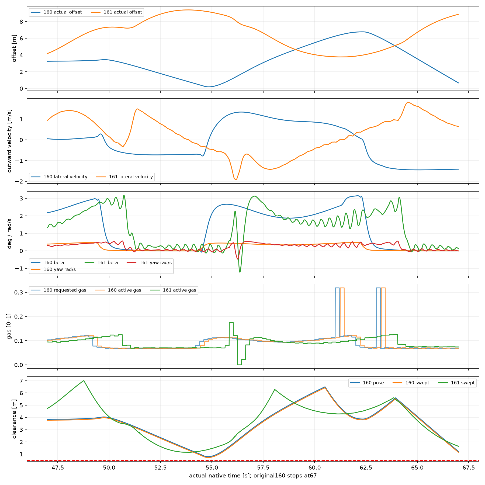
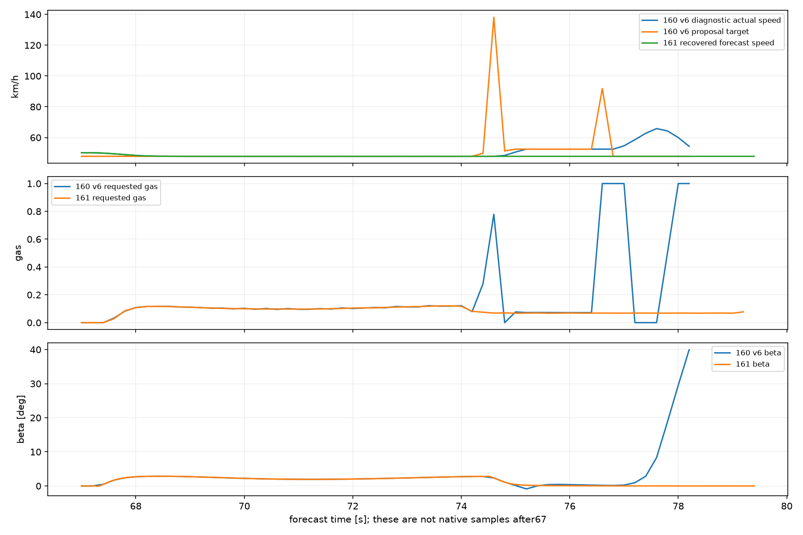
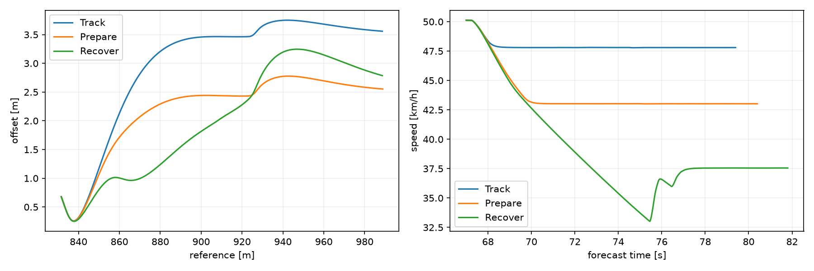
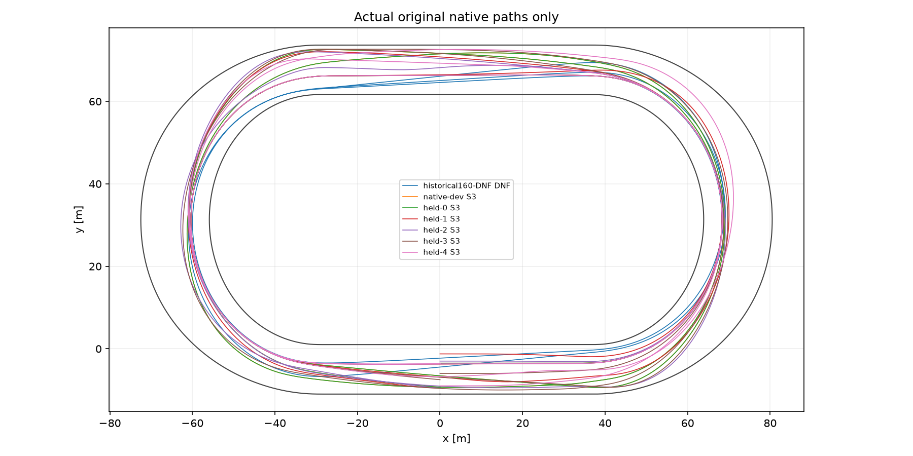

# Badanie #161 — trajektoria i wykonalność kontynuacji

**Werdykt: PASS.** Baza dokładna `e8866e91c4c3818b8ca836260883ca847ccc4a8a`. PROVISIONAL, domyślnie OFF, osobny Draft PR, bez merge. Prognozy i certyfikaty nie są ukończeniami natywnymi.

## Pięć odpowiedzi

1. **Dlaczego #160 nie znalazł kontynuacji?** V6 usuwa nielegalną różnicę skończoną v5, ale profil prędkości nadal używa `Planner146.Goal(...,3)`, który obcina podgląd krzywizny metą. Rezerwa wymaga jeszcze 32 m. W zachowanej prognozie z 67 s pierwsze żądanie 38,376 m/s pojawia się przy prognozowanym t=74,6 s i referencji 925,155 m. Potem cel skacze do25,507 m/s; po jego obniżeniu optymalizator pozostaje przy gazie1. Powstaje niestabilna końcówka rezerwy. To przyszłe komendy diagnostyczne, niewykonane po rzeczywistym DNF67.

2. **Algorytm czy fizyka?** Głównie ograniczenie generatora, przy niekorzystnym stanie fizycznym: offset0,679 m, prędkość do wewnątrz1,413 m/s i β≈0 nie oznaczają bezpiecznego kierunku ruchu. Nowy generator znajduje z dokładnie tego stanu trzy legalne kontynuacje z pełną kolejką i rezerwą988,336 m. Przy67 s nie było zatem za późno dla znalezionego manewru. Nie jest to dowód globalnej granicy osiągalności.

3. **Rzeczywiste S3 szybciej niż #158?** Nowe światy 6, ukończenia 6, DNF 0. Rozwojowe S3: 79.868 s, baza 101.390 s.

4. **Pięć warunków?** Wykonano 5/5 wcześniej ustalonych różnych walidacji; DNF 0. Mediana ukończeń 79.603 s; rozrzut [79.18350155575507, 80.24817434187996]. PASS wymaga kompletu pięciu par i przewagi czasowej, po zamrożeniu źródeł.

5. **CPU i większa prędkość:** pełne światy kosztowały 1370.781–1892.453 CPU-s, mediany callbacków 3.031–3.375 s. To obecnie obliczenia offline, powyżej okresu review0,2 s. Pozostaje konserwatywny budżet propozycji siły normalnej, ograniczona liczba manewrów, zasięg aktuatora i pełne rezerwy 13/9. Nie szukano kolejnego rekordu, nie zwiększano siły silnika ani opon, nie wyznaczono globalnego optimum.

## Granica wiedzy o historycznym DNF

Odzyskano pełny fizyczny stan67 s oraz wejścia 10 taśm portfolio z ostatniego zaakceptowanego review66,8 s: nominalna i dziewięć warunkowych, ich kolejność, akcje, początki, cele oraz hash fizyczny. `Remember` usuwa wcześniejsze portfolio i zapisuje ten komplet. Nie zachowano gęstych tablic przyszłych stanów, wszystkich cache ani snapshotu nieudanej callback przy67 s. To rekonstrukcja stanu i struktury wejść portfolio, **nie bitowo dokładne odtworzenie całego procesu decyzyjnego**. Nie przedstawiamy świeżego planera jako repliki starego portfolio.

W66,8 s zaakceptowany safetyGoal wynosił956,336 m, czyli metę. Przy przejściu celu w67 s wymagany jest988,336 m. Poprzednie certyfikaty nie sprawdzały tego nowego końca. Najwcześniejsza udokumentowana utrata zdolności tej rodziny generatora do obsługi nowego obowiązku występuje przy tej zmianie celu; nie dowiedziono wcześniejszej fizycznej utraty osiągalności. Nowa kontynuacja działa już z ostatniego zapisanego stanu67 s, jest to więc najpóźniejszy znaleziony autentyczny stan. Sprawdzono również poprzednie zaakceptowane review66,8 s przy identycznym końcu988,336 m: Track i Prepare są legalne, Recover narusza swept (0,478 m) i zostaje odrzucony. Wcześniejszy stan nie musi być łatwiejszy: ma inną pełną kolejkę, aktuator i fazę ruchu. Nie przypisujemy różnicy pojedynczemu składnikowi bez osobnej ablacji. Dalsze cofanie nie było potrzebne do znalezienia legalnego stanu przed DNF.

## Zmiany algorytmu i numeryka

Podgląd profilu obejmuje dwa następne pełne fizyczne łuki w okresowej geometrii także za metą. Nie skraca się safetyGoal ani dystansu biegu. Gdy opóźniony stan jest za szybki lub skierowany do granicy, lokalny strzelający optymalizator ocenia także legalne odjęcie gazu; nasycenie nie jest jedynym punktem startowym Newtona. Stan przestrzenny zawiera XY i obrys obu granic, offset i prędkość poprzeczną, θχβyaw, wykonany skręt, gaz, napęd i pełne pending.

Generator porównuje najwyżej trzy różne manewry: Track — docelowa linia i jazda; Prepare — linia z prognozowanego położenia, wcześniejsza redukcja przy ruchu poprzecznym; Recover — odjazd od bliższej granicy, dłuższe uspokojenie i odjęcie gazu przed zmianą kierunku. Linie2,5 m lub width−3 są propozycjami korytarza, nie nowymi granicami bezpieczeństwa. Wybór: najmniejszy fizycznie obliczony czas do wspólnego celu spośród pełnych legalnych rezerw. Każda nielegalna lub nieukończona propozycja zostaje odrzucona osobno. Brak nagrody za Vmax, gaz1 lub β0.

W feedback przywrócono wspólną korektę yaw i oryginalnej prędkości poślizgu tylnego koła; β i kierunek ruchu nadal pozostają osobnymi wielkościami. Wszystkie odpowiedzi używają oryginalnych kontaktów, rzeczywistego skrętu, wału i koła. Pochodne gazu i skrętu są ograniczone do fizycznego zakresu z rzeczywistym mianownikiem; dotyczy to również dawnego `actual±0,005`. Brak wiarygodnej pochodnej daje legalną propozycję feed-forward i jawny licznik, nigdy certyfikat. Wyjątki fizyki i niezmienników nie są zamieniane w sukces.

Planner161 powstaje mechanicznie z zamrożonego Planner160 przez zmianę haków propozycji. Runtime158, 13 węzłów/9 pełnych rezerw, niezależne odtworzenie, opóźnienie0,24 s, review0,2 s, aktuator, β45, obrys/swept0,5 m i Box2D pozostają identyczne. Wyłączono opcjonalne korzenie dodające gaz do zachowanego planu; czas porównuje generator pełnych manewrów. OFF deleguje bezpośrednio do oryginalnego kontrolera.

## Diagnostyki i alternatywy

### d1-native67 — stan t=67.000 s

|Manewr|Legalny|Przybycie do celu [s]|Koniec ref [m]|Swept [m]|CPU [s]|Powód|
|---|---|---|---|---|---|---|
|Track|True|76.970|988.603|0.783|3.375|legal complete forecast; swept physical footprint>=0.5m|
|Prepare|True|77.680|988.844|0.782|2.328|legal complete forecast; swept physical footprint>=0.5m|
|Recover|True|78.706|988.610|0.774|1.828|legal complete forecast; swept physical footprint>=0.5m|

|Wariant|Offset min/max [m]|Vmax [km/h]|Hash komend (skrót)|
|---|---|---|---|
|Track|0.257 / 3.750|50.127|b3eb44fa369a9b57|
|Prepare|0.256 / 2.777|50.127|676035bcc6835a54|
|Recover|0.251 / 3.246|50.127|5a83e351e8c1d775|

### d2-rest-terminal — stan t=0.000 s

|Manewr|Legalny|Przybycie do celu [s]|Koniec ref [m]|Swept [m]|CPU [s]|Powód|
|---|---|---|---|---|---|---|
|Track|True|78.179|988.483|3.699|15.312|legal complete forecast; swept physical footprint>=0.5m|
|Prepare|True|85.052|989.772|3.690|15.984|legal complete forecast; swept physical footprint>=0.5m|
|Recover|False|—|838.024|2.696|12.938|bounded terminal maneuver incomplete|

|Wariant|Offset min/max [m]|Vmax [km/h]|Hash komend (skrót)|
|---|---|---|---|
|Track|3.190 / 3.745|48.177|a5ffe3efbed0a65e|
|Prepare|3.168 / 3.780|45.787|ad53fc6f980ec542|
|Recover|2.149 / 3.500|37.668|25e5d79efa432984|

### d3-before-dnf — stan t=66.800 s

|Manewr|Legalny|Przybycie do celu [s]|Koniec ref [m]|Swept [m]|CPU [s]|Powód|
|---|---|---|---|---|---|---|
|Track|True|76.937|989.035|0.645|3.219|legal complete forecast; swept physical footprint>=0.5m|
|Prepare|True|77.658|989.103|0.638|2.391|legal complete forecast; swept physical footprint>=0.5m|
|Recover|False|—|842.471|0.478|0.109|swept physical footprint reserve0.5m|

|Wariant|Offset min/max [m]|Vmax [km/h]|Hash komend (skrót)|
|---|---|---|---|
|Track|0.129 / 3.757|50.137|fa1a6dfcd9e3c08e|
|Prepare|0.123 / 2.781|50.137|1d914951db689f09|
|Recover|-0.029 / 0.963|50.137|0d3833cb47b12a02|

W odzyskaniu67 s wszystkie trzy warianty są legalne, najszybszy Track wygrywa uczciwe porównanie czasu. Nie wymuszano wyboru wolniejszego wariantu dla demonstracji. Profile linii, prędkości i hashe komend są różne. Recover od startu nie kończy pełnego dystansu w limicie450 review/90 s i pozostaje odrzuconą niepełną prognozą, mimo zachowanych marginesów. Nie jest to dowód fizycznej niemożliwości wolniejszej jazdy.

W rzeczywistych sześciu światach świeżym zwycięzcą generatora był wyłącznie Track. Prepare ani Recover nie wygrały selekcji; pozostałe decyzje używały sprzężenia własnego planu lub ponownej fizycznej walidacji zachowanych komend. Różnorodność prognoz i odrzucenie pojedynczego wariantu są udowodnione diagnostykami, ale te biegi nie dowodzą korzyści z faktycznego przełączenia na Prepare/Recover.

## Certyfikacja

|Probe|Stan|13/9 + independent|CPU [s]|
|---|---|---|---|
|c1-rest|rest|True|17.062|
|c2-native67|native-end|True|10.953|

## Natywne wyniki i pełne pary

|Próba|Status|S3 [s]|Baza [s]|Δ [s]|Pose [m]|Swept [m]|βmax [°]|CPU [s]|
|---|---|---|---|---|---|---|---|---|
|native-dev|S3|79.868|101.390|-21.522|0.646|0.576|4.730|1370.781|
|held-0|S3|79.868|101.390|-21.522|0.646|0.576|4.730|1403.266|
|held-1|S3|79.184|99.886|-20.702|0.991|0.924|3.866|1700.469|
|held-2|S3|79.603|100.724|-21.122|0.878|0.807|5.734|1455.938|
|held-3|S3|80.248|100.179|-19.930|0.586|0.517|6.030|1892.453|
|held-4|S3|79.585|101.042|-21.457|0.662|0.593|4.733|1601.562|

### native-dev

Czasy okrążeń [s]: 26.943, 26.558, 26.366. Droga XY 1049.218 m. Komendy z pełnym certyfikatem 400, ABSTAIN 0, kontakty 0, odrzucenia planów 1512.

|Łuk|Stan|Wejście [km/h]|Vmin [km/h]|Wyjście [km/h]|Czas [s]|
|---|---|---|---|---|---|
|1|complete|47.811|47.781|47.788|8.136|
|2|complete|47.812|47.797|48.077|8.140|
|3|complete|49.372|47.771|48.392|8.754|
|4|complete|48.986|47.843|48.217|8.592|
|5|complete|48.763|47.795|48.427|8.511|
|6|complete|49.042|47.786|48.374|8.635|

|Okr./prosta|Czas obserwacji [s]|Średnia [km/h]|Vmax [km/h]|
|---|---|---|---|
|1/1|3.970|31.681|48.177|
|1/2|4.670|47.800|47.811|
|1/3|2.020|48.315|48.620|
|2/1|2.580|49.009|49.371|
|2/2|4.620|48.506|48.986|
|2/3|2.020|48.237|48.259|
|3/1|2.610|48.317|48.760|
|3/2|4.590|48.733|49.041|
|3/3|2.020|48.494|48.614|

CPU callbacków: suma 1348.266, mediana 3.031, maksimum 55.156 s. Fazy: hierarchical_generation=75.500s, conditional_continuations=961.484s, outside_decision=50.391s, independent_preflight=128.766s, candidate_generation=0.172s, causal_reserve_generation=0.016s, uncertainty_scenarios=0.047s, recertification=126.344s. Fazy zagnieżdżone nie są dodatkowym kosztem do sumy callbacków.

Źródła wybranych planów: {"causal physical state-feedback reserve/Track": 1, "endogenous primitive feedback; full physical replay": 311, "primitive retained controls; full physical revalidation": 88}. Szczegóły rzeczywistych generacji i odrzuceń zachowuje analysis.json i każdy policy DAG.

### held-0

Czasy okrążeń [s]: 26.943, 26.558, 26.366. Droga XY 1049.218 m. Komendy z pełnym certyfikatem 400, ABSTAIN 0, kontakty 0, odrzucenia planów 1512.

|Łuk|Stan|Wejście [km/h]|Vmin [km/h]|Wyjście [km/h]|Czas [s]|
|---|---|---|---|---|---|
|1|complete|47.811|47.781|47.788|8.136|
|2|complete|47.812|47.797|48.077|8.140|
|3|complete|49.372|47.771|48.392|8.754|
|4|complete|48.986|47.843|48.217|8.592|
|5|complete|48.763|47.795|48.427|8.511|
|6|complete|49.042|47.786|48.374|8.635|

|Okr./prosta|Czas obserwacji [s]|Średnia [km/h]|Vmax [km/h]|
|---|---|---|---|
|1/1|3.970|31.681|48.177|
|1/2|4.670|47.800|47.811|
|1/3|2.020|48.315|48.620|
|2/1|2.580|49.009|49.371|
|2/2|4.620|48.506|48.986|
|2/3|2.020|48.237|48.259|
|3/1|2.610|48.317|48.760|
|3/2|4.590|48.733|49.041|
|3/3|2.020|48.494|48.614|

CPU callbacków: suma 1380.438, mediana 3.148, maksimum 56.359 s. Fazy: hierarchical_generation=76.094s, conditional_continuations=984.641s, outside_decision=54.266s, independent_preflight=131.047s, causal_reserve_generation=0.047s, candidate_generation=0.359s, uncertainty_scenarios=0.047s, recertification=128.250s. Fazy zagnieżdżone nie są dodatkowym kosztem do sumy callbacków.

Źródła wybranych planów: {"causal physical state-feedback reserve/Track": 1, "endogenous primitive feedback; full physical replay": 311, "primitive retained controls; full physical revalidation": 88}. Szczegóły rzeczywistych generacji i odrzuceń zachowuje analysis.json i każdy policy DAG.

### held-1

Czasy okrążeń [s]: 26.881, 26.136, 26.166. Droga XY 1036.207 m. Komendy z pełnym certyfikatem 396, ABSTAIN 0, kontakty 0, odrzucenia planów 1931.

|Łuk|Stan|Wejście [km/h]|Vmin [km/h]|Wyjście [km/h]|Czas [s]|
|---|---|---|---|---|---|
|1|complete|47.812|47.786|47.796|8.067|
|2|complete|47.807|47.796|48.210|8.140|
|3|complete|49.396|47.785|47.798|8.687|
|4|complete|47.806|47.790|47.799|8.135|
|5|complete|47.810|47.797|48.276|8.155|
|6|complete|48.598|47.791|48.085|8.707|

|Okr./prosta|Czas obserwacji [s]|Średnia [km/h]|Vmax [km/h]|
|---|---|---|---|
|1/1|3.970|31.681|48.176|
|1/2|4.670|47.801|47.806|
|1/3|2.030|48.233|48.260|
|2/1|2.611|48.399|49.396|
|2/2|4.670|47.802|47.807|
|2/3|2.030|47.807|47.811|
|3/1|2.640|47.807|47.811|
|3/2|4.630|48.403|48.598|
|3/3|2.050|47.856|48.085|

CPU callbacków: suma 1678.406, mediana 3.242, maksimum 46.594 s. Fazy: hierarchical_generation=340.672s, conditional_continuations=1013.531s, outside_decision=49.641s, independent_preflight=138.141s, causal_reserve_generation=0.078s, candidate_generation=0.094s, uncertainty_scenarios=0.062s, recertification=130.656s. Fazy zagnieżdżone nie są dodatkowym kosztem do sumy callbacków.

Źródła wybranych planów: {"causal physical state-feedback reserve/Track": 2, "endogenous primitive feedback; full physical replay": 265, "primitive retained controls; full physical revalidation": 129}. Szczegóły rzeczywistych generacji i odrzuceń zachowuje analysis.json i każdy policy DAG.

### held-2

Czasy okrążeń [s]: 26.938, 26.136, 26.528. Droga XY 1042.834 m. Komendy z pełnym certyfikatem 399, ABSTAIN 0, kontakty 0, odrzucenia planów 2081.

|Łuk|Stan|Wejście [km/h]|Vmin [km/h]|Wyjście [km/h]|Czas [s]|
|---|---|---|---|---|---|
|1|complete|47.811|47.786|47.790|8.120|
|2|complete|47.808|47.782|47.787|8.137|
|3|complete|47.809|47.795|48.282|8.146|
|4|complete|48.427|47.761|48.450|8.713|
|5|complete|48.861|47.749|47.988|8.682|
|6|complete|47.912|47.912|48.501|8.529|

|Okr./prosta|Czas obserwacji [s]|Średnia [km/h]|Vmax [km/h]|
|---|---|---|---|
|1/1|3.970|31.681|48.177|
|1/2|4.678|47.801|47.808|
|1/3|2.030|47.801|47.805|
|2/1|2.640|47.801|47.809|
|2/2|4.620|48.426|48.508|
|2/3|2.020|48.422|48.458|
|3/1|2.590|48.663|48.902|
|3/2|4.700|47.619|47.988|
|3/3|2.030|48.294|48.501|

CPU callbacków: suma 1434.797, mediana 3.375, maksimum 34.656 s. Fazy: hierarchical_generation=97.719s, conditional_continuations=1013.078s, outside_decision=51.703s, independent_preflight=138.906s, causal_reserve_generation=0.031s, candidate_generation=0.188s, uncertainty_scenarios=0.078s, recertification=127.062s. Fazy zagnieżdżone nie są dodatkowym kosztem do sumy callbacków.

Źródła wybranych planów: {"causal physical state-feedback reserve/Track": 2, "endogenous primitive feedback; full physical replay": 236, "primitive retained controls; full physical revalidation": 161}. Szczegóły rzeczywistych generacji i odrzuceń zachowuje analysis.json i każdy policy DAG.

### held-3

Czasy okrążeń [s]: 27.021, 26.916, 26.311. Droga XY 1054.543 m. Komendy z pełnym certyfikatem 402, ABSTAIN 0, kontakty 0, odrzucenia planów 1661.

|Łuk|Stan|Wejście [km/h]|Vmin [km/h]|Wyjście [km/h]|Czas [s]|
|---|---|---|---|---|---|
|1|complete|47.810|47.781|47.789|8.212|
|2|complete|47.806|47.795|48.276|8.142|
|3|complete|48.517|47.878|48.700|8.864|
|4|complete|48.788|47.812|48.349|8.831|
|5|complete|49.006|47.792|48.409|8.506|
|6|complete|49.045|47.781|48.328|8.589|

|Okr./prosta|Czas obserwacji [s]|Średnia [km/h]|Vmax [km/h]|
|---|---|---|---|
|1/1|3.980|31.720|48.175|
|1/2|4.670|47.800|47.807|
|1/3|2.020|48.363|48.442|
|2/1|2.600|48.446|48.520|
|2/2|4.590|48.637|48.784|
|2/3|2.020|48.385|48.417|
|3/1|2.608|48.484|49.006|
|3/2|4.600|48.730|49.045|
|3/3|2.010|48.515|48.717|

CPU callbacków: suma 1871.188, mediana 3.203, maksimum 23.234 s. Fazy: hierarchical_generation=566.016s, conditional_continuations=974.641s, outside_decision=51.047s, independent_preflight=136.609s, causal_reserve_generation=0.234s, candidate_generation=0.359s, uncertainty_scenarios=0.062s, recertification=136.609s. Fazy zagnieżdżone nie są dodatkowym kosztem do sumy callbacków.

Źródła wybranych planów: {"causal physical state-feedback reserve/Track": 1, "endogenous primitive feedback; full physical replay": 295, "primitive retained controls; full physical revalidation": 106}. Szczegóły rzeczywistych generacji i odrzuceń zachowuje analysis.json i każdy policy DAG.

### held-4

Czasy okrążeń [s]: 27.148, 26.407, 26.030. Droga XY 1042.712 m. Komendy z pełnym certyfikatem 398, ABSTAIN 0, kontakty 0, odrzucenia planów 2202.

|Łuk|Stan|Wejście [km/h]|Vmin [km/h]|Wyjście [km/h]|Czas [s]|
|---|---|---|---|---|---|
|1|complete|47.810|47.783|47.788|8.304|
|2|complete|47.808|47.794|47.988|8.147|
|3|complete|48.205|48.205|48.733|8.733|
|4|complete|49.077|47.785|47.792|8.416|
|5|complete|47.812|47.796|48.149|8.148|
|6|complete|47.248|47.226|47.793|8.527|

|Okr./prosta|Czas obserwacji [s]|Średnia [km/h]|Vmax [km/h]|
|---|---|---|---|
|1/1|3.980|31.721|48.172|
|1/2|4.670|47.800|47.807|
|1/3|2.040|47.770|47.993|
|2/1|2.656|47.651|48.205|
|2/2|4.580|48.846|49.070|
|2/3|2.030|47.800|47.802|
|3/1|2.640|47.802|47.812|
|3/2|4.681|47.709|48.149|
|3/3|2.030|47.798|47.802|

CPU callbacków: suma 1579.938, mediana 3.328, maksimum 22.109 s. Fazy: hierarchical_generation=255.609s, conditional_continuations=1008.625s, independent_preflight=135.297s, outside_decision=47.141s, candidate_generation=0.328s, causal_reserve_generation=0.203s, uncertainty_scenarios=0.062s, recertification=126.859s. Fazy zagnieżdżone nie są dodatkowym kosztem do sumy callbacków.

Źródła wybranych planów: {"causal physical state-feedback reserve/Track": 3, "endogenous primitive feedback; full physical replay": 216, "primitive retained controls; full physical revalidation": 179}. Szczegóły rzeczywistych generacji i odrzuceń zachowuje analysis.json i każdy policy DAG.

## Budżet i granice dowodu

|Rodzaj|Wykonano|CPU rozliczone [s]|Limit liczby|
|---|---|---|---|
|diagnostic|3|68|6|
|certificate|2|31|2|
|native|6|9433|6|

Przed uruchomieniami: diagnostyki6 / 360 CPU-s, maks90 CPU-s na diagnostykę i trzy jawne alternatywy; certyfikacje2×60 CPU-s; jeden świat rozwojowy i tylko po jego sukcesie pięć odłożonych, każdy maks2400 CPU-s, łącznie14400 CPU-s; review60 CPU-s. Nie podnoszono budżetu. Obowiązkowe certyfikacje każdej natywnej komendy wchodzą do CPU biegu; dwie próby odnoszą się do osobnych probe przed światem. Historyczny audyt jest odczytem istniejących danych, bez prognoz. Nie uruchamiano prób dla wykorzystania pozostałego limitu.

Rozwojowy161 ma swept minimum0,576 m wobec0,719 m historycznego160 i1,704 m nominalnej bazy158. Szybsze ukończenie nie oznacza poprawy wszystkich marginesów bezpieczeństwa. Pozostaje tylko0,076 m zapasu nad wymogiem0,5 m w najciaśniejszym punkcie nominalnego161. Wyniki odłożone muszą potwierdzić osobno legalność; nie dostrajano po nich źródeł.

Najciaśniejszy wynik całego zestawu to 0.517402 m, czyli tylko 17.40 mm nad minimum. PASS dotyczy pięciu ustalonych warunków; nie dowodzi szerokiego zapasu odporności.

Pełne stany początkowe, specyfikacje, masa i bezwładność w parach są identyczne; zamrożone drzewa fizyki, geometrii i historii nie zmieniły się. Pięć walidacji to pierwsze pięć różnych warunków final-v6 #158, określonych przed wynikami; rozwój nie jest szóstym niezależnym warunkiem. DNF pozostaje w mianowniku, nie otrzymuje fikcyjnego czasu mety.

CSV.gz przechowuje100Hz: XY/drogę, offset i prędkość poprzeczną, θχβyaw i krzywiznę rzeczywistej trajektorii, żądany/aktywny gaz i skręt, wheelspin, siły obu opon, wykorzystanie przyczepności, wał/sprzęgło, obrys/swept i pełne pending. Sekcje pomiarowe mają interpolowane czasy przecięcia granic; replay wybiera wyłącznie zapisane oryginalne próbki i indeksy. Historyczny160 kończy się przy67 s — niczego po DNF nie dopisano.
