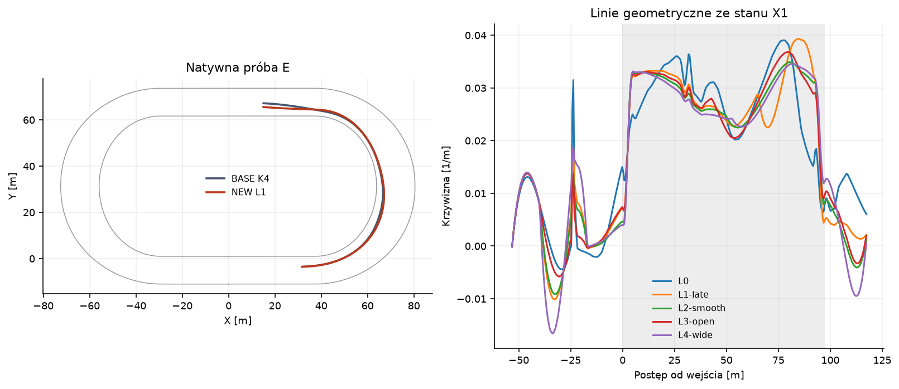
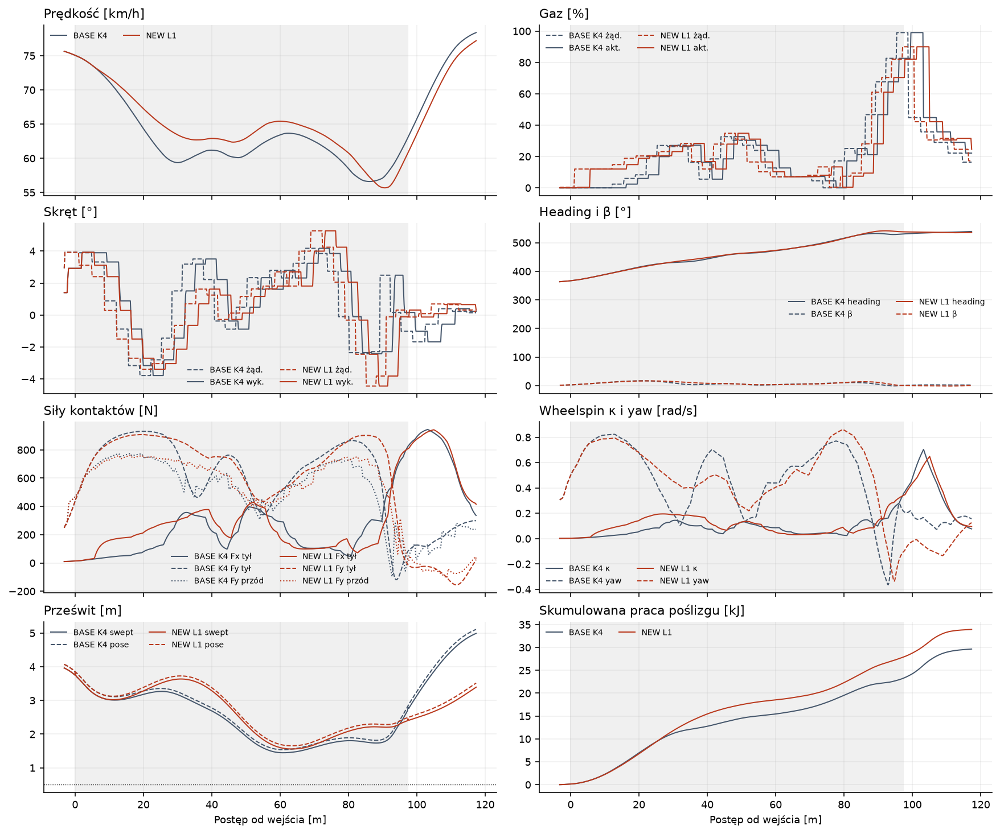
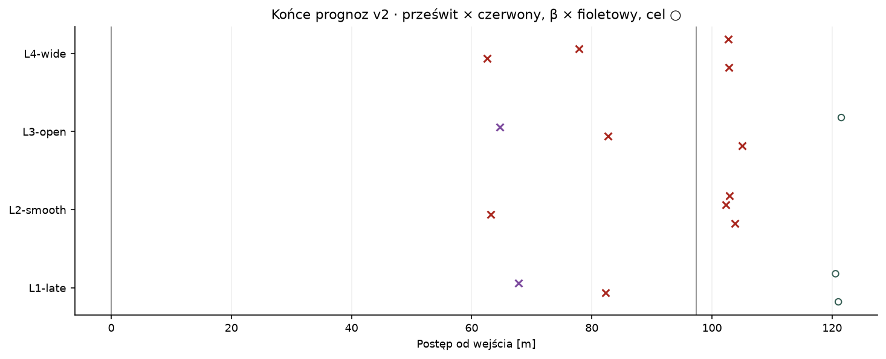
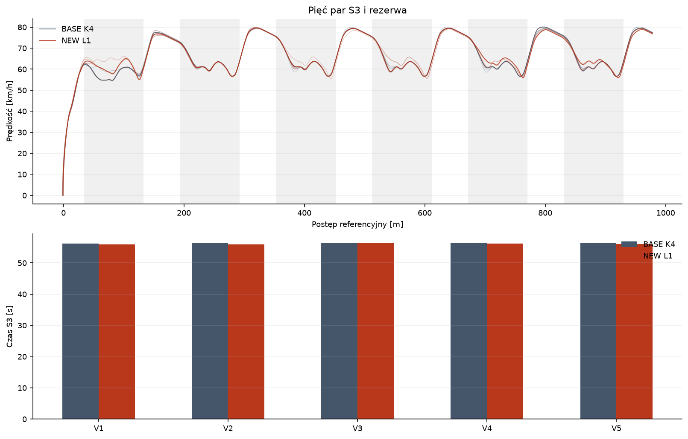

# Badanie #177 · trajektoria i wspólne sterowanie

**PARTIAL. Diagnostycznie PARTIAL, funkcjonalnie PASS, sportowo poniżej progu 5%.** W pięciu nowych dopasowanych parach oba ramiona ukończyły po trzy okrążenia i co najmniej sekundę dalszej legalnej jazdy. Mediana spadła z **56,330233 do 56,068873 s**, o **0,261360 s (0,464%)**. Diagnostykę ogranicza skok stycznej w jednej części profilu propozycji. Wynik pełnego Windows CI jest przypięty do Draft PR.

Baza #176 to `f55fb06ceb7685306dd07c4d8dcbe3e55fbe6896`. Zamrożony K4 i fizyka BASE pochodzą z #172 `c5f0a4cc4de34fc4c8c47ef912cafabf34055f29`. Prototyp jest PROVISIONAL i uruchamia się wyłącznie jawną komendą narzędzia. Porównanie korzysta z oryginalnego świata Box2D, kontaktów i nawierzchni `progressive-b`. Transfer nacisku jest wyłączony. Okres decyzji 0,20 s, opóźnienie 0,24 s, β≤45°, pose i swept≥0,5 m oraz meta 3×318,778749943 m obowiązują w obu ramionach.

## Odpowiedzi na 17 pytań

1. **Czy K4 jest zbyt ciasny?** W pięciu archiwalnych S3 mediana szczytowej krzywizny śladu wynosi 0,04174 1/m, czyli R≈23,96 m. Utrzymanie 80 km/h na tym śladzie przekraczało oszacowany dostępny budżet boczny przez medianę 69,5% próbek łuku w #175. Przejście na gładką linię obniża wymagania w geometrii, ale w naszych natywnych jazdach L1 największa rzeczywista krzywizna pozostała zbliżona do K4.
2. **Gdzie są maksima?** W 29/30 łuków szczyt bezwzględnej krzywizny przypadł między 80 a 90% postępu, podczas przejścia do wyjścia. Najciaśniejszy był S1, okr. 2, łuk 1, przy s=436,176 m, XY=(50,144; 60,767) m, 84,6% łuku i R=23,65 m. Wyjątek to pierwszy łuk S4 z maksimum przy 14,4%. Wejściowa utrata prędkości pojawia się znacznie wcześniej. Lotne K4 traci ok. 14,6 km/h do 30% łuku. Sam ślad nie rozstrzyga, czy pierwsze żądanie skrętu powinno pojawić się wcześniej lub później.
3. **Czy warto jechać dłużej i łagodniej?** Tak w przesiewie geometrycznym X1. L3 jedzie o 3,15 m dalej od L0 i daje szacunek krótszy o 0,068 s przy mniejszym szczycie krzywizny. L2 jest o 5,62 m dłuższa i wygrywa tylko 0,016 s. L4 już przegrywa czasem. Natywnie szybsza L1 w E pokonała 0,689 m więcej, lecz jej rzeczywisty szczyt krzywizny wzrósł. To dowód zysku na dłuższej trajektorii z innym rozkładem prędkości, przy niewykazanej przewadze łagodniejszego śladu w całym łuku.
4. **Które wejście najszybsze?** W natywnym porównaniu wygrała L1 z dopuszczeniem tuż przed lotnym wejściem E. Do 30% łuku miała 63,65 wobec 59,42 km/h. Pierwsza sekcja trwała 1,871 wobec 1,927 s. Szersze przygotowanie z X1 i P nie spełniło kryteriów modelu, więc regulator zachował K4. Badanie nie wyznacza globalnego optimum.
5. **Czy późniejszy apex pomaga?** W E minimum offsetu przesunęło się z 62,71% na 65,50% łuku, a łuk skrócił się czasowo o 0,102 s. We wszystkich lotnych łukach walidacji mediana przesunęła się z 62,46% na 62,79%. L1 zmieniała gaz i skręt razem z linią, więc nie izoluje wpływu samej pozycji apexu.
6. **Czy wcześniejsze prostowanie wydłużyło pełny gaz?** W próbie E prędkość wyjścia i czas z gazem ≥95% spadły. Mediana czasu ≥95% na S3 spadła z 2,20 do 1,40 s. L3, wariant nastawiony na otwarcie wyjścia, osiągnął w prognozie E cel szybciej, lecz zakończył na offsecie 0,64 m wobec 4,57 m w modelu K4 i odpadł na bramce stanu terminalnego.
7. **Czy można wejść szybciej niż 75 km/h?** Tak. E w obu ramionach miało 75,07 km/h. Maksymalne legalne wejście w nowych parach wyniosło 75,59 km/h BASE i 75,57 km/h NEW. Historyczna próba P7 #174 uzyskała 78,49 km/h w całym legalnym manewrze. #177 nie podniósł typowej prędkości wejścia.
8. **Jak szybko w środku?** W X1 profil L2 i L4 daje 69,1–69,6 km/h w połowie łuku w uproszczonym bilansie. Prognozy wspólnego sterowania je odrzuciły. Natywna mediana minimów lotnych łuków to 56,63 km/h BASE i 56,59 km/h NEW. L1 w E zachowała o 4,23 km/h więcej przy 30% łuku, ale spadła do 55,68 km/h później.
9. **Jak szybko na wyjściu?** W nowych S3 mediana lotnych wyjść wyniosła 63,11 km/h BASE i 62,97 km/h NEW. Maksimum NEW to 63,36 km/h. W lokalnym E było 63,05→60,79 km/h. To obserwacje, nie fizyczne górne granice.
10. **Czy spadły straty?** Nie w badanych przejazdach. E zmniejszyło szczyt wheelspinu κ z 0,704 do 0,649, ale praca wzdłużnego poślizgu wzrosła z 8,80 do 9,62 kJ, a bocznego z 20,85 do 24,33 kJ. Mediana całego S3 dla sumy poślizgów wzrosła z 189,61 do 199,44 kJ. Szczyt κ w całym biegu, liczony także podczas rozruchu od zera, miał tę samą medianę 11,32.
11. **Czy regulator wykorzystał moc silnika?** Mediana pracy spalania wzrosła z 364,86 do 375,11 kJ. Większa część dodatkowej pracy trafiała w straty poślizgu. Mediana Vmax prostych spadła z 79,98 do 79,86 km/h. Obserwowany zysk pochodzi głównie z tempa początkowej części manewru i pierwszego okrążenia.
12. **Co z `CanPrepare`?** Został w zamrożonym K4, który stanowi propozycję i rezerwę. W gałęzi L1 decyzję o przyjęciu linii rozstrzyga prognoza całego manewru z pending i kontrolą końca. Regulator wspólny może zmienić żądanie gazu niezależnie od starego warunku. Ten eksperyment nie izolował liczby skutecznych obejść `CanPrepare` od pozostałych zmian. Przy odrzuceniu linii obowiązuje decyzja K4.
13. **Czy cały łuk się skrócił?** E ma 5,974→5,872 s od wejścia do wyjścia oraz 7,133→7,052 s od rozwidlenia do wspólnego punktu +20 m. X2 odtworzył tę samą interwencję po opóźnionym dopuszczeniu i daje ten sam wynik, więc stanowi powtórzenie, nie drugi niezależny efekt.
14. **Czy pełne trzy okrążenia są szybsze?** Tak, we wszystkich pięciu parach. Zakres zysku 0,053–0,364 s, czyli 0,094–0,646% czasu odpowiadającego BASE. Mediana poprawiła się o 0,464%.
15. **Skąd zysk?** Mediana rzeczywistego dystansu wzrosła o 2,193 m, a rzeczywista średnia prędkość z 63,64 do 64,09 km/h. Zysk z wejściowej części łuku przewyższył dłuższą drogę i skromniejsze wyjścia. W E na odcinku od wyjścia do celu oddano ok. 0,021 s z zysku 0,102 s zdobytego w łuku. To rozliczenie czasów odcinków, bez przypisania całej różnicy jednemu elementowi regulatora.
16. **Co ogranicza 100–120 km/h?** Przy R=23,96 m ślad K4 potrzebuje ok. 32,2/46,4 m/s², czyli 4,73/6,82 kN bocznie. BASE daje najwyżej 12,60 m/s² (1,85 kN łącznie) w idealizacji bez Fx. Potrzeba R≥61,2/88,2 m dla samych sił bocznych. Łagodniejsze L2 w X1 z R≈28,67 m nadal żąda ok. 3,96/5,70 kN przy 100/120. Przy jednoczesnym napędzie rezerwa tyłu maleje, a rozkład sił musi wytworzyć także moment yaw. W prostej 62 m zostaje jeszcze dystans na przygotowanie następnego łuku. Historyczne 108,62 km/h dotyczy izolowanej prostej. W obecnych S3 nie potwierdzono takiej prędkości z legalną kontynuacją.
17. **Co pozostało ograniczeniem?** Zmiana sterowania jest przyczynowo skuteczna w obecnym modelu, lecz ten regulator nie przenosi przewagi geometrycznej na duży zysk. Najbliższa wykazana luka to utrzymanie łagodnego śladu i dobrej pozycji wyjściowej przy większym napędzie. Przypisanie różnicy do opony lub Motoareny wymaga pomiarów geometrii i kontaktu, których te próby nie dostarczają. #175 oddziela dane ligowe od rzeczywistego przebiegu i przekroju obu łuków.

## A–D · trajektoria i sterowanie

[Pełna telemetria próbek](telemetria.csv.gz) obejmuje pięć historycznych S3, cztery nowe próby rozwojowe i dziesięć biegów walidacji. [Tabela maszynowa](summary177.json) zawiera 30 historycznych łuków, z czasem każdej z trzech sekcji i punktami szczytowej krzywizny, oraz wszystkie łuki walidacji. Krzywizna śladu pochodzi z XY z interpolacją po fizycznej drodze co 0,25 m i cięciwami o rozpiętości 2 m. Kurs jest kierunkiem prędkości. Rezerwa tyłu uwzględnia aktualne Fx, a przód generuje tylko Fy w lokalnych osiach kontaktu. Praca poślizgu używa prędkości obu punktów styku i połowy kroku dla całkowania. Pole mocy spalania i straty mają jednostkę W. Definicja apexu w pomiarze to minimum offsetu środka motocykla.

Rodzina miesza spline historycznego profilu z kwintycznymi odcinkami offsetu. Łączenia własnych odcinków kwintycznych mają ciągły offset, styczną i drugą pochodną. Przegląd krzywizny po walidacji ujawnił, że domieszka obciętej historycznej krzywej składanej pozostawia skok stycznej na jej lewym końcu 24 m przed łukiem. W lotnym L1 skok nachylenia offsetu ma ok. 0,0071 m/m (0,40°). Geometria przechodzi próbkowane bramki prześwitu, ale wymóg pełnej ciągłości stycznej nie jest spełniony. Wpływ na rzeczywisty ślad pozostaje nierozstrzygnięty. Na początku lokalne dołączenie dopasowuje pozycję i kierunek aktualnego ruchu. Przez wspólne ramy obu łuków zachowuje tę samą strategię i przedłuża profil do +20 m. Przy przejęciu z powrotem przez K4 pozostaje ta sama kolejka, a model sprawdza położenie i orientację końcową. Geometryczny swept jest konserwatywną dolną granicą dla zakładanych póz. Ocena dynamiczna przelicza (m v^2\kappa), moment (I(v^2\,d\kappa/dl+a_x\kappa)) i osobne wymagania Fy na osiach. Profil wsteczny liczy drogę potrzebną na roll-off, a w przód uwzględnia wolne Fy/Fx, pracę silnika, prędkość koła, wału i aktualny stan na aktywacji. Jest to model propozycji. Rzeczywistą dynamikę sprzęgła, wheelspin, yaw, β, aktuator i kolejkę sprawdza osobna prognoza z kontaktami #153.

| Przesiew X1 | Droga [m] | Szczyt κ [1/m] | Swept geometryczny [m] | Czas modelu drogi [s] | Prędkość wejście / połowa / wyjście [km/h] |
|---|---:|---:|---:|---:|---|
| L0 | 176,25 | 0,03906 | 1,047 | 9,548 | 67,2 / 65,0 / 74,7 |
| L1 późny apex | 179,01 | 0,03932 | 1,816 | 9,584 | 67,2 / 66,1 / 67,1 |
| L2 łagodna | 181,86 | 0,03488 | 3,346 | 9,532 | 66,6 / 69,1 / 70,3 |
| L3 otwarte wyjście | 179,40 | 0,03685 | 2,265 | 9,480 | 66,9 / 67,2 / 71,2 |
| L4 szeroka | 183,88 | 0,03458 | 3,846 | 9,620 | 66,5 / 69,6 / 69,6 |

Te prędkości z uproszczonej obwiedni nie są oczekiwanym wynikiem native. Model zachowuje część budżetu tylnej opony na napęd, ale nie rozwiązuje w tym kroku stanu poślizgu. Profile X1 i X2 pozwalają testować przygotowanie do obu łuków. Przy P i E ruch w chwili aktywacji jest narzucony przez już oczekujące komendy. Prostoliniowe dojście zależy od zapasu do kolejnej krzywizny, a nie od historycznej stałej 73–76 km/h.

Sterownik łączy każdą kandydaturę gazu z kilkoma żądaniami skrętu. Ocena bierze rzeczywisty pending, model wału i koła, błąd kursu, pozycję, yaw i β. Przyjęcie następuje po przyczynowej prognozie do +20 m, z ponownym wyborem komendy co 0,20 s ze stanu obliczonego w modelu. Wymagany zysk modelu 0,025 s i swept modelowy 0,60 m odróżniają wybór propozycji od wiążącej bramki native 0,50 m. Próba przyjęcia linii może nastąpić wcześnie i ponownie tuż przed wejściem, jeśli wcześniejsza nie przeszła. Po wyborze linia jest śledzona z korektami pary komend na każdym review. Przy braku lepszej dopuszczalnej pary pozostaje propozycja K4.

Przesiew v1 odpadł w czterech stanach, często przez β. W v2 ograniczono jednorazowy przyrost gazu i skrętu, zaostrzono rezerwę β, yaw i kursu oraz przesunięto cel prędkości w stronę różnicy wynikającej z dwóch profili. X1/L1 dotarł w prognozie 0,176 s wcześniej, lecz przesunięcie terminalne 3,96 m zamknęło bramkę. E/L1 przeszedł z prognozowanym zyskiem 0,081 s. Szczegółowe pozycje i powody wszystkich odrzuceń są w protokole. Akceptacja do jednego pełnego łuku jest ograniczoną prognozą kontynuacji. Jedna sekunda po rzeczywistej mecie i sześć rzeczywistych łuków są odrębnym pomiarem.

## E–F · integracja i próby rozwojowe

Przed próbami porównano źródła z #172, w tym `NativeWorld172.Generated.cs` i fizykę. Projekt linkuje ten runner bez zmian. K4 wykorzystuje zweryfikowane mechaniczne forki #174. Różnice w nich ograniczają się do kopiowania stanu kontrolera potrzebnego przy prognozie. Pierwsza kontrola zatrzymała się na 2,60 s, ponieważ wskazano starszy `c3a`, który miał inne komendy. Zaliczono ją do rezerwy i zachowano dane. Właściwa kontrola z końcowym `c3b` odtworzyła 1142 próbki i 57 żądań bez rozbieżności, do 152,389 m. Audyt odrzucił celowo pozostawione stare stany koła i skrętu. W każdym poprawnym interwale sprawdzono stan wału, koła i skrętu przed i po kroku, pełną kolejkę oraz impuls liniowy i kątowy. Bilans kontroli ma domknięcie −0,083 J. Maksymalna różnica impulsu liniowego to 4,8 µm/s, co wychwytuje podwójne wykonanie kroku pod obciążeniem.

| Próba | Rozwidlenie | Cel [m ref.] | Czas od rozwidlenia BASE → NEW [s] | Zmienione decyzje | Wynik |
|---|---|---:|---:|---:|---|
| P | prosta przed łukiem 2 | 311,779 | 8,406 → 8,406 | 0 | model odrzucił L1, odtworzony K4 |
| E | lotne wejście do łuku 1 | 471,168 | 7,133 → 7,052 | 32 | legalnie szybciej, stan terminalny zachowany |
| X1 | wyjście z pierwszego łuku | 311,779 | 9,806 → 9,806 | 0 | model odrzucił L1, odtworzony K4 |
| X2 | wyjście z drugiego łuku | 471,168 | 9,732 → 9,652 | 32 | przyjęcie dopiero w E, identyczna trajektoria z E |

| Metryka E do wspólnego celu | BASE | NEW |
|---|---:|---:|
| Rzeczywista droga [m] | 126,961 | 127,650 |
| Wejście / minimum / wyjście [km/h] | 75,07 / 56,61 / 63,05 | 75,07 / 55,68 / 60,79 |
| Vmax na prostej po wyjściu [km/h] | 78,38 | 77,20 |
| Min swept [m] | 1,447 | 1,560 |
| Max β [°] | 16,98 | 16,61 |
| Max yaw [rad/s] | 0,823 | 0,861 |
| Max κ wheelspin | 0,704 | 0,649 |
| Energia poślizgu [kJ] | 29,66 | 33,95 |
| Aktywny gaz ≥95% [s] | 0,20 | 0,00 |

Cztery światy rozwojowe wystartowały od zatrzymania w tym samym D1, ze sterowaniem K4 do autentycznej obserwacji rozwidlenia. Próby P/X1 i E/X2 są parami powtórzeń tej samej trajektorii. Wykres odrzuceń dotyczy prognoz, a wszystkie 14 ważnych światów eksperymentalnych i poprawna kontrola przejechały legalnie do swojego celu. Jedyne natywne przerwanie to kontrola starszego `c3a` na niespójnej wersji komend przy t=2,60 s, s=15,324 m, XY=(15,324; −5,109) m i przed rozpoczęciem badań rozwojowych. Dowód zawiera obie kontrole i każdą rezerwację. Zużyto 16/24 światów, w tym 2/6 kontroli, 4/8 rozwojowych i 10/10 walidacyjnych.

## G · walidacja

Wybór L1 i SHA256 źródeł zamrożono przed odczytaniem pięciu warunków. Każda para korzysta z dokładnie tej samej pozycji i pola startowego od zatrzymania. Wszędzie odnotowano komplet sześciu łuków, trzy rzeczywiste przekroczenia mety i sekundę legalnej rezerwy. Nie zmieniano regulatora, danych ani progów po uruchomieniu walidacji. Najkrótszy prześwit NEW to 1,280 m w V4. Nowa para komend zmieniła realną decyzję co najmniej 68 razy w każdym S3.

| Warunek | BASE S3 [s] | NEW S3 [s] | Zysk [s] | Zysk [%] | NEW min swept [m] |
|---|---:|---:|---:|---:|---:|
| V1 | 56,227977 | 55,950185 | 0,277792 | 0,494 | 1,397 |
| V2 | 56,330233 | 55,966482 | 0,363750 | 0,646 | 1,401 |
| V3 | 56,321843 | 56,269006 | 0,052837 | 0,094 | 1,365 |
| V4 | 56,454799 | 56,228979 | 0,225820 | 0,400 | 1,280 |
| V5 | 56,410586 | 56,068873 | 0,341713 | 0,606 | 1,382 |
| **Mediany ramion** | **56,330233** | **56,068873** | **0,261360** | **0,464** | **1,382** |

| Metryka | BASE | NEW |
|---|---:|---:|
| Legalne S3 | 5/5 | 5/5 |
| Mediana okr. 1 / 2 / 3 [s] | 20,742 / 17,810 / 17,812 | 20,542 / 17,809 / 17,790 |
| Mediana rzeczywistej średniej [km/h] | 63,64 | 64,09 |
| Mediana Vmax prostych [km/h] | 79,98 | 79,86 |
| Mediana lotnego wejścia / minimum / wyjścia [km/h] | 75,16 / 56,63 / 63,11 | 75,14 / 56,59 / 62,97 |
| Mediana fizycznej drogi [m] | 994,743 | 996,936 |
| Mediana gazu ≥95% [s] | 2,20 | 1,40 |
| Mediana maks. β [°] | 17,99 | 18,37 |
| Mediana min pose / swept [m] | 1,456 / 1,369 | 1,473 / 1,382 |
| Mediana pracy poślizgu [kJ] | 189,61 | 199,44 |
| Mediana CPU biegu i rezerwy [s] | 2,969 | 18,250 |

Maksimum kosztu jednej decyzji NEW wyniosło 1606 ms czasu ściennego, zwykle przy przesiewie. W czasie obliczeń stan symulacji nie jest posuwany naprzód. Każdy nowy świat ma koszt i liczbę prognoz w archiwum. Odczyty i porównania na końcu są deterministyczne względem zapisanych danych. Testy CI odtwarzają audyt, bez wydawania dodatkowych światów.

## Dowody i odtworzenie

- [Zamrożony protokół, budżet i przesiew](177-protokol.zip)
- [Kontrole i cztery światy rozwojowe](177-natywne.zip)
- [Pięć dopasowanych par z pełną kolejką i stanami](177-walidacja.zip)
- [Tabela i metryki](summary177.json) · [CSV próbek](telemetria.csv.gz) · [SHA256SUMS](SHA256SUMS)
- [Instrukcja uruchomienia](../../../tools/trajectory-control/README.md)
