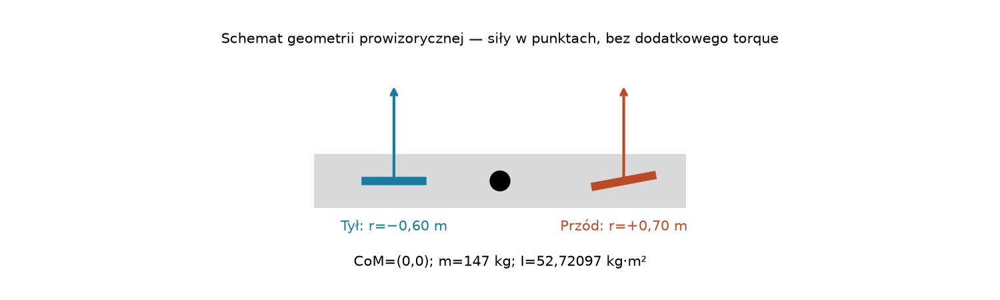
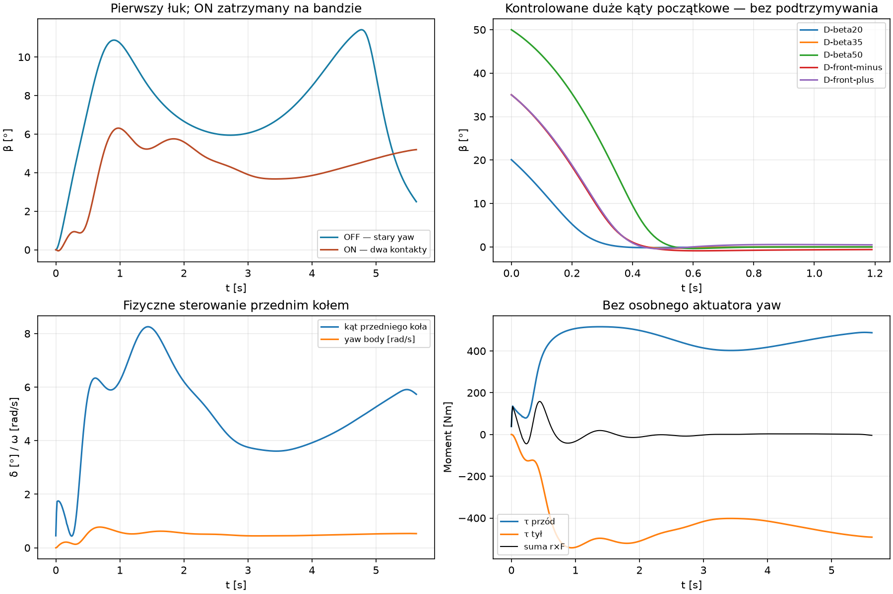
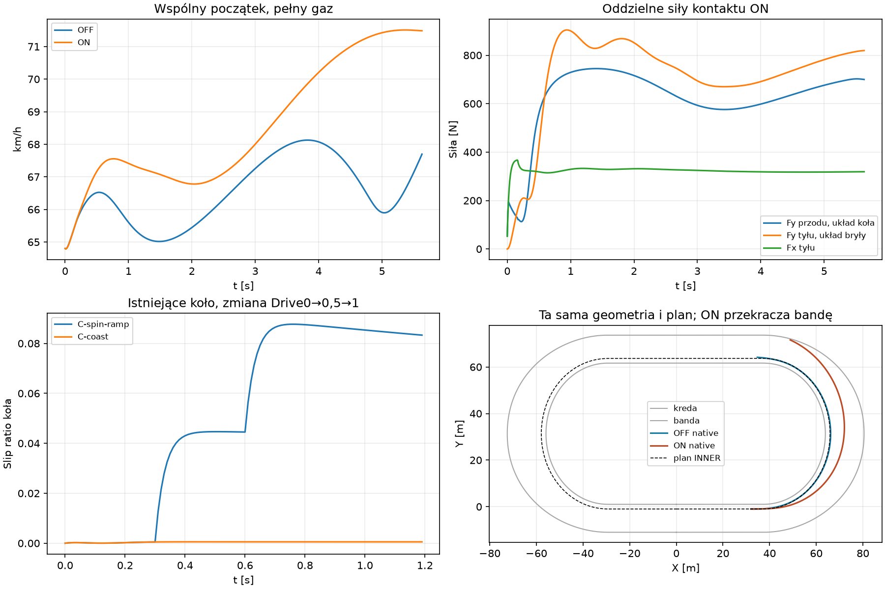

# Two Contact Bike Dynamics — Etap 1

**Ocena B — model działa mechanicznie, ale sterowanie na torze ma konkretne ograniczenie.**
`EnableTwoContactBikeDynamics=false` domyślnie. Nie promować wariantu do produkcji.
Status: PROVISIONAL. Baza: Draft #111, `a0a1e91dc208c7a33b56cdb4848509271d27f822`,
na #109 `a5164d9daddb091eb86a2809792703941069fd56`. Jeden Draft, bez merge.

## Notatka audytu przed implementacją

- `SlipCoupledDynamics.Forces` wyznacza jeden budżet z obecnych capability/Grip,
  pobiera napęd i opory. `RearWheelDynamics.Evaluate` liczy osobno Fx tyłu,
  Fy tyłu i Fy przodu, lecz używa jednej bocznej prędkości ciała dla obu osi.
- `SlipCoupledDynamics` sumuje te siły w osiach bryły.
  `WorldRunner.Run` przekazuje wynik do `ContactAdapter.Force`, który wywołuje
  `b2Body_ApplyForceToCenter` oraz niezależne `b2Body_ApplyTorque`.
- Osobny yaw actuator wyznacza β target z lateral demand, a następnie moment
  PD z błędu β i różnicy prędkości kątowych, z authority i energy guard.
  `CoupledSlipInverse` opcjonalnie odwraca pełny kontakt do β; nie opisuje osi.
  `AuthoredRacingPath` dostarcza geometrię i preview, nie integruje motocykla.
- Faktyczny β to `RiderView.SlideRadians`, czyli heading bryły minus kierunek v.
  Wheelspin to osobny slip ratio `(R*omegaWheel-u)/sqrt(u²+u0²)`.
- Koło ma implicit scalar midpoint, reakcję `R*Fx`, bearing i jeden commit po
  native Box2D step. Ledgery #100/#106/#107/#111 rozliczają body+wheel; praca
  yaw jest tam osobną pozycją, bo stary moment jest osobnym źródłem pracy.
  Tego starego ledger nie można bez zmian używać dla sił na osiach.
- `BikeFootprint` obejmuje chassis2,1×0,3 m i kierownicę0,8 m przy x0,65 m;
  nie definiuje rozstawu osi. Adapter ustawia CoM jawnie na lokalne(0,0),
  masę rider+bike (147 kg dla tego zawodnika) i dotychczasową bezwładność
  wynikającą z istniejących kapsuł. Tych ustawień nie zmieniamy.

Plan zastąpienia tylko przy `EnableTwoContactBikeDynamics=true`: przedni i tylny
kontakt dostają `v + omegaBody × r`; przód ma oddzielne osie obrócone o
ograniczony kąt kierowania. Istniejący kontakt tylnego koła i jego reakcja
pozostają, z uwzględnieniem przedniej siły w zewnętrznym obciążeniu longitudinal
midpoint. Box2D dostaje dwie siły w punktach oraz opory w CoM, bez ApplyTorque.
Stary yaw, inverse i full-contact feed-forward są w tym wariancie wykluczone.

Parametry prowizoryczne, jawne i zamrożone przed próbami: przód +0,70 m,
tył −0,60 m względem obecnego CoM (wheelbase1,30 m, CoM nie w połowie),
steering ±35°, tempo90°/s. Nie są pomiarami realnej żużlówki. Podział budżetu
40/60 pozostaje niezależnym uproszczeniem, bez transferu obciążeń.

Najpierw izolowane A–E, kontrola znaków, impulsu oraz energii obu kontaktów.
Dopiero po ich przejściu wykonano krótki test na progressive-b, bez zmiany toru,
napędu, Grip i bez optymalizacji linii. Poniżej zapis wyników.

## Implementacja i równania



Nowy wariant pozostaje w tym samym `WorldRunner` i `ContactAdapter`. Nie ma
drugiej integracji bryły. `TwoContactBikeDynamics.Forces` przygotowuje siły,
oryginalny `RearWheelDynamics.Evaluate` przygotowuje koło, Box2D wykonuje jeden
krok, potem następują jeden commit koła i jeden commit kierownicy. Dotychczasowe
równania i kolejność działań OFF są zachowane. Guardy wykluczają jednoczesne
użycie starego yaw, #108 inverse i #109 feed-forward, również bezpośrednie
wywołanie legacy actuator przy nowej fladze. Stage1 obsługuje jednego zawodnika
bez ruchu taktycznego. Nie zmienia `src/CoreSim`, kolizji, toru ani nawierzchni.

Dla osi bryły e=(cosθ,sinθ), n=(−sinθ,cosθ):

```text
rF = +0,70 e                      rR = −0,60 e
vF = vCoM + omegaBody × rF        vR = vCoM + omegaBody × rR
eF = (cos(θ+δ), sin(θ+δ))         nF = perpendicular(eF)
uF = dot(vF,eF), wF=dot(vF,nF)    uR=dot(vR,e), wR=dot(vR,n)
FF = nF * FyF                    FR = e * FxR + n * FyR
tauF = rF × FF                   tauR = rR × FR
```

`ContactAdapter.ForcesAtContacts` wywołuje `b2Body_ApplyForce` w obu światowych
punktach i `ApplyForceToCenter` tylko dla odziedziczonych oporów. **Nie wywołuje
ApplyTorque.** Zwracany w diagnostyce moment to opis sumy r×F, nie drugi moment
przekazany do solvera. Ramiona w logu są tym samym floatowym odejmowaniem
punkt−CoM, którego używa Box2D. Znaki lewo/prawo są testowane w rzeczywistych
krokach; dodatni yaw oznacza obrót przeciwny do zegara.

Budżet B pochodzi z tej samej funkcji capability i tej samej próbki nawierzchni
przy CoM. Bf=0,4B, Br=0,6B. To **budżety sił**, nie wyliczony rozkład nacisków
z geometrii osi. Nie ma transferu obciążeń. Przód zachowuje oryginalne równanie
`FyF=−Bf*wF/sqrt(wF²+deltaYF²)`, ale używa własnego uF/wF i kierunku koła.
Lokalny Fx przodu wynosi zero; globalna składowa Fx przedniej siły może być
niezerowa przy δ≠0. Tył zachowuje dokładnie ten sam combined contact:
`FxR=Br*a/sqrt(1+a²+b²)`, `FyR=−Br*b/sqrt(1+a²+b²)`, z istniejącym midpoint
dla slipu wzdłużnego i skalami regularizacji. Nie zmieniono ich stałych.

W oryginalnym scalar root zewnętrzna siła wzdłużna to teraz
`dot(Fres+FF,e)`. Przednia siła wpływa na uR_mid, dlatego jej pominięcie
naruszałoby bilans kontaktu koła. Ponieważ tylna oś leży na osi e, jej Fx
nie ma ramienia yaw i efektywna mobilność wzdłużna pozostaje 1/m.
Nie integrujemy tu bryły — wynikową siłę dostaje Box2D. W `RearWheelStep`
stara kopia Fy przodu jest zerowana; rzeczywista przednia siła ma osobną
obserwację, osie i rozliczenie pracy. Nie jest dodawana drugi raz.

### Kierownica zamiast żądanego β

Istniejące geometryczne preview i PD położenia dostarczają żądanie
przyspieszenia `a_req`; zachowano ich gains i czasy odpowiedzi. Nowy interfejs
zamienia je na kierunek przedniego koła:

```text
κ_req = a_req / max(V², 0,25)
δ_request = wrap(heading_path − heading_body + atan(wheelbase * κ_req))
δ_bounded = clamp(δ_request, −35°, +35°)
δ_next = δ + clamp(δ_bounded−δ, −rate*h, +rate*h), rate=90°/s
δ_used = (δ + δ_next)/2
```

To jawna, prowizoryczna kinematyczna sugestia sterowania, **nie** odwrotność
sił ani idealny tracking. Ograniczenie dotyczy wyłącznie kierownicy, nie kąta
bryły. Nie ma β target, yaw PD ani zapisu headingu w czasie ruchu. β jest
obserwacją `heading−atan2(vy,vx)`. W testach izolowanych jawne polecenia δ
zastępują sugestię ścieżki, nadal z tym samym zakresem i ograniczeniem tempa.
Koło przednie jest bezmasowe: brak trail/caster, żyroskopu i momentu
prostującego kierownicę. Te uproszczenia nie są kalibracją realnej żużlówki.

## Próby izolowane A–E

Protokół [freeze](two-contact-bike-dynamics/freeze.json) powstał przed próbami.
Osiemnaście krótkich zapisów po 1–1,2 s; wszystkie zakończone bez awaryjnego
stopu, NaN, niejawnego yaw i dodatniego przyrostu energii ponad pracę silnika.
Pełne siły, osobne momenty, lokalne prędkości i stan koła są w CSV każdego testu.
[isolated-runs](two-contact-bike-dynamics/isolated-runs.json),
[gate](two-contact-bike-dynamics/isolated-gate.json),
[niezależna analiza](two-contact-bike-dynamics/analysis.json).

| Próba | Wynik |
|---|---|
| A, 18 m/s, δ=0, Drive0/1 | yaw=0 i heading=0 przez cały test w obu przypadkach; moc sama nie powoduje skrętu |
| B, δ=±0,04 rad, Drive0 | prawidłowe przeciwne znaki τ i obrotu; końcowe β≈±1,922°, max ω≈0,368 rad/s; stary yaw calls=0 |
| C, Drive0→0,5→1 przy 0/0,3/0,6 s | rzeczywisty wheelspin rośnie do 0,08768; kontrola coast do 0,000553; zmieniają się rear Fx/Fy i moment, nie tylko obraz headingu |
| D, start β20°/35°/50° i −35° | faktyczne maksima ≈20,075°/35,018°/49,992°; bez podtrzymywania kąta wracają do mniej niż 0,001° w 1,2 s na coast |
| D, start35°, steering−0,08/+0,08 rad | końcowe β≈−0,610°/+0,476° zamiast ≈0° dla δ=0; przód rzeczywiście zmienia odpowiedź, bez korekty headingu |
| E, spoczynek / sam yaw2 rad/s / V0,05 m/s | stabilne; sam yaw rozprasza energię przez przeciwne prędkości kontaktów; spoczynek nie tworzy ruchu |
| E, h20/10/5 ms | zbieżność położenia po1 s względem5 ms: 25,127 / 8,550 / 0 mm; dokładny repeat h10 ma ten sam fingerprint |

Testy C# dodatkowo sprawdzają niski V i sam spin przy h20 i h5 ms. Nie dodano
sztucznego tłumienia, ograniczenia β ani nowej korekty prędkości. Minimalna
zarejestrowana ujemna strata pojedynczego przedniego interwału to około
−1,53e−7 J przy przejściu przez zero; nie była obcinana. Łączna energia
coast maleje w każdym kroku. Największy residual całego izolowanego testu
wynosi **0,07198 J**; residual impulsu <0,000563 Ns i momentu <0,000012 Nms.

Przy przygotowaniu prób E wykryto i poprawiono kolejność inicjalizacji:
niezerowy spin musi być ustawiony **po** utworzeniu kapsuł i finalnym mass/CoM.
Box2D transportuje v przy zmianie CoM; wcześniejsze ustawienie spinu zmieniało
żądaną początkową vCoM. Powtórzono tylko dwa dotknięte testy E. Zapisane wyniki
E są po tej poprawce. Nie ma korekty CoM, headingu ani v podczas symulacji.
Przed eksportem poprawiono też obserwację Drive na granicy polecenia: CSV
używa actual pre-force snapshot po aktywacji, a nie poprzedniego snapshotu UI.
Te poprawki nie zmieniają dotychczasowego OFF ani głównego przejazdu z ω0=0.

### Wheelspin: izolacja przyczyny od zmiany stanu bryły

W dynamicznym C β prawie wygasa przed pełnym otwarciem gazu, więc nie należy
przypisywać różnicy obu późniejszych trajektorii samemu wheelspin. Dlatego
wykonano **6 dodatkowych zapytań kontaktu bez BodyStep/commit** na identycznych
stanach: V18 m/s, β±0,35 rad, ωBody±0,3 rad/s, δ=0, zmieniana tylko początkowa
ω koła. [contact-probes](two-contact-bike-dynamics/contact-probes.json).

| Rω/uR | Slip ratio | Fy front [N] | Fx rear [N] | Fy rear [N] | τ front [Nm] | τ rear [Nm] |
|---|---:|---:|---:|---:|---:|---:|
| 1,0 | 0 | 807,741 | 18,502 | 1219,359 | 565,418 | −731,615 |
| 1,3 | 0,29987 | 807,741 | 371,089 | 1167,361 | 565,418 | −700,416 |
| 1,8 | 0,79965 | 807,741 | 794,072 | 957,842 | 565,418 | −574,705 |

Przód jest identyczny. Tylny combined contact oddaje część budżetu Fx kosztem
Fy, a jego rzeczywisty moment zmienia się o około157 Nm. Lustrzane stany
dają przeciwne znaki momentów. Sam Fx na centralnej tylnej osi nie wytwarza
yaw; robi to jego wpływ na Fy oraz lokalny slip. To potwierdzony mechanizm,
nie dowód stabilnego driftu przy tak dużym spin ratio.

## Próba na torze — to samo INNER, napęd i początek

Egg Mild/progressive-b, istniejąca C3 INNER z #106, standardowy silnik baseline
(bez Power3/4), Grip1/ruts0/moisture0,5, Drive1. Stan body/wheel identyczny:
ref32 m, XY=(32,−1), v=(18,0) m/s, heading0, yaw0, rolling omega=18/0,33.
Nowa kierownica zaczyna od0. ON ma nowy fizyczny interfejs sterowania, więc
różnicy trackingu nie przypisujemy wyłącznie przeniesieniu sił z CoM na osie.

OFF wykorzystuje natywne dane #106 i rozkład Fy z #107; nie powtarzano tych
historycznych macierzy. ON uruchomiono po zaliczeniu izolowanych testów.
Zatrzymano na pierwszym zaakceptowanym stanie z przekroczeniem bandy:
**t=5,64 s**, z crossing w interwale5,63..5,64 s,
ref≈122,017 m, offset≈10,869 m, prędkość≈71,483 km/h. Metryki peak/min i
energia w tabelach dotyczą wspólnego okna czasu0..5,64 s.

| Metryka | OFF — stara fizyka | ON — dwa kontakty |
|---|---:|---:|
| Wejście pierwszego łuku [km/h] | 65,566 | 65,574 |
| Środek łuku [km/h] | 67,107 | 68,251 |
| Wyjście [km/h] | 67,629 | brak — stop przed wyjściem |
| Max faktyczny β [°] | 11,415 | 6,311 |
| Max body ω [rad/s] | 0,84486 | 0,77403 |
| Max wheelspin | 0,15011 | 0,10933 |
| Max Fy przodu / tyłu [N] | 731,349 / 1059,970 | 744,873 / 904,353 |
| Max moment osi przodu / tyłu [Nm] | 0 / 0 | 516,045 / 542,612 |
| Max osobny aktuator yaw [Nm] | 328,099 | **0 — wykluczony** |
| Max sumy momentów osi [Nm] | 0 | 158,363 |
| Minimalny prześwit kreda / banda [m] | 1,30045 / 9,08796 | 1,52221 / **−0,00536** |
| ON dolne granice między krokami kreda / banda [m] | — | 1,41736 / −0,11943 |
| Bezpieczeństwo wspólnego okna | zachowane | **FAIL — zaobserwowany wyjazd** |

Fazy są interpolacją pomiędzy istniejącymi stanami przy referencjach35,
83,6947 i132,3894 m. Nie są dodatkową symulacją. Peak sił i momentów nie
występują jednocześnie i nie wolno sumować ich peaków. Tabela nie jest
rankingiem okrążeń. OFF w tym krótkim oknie jest zawarty w torze; nie jest
to nowy certyfikat całej historycznej trajektorii.

Pierwszy błąd XY względem INNER przekracza1 m przy **0,94 s**, s≈48,759 m.
Kierownica wykorzystuje maksymalnie **8,256°**, więc przy wyjeździe nie blokuje
jej ograniczenie ±35°. Momenty osi przez większość łuku prawie się równoważą;
układ generuje rzeczywisty, lecz zbyt szeroki ruch. Nie ma niestabilności
energii ani numerycznej eksplozji. Jest **nieskuteczne prowadzenie po INNER
przez prowizoryczne sterowanie kierunkiem koła**. Nie dobierano gains ani
opony do poprawy tego wyniku; dokładnego udziału uproszczeń opony i sterowania
nie wyznaczono z jednego przejazdu.

Ujemny accepted gap jest faktycznym przekroczeniem. Sam ujemny bound pomiędzy
próbkami oznaczałby tylko brak certyfikatu; te klasyfikacje są odrębne.
Użyto dokładnego pełnego obrysu przeciw krzywym krawędziom, nie przybliżonego
`WorldWork.MinimumTrackClearanceMeters` opartego na lokalnym przekroju.
Nie dodano fizycznej ściany. Stop jest decyzją audytu po zaakceptowaniu kroku,
nie siłą, hamulcem ani zmianą headingu. Przy braku bezpiecznej krótkiej próby
bramka dłuższego przejazdu jest zamknięta; ponowne odtworzenie jej prefiksu
do identycznego wyjazdu niczego nie doda. **Okresowość ON pozostaje niezweryfikowana.**

## Energia: praca kontaktów zawiera yaw dokładnie raz

Nowy ledger używa rzeczywistych końców kroków i prędkości punktów:

```text
Wi_body = Fi · (vCoM_mid + omegaBody_mid × ri_start) * h
Lfront = −WF_body
Lrear_lat = −FyR * dot(vR_mid,n) * h
Lrear_long = FxR * (R*omegaWheel_mid − dot(vR_mid,e)) * h
ΔKbody + ΔKwheel = Wengine − Lfront − Lrear_lat − Lrear_long
                    − Lbearing + Wresistance + residual
```

Osobne `tau_i*omega_mid*h` są diagnostycznym podziałem Wi, **nie** dodatkiem
do powyższego równania. Stary ledger miał odrębne Wyaw i nie jest używany
do rozliczenia ON. Niezależny Python rekonstruuje nowe prace z CSV oraz
native endpointów; residual różni się od C# o mniej niż0,00003 J na torze.

| Pozycja, wspólne0..5,64 s | OFF [kJ] | ON [kJ] |
|---|---:|---:|
| Silnik | 38,443814 | 38,734941 |
| Strata boczna przodu | 8,299894 | 10,003566 |
| Strata boczna tyłu | 12,033646 | 7,264851 |
| Strata wzdłużna tyłu | 3,809532 | 3,151315 |
| Łożysko | 0,429815 | 0,445144 |
| Praca oporów | −11,281264 | −12,110370 |
| Praca osobnego aktuatora yaw | 0,000816 | **0** |
| Zmiana K body, translacja+yaw | 2,215857 | 5,172669 |
| Zmiana K koła | 0,374626 | 0,587163 |
| Residual [J], nie kJ | 0,00470 | 0,13715 |

W ON przedni kontakt wykonuje na bryle −10,003566 kJ, tylny +27,286467 kJ.
W ich pracy zawierają się obrotowe +1,272246 / −1,264859 kJ. Suma tej pracy
obrotowej to około7,3876 J, zgodna ze zmianą energii obrotu bryły. Energia
skrętu pochodzi z tego samego przepływu energii przez kontakty, a nie nowego
aktuatora. Nie odejmowano jeszcze raz strat jako „hamulca driftu”.

Na torze: maksimum residual impulsu **0,000599 Ns**, momentu **0,00000623 Nms**,
root koła <9,73e−9 m/s. Brak kroku z przyrostem body+wheel ponad pracę
silnika. Całkowity residual **0,13715 J** przy38,735 kJ pracy silnika mieści
round-off native float. Nie jest ukrytą autoryzacją energii lub dodatkowym
tłumieniem. Dane zawierają wszystkie składniki, również minimalne straty
poszczególnych interwałów.

## Odpowiedzi diagnostyczne

1. **Skręt z momentów kontaktu? Tak.** Native IΔω zgadza się z (rF×FF+rR×FR)h;
   osobny yaw jest wykluczony w adapterze i starym actuatorze.
2. **Wheelspin fizycznie zmienia yaw? Tak, przez rear combined Fy.** Zmiana
   wykazana na identycznym stanie; sama symetryczna jazda z Fx nie daje yaw.
3. **Przód może stabilizować/zmieniać β? Tak.** Polecenia ±δ zmieniają
   moment i odzyskanie kontroli; działają przez lokalną prędkość i siłę.
4. **β większy niż19°? Model go dopuszcza i poprawnie obsługuje.** Zainicjowane
   35°/50° nie są obcinane. Nie wykazano naturalnego powstania stabilnego
   β>19° z małego kąta przy obecnym silniku i sterowaniu.
5. **Duży β to kontrolowany przejazd? Nie udowodniono.** W izolacji występuje
   rozproszenie i odzyskanie prostego ruchu. Na torze β≤6,31° i wyjazd.
6. **Rozkład sił/strat? Zmieniony zgodnie z lokalnymi prędkościami.** Przód
   rozprasza więcej, tył mniej w tym wspólnym oknie; pełny bilans jest wyżej.
7. **Lepsza kontrola wejścia/wyjścia? Nie w tej próbie.** Wejście fizycznie
   obraca motocykl, lecz tracking jest gorszy; ON nie dociera do wyjścia
   w granicach toru. Brak podstaw do ogłoszenia poprawy prowadzenia.
8. **Ograniczenia opony?** Nadal efektywny monotonny model combined slip,
   regularizacja low-speed i stały podział40/60. Brak transientów kontaktu
   innych niż koło, obciążeń pionowych/transferu, przechyłu, samonastawności
   kierownicy i zweryfikowanej charakterystyki luźnego gruntu. Nawierzchnia
   i obrys mechaniczny są dotychczasowe; nie dodano colliderów skręconej opony.
9. **Nowa opona już teraz? Nie ma wystarczającego dowodu na konkretną zmianę.**
   Wpierw trzeba zweryfikować sterowanie δ→siły→yaw i osiągalność przejazdu,
   zachowując ten sam kontakt. Zwiększenie Grip lub premiowanie dużego β
   zamaskowałoby nierozstrzygnięte sterowanie.
10. **Stabilność i energia? Tak w przetestowanym zakresie izolacji i krótkiego
    toru; nie ma certyfikatu stabilnego bezpiecznego wielookrążeniowego ruchu.**

**Rekomendacja: B, pozostawić OFF.** Fundament dwóch punktów kontaktu jest
mechanicznie spójny. Następny mały PR powinien sprawdzić i poprawić fizyczny
regulator kierownicy na podstawie odpowiedzi momentów i yaw rate, z siłami
nadal wyłącznie w kontaktach. Najpierw zaliczyć pierwszy łuk i bezpieczne
wyjście przy obecnym baseline; dopiero potem dłuższa stabilność i kalibracja
opony na podstawie danych. Bez dostrajania do30–50° lub120 km/h.

## Dowody, koszt i odtworzenie





CSV/JSON są prawdziwymi zapisami Box2D, nie trajektoriami zastępczymi. SVG
są obok PNG. [analysis.json](two-contact-bike-dynamics/analysis.json) zawiera
prace rekonstruowane niezależnie i źródłowe hashe. Zachowano **906/906**
historycznych hashy #95–#111. Jeden pełny OFF repeat #106/#107 ma dokładny
fingerprint `60E0FF8095C5CB1102F82FD20E8DCF7AC18AC8DD9B642B0CFC56310DD2A511D4`;
[off-verification](two-contact-bike-dynamics/off-verification.json).
Regresje #111 sprawdzają też natywne prefiksy Power3/4 i geometrię.

Dane eksperymentu:18 izolowanych ON,6 zapytań bez integracji,1 krótki ON
na torze oraz1 pełny OFF do fingerprintu. Dwie wadliwie zainicjowane próby E
zostały poprawione i powtórzone przed publikacją. Testy jednostkowe mają
własne krótkie światy, oddzielnie od tego kosztu. Brak historycznych macierzy,
optymalizatora i zmian AI. Na torze było565 native steps,565 commits koła,
jedno dodatkowe h0 zapytanie granicy; stary inverse i yaw mają0 wywołań.
Nowa siła nie wymaga rolloutów ani klonowania świata. Profil solvera w tym
krótkim zapisie≈27,4 ms nie jest benchmarkiem porównawczym.

Windows/PowerShell, z repo, zawsze świeży katalog wyników:

```powershell
dotnet restore SpeedwayManager.sln
dotnet build SpeedwayManager.sln -c Release --no-restore --warnaserror
$outDir = 'results/two-contact-recapture'
foreach ($stage in @('freeze','isolated','contact-probes','verify-off')) {
  dotnet run --no-build -c Release --project tools/shared-world-speedway -- two-contact-bike $outDir $stage
}
python tools/shared-world-speedway/two-contact-bike-report.py --data $outDir isolated-gate
# Tylko gdy gate.Passed=true:
dotnet run --no-build -c Release --project tools/shared-world-speedway -- two-contact-bike $outDir track-short
python tools/shared-world-speedway/two-contact-bike-report.py --data $outDir
# track-long tylko gdy short-gate.Passed=true; obecne dane go odrzucają.
# matplotlib jest potrzebny wyłącznie do wykresów:
python tools/shared-world-speedway/two-contact-bike-report.py --data $outDir --plots
```

Eksport raw odmawia nadpisywania. Analiza/wykresy są odtwarzalnymi pochodnymi.
Release `--warnaserror`:0 warnings/errors. Lokalne testy celowane18/18 C#;
124/124 Python analizy (w tym7 nowych),7/7 kontroli CI,13/13 Node;
[validation.json](two-contact-bike-dynamics/validation.json). Standardowe Windows Draft CI dla końcowego
HEAD i jego wynik są zapisane w opisie Draft PR. Bez merge.
