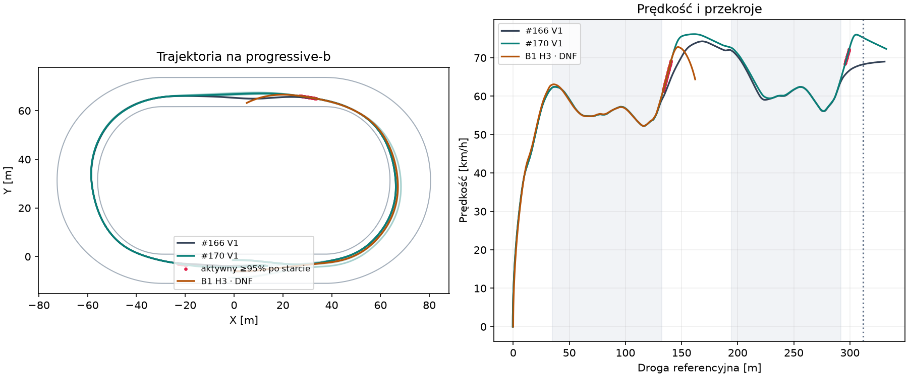
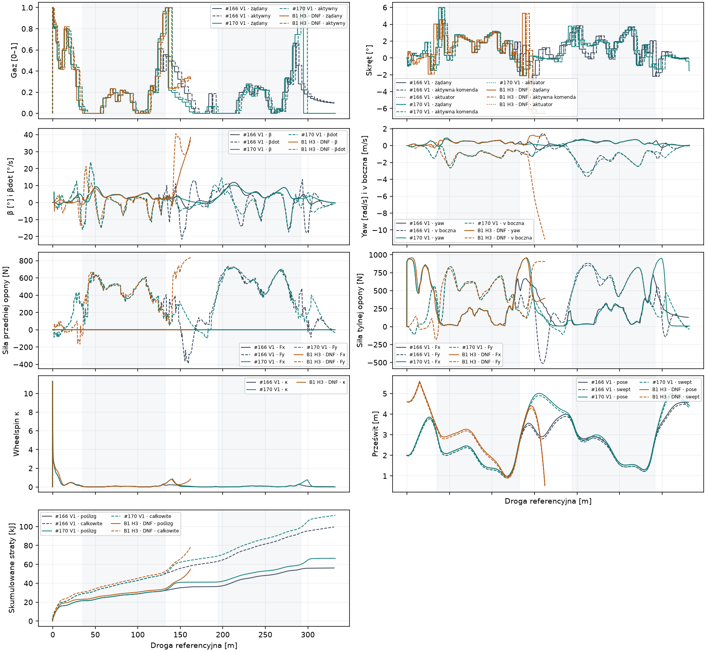
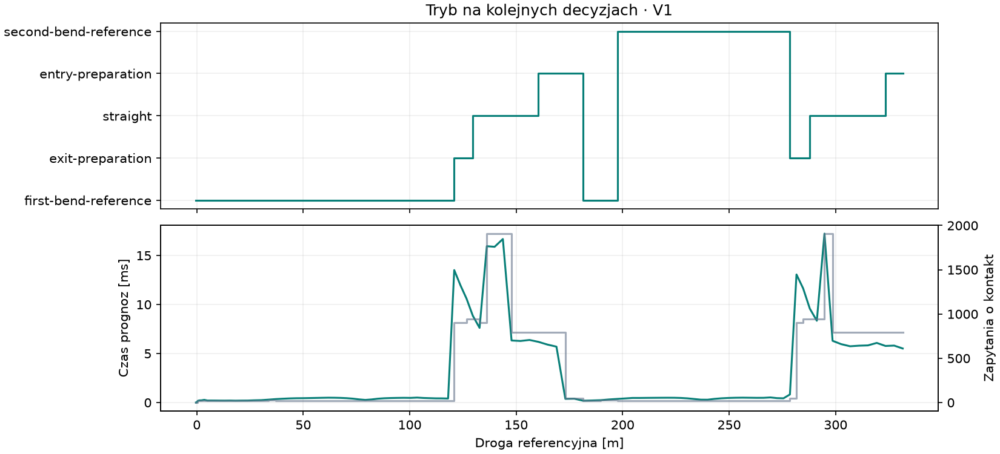

# Badanie #170 · dwa łuki i pełny gaz na wyjściu

**PARTIAL.** Zamrożony #170 i niezmieniony #166 ukończyły po **8/8** nowych, dopasowanych manewrów z co najmniej sekundą autonomicznej rezerwy. #170 był szybszy w każdej parze. Mediana poprawy parami to **1,08%**, przy progu sportowym 5%. Po pierwszym łuku wszystkie przejazdy #170 utrzymały aktywne **100% przez 0,40 s**. Po drugim łuku **5/8** osiągnęło ≥95% przez 0,20 s, w tym **2/8** osiągnęło 100%. Powtarzalne wykorzystanie pełnego gazu po obu łukach pozostaje otwarte.

[Tabela wszystkich przejazdów i czasy aktywacji](TABELE.md) · [metryki maszynowe](summary.json) · [pełna telemetria i rejestr](170-dowody.zip) · [manifest SHA256](SHA256SUMS).

## Zakres i niezależność

Baza techniczna `63e3fb26b3da5fab4bb157594537d0fd3db83a65`. Kontroler odniesienia, profil i parametry pochodzą z zamrożonego #166 `7754819d5e96ad8808e4de560262c7993fdad008`. Odtworzenia H3/H4 dały zgodność fingerprintów z pełnymi porównaniami #167. Te starty są częścią rozwoju. V1–V8 to nowe kombinacje przesunięć referencyjnych i poprzecznych na czterech polach. Każdy świat inicjuje zatrzymane nadwozie i koło, ze zwykłym stanem wału i sprzęgła. Zapisano hash V1–V8 przed pierwszym odtworzeniem. Wybrano `reserve-speed` po H3/H4 i utrwalono źródła oraz parametry przed uruchomieniem V1. Wszystkie 16 odłożonych ramion ma tę samą kolejność przekrojów i identyczne stany w parach.

`TrackFrame` daje kolejno 35,000, 132,389, 194,389 i 291,779 m. Cel to 311,779 m, a rezerwa zaczyna się od pierwszej zaakceptowanej próbki za celem. Czas sportowy biegnie od zatrzymanego startu do interpolowanego przekroju celu. Po nim ten sam sterownik generuje nowe komendy przez dodatkową sekundę. Progressive-b jest geometrią badawczą. Wyniki dotyczą tego toru.

## Co zmieniło wynik

[Diagnoza #169 przed implementacją](DIAGNOZA.md) opisuje rolę krótkich impulsów, błędy odniesienia na łuku i koszt horyzontu. #170 zachowuje trajektorię #166 na zasadniczej części obu łuków. Przy wyjściu płynnie zwiększa udział stabilizatora wraz z prognozowanym postępem w chwili aktywacji. Koszt liczy błędy β, βdot i yaw względem profilu oraz kurs, orientację, offset i ruch poprzeczny. Geometria wyznacza styczną i wyprzedzenie następnego wejścia. Aktuator, oba kontakty i ich budżety, cała kolejka, koło, wał i sprzęgło pozostają w oryginalnym wykonawcy. Model kontaktów działa również w prognozie. Wybór gazu sprawdza wykonalność przez propagację tego modelu i zapas drogi do wytracenia prędkości.

Ocena skrętu wykorzystuje do 17 krótkich prognoz 0,44 s dla danej wartości gazu. Dla najlepszego skrętu sprawdzana jest dłuższa ścieżka do 0,84 s z korektą możliwą na kolejnym review. Kolejka przesuwa decyzje o 0,24 s przy okresie 0,20 s. Dłuższa bramka wymaga zapasu swept, warunku końcowego β/βdot, yaw i kursu oraz przygotowania prędkości do łuku. Po odmowie impulsu stabilizator nadal wybiera skręt przy odpuszczaniu. Gdy brak przechodzącej propozycji, używa zaplanowanej korekty albo komendy #166.

| Etap | Próby | Cel + rezerwa | Obserwacja |
|---|---:|---:|---|
| Odtworzenie #166 | 2 | 2 | H3 20,685 s, H4 21,001 s |
| Pierwsze wyjście | 2 | 0 | Powrót do #166 po odrzuconym impulsie wywołał dużą zmianę skrętu |
| Wykonanie zaplanowanej korekty | 2 | 0 | Poprawa zasięgu, potem narastanie β po powrocie do #166 |
| Stabilizacja podczas odpuszczania | 2 | 2 | Oba przejazdy legalne |
| Rozszerzenie na drugie wyjście | 2 | 2 | H3 20,550 s, H4 20,832 s |
| Strojenie trzech pojedynczych zmian | 6 | 6 | Najszybszy legalny `reserve-speed` |
| Odłożony #170 | 8 | 8 | Minimum swept 0,837 m |
| Dopasowany #166 | 8 | 8 | Minimum swept 0,837 m |

### Pierwsza rzeczywista przyczyna DNF

| Próba | t [s] | s [m] | Bramka |
|---|---:|---:|---|
| Pierwsze wyjście H3 | 12,01 | 162,17 | Swept <0,5 m |
| Pierwsze wyjście H4 | 12,19 | 160,48 | Swept <0,5 m |
| Zaplanowana korekta H3 | 13,66 | 191,34 | β >45° |
| Zaplanowana korekta H4 | 13,51 | 185,26 | β >45° |

W pierwszym wariancie H3 po żądaniu 100% z −2,12° pojawiło się żądanie 24% z +5,31°. H4 wykonał analogiczne przejście z −1,32° do +4,30°. Wzrost yaw po aktywacji tej korekty poprzedził narastanie β i utratę prześwitu. Zaplanowana korekta usunęła pierwszy skok, lecz po jej wykonaniu powrót do dużych propozycji #166 wciąż uruchamiał oscylację. Utrzymanie sprzężenia #169 podczas odpuszczania zamknęło ten mechanizm na obu startach. Przyczyna każdej przerwanej próby, ostatnia decyzja, aktywny gaz i pełny pending są w archiwum.

## Wynik odłożony

| Miara | #166 | #170 |
|---|---:|---:|
| Mediana czasu [s] | 20,820 | 20,582 |
| Mediana pierwszego łuku [s] | 6,554 | 6,552 |
| Mediana drugiego łuku [s] | 6,029 | 6,003 |
| V wyjścia 1 [km/h] | 58,93–59,13 | 59,96–60,26 |
| Vmax na prostej [km/h] | 73,17–74,35 | 76,17–78,02 |
| V wejścia 2 [km/h] | 71,18–71,89 | 72,62–73,15 |
| V wyjścia 2 [km/h] | 63,50–63,73 | 64,27–64,50 |
| Min pose / swept [m] | 0,913 / 0,837 | 0,913 / 0,837 |
| Max β całego przejazdu [°] | 12,72 | 13,82 |
| ≥95% po apexie 1 / 2 | 0/8 / 0/8 | 8/8 / 5/8 |

Pierwszy pełny gaz pojawił się od 133,47 do 136,06 m, czyli 1,08–3,67 m za końcem pierwszego łuku. W czasie 0,40 s prędkość wzrosła o 7,92–8,14 km/h, przy |β| do 4,11° i |yaw| do 0,242 rad/s. Następnie #170 odpuszczał z utrzymaną stabilizacją. Mierzony początek obrotu do drugiego łuku wypadał przy 186,07–187,08 m, około 7,31–8,32 m przed wejściem. Przyjęto kryterium ≥0,09 s jednoczesnego skrętu >0,7° i yaw >0,10 rad/s. W pięciu przypadkach ≥95% na drugim wyjściu dało +3,79 do +3,99 km/h w 0,20 s, przy |β| do 3,85° i |yaw| do 0,293 rad/s. W trzech pozostałych szczyt aktywnego gazu wyniósł 93,93–94,99%. Wariant rozwiązuje pierwszy impuls, przejazd prostej i przygotowanie kolejnego łuku z małą przewagą czasu. Powtórzenie pełnego gazu na drugim wyjściu jest mniej odporne.

## Koszt i dowody

Wykonano **32 światy** za **29,36 CPU-s**, razem z serializacją telemetrii. Osiem integracji i sześć prób strojenia pozostawiło rezerwę na komplet 16 odłożonych ramion. Po ich zakończeniu zamknięto eksperyment. Lokalny build narzędzia i solution, regresja C# (172 przypadki) i Node (124 przypadki) zostały uruchomione. Status pełnego Windows CI przypisano do końcowego SHA w Draft PR.

Mediana CPU świata #170 wyniosła 0,422 s, w tym 0,289 s raportowanego CPU decyzji i 0,133 s pozostałego CPU fizyki wraz z obserwacją. W #166 mediana CPU świata wyniosła 0,172 s. Mediana średniego czasu ściennego jednej decyzji to 2,70 ms dla #170 i 0,34 ms dla #166. Dla #170 na świat przypadało 37 095 zapytań kontaktu (mediana) oraz 280 ms czasu ściennego wywołań prognoz i obliczenia bazowego. Rozdzielczość CPU procesu w Windows wynosiła 15,625 ms. Dla predykcji zapisano licznik i czas ścienny, osobno od całkowitego CPU decyzji. Podział wyłącznego CPU między predykcję i pozostałe obliczenia sterownika oraz między fizykę i obserwację pozostaje niewymierzony.

Telemetria rozróżnia żądanie, aktywną komendę i pozycję aktuatora. Udział ≥95% jest ważony czasem. Kontrola z historii odtwarza aktywacje z wszystkich decyzji i sprawdza stan pending oraz aktualny napęd w każdej próbce. Pose i swept przeliczono niezależnie od zarejestrowanych wartości. Energia poślizgu łączy natywną stratę wzdłużną koła z pracą sił bocznych oszacowaną na kroku. Raport i archiwum zachowują też chwilowe κ, Fx/Fy, zmiany skrętu i czasy obu łuków. Eksperyment pozostaje OFF i uruchamia się przez osobny CLI. #166 zachowuje rolę referencji wykonawczej. Transfer nacisku i C2 pozostają wyłączone.
