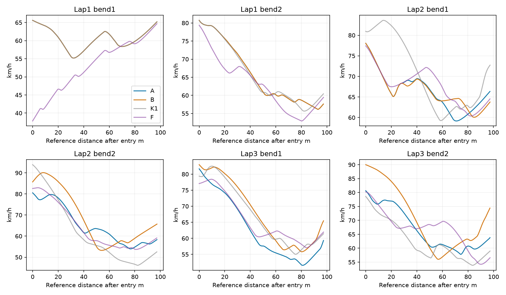
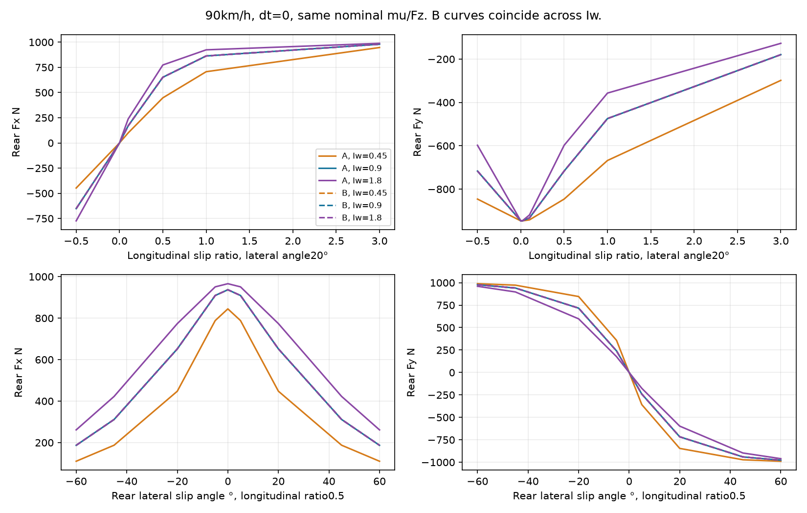
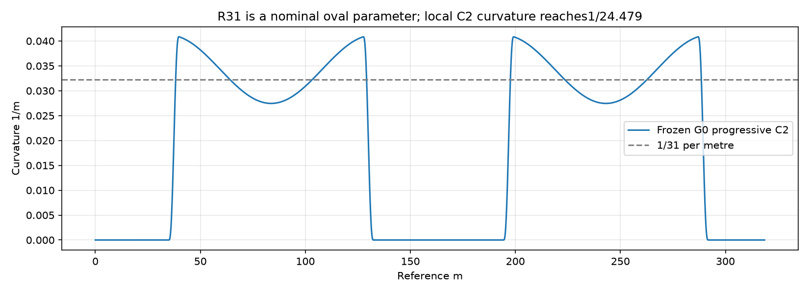
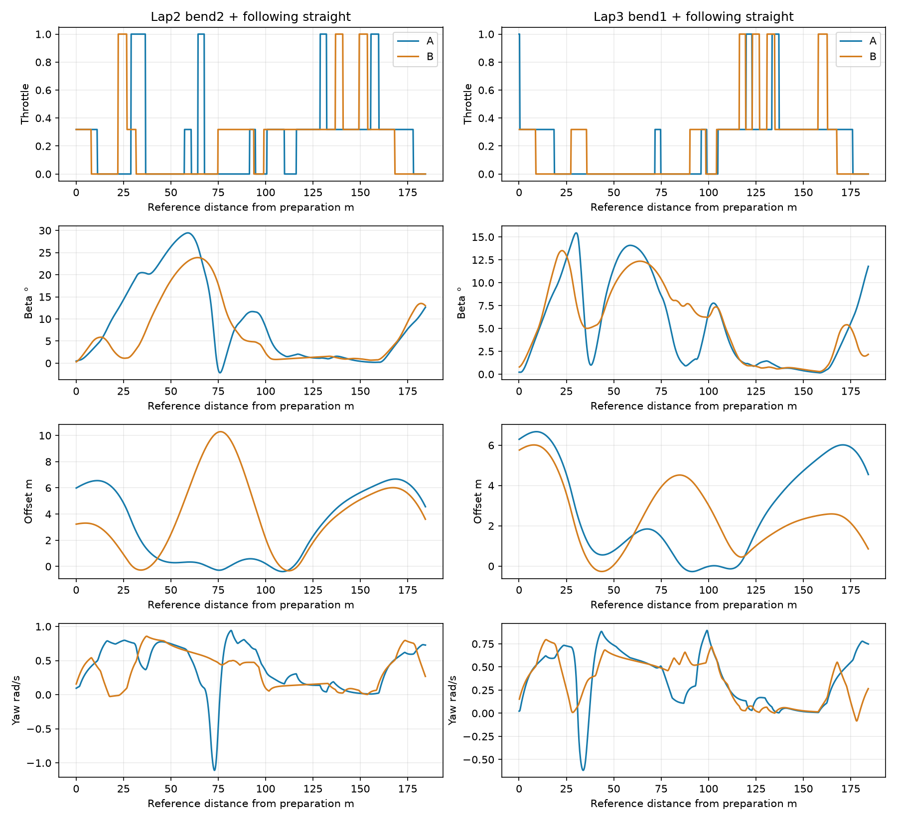
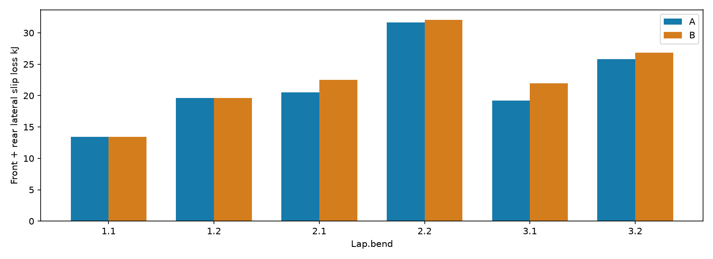

# Badanie #149 — prawo opony, granica prędkości i sterowanie

**Wynik: wykryto niepożądane sprzężenie prawa kontaktu z bezwładnością koła. Jego separacja nie poprawiła autonomicznego przejazdu.** A: **53,989766 s**; B: **54,234944 s**, czyli **+0,245178 s**. Oba warianty kończą trzy legalne okrążenia od zera. Powtórzenie B odtworzyło wszystkie stany i komendy. Większe maksimum prędkości B nie oznacza lepszego czasu. Realizm obu charakterystyk opony pozostaje **INCONCLUSIVE bez zewnętrznej kalibracji**.

Dokładna baza: PR #147, `14cb6c2fb947d2d04b1a7979346c8947b131b4fd`. Gałąź `experiment/tyre-physics-corner-limits-149`. [Draft PR #148](https://github.com/arturgladysz91/zuzel/pull/148), badanie **#149**, bez merge. Silnik, moc, masa147 kg, bezwładność nadwozia52,72097 kg·m², nominalne μ/Fz, G0, kolejka0,24 s i decyzje0,2 s pozostają identyczne. Nowe ścieżki są domyślnie OFF.

## Siedem odpowiedzi

1. **Czy błąd opony ogranicza szybkie łuki?** Oryginalna sztywność materiałowa zależy od Iw nawet przy dt=0; to nie jest wyłącznie efekt implicit solvera. Jest to niepożądane sprzężenie modelu konstytutywnego i dynamiki. Nie wykazano jednak, że ono jest dominującym ograniczeniem tempa przy nominalnych parametrach: B zachowuje tę samą nominalną charakterystykę i jedzie wolniej.

2. **Czy R24,479 m jest zamierzony i realistyczny?** Wynika wprost z jawnego profilu kompresji0,2 i normalizacji skrętu doπ przy zachowaniu długości łuku. Parametr31 m opisuje bazowy owal, nie stały lokalny promień C2. Profil świadomie zmienia krzywiznę, lecz nie jest pomiarem Motoareny; interpretacja31 m jako minimum była błędna. Realizmu lokalnego minimum nie potwierdzono.

3. **Jakie prędkości są wykonalne?** Tabela sześciu łuków podaje osiągnięte legalne wejścia/minima/wyjścia i linie. Próby K1 z początkowymi70/80/90/100 km/h nie wykazały utrzymania70 km/h przez cały łuk: najlepsze minimum to63,440 km/h. Nie jest to globalna granica fizyczna. Maksimum legalnego pełnego przejazdu wyniosło97,076 km/h w historycznym K1; dla A86,587, dla B93,870 km/h. Stałe70/80/90/100 km/h na dowolnej zmiennej linii: **INCONCLUSIVE**.

4. **Dlaczego długo bez gazu?** Napęd zwiększa poślizg wzdłużny i zajmuje wspólny budżet Fx/Fy tyłu. Zmienia yaw, β i późniejszą linię. Krótki gaz przed drugim łukiem drugiego okrążenia przekracza β45° i później traci certyfikat obrysu; nie oznacza to automatycznie upadku. W okolicy wejścia w pierwszy łuk trzeciego okrążenia większy gaz w A pogarsza cały dystans o0,766677 s. Nie udowodniono konieczności każdego odpuszczenia. Legalna ręczna korekta B daje lepszą kontynuację, więc przeszukiwanie nadal pomija przydatne sekwencje.

5. **Czy poprawka pozwala jechać szybciej bez zwiększenia przyczepności?** W tym izolowanym A/B — nie. B ma identyczne nominalne pojemności kontaktu, ale wynik jest o0,245178 s gorszy. Ręczne53,784509 s jest diagnostyką osiągalności po zmianie komendy, a nie autonomicznym sukcesem B.

6. **Fizyka czy wybór sekwencji?** Potwierdzonym bieżącym ograniczeniem jest wybór sekwencji i wrażliwość planera na stan/numerykę. Separacja Iw nie usuwa problemu. Bezwzględnego realizmu fizyki i toru nie rozstrzygnięto; bez kalibracji nie można przypisać im procentowego udziału w stracie czasu.

7. **Co przed czterema zawodnikami?** Potrzebna jest kalibracja Fx/Fy, przejść poślizgu i geometrii, szersze deterministyczne przeszukiwanie wspólnych prefiksów z ponowną certyfikacją oraz mniejszy koszt dalekiego K1. Obecny B107,53 CPU-s na54,23 s jazdy i p95 decyzji4,48 s nie daje budżetu do bieżącej symulacji czterech niezależnych plannerów. Naiwne4× to około430 CPU-s na jeden taki dystans, bez kosztu wzajemnych interakcji.

## Izolacja A/B i odtworzenie końcowego #148

Nowe odtworzenie finalnego #148 zachowało wszystkie **5412 próbek i270 komend**, fingerprint `EA342AF146E248C411CB7C409D26AEFAB4ED79A307AD1D03D80AE9F5F478AAE0`. Nowy pomiar kontrolera to83,15625 CPU-s; native+obserwacje13,953125 CPU-s, całe zarejestrowane zadanie97,828125 CPU-s. Historyczne82 CPU-s nie zostało użyte jako nowy pomiar.

B stosuje #140 `TyreLaw140` i `WheelSolver140` w obu miejscach oryginalnego kontaktu #144: wewnątrz callbacku koła używanego przez sprzęgło oraz w bezpośredniej ewaluacji. Przednia opona i oryginalny wał/sprzęgło pozostają niezmienione. Każda prognoza planera i niezależny preflight używają B. Zachowano dokładne cache, wspólny opóźniony prefiks, fast clearance i oba końcowe strażniki budżetu #148. Nie testowano nowego algorytmu ani nowej geometrii w tym A/B.

|Miara|A — oryginalna|B — separacja #140|Wniosek|
|---|---|---|---|
|Maksimum w legalnym pełnym przejeździe km/h|86.587|93.870|Osiągnięte wartości; globalne maksimum N/D|
|Najmniejsze minimum łuków km/h|51.595|53.239|Wyższe minimum B nie kompensuje drogi/czasu|
|Gaz0 łącznie w sześciu łukach s|20.767|19.079|Nie zakładamy, że każde odjęcie jest konieczne|
|β max / yaw max ° / rad·s⁻¹|29.455 / 1.109|23.872 / 0.905|Oba w standardowej obwiedni|
|Slip ratio średni / maksimum|0.265 / 11.316|0.256 / 11.316|Maksimum obejmuje start|
|Boczna dyssypacja przodu kJ|62.671|65.977|Rozłączne składniki bilansu|
|Boczna dyssypacja tyłu kJ|87.747|85.924|Rozłączne składniki bilansu|
|Wzdłużny poślizg kJ|112.175|111.002|Rozłączne składniki bilansu|
|Ciepło sprzęgła kJ|2.233|2.282|Rozłączne składniki bilansu|
|Opory kJ|109.741|118.362|Rozłączne składniki bilansu|
|Trzy okrążenia s|53.989766|54.234944|B wolniej o0.245178|
|CPU kontrolera s|83.156250|107.531250|Nowe pomiary procesu|
|Legalne pełne ukończenia|1/1 nowe; zgodne z #148|2/2, próbki i komendy identyczne|Diagnostyki nie wchodzą do tego mianownika|
|Minimalny certyfikat sweep m|0.105992|0.117534|Bez stwierdzonych kontaktów|

Powtórzenie B: 54.234944 s i 106.625000 CPU-s kontrolera. Wszystkie próbki, komendy i fingerprint są identyczne. W surowych wynikach `SportingImprovement` porównuje z historycznym K1 54,794530 s; **nie** oznacza poprawy względem A #148.

## Sześć łuków — pełne przejazdy

|Łuk|A czas s|B czas s|B−A s|A wej./min./wyj. km/h|B wej./min./wyj. km/h|Gaz0 A/B s|Linia offset A/B m|β max A/B °|
|---|---|---|---|---|---|---|---|---|
|1.1|5.822|5.822|-0.000|65.609/55.197/65.247|65.609/55.197/65.247|2.364/2.364|-0.38…1.79 / -0.38…1.79|10.613/10.613|
|1.2|5.553|5.553|-0.000|80.719/56.149/57.667|80.719/56.149/57.667|4.023/4.023|-0.30…3.58 / -0.30…3.58|13.338/13.338|
|2.1|5.554|5.501|-0.053|78.057/59.170/66.379|78.058/60.077/63.789|3.049/3.049|-0.30…7.80 / -0.35…7.80|12.668/12.668|
|2.2|5.606|6.101|0.495|80.549/53.960/58.342|85.716/53.239/65.718|3.595/2.800|-0.39…4.85 / -0.33…10.29|29.455/23.872|
|3.1|5.881|5.674|-0.206|81.648/51.595/59.360|82.948/55.823/65.470|4.310/3.508|-0.27…4.56 / -0.27…4.52|15.444/12.967|
|3.2|5.466|6.165|0.699|80.660/57.805/63.929|89.998/56.023/74.603|3.426/3.335|-0.37…4.53 / -0.25…10.99|18.932/17.190|

Offset jest od linii referencyjnej położonej1 m od krawędzi wewnętrznej; niewielki ujemny offset nie oznacza naruszenia. Legalność sprawdza pełny obrys, nie CoM. B wykorzystuje szerszą linię do10,99 m i kontrolowany β do23,87°, ale drugi łuk3.2 trwa6,165 s zamiast5,466 s mimo wejścia90,0 zamiast80,66 km/h.



Pełne porównanie K1, F, A i B, z drogą, yaw, granicami i CPU poszczególnych łuków, jest w `corners.csv`. Historyczne K1/F:54,794530/58,865997 s. Ich koszt nie jest nowym pomiarem #149. F był szybszy w wybranym historycznym łuku #145, lecz nie na całym dystansie.

## Audyt matematyczny kontaktu

Szczegóły i diagnoza zapisane przed pełnym B: [TYRE-AUDIT.md](TYRE-AUDIT.md). Oryginał: a=s/dx, b=wr/dy, (Fx,Fy)=Br·(a,−b)/√(1+a²+b²), Br=μFzr. Jednocześnie dx²=0,1²·(ur²+0,5²)+[Br·(R²/Iw+1/m)·0,03]². Ostatni składnik zależy od Iw i pozostaje przy h=0. Parametr0,03 jest podłogą skali prędkości, a nie rozwijanym w czasie stanem relaksacji kontaktu.

Prawidłowa dynamiczna zależność od Iw pozostaje w równaniu Iw·Δω/h=T−R·Fx−c·ωmid. Silnik i sprzęgło wyznaczają T; układ rozwiązuje monotoniczny pierwiastek z reakcją identycznej float-siły przekazywanej do Box2D. B oddziela te dwa poziomy. Przedni kontakt ma własne osie i prędkość z yaw; jego siła jest pasywna, ale również fenomenologiczna. Yaw wynika z rzeczywistych ramion r×F, β z kierunku prędkości i orientacji nadwozia. Nie ma zadanego docelowego ślizgu ani sztucznego momentu yaw.

Grid: 6804 zapytań dt=0 i 1080 kroków dynamicznych. Prędkości0,1–27,78 m/s, obroty wynikające ze slip ratio−0,5…3, kąty−60…60°, Iw0,45/0,9/1,8, obciążenia0,5/1/1,5 oraz momenty0/120/360 Nm. Pole SlipRatio w gridzie opisuje żądane ustawienie; przy u=0,1 m/s i żądaniu−0,5 omega jest ograniczone do0, więc rzeczywiste κ≈−0,196116. Rzeczywisty slip wynika z zapisanych U/Omega; wykres90 km/h nie wymaga tego ograniczenia. Maksymalne wykorzystanie tylnej pojemności 0.999501910; reszta to wspólna, nie zwiększona pojemność. Błąd lokalnej tożsamości energii <1e−7 J, resztka pierwiastka <7,47e−8 m/s. Natywny bilans całego korpusu/koła/wału jest dodatkowo sprawdzany na każdym kroku.

B zamraża materiałowe skale #140 raz przy nominalnym #139: dx-floor3,824164 m/s, dy-floor0,378028 m/s. Nie przelicza ich z aktualnego Iw, masy ani kroku. Przy nominalnym stanie różnica A/B sił statycznych wynosi najwyżej6,11e−5 N. Przy innym obciążeniu lub Iw zmienia się interpretacja parametru: podłoga jest własnością materiału, nie wynikiem mobilności. To nie są bezpośrednio równoważne modele poza punktem odniesienia. Mu nie wzrosło; tył nadal dzieli jedną pojemność między Fx i Fy.

Dodatkowy `clutch-coupling.json.gz` zawiera72 pełne ewaluacji kontaktu/sprzęgła przy tej samej obserwacji30 s, gazie0/0,5/1, trzech Iw i dt0/0,02/0,01/0,005. Oddziela zmianę materiału od zmiany rzeczywiście rozwiązanego momentu sprzęgła. `contact-convergence.json` przechowuje cztery rozdzielczości1D przez1 s; nie przedstawia tego jako walidacji łuku Box2D. Wszystkie obliczenia są deterministyczne, bez strojenia wag i bez CEM.



## Geometria: skąd bierze się24,479 m

Zamrożony generator: k(t)=π·Ramp(t)·[1+c·cos(2πt)]/(Lb·I), c=0,2, Lb=(318,77875−124)/2=97,389375 m. Ramp ma łagodne złącza na pierwszych i ostatnich5% łuku; I normalizuje całkę krzywizny doπ. Usunięcie krzywizny przy złączach i kompresja przy końcach wymagają wyższej krzywizny w innych miejscach, jeśli długość i obrót pozostają stałe. Kwintyczne kawałki dopasowują pozycję, styczną i krzywiznę.

Siatka2000 punktów #148 dała maksimumκ0,040850768 1/m, Rmin24,479344 m. Gęstsza siatka profilu źródłowego daje24,478365 m; różnica około0,98 mm to rozdzielczość próbkowania, a nie zmiana G0. Minimumκ=0 na prostych i przy złączach, zatem maksymalny promień jest nieskończony. Środek łuku ma mniejszą krzywiznę niż okolice jego końców.

|Kompresja c|Rmin profilu m|κmax 1/m|Optymistyczne stałe offset0/6/15,6 m km/h|
|---|---|---|---|
|0.00|29.450001|0.033955856|69.350/76.087/85.773|
|0.10|26.748975|0.037384610|66.093/73.131/83.162|
|0.20|24.478365|0.040852402|63.226/70.550/80.902|
|0.35|21.679831|0.046125820|59.502/67.234/78.026|

To czułość samego profilu przy tej samej długości; nie są to nowe przejazdy ani zgoda na zmianę toru. Ponownie wykorzystano osobne natywne kontrole kołowe G0c/G1–G4 z #148: większa prosta nie zawsze poprawia następny łuk. Nie mieszamy ich ze stałą geometrią głównego A/B. Przy pojemności1852,34 N stałe90 km/h wymagają R49,60 m,100 km/h R61,24 m; lokalny zewnętrzny offset daje optymistycznie około40,08 m. To warunek punktowy dla stałego offsetu, **nie globalny dowód niemożliwości zmiennej linii**. Uwzględnienie Fx i pełnego obrysu zmniejsza dostępny zapas.

Oficjalne dane [Ekstraligi](https://ekstraliga.pl/sezon-stelmet-falubazu-zielona-gora-wedlug-jacka-fratczaka-wideo/druzyny/1/2026/info) podają318 m, proste12 m, łuki17,0 i16,2 m; [klub](https://speedway.torun.pl/) potwierdza318 m. [Historia zmian toru](https://ekstraliga.pl/se/news/czy-podczas-pge-imme-im-zenona-plecha-padnie-nowy-rekord-toru) opisuje zmianę drugiego łuku przed2017 r. Źródła te nie podają ciągłego przebiegu lokalnej krzywizny ani pomiaru Rmin24,479 m. Symetryczne16,6 m w G0 są uproszczeniem. Brakuje geodezyjnego przebiegu obu krawędzi, definicji linii pomiaru318 m, wysokości/bankingu i ich niepewności; nie uznajemy wybranego profilu C2 za pomiar Motoareny.



## Wejścia70/80/90/100 km/h i linie

24 nowe światy K1: A/B ×4 prędkości ×3 offsety2/6/10 m, start12 m przed łukiem. Są to jawne starty diagnostyczne w ruchu z dopasowanym kołem i wałem, bez resetów. Nazywamy je pozycjami wejścia: sterownik może potem zmieniać linię. W tabeli jest rzeczywista prędkość na granicy łuku, a nie wartość ustawiona12 m wcześniej. Oceniono łuk, całą następną prostą62 m i dalszy fragment kolejnego łuku.

|Model /początkowa /offset|V rzeczywista wej. km/h|Minimum łuku km/h|Wyjście km/h|Łuk+62 m cert.|Dalszy wynik14 s|
|---|---|---|---|---|---|
|A/100/10|N/D|N/D|N/D|NIE|confirmed footprint crossing|
|B/100/10|N/D|N/D|N/D|NIE|confirmed footprint crossing|
|A/100/2|97.845|32.388|39.435|TAK|experiment timeout|
|B/100/2|97.845|32.388|39.435|TAK|experiment timeout|
|A/100/6|N/D|N/D|N/D|NIE|confirmed footprint crossing|
|B/100/6|N/D|N/D|N/D|NIE|confirmed footprint crossing|
|A/70/10|68.237|61.813|67.994|TAK|experiment timeout|
|B/70/10|68.237|61.813|66.091|TAK|confirmed footprint crossing|
|A/70/2|67.804|57.180|62.287|TAK|experiment timeout|
|B/70/2|67.804|57.180|62.287|TAK|experiment timeout|
|A/70/6|67.804|58.705|63.825|TAK|experiment timeout|
|B/70/6|67.804|58.705|63.825|TAK|experiment timeout|
|A/80/10|77.868|60.775|67.299|TAK|experiment timeout|
|B/80/10|77.868|60.775|67.299|TAK|experiment timeout|
|A/80/2|77.868|55.464|62.044|TAK|experiment timeout|
|B/80/2|77.868|55.464|62.044|TAK|experiment timeout|
|A/80/6|77.868|51.939|58.428|TAK|experiment timeout|
|B/80/6|77.868|51.939|58.428|TAK|experiment timeout|
|A/90/10|87.873|63.440|73.306|TAK|experiment timeout|
|B/90/10|87.873|63.440|73.306|TAK|experiment timeout|
|A/90/2|87.873|52.814|56.868|TAK|experiment timeout|
|B/90/2|87.873|52.814|56.868|TAK|experiment timeout|
|A/90/6|87.873|60.659|70.840|TAK|experiment timeout|
|B/90/6|87.873|60.659|70.840|TAK|experiment timeout|

K1 ukończył łuk+62 m w20/24 przypadkach. Minimum przy początkowych90 km/h na zewnętrznym wejściu wyniosło63,440 km/h; przy100 km/h z wewnętrznego wejścia spadło do32,388 km/h. To nie są próby utrzymywania zadanej prędkości ani dowód optymalności K1. Dwie zewnętrzne/środkowe próby100 km/h w każdym modelu przekraczają obrys w pierwszym łuku. B przy70 km/h /offset10 ukończył pierwszy łuk i62 m, ale przekroczył obrys na następnym łuku po10,63 s. Ukończenie pojedynczego łuku nie stało się przez to pełnym sukcesem.

Standardoweβ45° jest w diagnostykach obserwatorem, nie automatycznym fizycznym DNF. Oprócz skończoności i ciągłości stanów zachowano kontrole dodatnich strat kontaktu/sprzęgła, energii korpusu/koła/wału, wykorzystania opony≤1, fizycznej zmiany kierownicy, ruchu naprzód i sweep pełnego obrysu. Próby gazu przekraczająβ45° do47,48/47,71° i kontynuują aż do utraty certyfikatu sweep. Dla B w tym miejscu endpoint ma jeszcze+0,001725 m odstępu: to **brak certyfikatu**, nie potwierdzone przekroczenie ani kontakt. Żadna jazda poza obwiednią nie dostała race PASS. Zaplanowany timeout14 s oznacza koniec okna, nie upadek.

## Pięć obszarów strat i wpływ następnej prostej

Zakres raportu: start do pierwszego wejścia oraz łuki2.1,2.2,3.1,3.2 od1,2 s przed wejściem do następnego wejścia. Ostatni3.2 jest ucięty metą; brakujące35 m nie zostało dopowiedziane. Całki do końca następnego łuku są zapisane oddzielnie w `regions`; za metą pozostają N/D.

|Obszar|Boczna dyssypacja A/B kJ|Poślizg wzdłużny A/B kJ|Gaz0 A/B s|Czy pełna następna prosta?|
|---|---|---|---|---|
|start|0.945/0.945|50.148/50.148|0.476/0.476|TAK|
|2.1|27.946/26.864|12.220/14.589|4.405/4.400|TAK|
|2.2|40.149/38.287|16.333/12.392|4.490/4.092|TAK|
|3.1|26.280/27.797|9.335/12.527|4.974/4.865|TAK|
|3.2|29.522/28.219|18.228/17.062|3.800/4.000|N/D za metą|

Start:50,148 kJ wzdłużnego poślizgu jest niemal identyczne A/B; separacja nie usuwa wheelspinu. Brakuje danych o rzeczywistej oponie i sprzęgle, żeby nazwać tę wartość poprawną fizycznie. Łuk2.1: mniej bocznej dyssypacji B do następnego wejścia, ale niższa prędkość wyjścia; gaz nie jest samodzielnym kryterium. Łuk2.2: szersza linia B i wejście85,72 zamiast80,55 km/h dają6,101 zamiast5,606 s; mniej gaz0 i mniejsza dyssypacja nie gwarantują czasu. Łuk3.1: B poprawia minimum i skraca łuk, ale nie cały dystans. Łuk3.2: wyższe wejście i szerszy łuk B zwiększają czas o0,699 s. Straty poślizgu są pracą kontaktu, nie wymyślonym hamulcem; ich wielkość zależy od nieskalibrowanej charakterystyki.





## Przyczynowe impulsy z pełnymi prefiksami natywnymi

Każda próba ma jedną ciągłą symulację od0 km/h. Prefiks A jest sprawdzany na każdej decyzji względem zapisanych stanów, wału, koła i kolejki. Potem kontrola i interwencja przechodzą na ten sam endogeniczny K1 do mety albo zatrzymania. Impuls gaz1 trwa0,2 s, żądany1 s po punkcie rozgałęzienia. Korekta skrętu±0,5° trwa0,4 s; fizyczny actuator i kolejka0,24 s pozostają aktywne. To celowe sondy przyczynowe, nie nowy autonomiczny kontroler.

|Próba|Wynik|Czas mety s|Δ własna kontrola s|β max °|Interwencja osiągnięta|
|---|---|---|---|---|---|
|causal-28.4-control-A|completed|53.954530|0.000000|29.455|TAK|
|causal-28.4-control-B|completed|54.373355|0.000000|29.497|TAK|
|causal-28.4-early-A|confirmed footprint crossing|N/D|N/D|27.798|TAK|
|causal-28.4-early-B|completed|54.496379|0.123023|23.629|TAK|
|causal-28.4-gas-A|uncertified swept interval|N/D|N/D|47.482|TAK|
|causal-28.4-gas-B|uncertified swept interval|N/D|N/D|47.713|TAK|
|causal-28.4-outward-A|confirmed footprint crossing|N/D|N/D|37.589|TAK|
|causal-28.4-outward-B|completed|53.784509|-0.588846|25.942|TAK|
|causal-37.2-control-A|completed|54.194461|0.000000|29.455|TAK|
|causal-37.2-control-B-nativeprefix|confirmed footprint crossing|N/D|N/D|24.715|TAK|
|causal-37.2-control-B|uncertified swept interval|N/D|N/D|29.497|NIE|
|causal-37.2-early-A|completed|54.134518|-0.059943|32.582|TAK|
|causal-37.2-early-B-nativeprefix|completed|55.086292|N/D|23.872|TAK|
|causal-37.2-early-B|uncertified swept interval|N/D|N/D|29.497|NIE|
|causal-37.2-gas-A|completed|54.961139|0.766677|29.455|TAK|
|causal-37.2-gas-B-nativeprefix|confirmed footprint crossing|N/D|N/D|25.693|TAK|
|causal-37.2-gas-B|uncertified swept interval|N/D|N/D|29.497|NIE|

Istotne: korekta wcześniejszego skrętu A przed3.1 poprawia własną kontrolę o0,059943 s, lecz nadal jest wolniejsza niż pełny autonomiczny A. Gaz pogarsza ją o0,766677 s. Korekta kierownicy na zewnątrz B przed2.2 poprawia własną kontrolę o0,588846 s i kończy pełny dystans53,784509 s wβ25,94° z dodatnim sweep. A z tą samą interwencją przekracza obrys. Nie dowodzi to dodatkowej przyczepności B: materiał nominalny jest prawie identyczny, lecz stany i kolejne wybory K1 się rozchodzą.

Przeniesienie komend A do B do37,2 s zatrzymało się już34,1 s. Trzy zachowane próby nie dotarły do interwencji i nie są dowodem jej efektu. Po diagnozie wykonano trzy oznaczone `nativeprefix` próby z własnym, dokładnie zgodnym prefiksem B. K1 jako dalsza kontrola przekracza wtedy obrys; wcześniejszy skręt pozwala ukończyć55,086292 s, bez poprawy wobec54,234944 s pełnego planera B. Pokazuje to znaczenie dalszej sekwencji i brak zamienności ogona K1 ze spójnym planem.

## Zgodność prognoz, kolejki i koszt

|Wariant|Decyzje|Zgodna przewidziana kolejna komenda|Kolejki|Max XY m|Max V m/s|CPU p50/p95/max s|
|---|---|---|---|---|---|---|
|baseline149-final148|270|266/269|True|0.000038254|0.000112534|0.031250/2.671875/10.343750|
|separated149-autonomous|272|270/271|True|0.000053440|0.000082016|0.046875/4.484375/7.500000|

Każda wykonana komenda ma zgodny zapis dziennika przed zwrotem, certyfikat kompletnego planu i niezależny świeży preflight. Zmiany dalszego planu mają zapisane powody i błędy. Dwa testy stojące oraz dwa testy wejścia w łuk sprawdzają prognozy0,2 s z rzeczywistą aktywacją pending; B ma44 porównania w zakręcie, maxXY0,000030652 m, maxV0,000060082 m/s, maxωkoła0,000232557 rad/s i maxωwału0,002092217 rad/s. Same zera przy polach `Comparisons=0` nie są pomiarem zgodności.

Pierwsza różna komenda A/B pojawia się22,6 s: A skręt0°/gaz0,318207, B skręt0,5°/gaz0; pozycje różnią się wtedy około1,27 mm. Szczegóły obu obserwacji i planów są w `first-decision-divergence.json`. Prawie równe krzywe materiałowe nie dają identycznego zamkniętego sterowania: float-arytmetyka/solver i dyskretna selekcja mogą zmieniać kolejny plan. Nie przypisujemy0,245 s różnicy do samej wielkości siły materiałowej. Dokładnego marginesu rankingowego wszystkich odrzuconych planów nie zachowano — ta część przyczynowej dekompozycji pozostaje INCONCLUSIVE.

|Wariant|Fizyczne segmenty prognoz|Kontakty prognoz|Pełne K1|Oszczędzone kontakty wspólnego prefiksu|
|---|---|---|---|---|
|baseline149-final148|74091|3552122|1643|1032014|
|separated149-autonomous|72714|3425856|1568|983468|

B ma nieco mniej prognoz, ale droższy jawny solver/material validation. Licznik pełnego K1 nadal obejmuje wiele ogonów planu, nie tylko272 decyzje natywne. Samo trzymanie co drugiej komendy ogona wcześniej zawiodło w #148; zachowano te negatywne wyniki i nie włączono go ponownie. Konkretny następny krok: drzewo deterministycznych, fizycznie propagowanych prefiksów dla niezależnych korekt gazu i kierownicy, zachowanie alternatyw wcześniejszego odpuszczenia/przesunięcia linii, wspólny punkt czasowy za łukiem i certyfikowany ogon do następnego łuku. Ponowne użycie taśmy komend może ograniczyć pełne K1, lecz każdy odgałęziony stan musi dostać ponowną propagację i preflight; nie wolno przenosić certyfikatu ze starego stanu.

## Brakujące dane do realizmu

Potrzebne są zmierzone oddzielnie dla przodu i tyłu: Fx(κ,α,Fz,V), Fy(κ,α,Fz,V) i momenty przy małym/średnim/dużym poślizgu, siły na luźnej i ubitej nawierzchni, jednoczesny napęd/boczne obciążenie, odpowiedź przejściowa/relaksacja, wpływ ciśnienia/tread/camber, rozkład obciążeń i transferu oraz rzeczywisty Iw. Do napędu: mapa momentu, RPM, poślizg i grzanie sprzęgła oraz straty przekładni w stanie startu i driftu. Do toru: geodezyjne krawędzie, banking, powierzchnia i definicja linii referencyjnej. Dopiero potem można ocenić, czy koło powinno trzymać70–100 km/h w danym miejscu bez sztucznego zwiększania μ.

## Budżet i odtwarzanie

Eksperymenty i zapisane analizy/wykresy: **794.796875 CPU-s /1200**, **48 światy**. Podział: trzy pełne autonomiczne przejazdy (A i dwaB),24 wejścia, cztery testy zgodności,17 prób przyczynowych. Pierwszy start pełnego B odrzucono przed budową świata przez odziedziczony limit24; zachowano log i konserwatywny1 CPU-s, jawnie nie jako pomiar. Nowy centralny limit48 światów i1180 CPU-s zostawia rezerwę przed1200. Kompilacja, standardowe testy i CI są walidacją, poza budżetem eksperymentów natywnych. Koszt samego generatora raportu jest dopisany osobno w ledgerze.

Wcześniejsze badania #139/#140 rozdzielają problem konstytutywny i jego brak kalibracji; #143 potwierdza, że usunięcie preferencji gazu samo niewiele zmienia; #145 dowodzi istnienia korzystnych komend; #146 diagnozuje zaniechanie obiecywanej korekty i wprowadza spójny ogon; #147 waliduje trzy okrążenia; #148 daje dokładne optymalizacje i negatywny wynik rzadszego ogona. Ich źródła, parametry i evidence pozostają bez zmian (`source-proof.json`).

```powershell
dotnet restore SpeedwayManager.sln
dotnet build SpeedwayManager.sln -c Release --no-restore --warnaserror
dotnet test tests/CoreSim.Tests -c Release --no-build --filter "Shard=core|Shard=trajectory"
python -m unittest discover -s tests/calibration
python -m unittest discover -s tools/ci
node --test tools/replay-viewer/replay.test.mjs
python tools/tyre-physics-corner-limits/generate149.py --check
```

Jawne flagi programu `tools/tyre-physics-corner-limits`: `--baseline149`, `--audit149`, `--coupling149`, `--parity149`, `--corner-parity149`, `--capabilities149`, `--native-b149`, `--repeat-b149`, `--causal149`, `--causal-own-b149`. Istniejące próby nie są nadpisywane; ponowna symulacja wymaga nowego jawnego katalogu/budżetu w nowym badaniu. Zapisy można odtwarzać wielokrotnie bez tworzenia światów.

[Replay A/B i diagnostyk](http://127.0.0.1:8018/tools/replay-viewer/?case=tyre149&run=separated149-autonomous&t=29) czyta zapisane stany. Lista zawiera także nieudane próby i starty diagnostyczne w ruchu, z odpowiednimi opisami. [Walidacja](VALIDATION.md) podaje zakres testów i Windows CI.
