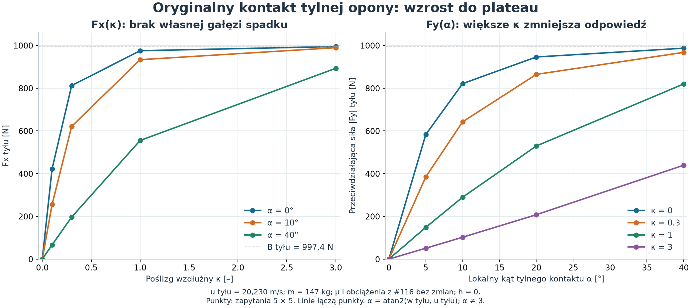
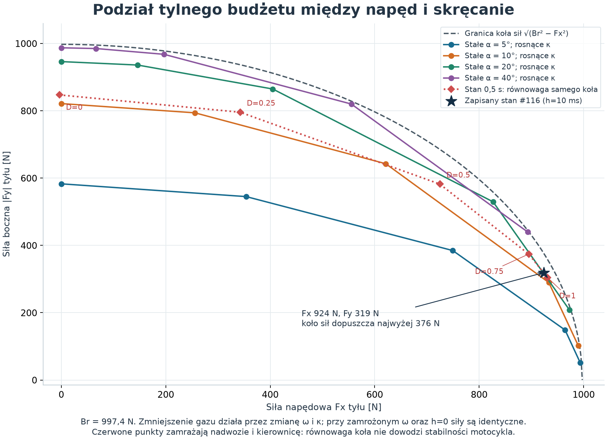

# #118 — czy kontakt opony reprezentuje nawierzchnię żużlową?

**Ocena końcowa: Nierozstrzygnięte — brak danych pozwalających wiarygodnie wybrać A/B/C.**
Obecne równania dopuszczają lokalnie stabilny ruch z niezerowym uślizgiem przy
silniku #116 i częściowym gazie. W badanym stanie Egg wybrana prędkość/promień
przekraczają nawet absolutną granicę wszystkich kontaktów. Nie wykazano natomiast,
że poziom sił, podział Fx/Fy lub brak spadku po maksimum odpowiadają prawdziwemu
żużlowi. Brak takiej kalibracji nie dowodzi konieczności przebudowy.

Baza: otwarty Draft [#117](https://github.com/arturgladysz91/zuzel/pull/117),
HEAD `29cece47bc8fc7dfe6e678c08b3a0c8e5c837a89`.
Jeden kolejny Draft na jego gałąź, bez merge. Wyłącznie analiza i dokumentacja:
silnik, regulator, µ, opony, parametry, flagi i historyczne dane bez zmian.

## Wykorzystane wyniki, bez powtarzania przejazdów

| Eksperyment | Co już ustalił i jak wykorzystano wynik |
|---|---|
| [#97](slip-coupled-dynamics.md) | Pojedyncze Fy miało pierwszeństwo, napęd dostawał resztę koła sił. Monotoniczna saturacja bez kalibracji spadku. To historyczna podstawa, nie aktualny podział dwóch kontaktów. |
| [#98](slip-control-validation.md) | Przy zamrożonym stanie gaz nie zmieniał Fy; później zmieniał stan. Limiter energii yaw nie wyjaśniał opóźnień. Nie powtarzano tych testów. |
| [#100](rear-wheel-dynamics.md) | Fizyczny stan ω i wspólny mianownik Fx/Fy; gaz działa przez ω/κ. Już wskazano wpływ regularizacji 30 ms na kształt charakterystyki. |
| [#107](full-throttle-slide-grip-audit.md) | Oryginalne siły i rzeczywiste straty potwierdzone; dawny model miał bezpieczny okresowy drift przez 8 okrążeń i powrót po ±5% prędkości. Nie przenosimy tego dowodu na silnik #116 i dwa kontakty. Empiryczna wiarygodność oraz spadek sił pozostały otwarte. |
| [#116](motorcycle-performance-500cc.md) | Większy napęd i µFz, bez empirycznego µ. Zachowane C-both-egg-first dostarczają trzech stanów oraz dokładnego odtworzenia sił. |
| [#117](controlled-slip-travel-direction.md) | Rozdzielenie ψ/χ/β, krótki wykonalny R 46 i odzyskanie kontroli po zamknięciu gazu; częściowe 0,35 nie wystarczało. Nie powtarzano tych przejazdów ani pełnych okrążeń. |

## Mała siatka oryginalnych funkcji

[Protokół](tyre-surface-diagnostic/protocol.json) zamraża stan nawierzchni
Grip=1/Ruts=0/Moisture=0,5, m=147 kg, I=52,72097 kg·m² i wszystkie parametry
#116. B=1852,339 N, przód 854,926 N, tył 997,413 N. Są to **wartości modelu**,
z niekalibrowanym µeffective=1,2845, nie pomiary prawdziwego toru.

Trzy stany początku kroku C z t=0,2/0,5/1,0 s mają lokalne u tyłu
18,910/20,230/19,223 m/s. Dla każdego utrzymano u, yaw rate, obciążenia i materiał,
a zmieniono tylko boczną prędkość kontaktu oraz ω, aby uzyskać siatkę
κ={0;0,1;0,3;1;3} × α={0;5;10;20;40}°. To 75 punktów plus
6 zapytań ogonów (κ=10/α=10° oraz κ=0,3/α=80°): **81 punktów, zero Box 2 D**.
Stałe u przy zmianie α oznacza zmianę całkowitej prędkości; nie jest to siatka
stałej V ani deklaracja osiągalności każdego punktu pod dostępnym momentem.

[Adapter C#](tyre-surface-diagnostic/Program.cs) wywołuje niezmienione
`TwoContactBikeDynamics.Forces` i bezpośrednio `RearWheelDynamics.Evaluate`.
Oryginalny wewnętrzny helper regularizacji jest odczytany przez reflection;
Python nie implementuje prawa opony. Siatka używa h=0, a trzy zapisane stany
odtwarzane są również z oryginalnym h i regulatorem #116. Maksymalna różnica
Fx/Fy: **0 N** między bezpośrednim kontaktem i dwoma kontaktami oraz **0 N**
w odtworzeniu zapisanych sił. Nie zatwierdzono koła ani kierownicy.

Definicje są jawne: **αr=atan 2(wr,ur)** to podpisany kąt lokalnego tylnego
kontaktu, **β=ψ−χ** dotyczy COM, a κ=(rω−ur)/sqrt(ur²+0,5²).
Dla lewego łuku αr jest tutaj ujemny, β dodatni. W osiach nadwozia
wr=wCOM−0,60·yawRate, więc αr nie jest ani β, ani dokładnie −β.
Wykresy pokazują wielkość przeciwdziałającej Fy dla dodatniego α.



Dla a=(rω−ur)/δx, b=wr/δy oryginalne równania chwilowe to:

```text
Fx = Br·a / sqrt(1+a²+b²)
Fy = −Br·b / sqrt(1+a²+b²)
δx² = 0,10²(ur²+0,5²) + [Br·(r²/Iw+1/m)·0,03]²
δy² = 0,12²(ur²+0,5²) + [(B/m)·0,03]²
```

Przy stałym ur i drugim poślizgu moduł własnej składowej rośnie monotonicznie
do Br. Norma również saturuje; **nie istnieje własna gałąź spadku po maksimum**.
Fy maleje, gdy rośnie a przy stałym b, a Fx maleje, gdy rośnie b przy stałym a.
To combined slip, a nie degradacja siły przez ścięcie materiału.

| κ przy αr=10°, u=20,230 m/s | Fx [N] | \|Fy\| [N] |
|---:|---:|---:|
|0|0,00|821,35|
|0,1|255,82|793,87|
|0,3|621,21|642,60|
|1|933,34|289,64|
|3|989,64|102,37|
|10, punkt ogona|996,71|30,93|

Dla κ=0,3 i αr=80° otrzymano Fx=29,96 N, |Fy|=996,73 N.
Tego nasycenia nie uznajemy za empirycznie poprawną siłę przy 80°.
W środkowym stanie δx=4,327 m/s; składnik minimalnej relaksacji odpowiada
za **78,1% δx²**. Numeryczny parametr istotnie kształtuje κ–Fx nawet przy h=0.
Nie jest to pamięć odkształcenia ani zmierzona długość relaksacji opony.

## Czy podział Fx/Fy nadmiernie odbiera skręt?

Eliminacja a daje, przy stałym b:

```text
|Fy| = |b|/sqrt(1+b²) · sqrt(Br²−Fx²)
```

Mechanizm jest symetryczną normalizacją obu poślizgów, bez uprzywilejowanego
clampu Fx. Przód zachowuje osobną pojemność i nie zależy bezpośrednio od κ tyłu.
Spadek bocznego zapasu jest duży, ale zgodny z zadanym kołem sił. **Nie wykazano,
że jest nadmierny względem prawdziwej nawierzchni.** Samo koło sił jest granicą,
nie obietnicą osiągnięcia jej przy każdym α.



W zapisanym stanie t=0,5 s Fx/Br=92,6%; koło sił zostawia najwyżej
375,65 N bocznie, a rzeczywiste Fy wynosi 319,05 N. To około 85% tego zapasu,
zgodne z podanym wzorem. Nowy silnik dostarcza tu 333,09 Nm; chwilowe Tω
na początku kroku wynosi 40,75 kW.
Sam limit Br·r wynosi 329,15 Nm (przed oporem łożyska); pełny nowy napęd łatwo
osiąga więc nasycenie. To stwierdzenie o relacji dwóch niezmienionych modeli,
nie dowód, że prawdziwa opona żużlowa ma za małą przyczepność.

## Stan utraty kontroli: co daje odjęcie gazu?

Wybrano zapisany początek kroku **C #116, t=0,5 s**: V=20,524 m/s,
β=9,702°, αr=−11,060°, yawRate=0,8262 rad/s, χdot=0,2749 rad/s,
βdot=0,5513 rad/s. Utrzymano nadwozie i kierownicę δ=−4,871°.

Przy h=0 i zamrożonym ω wszystkie pięć poziomów Drive daje identyczne
Fx=923,85 N i Fy=319,31 N. W oryginalnej ocenie h=10 ms zmiana Drive 1→0
daje tylko Fx 923,97→919,86 N i Fy 319,05→327,51 N: koło nie przestaje
buksować natychmiast. Następnie znaleziono równowagę **samego koła**
Tdrive−rFx−cω=0, bez integracji nadwozia:

| Drive | κ po uspokojeniu koła | Fx tyłu [N] | Fy tyłu [N] | Pełna siła normalna do v [N] | βdot [rad/s] |
|---:|---:|---:|---:|---:|---:|
|0|−0,0015|−3,71|847,13|1193,58|0,431|
|0,25|0,1481|342,45|795,64|1201,16|0,428|
|0,50|0,4283|724,67|582,08|1055,06|0,476|
|0,75|0,8229|894,88|374,12|878,76|0,535|
|1|1,0535|930,98|304,00|815,73|0,556|

Równowagi koła mają ujemną lokalną pochodną ωdot względem ω; wynikające
stałe czasowe wynoszą 0,068–0,178 s. To oszacowanie lokalne przy zamrożonym
nadwoziu, nie czas pełnego odzyskania kontroli. Także większy Fx może dać
część siły normalnej do v przy β≠0, dlatego całkowity skręt nie jest po prostu Fy.

**Mniejszy napęd odzyskuje dużo Fy, lecz w tym stanie nadal za mało na wybrany łuk.**
Lokalny promień zapisanej ścieżki wynosi 25,635 m, wymagając 2415,44 N przy tej V.
Nawet absolutny budżet obu kontaktów 1852,34 N daje dolną granicę promienia 33,427 m
(sama granica nie dowodzi osiągalności takiego łuku).
Żądanie regulatora, obejmujące korektę błędu, jest jeszcze większe:2792,56 N
(równoważny promień 22,173 m). Odpowiedź przy gazie 0,25 daje 1201,16 N i nadal
dodatnie βdot; nie jest równowagą motocykla. Odjęcie gazu może pomóc później
przez zwolnienie i zmianę stanu, czego nie można utożsamiać z natychmiastowym
wykonaniem ciasnej linii. Historyczna próba coast #117 pokazuje taki mechanizm
na R 46, nie dowodzi jego skuteczności z tego miejsca Egg.

## Niezerowy uślizg i lokalna stabilność

Dla R=46 m i V=18 m/s, zgodnych ze znanym fixture, rozwiązano równocześnie bilans
siły stycznej, normalnej mV²/R, momentu nadwozia i momentu koła.
To rozwiązanie punktu pracy, bez dopasowywania parametrów opony lub silnika.
Pierwszy z dwóch z góry zapisanych startów algebraicznych daje:

| Wielkość | Wynik |
|---|---:|
| β / αr |4,012° /−4,757°|
| κ / kierownica |0,05505 /+1,493°|
| Drive / rzeczywista moc koła |0,14958 /3,652 kW|
| Fx tyłu / Fy tyłu / Fy przodu |189,29 /552,20 /473,48 N|
| Siła normalna / wymaganie |1035,391 /1035,391 N|
| Moment nadwozia |0 Nm w arytmetyce float|

**Nie kończymy na równowadze sił.** Z oryginalnych zapytań h=0 wyznaczono
lokalną linearyzację równań ruchu w osiach nadwozia:

```text
x = [u, w, yawRate, ω, δ],  sterowanie = [Drive, δdot]
udot = Fx_net/m + yawRate·w
wdot = Fy_net/m − yawRate·u
yawAcceleration = τ/I
ωdot = (Tdrive−rFx−cω)/Iw
```

Przy utrzymanej kierownicy cztery mechaniczne wartości własne wynoszą
**−23,218; −5,241; −1,697; −0,241 s⁻¹**. Ich znaki pozostają takie same po
zmniejszeniu kroków różnicowania o połowę. Jest więc lokalne przyciąganie
prędkości/uślizgu/obrotu w badanej linearyzacji, a nie tylko chwilowe trafienie sił.
Stan kierownicy dodaje neutralne zero; para (A,B) ma rangę sterowalności 5.
Algebraiczny świadek sprzężenia zwrotnego daje bieguny−1/−2/−3/−4/−5 s⁻¹,
a na niezależnie przeliczonych połówkowych różnicach−0,996/−2,018/−2,999/−3,977/−5,005.
W małym wskazanym w JSON pudełku perturbacji potrzebne zmiany są≤0,00215 Drive
i≤0,000283 rad/s kierownicy, wewnątrz limitów aktuatorów. Pudełko nie jest
certyfikowanym obszarem przyciągania.

To **lokalna możliwość stabilizacji obecnego modelu ciągłego**, przy małej mocy
wykorzystanej z silnika 500. Hipotetyczne sprzężenie pozostaje wyłącznie w analizie;
nie wdrożono go i nie przypisano go regulatorowi #117. Nie obejmuje błędu położenia
na torze, fazy ruchu, zakresu odzyskania po dużej perturbacji ani stabilności
skończonego kroku native. Dodatnie rezerwy gazu/kierownicy pozwalają wnioskować
o dostatecznie małym otoczeniu punktu pracy, nie o całym łuku Egg.

Drugi start (β20°, ω110 rad/s, Drive 0,8) **nie znalazł równowagi**: doszedł
do górnej granicy Drive 0,9999, z błędami 1,921 m/s² stycznie,2,146 m/s² normalnie
i−0,924 rad/s² yaw. Pełny negatywny wynik jest zachowany. Nie dowodzi nieistnienia
innej gałęzi ani stabilności dużego powerslide'u przy 40–46 kW.
Nie uruchomiono nowego testu dynamicznego: liniowa analiza odpowiada na ograniczone
pytanie lokalne, a nowy krótki przejazd nie rozstrzygnąłby kalibracji materiału.

## Twarda, śliska i luźna nawierzchnia: zakres porównania

| Nawierzchnia | Co reprezentują równania i czego z nich nie wywnioskujemy |
|---|---|
| Twarda, nieodkształcalna | Gładka odpowiedź od małego poślizgu do ograniczonego tarcia jest strukturą uproszczonego kontaktu na sztywnym podłożu. Nie ma jednak empirycznej krzywej opony, piku, przechyłu ani pamięci śladu kontaktu. Nie zatwierdza to realizmu asfaltu. |
| Bardzo śliska | Mniejszy limit siły może opisać ograniczoną przyczepność, lecz materiał nadal należy do tej samej rodziny krzywych. Brak danych, żeby utożsamić ją z lodem lub śliskim twardym torem. W tym eksperymencie nie zmieniano µ. |
| Luźna, odkształcalna żużlowa | Brakuje ścinania gruntu, zagłębiania, przemieszczania materiału i bocznego oporu jego nagarniania. Grip/Ruts/Moisture nie stają się historią naprężeń i deformacji. Brak niezależnej kalibracji Fx/Fy oraz ewentualnego spadku po dużym poślizgu. |

Podstawę jakościowego rozróżnienia daje
[dokumentacja Altair](https://2025.help.altair.com/2025/hwdesktop/hwx/topics/motionview/soft_soil_tire_r.htm):
osobne zależności nacisk–zagłębienie i naprężenie ścinające–przemieszczenie,
boczny opór przemieszczanego gruntu oraz pamięć kolejnych przejazdów.
To opis mechanizmów, nie źródło naszych wartości µ.
[Naranjo, Virginia Tech2013](https://vtechworks.lib.vt.edu/items/167607e6-71f1-4b5c-bce9-9e8678ef2fbe)
mierzył na stanowisku zależność zagłębiania i uciągu od poślizgu, nacisku,
ciśnienia i przygotowania gruntu. Badanie małą prędkością nie kalibruje żużla.
[McIntyre, Auburn2015](https://auetd.auburn.edu/handle/10415/4630)
mierzył combined slip na przygotowanej glinie, zmieniając kąt, camber, ciśnienie
i obciążenie; wskazuje potrzebne rodzaje pomiarów, nie gotowe liczby dla toru.
[Chrono](https://api.projectchrono.org/vehicle_terrain.html) również rozdziela
zapytania handling o skalar tarcia od interakcji z odkształcalnym gruntem.

[Mitas SPEEDWAY](https://www.mitas-moto.com/en-gb/products/motorcycle-off-road-tyres/speedway-tyres/speedway)
opisuje karkas i powierzchnię styku, ale nie dostarcza wykorzystanej tu mapy sił.
**Żadne z tych źródeł nie uzasadnia optymalnego α, konkretnego µ ani rozmiaru
spadku sił prawdziwej opony żużlowej.** Możliwy spadek przez zniszczenie struktury
gruntu pozostaje hipotezą do pomiaru; nie każdy luźny grunt musi mieć taki sam pik.
Dodanie arbitralnej gałęzi spadku mogłoby również zmniejszyć zdolność skręcania.

## Pięć odpowiedzi i decyzja

1. **Za duża czy za mała przyczepność?** Nie wiadomo empirycznie. Wiemy, że jest
   niewystarczająco opisana jako materiał: µFz i monotoniczna rodzina sił bez gruntu.
   W stanie 0,5 s siła jest za mała dla wybranego promienia, co nie oznacza za małego µ.
2. **Kontrolowany powerslide przy większej mocy?** Nowy silnik dopuszcza lokalny,
   stabilny niezerowy uślizg przy wykorzystaniu 3,65 kW. Nie potwierdzono trwałego
   dużego powerslide'u przy pełnych 40–46 kW; stary dowód #107 tego nie zastępuje.
3. **Czy Fx/Fy nadmiernie odbiera skręt?** Mocno ogranicza Fy, ale zgodnie z zadanym
   kołem sił:924 N Fx zostawia≤376 N, faktycznie 319 N. Brak dowodu nadmierności
   wobec żużla i brak błędu dodatkowego priorytetu Fx.
4. **Czego brakuje?** Przede wszystkim danych combined slip dla opony/toru przy
   znanym nacisku i stanie nawierzchni. Mechanicznie: ścinania, zagłębiania,
   nagarniania materiału, historii kontaktu i empirycznego kształtu po maksimum.
   Nie wszystkie te elementy muszą wymagać pełnego solvera gruntu.
5. **Opony czy AI?** Ten eksperyment nie uzasadnia jeszcze konkretnej zmiany fizyki.
   Najbliższy uzasadniony krok to jawna wcześniejsza decyzja AI o gazie/prędkości
   względem osiągalnej krzywizny, jak zalecił #117. Osobne dane opon są potrzebne
   do zatwierdzenia realizmu i wyboru ewentualnej małej korekty lub przebudowy.

**Nierozstrzygnięte.** A wymagałoby uznania niezweryfikowanej charakterystyki za
wystarczającą dla zamierzonej jazdy; B wymaga wskazania uzasadnionej małej zmiany;
C wymaga dowodu, że podstawowej rodziny sił nie da się użytecznie skalibrować.
Obecne dane nie pozwalają uczciwie wybrać żadnej z tych trzech ocen.

## Dane, koszt i reprodukcja

[Siatka JSON](tyre-surface-diagnostic/static-grid.json) /
[CSV](tyre-surface-diagnostic/static-grid.csv),
[stan i gaz](tyre-surface-diagnostic/saved-state.json),
[obie próby równowagi i macierze](tyre-surface-diagnostic/local-equilibria.json),
[walidacja i hashe](tyre-surface-diagnostic/validation.json),
[źródła](tyre-surface-diagnostic/sources.json).

Jedno wykonanie analizy:826 wejść do funkcji dwóch kontaktów, 147 wewnętrznych
zapytań oryginalnego regulatora przy odtworzeniu trzech stanów, 745 bezpośrednich
porównań tylnego kontaktu, razem 1718 ocen konstytutywnych. Obejmuje również
rozwiązania algebraiczne i różniczkowanie. **0 światów, 0 kroków, 0 commitów.**
1118/1118 historycznych plików z manifestów ma identyczne SHA-256; pliki źródłowe
silnika, kontaktów i regulatora są identyczne z bazą. Nie powtarzano historycznych
testów energii ani fingerprintów przejazdów; zachowano ich pliki bez zmian.

Release adaptera i jego oryginalnych zależności:0 warnings/errors. Sprawdzono
parytet sił, limity kontaktu, brak commitów, obie rozdzielczości linearyzacji
oraz wygenerowane wykresy. Bez pełnego Windows CI i bez pełnej macierzy testów,
zgodnie z zakresem analizy. Commit oznaczony `[skip ci]`; nie jest to green CI gate.

```powershell
dotnet restore docs/experiments/tyre-surface-diagnostic/probe.csproj --locked-mode
dotnet build docs/experiments/tyre-surface-diagnostic/probe.csproj -c Release --no-restore --warnaserror
python -m pip install -r docs/experiments/tyre-surface-diagnostic/requirements.txt
python docs/experiments/tyre-surface-diagnostic/analyze.py
python docs/experiments/tyre-surface-diagnostic/plot.py
```

Użyto Python 3.12.14, NumPy 2.5.4, SciPy 1.18.1, matplotlib 3.11.2, SDK.NET 10.0.101
z targetem.NET 8 i runtime 8.0.26. Skrypty nadpisują wyłącznie własne wyniki #118;
do niezależnego odtworzenia służy osobny checkout. Macierze i kod świadka
sterowania są danymi diagnostycznymi, nie nową wersją regulatora.
