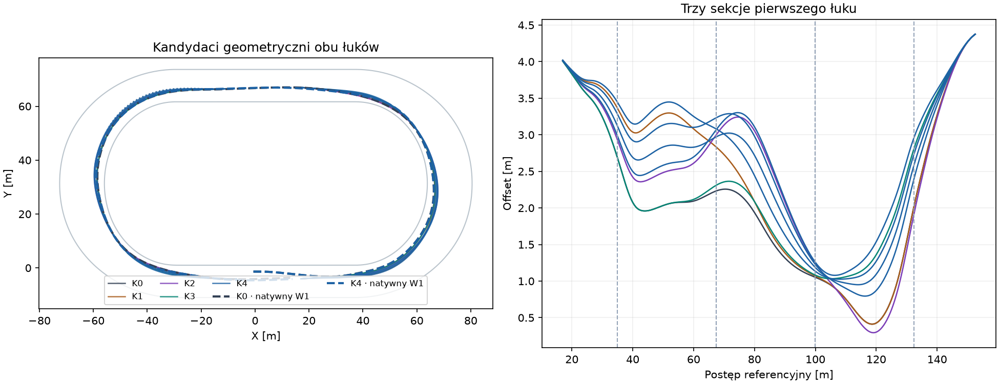
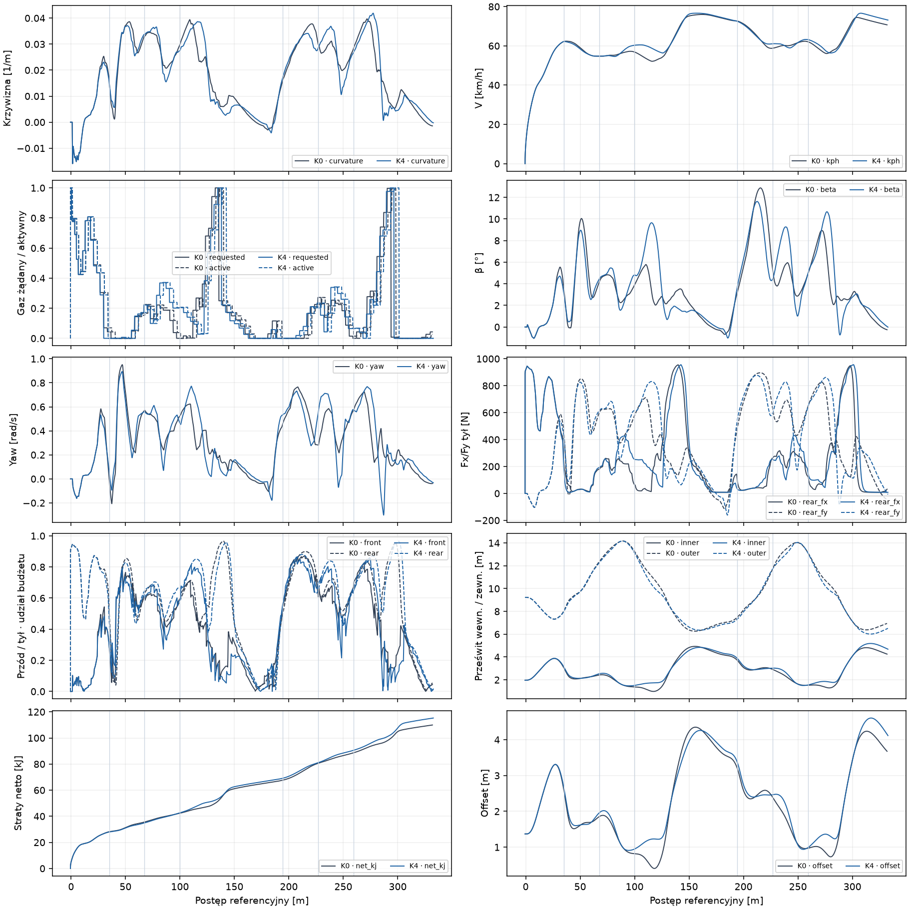
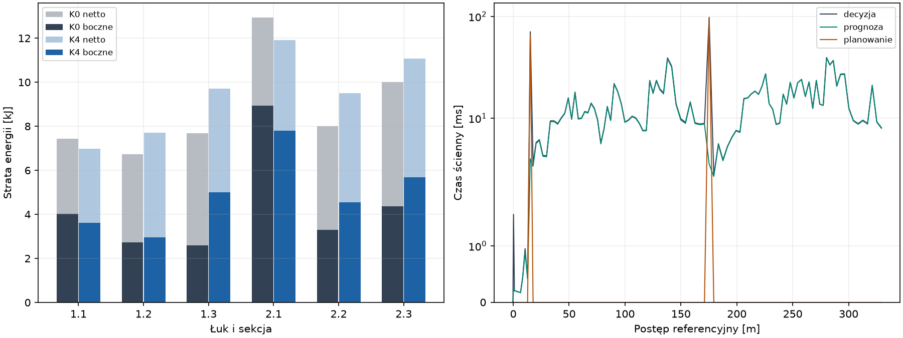

# Badanie #171 · plan całego łuku

**PARTIAL do zakończenia Windows CI.** Warunki natywnej walidacji funkcjonalnej są spełnione. Zamrożony K4 ukończył 8/8 odłożonych manewrów z legalną sekundą rezerwy. Niezmieniony #170 także ukończył 8/8. K4 był szybszy we wszystkich ośmiu parach, o **0,095–0,186 s**. Mediana poprawy parami wyniosła **0,83%**, przy wymaganiu 5% dla PASS sportowego.

[Audyt kodu i geometrii](AUDYT.md) · [Tabela 1 · sześć przekrojów](SEKCJE.md) · [Tabela 2 · strategie i próby](STRATEGIE.md) · [Pełna telemetria, plany i rejestr](171-dowody.zip) · [Manifest SHA256](SHA256SUMS).

## Co zostało porównane

Bazą techniczną jest `90a8d919941cdacefcbe04757290320eb1e7ddea`. K0 korzysta wprost z zamrożonego #170 `reserve-speed`. Porównania rozwojowe H3/H4 używają dopasowanych archiwów K0. Audyt sekcji wykorzystuje 16 wcześniej zapisanych natywnych przejazdów #166 i #170 na V1–V8. Z V1, V3, V5 i V7 pochodzą dwa odrębne profile nominalne dla obu łuków. Próbki przestrzenne opisują stan ruchu i napędu. W1–W8 mają nowe pozycje zatrzymanego startu i zostały zapieczętowane przed screeningiem i doborem kandydata.

Pełny manewr obejmuje odcinek od t=0 do końca drugiego łuku plus 20 m. Dochodzi do tego legalna sekunda z kolejnymi decyzjami. Geometria pochodzi z `TrackFrame`. Pole, położenie i mechaniczny stan początkowy są identyczne w każdej parze. Zachowano pojedynczy ciągły świat Box2D, oryginalny wał, sprzęgło, kontakty, kierownicę, μ, 0,24 s opóźnienia i decyzje co 0,20 s. Eksperymentalne transfer i prawo C2 pozostają OFF.

## Jak działa prototyp

Na podejściu do łuku planer pobiera obserwację po propagacji bieżącej kolejki. Buduje ścieżki od ok. 18 m przed wejściem przez trzy geometryczne sekcje do ok. 20 m po wyjściu. Wykorzystuje oddzielne gładkie profile przestrzenne dla obu łuków i deformacje z ciągłą krzywizną. K1 zmienia głównie wejście, K2 zachowuje szerszą linię dłużej, K3 zmienia przygotowanie wyjścia. K4 porównuje cztery jednoczesne kombinacje tych zmian według szacowanego czasu całej ścieżki.

Próbki geometryczne co 0,5 m dają fizyczną długość, kierunek i krzywiznę. Oszacowanie rozkłada siłę boczną i moment yaw między przód i tył, ogranicza dostępne Fx przez wykorzystanie tylnej opony i mapę oryginalnego silnika, a następnie liczy profil wytracania oraz przyspieszania. Kontrola obrysu używa kapsuł, orientacji z planowanego kursu i β, z zapasem swept między próbkami. To przesiew wykonalności. Planowana krzywa i oszacowanie przyspieszeń upraszczają rzeczywisty stan opon. Natywny przejazd rozstrzyga o legalności.

Sterowanie używa #170 jako przyczynowej propozycji oraz korekty skrętu i gazu ocenianej w oryginalnym predyktorze z pełnym pending. Zmiana wynika z różnicy linii, kursu, krzywizny i profilu prędkości wobec nominalnej ścieżki. Śledzenie zachowuje referencje β i yaw i ogranicza zmianę żądania względem propozycji #170. Przy istotnym odchyleniu przelicza pozostałą część łuku raz i odrzuca linie bez potwierdzonego przesiewu. Gdy plan zostaje odrzucony, wraca do decyzji #170 na aktualnym stanie. To pozostaje lokalną strategią wycofania. Natywne DNF wariantu z większym tempem pokazuje, że taki powrót sam nie daje gwarancji odzyskania wykonalności.

Dla mapowania test statyczny objął 6 wystąpień łuku i 18 sekcji w trzech kolejnych okrążeniach. Sprawdzono numer okrążenia i fazę profilu w obrębie sekcji, następne wejście po każdym wyjściu, metę z obu stron i pozycję startową za linią odniesienia. To weryfikacja mapowania, bez pełnego przejazdu S3.

## Co wykazały próby

| Etap | Nowe światy | Wynik |
|---|---:|---|
| Audyt #166/#170 i przesiew K0–K4 | 0 | 16 geometrii na dwóch łukach, w tym dwie odrzucone na drugim wejściu przez warunek prędkości |
| Pierwszy łuk i przygotowanie drugiego | 8 | K1–K4 po 2/2 legalnych dojściach do drugiego wejścia |
| Pełny manewr na H3/H4 | 4 | K3 i K4 po 2/2 z rezerwą |
| Jedna zmiana profilu prędkości | 2 | 1/2 z rezerwą. Wyższe tempo odrzucone |
| Odłożona walidacja W1–W8 | 16 | K0 i K4 po 8/8 z rezerwą |

K4 w rozwoju zyskał średnio 0,134 s do drugiego wejścia i 0,112 s do celu. Dodatkowa próba podniesienia docelowego tempa K4 dała szybsze H4, ale H3 przerwała bramka swept przy 135,659 m i 10,290 s. W kroku naruszenia aktywne były około −6,46° i 64,9% gazu. Nowsze żądanie z 10,20 s czekało jeszcze na aktywację. Min swept wyniosło 0,499 m. Zastosowano wcześniejszy, legalny wariant K4 z tempo=0. Parametry i źródła zamrożono przed W1. Po zakończeniu walidacji nie uruchomiono kolejnych światów.

| Miara na W1–W8 | K0 · #170 | K4 · #171 |
|---|---:|---:|
| Legalne ukończenia i rezerwy | 8/8 | 8/8 |
| Mediana czasu [s] | 20,614 | 20,443 |
| Mediana łuku 1 / łuku 2 [s] | 6,550 / 6,006 | 6,417 / 6,005 |
| Mediana minimum V łuku 1 / 2 [km/h] | 52,28 / 56,11 | 54,64 / 56,46 |
| Mediana prędkości wyjścia 1 / 2 [km/h] | 60,12 / 64,48 | 60,44 / 63,13 |
| Mediana rzeczywistej drogi do celu [m] | 323,71 | 324,71 |
| Min pose / swept [m] | 0,912 / 0,836 | 1,407 / 1,325 |
| Max bezwzględnego β [°] | 13,53 | 13,19 |
| ≥95% po apexie 1 / 2 | 8/8 / 6/8 | 8/8 / 8/8 |
| 100% po apexie 1 / 2 | 8/8 / 3/8 | 7/8 / 7/8 |

Trzecia sekcja pierwszego łuku odpowiada za większość zysku. Jej mediana spadła z 2,209 do 2,073 s, a minimum prędkości wzrosło z 52,28 do 56,70 km/h. Pierwsza sekcja trwała około 0,020 s dłużej. Zysk pojawił się mimo ok. metra dłuższej drogi do celu i większych strat kontaktowych w trzeciej sekcji. Na drugim łuku K4 poprawił minimum w pierwszej sekcji z 59,09 do 60,83 km/h. Czas całego drugiego łuku praktycznie się nie zmienił, a prędkość wyjścia spadła o 1,35 km/h.

K4 pierwszy raz aktywował ≥95% po pierwszym łuku między 138,48 i 141,07 m, wobec 133,80–136,27 m w K0. Utrzymywał ten poziom przez 0,20 s. W drugim wyjściu uzyskał 0,20 s w siedmiu próbach i 0,40 s w jednej. Po pierwszym łuku zysk wynikał z wcześniejszego utrzymania prędkości, a próg wysokiego gazu został osiągnięty później. Po drugim łuku poprawiła się powtarzalność wysokiego gazu, przy niższej prędkości na samym przekroju wyjścia.

## Odpowiedzi

1. **#170 głównie śledził profil demonstracyjny.** Dodawał aktywne korekty i sprawdzał przygotowanie wyjścia i następnego wejścia na krótkim horyzoncie.
2. **Geometria była dostępna jako ciągłość.** #170 nie wybierał alternatyw przez wspólną ocenę kosztu wszystkich trzech sekcji. #171 porównuje je jako jeden plan.
3. **Największy ubytek prędkości powstaje na wejściu w drugi łuk, około 14,2 km/h do minimum pierwszej sekcji.** Praca boczna to tam około 69% straty netto. W środku i na wyjściu udział wynosił zwykle 33–43%. Największy uzyskany zysk czasu pochodzi z późnej sekcji pierwszego łuku. Samo chwilowe wykorzystanie opon nie wyznacza wykonalnego gazu.
4. **Tak w badanym zakresie.** K4 wykonał szybszą legalną linię na wszystkich ośmiu dopasowanych startach. To dowód dla progressive-b i badanego manewru.
5. **Łuk 1 pokazuje kompromis od wejścia do wyjścia.** Niewielki koszt czasu przy wejściu zwrócił się w trzeciej sekcji. Na drugim łuku korzyść z wejścia nie przełożyła się na większą prędkość wyjścia. Porównanie obejmuje wspólną zmianę kształtu i śledzenia.
6. **Tak.** Mediana minimum wzrosła o 2,36 km/h w pierwszym łuku i 0,35 km/h w drugim. Zarówno pose, jak i swept miały większy zapas.
7. **Wcześniejsze 95% nie zostało potwierdzone.** Na pierwszym wyjściu gaz progowy był później. Na drugim pełny gaz wystąpił częściej.
8. **Tak dla mapowania.** Test objął geometrię i fazy profilu na trzech okrążeniach, łącznie z przejściami przez metę.
9. **Wynik jest wystarczający dla eksperymentu solo.** Samo planowanie K4 zużyło medianę 0,164 CPU-s na przejazd. Czas ścienny pojedynczego przeliczenia miał medianę 58 ms i maksimum 117 ms, przy okresie decyzji 200 ms. Kilku zawodników wymaga osobnego pomiaru, szczególnie przy jednoczesnych przeliczeniach.
10. **Dalszy kierunek to trajektoria i sprzężenie regulatora na wyjściu.** K4 potwierdził zapas w linii pierwszego łuku, a próba tempa pokazała ograniczenie lokalnego przejścia pod napędem. Dane nie wymagają zmiany fizyki ani geometrii.

## Koszt, weryfikacja i zakres

Rejestr screeningu i prób zamknął się w **40,53 CPU-s** wraz z zapisem dowodów i **30 światach**. Przesiew offline kosztował 0,422 CPU-s razem z serializacją plansz. Mediana CPU natywnego świata wraz z decyzjami wyniosła 0,570 s w K0 i 1,305 s w K4. Średnia decyzja liczona w obrębie przejazdu miała medianę 3,53 ms w K0 i 10,29 ms w K4. Łączny czas ścienny prognoz K4 miał medianę 0,950 s na przejazd. Rozdzielono go od CPU planowania i całego sterownika. Koszt predykcji samodzielnie jest raportowany jako czas ścienny. Pythonowy audyt i renderowanie wykresów są poza rejestrem CPU natywnych etapów.

Każde polecenie i jego aktywację odtworzono z natywnego logu. Porównano pending i faktycznie aktywny napęd w każdej próbce. Obrys i swept niezależnie przelicza `Course.Inspect`. Próby, wybór, zamrożone źródła, trajektorie planowane i natywne oraz pierwszy powód przerwania są w pakiecie. Narzędzie pozostaje OFF. Publikację gałęzi odrzuciła automatyczna kontrola zgód. Draft PR i pełny Windows CI oczekują na bezpośrednie zatwierdzenie publikacji przez użytkownika.
