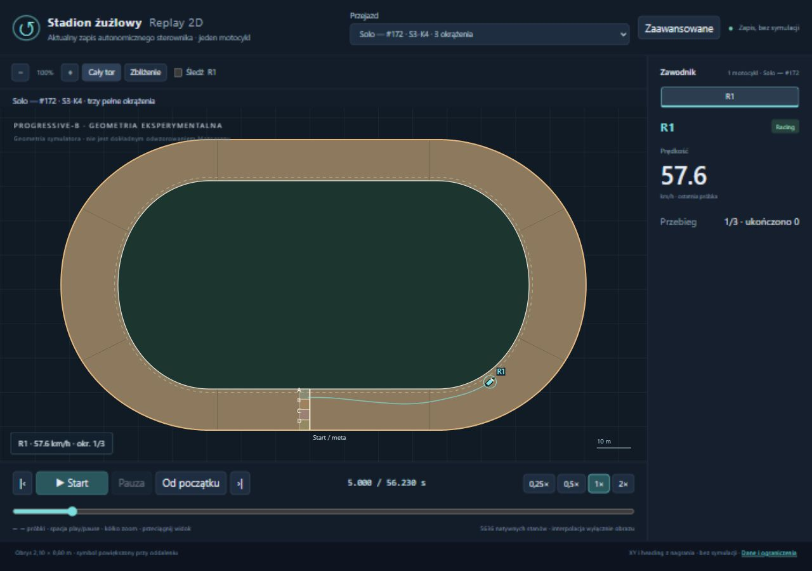
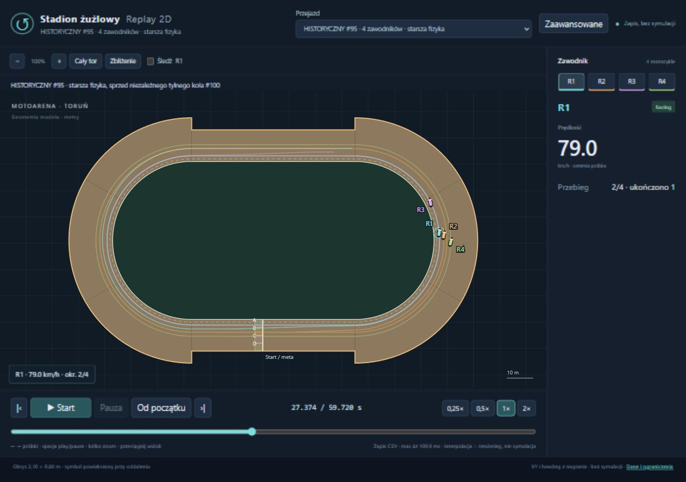
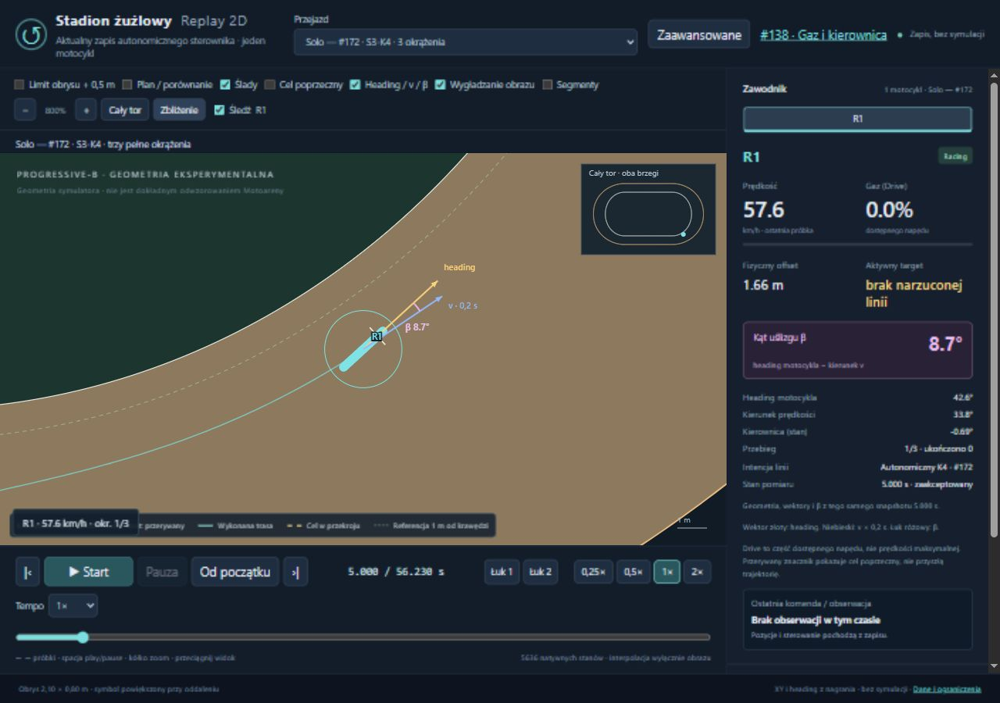

# Przywrócenie stadionu 2D i replaya #172

Baza: `c5f0a4cc4de34fc4c8c47ef912cafabf34055f29` (#172).
Gałąź: `fix/restore-stadium-viewer-172`. Tylko prezentacja zapisanych danych;
zero nowych światów, zmian fizyki, kontrolerów lub historycznych archiwów.

## Uruchomienie

Z katalogu głównego tej gałęzi:

```powershell
.\uruchom-stadion.ps1
```

Skrypt używa Python 3.8+ z `py`, `python` lub `python3` w PATH, a w środowisku
Codex potrafi też wybrać już obecny lokalny runtime. Pomija skróty Microsoft Store.
Skrypt wybiera wolny port, wypisuje URL i otwiera domyślną przeglądarkę.
Serwer nasłuchuje wyłącznie na `127.0.0.1`. Ctrl+C go zatrzymuje.
Opcjonalnie `-Port 8000` albo `-NoBrowser`. Zajęty port daje czytelny błąd
i kod 1. Nie używamy npm, frameworka, .NET ani ponownej symulacji do oglądania.
W sesji testowej działał adres `http://127.0.0.1:51539/tools/replay-viewer/`;
automatycznie wybrany port przy kolejnym uruchomieniu może być inny.

## Dlaczego podglądu nie było widać

Pliki viewera i historyczne nagrania nadal istnieją. Oryginalną stronę
uruchomiono przed zmianami przez lokalny HTTP: importy działały, Canvas miał
niezerowy rozmiar, a konsola nie wykazała błędów JavaScript. Nie znaleziono
usunięcia renderera. Nie da się z samego repozytorium ustalić, jakie okno lub
serwer był wcześniej otwarty na komputerze użytkownika.

Potwierdzone problemy dostępności:

- Brak skryptu startowego; instrukcja wymagała ręcznego serwera i URL.
  Otwarcie samego HTML przez `file://` nie wystarcza dla modułów i fetch.
- Domyślnie wybierany był stary #123, nadal opisany jako „najnowszy”.
  Jego loader automatycznie przechodził do pierwszego łuku, zbliżenia około
  1550%, śledzenia i tempa 0,25×. Cały stadion nie był widokiem startowym.
- Brak adaptera lub pozycji menu dla #172. Późniejsze badania nie podłączyły
  swoich pełnych S3 do tego istniejącego viewera.

Zachowano Canvas, model replaya, geometrię, historyczne adaptery i selektor.
Dodano skrypt, projekcję danych #172, właściwy domyślny wybór i prosty ekran.
Serwer zwraca aktualne pliki bez cache, aby odświeżenie nie pozostawiało
starego grafu modułów. Wyłączne zajęcie portu Windows zapobiega dwóm lokalnym
serwerom na tym samym porcie.

## Co widać

Cały tor i wnętrze, oba fizyczne brzegi, nawierzchnia, start/meta oraz cztery
oznaczenia pól w przekroju startowym. Współrzędne brzegów pochodzą z eksportu
symulatora; nie zastąpiono ich ręcznie narysowanym owalem. progressive-b jest
**geometrią eksperymentalną**, nie dokładnym odwzorowaniem Motoareny.

Domyślnie **Solo — #172 · S3-K4 · trzy pełne okrążenia**: jeden rzeczywisty
motocykl. Historyczny #95 udostępnia cztery odrębne zapisane trajektorie jednego
wspólnego wyścigu i ma jednoznaczną etykietę starszej fizyki. Nie powielano solo.

Start, Pauza, Od początku, cztery tempa, suwak, zoom i śledzenie pozostają
widoczne. „Cały tor” przywraca dopasowanie. Podgląd prędkości i okrążenia jest
także na Canvas, więc pozostaje widoczny w wąskim oknie. „Zaawansowane”
odkrywa istniejącą telemetrię i nakładki. Symbol motocykla ma wyraźny przód
i tył, a przy oddaleniu minimalny rozmiar interfejsu. Mechaniczny obrys nadal
ma rzeczywistą skalę. Pozycja i heading nigdy nie są przesuwane na idealną linię.





## Pochodzenie #172 i wierność odtwarzania

`tools/replay-viewer/export172.py` czyta wyłącznie zapieczętowane:

- `172-validation-K4.zip` → `v1-K4-S1.zip/native.json` oraz `result.json`;
- `172-protocol.zip` → `geometry.json`.

SHA256 obu wejściowych ZIP-ów jest przypięty w eksporcie. Wynikowy
`recordings/172-s3-k4.json.gz` zawiera 5636 natywnych próbek i trzy archiwalne
czasy przekroczeń: 20,591979315091308 / 38,40491543366984 / 56,22515215317 s.
Zapis zaczyna się przed linią, przy zerowej prędkości; samo ruszenie przez linię
nie liczy okrążenia. Kończy się pierwszą rzeczywistą próbką po trzeciej mecie,
56,230000000000004 s. Nie dopisano pozycji w dokładnym ułamkowym czasie mety.
Pominięto dalszą sekundę rezerwy, bez zmian w archiwum źródłowym.

XY, heading, prędkość, aktywny gaz i fizyczny skręt są kopiowane z pomiarów.
Interpolacja XY/heading służy tylko obrazowi. Prędkość i sterowanie panelu
pozostają ostatnim pomiarem, a okrążenia zmieniają się w zapisanych czasach.
Dla #172 interpolacja nie jest zatrzymywana w środku ostatniego kroku przez
samą flagę mety; kończy się na ostatniej dostępnej próbce. Historyczne replaye
zachowują wcześniejsze reguły. Nie ma ekstrapolacji ani resetu przy mecie.
Szczegółowe komendy pozostają w oryginalnym archiwum; nie odtwarza ich JS.

W zbliżeniu t=5 s heading wynosi 42,6°, kierunek prędkości 33,8°, β=8,7°.
To rzeczywiste różne kierunki, a nie ustawienie headingu według wektora ruchu.



## Wykonane testy

Testy UI wykonano w rzeczywistym Chromium przeglądarki wbudowanej Codex,
na działającym lokalnym HTTP, nie wyłącznie w Node. Sprawdzono okno desktopowe
1280×900 i normalne wąskie okno 744×892. Tymczasowy rozmiar testowy usunięto.
Skrypt bez `-NoBrowser` otworzył także domyślny Chrome; potwierdzono okno
„Stadion żużlowy · Replay 2D - Google Chrome”. Pełna macierz interakcji poniżej
dotyczy przeglądarki wbudowanej, nie osobnego testu wszystkich kontrolek Chrome.

| Kontrola UI | Wynik |
|---|---|
| Stadion, nawierzchnia, brzegi i motocykl widoczne | PASS |
| Start rzeczywiście zmienia XY i heading | PASS |
| Cały #172 od startu do trzeciej mety w tempie 2× | PASS; 3/3, crossing 56,225 s |
| Brak resetu przy wszystkich trzech metach | PASS; ruch około 0,044 m przez okno 2 ms, bez skoku headingu |
| Pauza zatrzymuje czas, Start wznawia | PASS |
| Od początku i przewijanie czasu w obie strony | PASS |
| 0,25× / 0,5× / 1× / 2× | PASS |
| Cały tor mieści się na Canvas; zoom i dopasowanie | PASS |
| Śledzenie i zbliżenie zawodnika | PASS |
| Historyczny #95: cztery osobne, poruszające się motocykle i wybór każdego | PASS |
| Konsola JavaScript bez błędów/ostrzeżeń | PASS |
| Odświeżenie strony i zachowanie wybranego nagrania | PASS |
| Domyślny #172 po otwarciu bez parametrów | PASS |

Surowe odczyty kontrolek i renderowanych współrzędnych:
[`ui-verification.json`](ui-verification.json). Zrzuty są z działającej strony.

Regresja lokalna:

- **128/128 Node**: wszystkie dotychczasowe testy oraz cztery testy #172
  (każda próbka, poślizg, wszystkie mety, brak ekstrapolacji, skokowe sterowanie,
  statyczny loader i brak nagrania).
- **24/24 C#**: ReplayGeometryTests, RaceProgressTrackerTests, StartingGateTests;
  zero pominiętych.
- Restore i build całego rozwiązania Release `--warnaserror`: PASS, zero ostrzeżeń.
  Lokalnie NuGetAudit=false z powodu niedostępnej usługi audytu; CI zachowuje
  standardowy restore.
- `export172.py --check`: zgodność projekcji z przypiętymi ZIP-ami, bez symulacji.
- HTTP: HTML/moduły/gzip 200, poprawny MIME mjs, odświeżenie 200/no-store,
  loopback; zajęty port: czytelny błąd i exit 1.
- Start w świeżej konsoli z oryginalnym PATH (tylko aliasy Microsoft Store):
  PASS dzięki wykryciu istniejącego runtime Codex; automatycznie wybrany port
  52150 i HTTP 200. Dodatkowy serwer testowy zatrzymano.

Status automatycznego CI i końcowy SHA zostaną podane w metadanych Draft PR.
Bez merge. Produkcyjne opcje eksperymentalne pozostają OFF.
